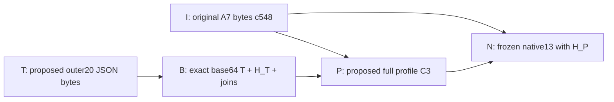

> Latest completed updates (2026-11-07): [A5 scoped F17 fix](phase41/f17-full-fix-review.md), [Math115 preparation ACK](phase40/math115-event-review.md), [Windows pipe primitive](phase39/windows-pipe-review.md). Current open findings:6 P1/3 P2; F16/F17 global OPEN. Overall NO-GO; earlier snapshots historical.

# Independent security, CI and physical acceptance — Agent 8

Initial historical snapshot: 2026-11-06T15:05:26.716427+00:00 (6 November 2026, Europe/Berlin).

**Overall: NO-GO. TAILSCALE_REMOVAL: BLOCKED / NO-GO.** No merge, deployment, network reconfiguration, Tailscale removal, real orders or destructive cleanup performed by this audit.

Initial snapshot findings: **P0: 0 independently confirmed defects; P1: 6; P2: 1.** This is not proof that no P0 exists. Failed mandatory gates and unperformed physical qualification independently prevent GO.

This is an interim independent acceptance report. It does not assert completion of the physical mission. Findings are assigned to the repository owner via Integration Owner; production implementation was not edited.

## Scope and evidence boundaries

Two independently fetched, paginated open-PR snapshots contain 432 stable PR HEADs. Latest check-runs were enumerated for all 432 SHAs with pagination. This verifies identity metadata at the observation time, not every checkout or artifact. The new audit PR is outside this baseline snapshot.

Detailed workflow runs, latest-attempt jobs and artifact metadata were collected for the newest three open PRs in each repository and the six local checkout SHAs (deduplicated). Latest run/job/artifact lists use up to 100 entries; any larger totals are coverage gaps. Older PRs have check metadata only. Artifact payload review covers eight selected ZIPs, not every CI artifact.

All eight downloaded ZIP hashes match GitHub API SHA-256 digests. These hashes establish downloaded-byte consistency, not release authority or physical acceptance. Native subject source hashes additionally match independently read exact-HEAD Git blobs. Terminan cache manifest member hashes match. JUnit XML was parsed independently.

## Repository and CI inventory

| Repository | Open PRs | Stable HEAD snapshots | HEADs with failed latest checks | No checks |
|---|---:|---:|---:|---:|
| unified-system | 20 | 20 | 8 | 0 |
| bybit-cluster-grid | 102 | 102 | 18 | 0 |
| strattester | 65 | 65 | 50 | 0 |
| math | 108 | 108 | 74 | 0 |
| meta_analyse | 72 | 72 | 27 | 1 |
| Terminan | 65 | 65 | 43 | 0 |

Check failures include historical branches and explicit NO-GO sentinel jobs; these counts are not distinct product defects. A successful check subset does not establish all mandatory CI PASS.

Newest PRs below are observation targets, **not an approved six-repository release**. Matrix rows refer to these observed heads; cross-node source binding remains UNQUALIFIED.

| Repository | PR | Exact observed HEAD |
|---|---|---|
| unified-system | [#20](https://github.com/YehorBabenko88/unified-system/pull/20) | `7ac7983acd4f7a5ba10c579e706f3d1f5a800722` |
| bybit-cluster-grid | [#261](https://github.com/YehorBabenko88/bybit-cluster-grid/pull/261) | `71084a336520187d6e260531a2f5d15555ba0e0c` |
| strattester | [#70](https://github.com/YehorBabenko88/strattester/pull/70) | `25eb939f8a816a80ac7c042ce75ec4d9173cd4ce` |
| math | [#111](https://github.com/YehorBabenko88/math/pull/111) | `11c3c470ebec9f9fdb6ec1b69e77b7b8aeea653a` |
| meta_analyse | [#76](https://github.com/YehorBabenko88/meta_analyse/pull/76) | `2c4db055e56e36384a2661d443f9abc7b2331e90` |
| Terminan | [#68](https://github.com/YehorBabenko88/Terminan/pull/68) | `7ed3708df53c8850fd11fc8331440bdfee99aa3e` |

## Independent execution

Windows local Python 3.15.2, isolated clean checkout of Unified #20 `7ac7983acd4f7a5ba10c579e706f3d1f5a800722`. Auditor-owned offline harness: **7/7 PASS**; upstream targeted negative regression: **23/23 PASS**. Logs: [independent negatives](evidence/independent-negatives.log), [upstream negative regression](evidence/upstream-negative-regression.log). Python 3.15 is not a substitute for mandatory CI Python 3.11/3.13.

The tests cover absent authenticator, denied-provider seam, wrong actor/role/node/service identity, unsupported order/destructive/LIVE intents, duplicate/nonfinite/oversized/deep JSON, missing/cloud/duplicate physical evidence and complete fabricated physical PASS claims. Session denial uses an auditor-owned provider double; no actual issued or expired human session was tested. All 90 fabricated physical ledger records still yield RECORDED_UNVERIFIED and no deployment authorization.

Reproduction: `python -I -S -B independent_negatives.py --source PATH_TO_CLEAN_UNIFIED --expected-head 7ac7983acd4f7a5ba10c579e706f3d1f5a800722`.

## Open findings

### A8-F01 — P1 — unified-system: Windows fixture/security acceptance fails

Observed: ACL_CANONICAL_ROOT_REQUIRED; Python 3.11 WindowsPath.is_junction errors; missing five-source-evidence upload.

Required correction: Rebase/include reviewed fixture fixes and independently rerun full Windows 3.11/3.13 plus PowerShell/pwsh security gates.

### A8-F02 — P1 — bybit-cluster-grid: Source admission regressions fail CI

Observed: KeyError owned_source_admission in tests/test_owned_control_source.py; downloaded PG18 JUnit: 1631 cases, 4 failures, 14 skipped.

Required correction: Restore source-admission test lifecycle isolation without skipping revocation negatives; rerun preflight and PG18 qualification.

### A8-F03 — P1 — math: Mandatory Windows Node 22/24 cells fail

Observed: ERR_ASSERTION / DIAG_CHILD_STATUS / worker_phase=COMPILE; platform result tests=98, pass=97, fail=1; Full CI coverage failed.

Required correction: Fix native compile/child-status path and run both mandatory Windows cells plus coverage aggregator.

### A8-F04 — P1 — math: Selected Windows evidence tests merge SHA

Observed: PR HEAD 11c3c470ebec9f9fdb6ec1b69e77b7b8aeea653a; downloaded receipts and checkout log use f1070af8698a5ef584fece43057be049e307ef2a.

Required correction: Run explicit exact-PR-HEAD qualification. Retain merge-result qualification as separate evidence; do not relabel it.

### A8-F05 — P1 — unified-system: Real operator authentication incomplete

Observed: Native artifact verifies compile/invalid-context only: authentication NOT_QUALIFIED, runtime_factory DENY, positive subject extraction NOT_RUN.

Required correction: Qualify actual native inbound context, TLS/CBT, operator session expiry/revocation, peer identity and per-human backend RBAC.

### A8-F06 — P1 — all: Coherent physical acceptance unavailable

Observed: No independently verified coherent release manifest, real all-node cluster, fault-injection run or alternate-access recovery proof for this audit.

Required correction: Integration Owner must publish immutable six-repo candidate and mandatory registry; obtain separate physical fault-injection authorization and execute acceptance.

### A8-F07 — P2 — all: Mandatory skip coverage unresolved

Observed: Passing job conclusions coexist with skipped JUnit cases; no authoritative case-to-requirement map supplied to auditor.

Required correction: Publish mandatory IDs, expected counts/platforms and permitted optional skip reasons; missing/skip/cancelled cannot count as PASS.

Original failed-job URLs, run/attempt/job IDs and decoded log diagnostics: [failure-diagnostics.json](failure-diagnostics.json). Downloaded artifact receipts and digest checks: [artifact-verification.json](artifact-verification.json). Payload checks: [artifact-content-checks.json](artifact-content-checks.json).

Strattester #70 financial-integration run 42052514344 deliberately exits 2 in system-acceptance-NO-GO: component gates PASS while external physical/OOS/coherent snapshot/native isolation/GPU/upstream-equivalence remain BLOCKED. This is an honest closed gate, not a falsely passing suite.

Math provenance `qualified=true` describes its source/provenance check; failed platform test receipts remain failed. It is not interpreted as a system PASS.

## Requirement results

The complete [acceptance-matrix.csv](acceptance-matrix.csv) supplies every requested field, per requirement and applicable repository. No entry below asserts physical PASS.

| ID | Requirement | Status |
|---|---|---|
| A8-01 | Exact HEAD всех PR | BLOCKED |
| A8-02 | CI runs и artifacts | FAIL |
| A8-03 | Обязательная Windows-матрица | FAIL |
| A8-04 | LAN transport | BLOCKED |
| A8-05 | Tailscale independence | BLOCKED |
| A8-06 | Peer authentication | BLOCKED |
| A8-07 | Operator RBAC | BLOCKED |
| A8-08 | Expired sessions | BLOCKED |
| A8-09 | Unauthorized commands | BLOCKED |
| A8-10 | Consensus split-brain | BLOCKED |
| A8-11 | Fencing | BLOCKED |
| A8-12 | Coordinator crash/restart | NOT_RUN |
| A8-13 | Worker loss | NOT_RUN |
| A8-14 | Storage corruption | NOT_RUN |
| A8-15 | Replica recovery | NOT_RUN |
| A8-16 | Backup/restore | NOT_RUN |
| A8-17 | Historical gaps | NOT_RUN |
| A8-18 | Live reconnect | NOT_RUN |
| A8-19 | Duplicate events | NOT_RUN |
| A8-20 | Resource overload | BLOCKED |
| A8-21 | Node schedules | NOT_RUN |
| A8-22 | Terminan relocation | NOT_RUN |
| A8-23 | Concurrent Terminan sessions | NOT_RUN |
| A8-24 | Update/rollback | NOT_RUN |
| A8-25 | Safe uninstall | NOT_RUN |
| A8-26 | Отсутствие real orders | BLOCKED |
| A8-27 | Отсутствие несанкционированных сетевых изменений | BLOCKED |
| A8-28 | Нет фиктивных PASS / mandatory skips | BLOCKED |

## Tailscale removal gate

LAN transport, real consensus, replication, Terminan on every node, failover, restart recovery and independently verified access recovery without Tailscale are all UNQUALIFIED in this audit. Tailscale remains present and Up. Even a later GO must not trigger automatic removal.

## Next actions

1. Integration Owner publishes immutable candidate manifest, node inventory, API/ownership contracts and mandatory case/platform registry.
2. Repository owners close A8-F01–F05 and supply original run/attempt/artifact URLs; auditor rechecks changed exact HEADs.
3. In an approved isolated environment, execute the missing LAN/auth/HA/data/Terminan/update/uninstall scenarios with independent observations. Physical disruptive tests require separate authorization; no such authorization was provided in this audit.
4. Compare original order/egress and network-state evidence for the whole candidate. The auditor’s own lack of trading/network mutations cannot certify other agents or past fleet activity.
5. Reassess all nine user PASS criteria. Any open P0, failed/missing mandatory case, source mismatch or missing physical proof keeps NO-GO.

Evidence index: [all PR HEAD snapshots](all-pr-head-verification.json), [all HEAD CI checks](all-head-ci-checks.json), [coverage](coverage-summary.json), [collection scope](collection-summary.json). Local raw API snapshots are retained under evidence/; remote GitHub URLs identify the original service records. SHA256SUMS.txt detects subsequent local file changes; it is an unsigned auditor manifest, not a trusted publisher signature.

Latest phase29: Meta PR78 f3c01a2 and Stratt PR72 88a180b independently verify replacement conformance10/0skip each, baseline4fail/6pass each, all782/765rawfiles before/after. Narrow offline fixes only; hosted mandatory jobs queued; global F16 and overall NO-GO remain. See phase29/a7-git-provenance-review.md.

Phase30 independently verifies Root final-integration F16 correction at1808556: clean75/0skip, oldblob/tree falsebinding75 reproduced, fixedblob/tree reject beforetests; post-source/wrongID/skip reject. Componentofflinefix only; globalF16open andNO-GO6P1/2P2 remain. See phase30/root-f16-review.md.

Phase31 exact PR30/29/31 focused28/26/46pass0skip; synthetic composition159unique pass plus15deny-onlyvectors, no runtime admission. Phase32 independently verifies causal fixture b892271 with10controlled cacheRED/GREEN+7modulecases, product gate unchanged; originalLAN768/1ERROR/11skips not waived. OverallNO-GO6P1/2P2, physical/TailscaleBLOCKED.

2026-11-07 phase34: executable isolated real3-voter ConsulCAS/consistentreads, actual3mTLS cases and defaultHTTP503 pass separately.10mandatory IDs/zero skips retained; MODELNOT_RUN,CODEharnesschecksPASS,integratedENDPOINT/WINDOWS/PHYSICALBLOCKED. AllownPopenstopped. No productionbridge/auth/source/runtime transfer; NO-GO6P1/2P2/F16open.

Phase35: exactcomposed237722b independently129unique/0skip,664rawtrackedfilesbefore/after;cc286bcidentityguard8purecases+60independentnegatives,671rawfilesbefore/after. Ownrevision10pathACKonly, sourceguardASTpreserved, owneroriginalreceipt/logbindingsverified. Nativeidentity/atomicguardCAS/integratedendpoint/hosted/physicalNOTQUALIFIED; overallNO-GO6P1/2P2/F16open.

Phase36 Math1149f08b23 preparationfix independently verified: actualunchangedverifierPSoldRED1/newGREEN0/hiddeneditdenied;13pure/modelcases0skip,690rawfilespre/post,188originalproof preserved. Originalconsumed42274233717attempt1terminalfailure/sourceCLIerror,0artifacts/ownedchildSKIPPED primaryrawlogverified. No native/activation, no renewedauthorization; NO-GO6P1/2P2/F16open.

Phase37 latestPR24 462935b independently52/0skip,8replacement/raw/ID/skipnegativesreject,5localstatevectors+1boundedmeasurementpass. NewF17P2confirmed: untracked timestampmatchedCPythoncacheexecutesharmlessmarker while16rawbindings/beforeafterand52PASSaccept. Sourceevidencerobustnessonly, nohostedtampering/nativebypassclaim; ownersnotified. Current6P1/3P2,NO-GO,F16/F17open.

Phase38 independently verifies0d6cachevectorfix and11conformance controls, but root_shadow_typingstill52PASS/raw16/beforeaftervalid with inertmarkerexecuted. F17PARTIAL/OPEN; no newfindingcount;6P1/3P2/NO-GO.

Phase39 exact4416localWindowsnativepipe4casesexecuted0skip/allownchildrenstopped/744rawfilesunchanged. IdentificationSID/PID/token/Revertand2actuallevelnegativesqualifiedprimitiveonly;WrongPidflagforceddenialnotactualkernelmismatch. Nativeoperatorbridge/Windowsfleet/physicalBLOCKED;6P1/3P2/NO-GO.

Phase40Math11563a source/modelACKonly13cases+31pureeventvectors,691rawfiles/188proofpreserved,noactivation/newRootauthorizationrequired. Phase41A5d4F17cache+rootimportvectorsfixed/52cases302bindings;d7fresh52+criticalnegatives317bindings. GlobalF17pendingotherguards;6P1/3P2/NO-GO.

Phase42e238Rootclean137/0skip/all786rawinputs+7negativesverified;correctedrealPID4actualcases/0skip/allownchildrenstopped andPIDinequalityproven. Initialharnessmissedjobenv137numericalPASS/postguardfailurepreserved;freshcorrectjobenvpasses. KnownA5/RootF17fixesverified,otherapplicableguardsassessmentpending;6P1/3P2/NO-GO.

## Phase43–45: immutable Math115 record and real PR32 isolated OPEN

Math115 Root223c225 authorization raw355ca961… and current merge36570645 workflow parity independently verified; ACK record/parity only, direct-owner authority original not independently authenticated, no activation or API mutation. Evidence phase43/record-parity-review.json.

PR32 exact3d48763/treeb410910:10unit+15real3Consul/HTTP+8source guard+5additional MODEL verifier cases PASS,0skip,658primary/672Grid raw before/after; all owned processes stopped. Only synthetic-native-identity OPEN primitive qualified; default missing-provider remains closed. First relative-output A8 invocation error preserved phase44, corrected freshclone phase45. Evidence phase45/independent-review.md and original receipts. No final native identity/GET/fleet/physical/Tailscale PASS. Overall NO-GO,6P1/3P2 unchanged.

## Phase47 Windows Home plan boundaries

Rootc510529/treec5d079 and69d3ae0 amendment independently reviewed. Six source unit cases plus43independent role/edition/foreignPASS/inventory/physicalclaim mutations PASS0skip;810rawinputs unchanged. HomePC1/LS7each14NOT_RUN/empty evidence, actual verifier NOT_IMPLEMENTED. v5inventory143preserves137; only6new tests executed here, no143/fullCI/Homefleet qualification inherited. Decision/text rawhashes match, original human authority not independently authenticated. Documentary wording clarification sent Root. Report phase47/independent-review.md. OverallNO-GO6P1/3P2unchanged.

## Phase48 fresh PR32 metadata hold

Exact5fd0ccb/treeac734aa independently18unit+28real3ConsulHTTP+8source negatives0skip/665primary672Gridrawprepost. Additional freshstand28original+2new assertions (not58unique) confirms WAIT_SOURCE ledger/metadata/snapshot with nullcontent and validDATASETdeny/privateKVunchanged;allownprocessesstopped. GET24MODELonly, default503/nativefixtureunqualified;noLIVE/release/reuse/fleet/Home/physicalPASS. PrimaryCI42350238072attempt1queued/nullnotPASS. Report phase48/independent-review.md.OverallNO-GO6P1/3P2unchanged.

## Phase49 fresh PR32 negative test extension

Exact08d6f01/tree18db861 independently18unit+42real+8source0skip,667primary/672Gridrawprepost;42=28retained+14new. Extra freshstand repeats42notadditionalunique, validates8actualGrid409-causes/fullnativeopsdigest/index pairs, PREPAREnoindex/command, FINALexactboundedPENDING/no receipt/response/no parentrelease. Allownedprocessesstopped. Fiveproduct+fiveGETmodelplan primaryrawbyteequal5fd/exact4testdocchanges. TwoCIsnapshotqueuednotPASS. Trustedstateconsistency NOTmaliciousauthoritywritersecurity;nativeprovider synthetic/GETunwired/READYACK204releaseclosed. phase49/independent-review.md.OverallNO-GO6P1/3P2unchanged.

## Phase50 Root Draft26 source/evidence consistency

Mergea77a5bd32paths match08d;872Unified/672Grid reportedrawinputs matchedGit;18copiedphase49originalsbyteequal. A8merged-sourceexecutionNOT_RUN;owner18/42/8nottransferredtodocs38/fullmatrix. P2existingF07:38c3909root-result indexes16members butonepycfixtureabsent;15membershashmatch. Ownernotified/required explicitpublished-localonlyscopeorretrievableboundfixture. Report phase50/independent-review.md. Numericalresultsnotrevoked;overallNO-GO6P1/3P2unchanged.

## Phase51 conditional physical pilot authorization and LS5 blockers

Originalownerattachment rawSHA1dc4bad5… read/bound; stagedphysicalpilotAUTHORIZED_SUBJECT_STAGE_GATES, notfullproduction/faultinjection/Mathsinglusetoken/provider/Tailscaleremoval. Six executable prerequisite/runtimegates enumerated in phase51/independent-review.md; freshLS5readiness notindependentlyreacquired, reviewed aefa manifestPROVISIONAL_NOT_INSTALLABLE/defaultAPI503. No install/hostprobe orpolicychange. OverallNO-GO forinstallation/runtimeacceptance, preparationauthorized;existing6P1/3P2unchanged. Earlierblanketpilotprohibition supersededonlywithinconditionalstages.

## Phase52 fresh prepared Math115 record

Root189record raw2d438482…/originaldirective/A8phase46ACK bound; currentMath2446/d5mergeworkflowparity independentlyprimaryAPI/Gitverified. RecordPREPARED/authnull/tokenNOT_RECEIVED/ledger0calls. ACKdeclaredrecord/source/eventboundariesONLY;nativeprerequisitesnotestablished/activationBLOCKED/nooperationauthorization. RootLS5readinessownerreportinstallBLOCKEDnotA8physicalreacquisition. Localpilotsubsetclosure required,noglobalclusterRC/distributedquorumsubstitute. phase52/independent-review.md.OverallNO-GO/preparationauthorized.

## Phase53 consumed Math ledger/primary run snapshot

Root78dconsent-intent-result ancestry verified/original2d438record unchanged. PrimaryAPI oneexact2446workflowrun42352374979attempt1 expectedactor/event queued/null and currentlabel recorddigestmatch. No terminal/nativePASS;permissionCONSUMED/no retry/remove/relabel/rerun/cancel. Humanorigin/pushbeforeAPI not independentlyserverattested; ledgeronecall+oneobservedrun notglobalmutationtelemetry. phase53/independent-review.md.OverallNO-GOacceptance.

## Phase54 A4 PR34 isolated filesystem

Exactcd0286d/tree84b7142:7newfiles/Stage1unchanged;43=26+17PASS0skip/307primaryrawprepost. FourindependentactualcasesPASS0skip real3rootmultiobject-empty-binaryrestore/actualWindowsjunctiondeny/marker-bounds/same-readrace. LegacyinmemoryREDexpected1failure/currentGREEN;no sourceedit. Full751pre-amendmentnottransferred;no mediadurability/datasetclosure/Consulpublication/pilotrollback/nativeadmission. phase54/independent-review.md.OverallNO-GObroaderacceptance.

## Phase55 Grid pure response advice

Exact9d71ee33/tree8a05f8f fresh44inventorycases+12A8vectorsPASS0skip/689primaryrawprepost/5NEWonly. Profile/inventoryhashmatched; clock/socketblockedpositivevectors. ProjectionhashNOTprovenance, noPERMIT/wiring/timers/persistence/rateenforcement/native/provideradmission. Prior43+55CIunchangednotrerun/new44hostednotreviewed. phase55/independent-review.md.OverallNO-GObroaderadmission.

## Phase56 Rootstorageconsolidation

Merge9d6857a/32f6publication independently7componentpathrawsamecd0286d/944ownermanifesthashmatchedGit/3publicationmembershashmatch/7phase54originalsrawsame. Root43/0skip exactmergeownerreceipt, A8mergedexecutionNOT_RUN. No docsHEAD/fullsuite/hosted/native/durability/authority/pilotrollback/physicalPASStransfer. phase56/independent-review.md.OverallNO-GObroaderacceptance.

## Phase57 Stratt73 actual CORE CI

Primaryexacta56c24a/run42343442185attempt1all4SUCCESS/4artifactZIPdigestsverified. WindowsPy311313each2090PASS28SKIP35subtest;Linuxeach2064PASS54SKIP35subtest;2118uniqueXMLnodes/suite2153 reconciled. Nativebroker19/sourceowner/Grid/historycollectionskipsNOTacceptedmandatorywaivers;Node78localnotrunworkflow. COREsuccessonly/noSYSTEMHomepilotnative/F16F17closure. Original4logs4ZIPs/fullpercaseskiplist phase57/independent-review.md.OverallbroaderNO-GO/F07open.

## Phase58 Grid fresh CI142workflow

Exact7a19/treee7ad workflowonlydelta/productprofilepolicy3inventoriesunchanged. Freshcommittedblocks43+55+44actual142/0skip/27guarded+689allrawprepost. Elevenownsourcecontrolsreject0pytest;15injectedJUnitmodelsNOTactualpytest separatelylabeled. Hosted42354101781attempt1queued/null NOTPASS, terminalWindowsUbuntu/artifactreviewpending. phase58/independent-review.md.OverallbroaderNO-GO/noproviderwiringnativeadmission.

## Phase59 A5 proposedsingle-node

Exact7a418/tree2b0c3:3NEWrawpinnedfiles/old52workflowinventoryunchanged. Freshseparate52legacy+18MODEL0skip/all339rawprepost;13ownMODEL+2sourcecontrols (0pytest) pass. Start0;Noneconventionnotadmission;FalseTrue/asyncawaitabledeny;strictsamecontextgenerationincarnationhistoryonly/nocrossgenerationcontinuity;unattachedlocaldrainintentonly/no releasepause. No realA2A4Rootnativeadapter/APIcompatibilityACK/hosted18/runtimephysicaldispatch. phase59/independent-review.md.OverallbroaderNO-GO.

## Phase60 runnerblocker and Stage0 batch

Root5182/treefd29 publication independently248indexedmembersrawSHA/primaryGitverified/unauthprofileexcluded. Historical9c35runs34queued1pending/87jobs and12assignedolderjobs reconcile;causalityUNKNOWN/saturationNOTestablished/UIpaidusageNOTcausalproof. Stageconfigsnapshotsequal/actualPS5ACLREJECTUntrustedwritable/notbypassed/PLANprovisionallockschemarefusal/model9notsecurityPASS/targetsabsent/adminrecoveryrollbackunaccepted. SameMathconsumedqueuedrunner0steps[]. NoA8officeprobe/actions. phase60/independent-review.md.OverallinstallruntimephysicalNO-GO/preparationconditional.

## Phase61 fresh PR35 GET

Exactbe5cb942/tree3472c:13ownedchanges/frozenReview4GETreview2 unchanged;33unit+72actual+8guards0skip/674primary672Gridrawprepost. Additionalfresh74=72overlap+2ownactualcaptureonlychecksfor201202:8nativeguards/no late read/no KVwrites/capturedreceiptindexquerybinding. Allownprocessesstopped. Typednative4kindsyntheticonly/no genericstorage401;24models204notactual;CLOSED/recreatedreceiptfaultfixturesnotcontainmentmaliciouswriterproof. BothCIqueued/notPASS/defaultnativeWSGI503/no nativeHomephysicalREADYreleaseadmission. phase61/independent-review.md.OverallbroaderNO-GO.

## Phase62 RootGETconsolidation

Mergef8f29/eb0publication14componentpathsrawsamebe5;1221Unified672GridmapsmatchedGit;30selectedmembers6Root+21A8+3A6hashretrievable/exactoriginalcopies. Root33/72/8ownexecnotA8mergererun;24modelsnotactual204;fixtureDirsexplicitlocalexcluded/noincompleteclaim. No docsHEAD/fullmatrix/hosted/native/browserofficeREADYreleasephysicaladmission. phase62/independent-review.md.OverallbroaderNO-GO.

## Phase63 Grid267 finitebootstrap

Exact7a83/tree246a 4allocatedpaths;ownbaseinf+positive_supportbugreproduced/currentrefusalfinitecorrected. Freshworkflow10+separateoldnew21PASS0skip/692primaryrawprepost;516Fractionoracles(505exact11within1ULP)/64seededsamples/8boundaryprobes/4sourcecontrolsreject0tests. Normalfsum/divisionnotuniversalexactrounding. HostedPR42365574486push42365571505queued/null NOTPASS;no profitability/native/researchcore/pilot/globalF16F17acceptance. phase63/independent-review.md.OverallbroaderNO-GO.

## Phase64 Grid268 narrowbook

Exact1f08/treefe885 fivepaths/assertionspreserved;own40focusedPASS0skip/broader259PASS1PG18skip(overlapnotadditive)/691primaryrawprepost.10independentfakefeedSQLprobespass;knownP1F06residualREPRODUCED:afterunpersistedempty-sidegap prioravailablepersistedrowatage2s stillcaptrue, notclosed/fullL3NO-GO. TwoA8harnesserrorspreserved/corrected(no productwaiver). Windowsbundle42366033121queuedNOTPASS/new29coverageunmapped/no actualPG/native/live/pilotadmission. phase64/independent-review.md.OverallendtoendNO-GO.

## Phase65 masterA-Gpublication

Root92b8328a/treea6ed30selected+index/7artifacts verified;88ownerrows18A3+22A6+48A7preserved/raworiginals equal/130uniqueGitblobOIDSHAmatch/sixcatalogpinscountsmanifestfactsverify. Canonicalprovisionalmanifestbyteunchanged/no baselinerepin. EightP0gate groupsnotnew8codedefects/ownerstatusnotA8newsemanticexecution. Archived4queuedrunattempt1/nativeMath2446 distinct917helper/6readonlynodesnotphysicalacceptance;Grid267268separate/5sgapOPEN. Directive2trailingMDspacelinespreserved/no token. phase65/independent-review.md.Scopepublicationprovenanceonly/notwidenedtests/overallreleasephysicalnativeNO-GO.

# Phase66 — Math116 independent numerical review

Requirement IDs: A8-HEAD, A8-OFFLINE-NUMERICAL, A8-SOURCE-GUARDS, A8-WINDOWS-CI.
Repository: math. Draft PR: https://github.com/YehorBabenko88/math/pull/116
Exact HEAD: ff1c42cad883f54c06293884ef29a290dd74e306
Tree: 68623befcb4de563e1d284569fea56b3d9c8de45
Base: 917d99672e37db59835a8ab23b03c99826b12d78.

Environment: own detached no-hardlinks raw-LF clone, local Windows Python3.12.10. Synthetic trades only. No orders, provider calls, installation, native activation, physical faults or network settings changes.

| Test | Expected | Actual | Status | Evidence | Severity / required correction |
|---|---|---|---|---|---|
| Exact HEAD/tree/four allocated paths | exact pin and unchanged source | four paths, all687 raw files equal before/after | PASS | local-review.json; workflow10.original.json | none in bounded scope |
| Actual committed stdlib workflow | ten mandatory tests, zero skips | 10/0 | PASS | workflow10.stderr.log | local execution only |
| Broader history suite | all25, no skip | 25/0, includes workflow10 | PASS | stdlib25.stderr.log | counts not additive |
| Primary-base overflow reproduction | reproduce invalid infinite support and block interval; current refuse/finite | reproduced and corrected; input unchanged | PASS | numerical-oracle.json; oracle-executed.py | no profitability claim |
| Independent rational mean oracle | finite, same sign, error at most1ULP in sampled cases | 516 vectors:505 exact,11 within1ULP;64 independently replayed seeded samples | PASS | numerical-oracle.json | fsum/division not universally correctly rounded |
| Four inert negative source fixtures | reject before any tests | cache/shadow/tracked mismatch/replace refs all refused,0 tests | PASS | guard-controls.json; guard-*.stderr.log | scoped guard only, global F16/F17 unchanged |
| Hosted Windows and Ubuntu matrix | terminal successful jobs and original artifacts | runs42368002687/42367969223 attempt1 queued, conclusion null | BLOCKED | ci-*.original.json | P1 acceptance gate: obtain terminal mandatory CI and original artifacts |
| Physical/native/Tailscale removal | separately admitted release and proof | not exercised | BLOCKED | owner authorization and current-acceptance-status.json | existing gates remain |

Initial A8 script-generation ValueError occurred before any tests and was corrected by a standalone harness. This was an audit harness error, not a product failure or waived test.

Bounded numerical correction is independently verified locally. Overall NO-GO; Tailscale removal BLOCKED/NO-GO. Existing open6P1/3P2 unchanged, no new implementation P0. Protected diagnostic2446 and consumed run42352374979 were not modified, rerun, relabelled or cancelled. No PASS transfers between local Windows execution, hosted Windows CI, integration, physical, or Tailscale removal.

# Phase67 — independent installer archive namespace review

Requirement IDs: A8-HEAD, A8-ARCHIVE-NEGATIVE, A8-EVIDENCE, A8-WINDOWS-CI.
Repository unified-system; Draft PR https://github.com/YehorBabenko88/unified-system/pull/26.
Executed source HEAD fe0f5234a1c5eeeca02b2dad3ddfa948ef6c51cf, tree e48e42630f3c709292d6832a40ad8fe0a41f30fa.
Current observed PR HEAD2590cdad71a777029a616c36c0449624d498ea66; builder, test and workflow raw bytes identical, later changes documentary. No full current-HEAD matrix execution is inferred.

Environment: isolated own detached no-hardlinks raw-LF source clone on local Windows, Python3.12.10; new temporary output per inert archive. No installer invocation, ACL modification, service, office probe, provider or host network change.

| Test | Expected | Actual | Evidence | Status | Severity / correction |
|---|---|---|---|---|---|
| Source/tree/raw closure | pinned source and unchanged files |1292 raw files before/after exact |local-review.json; workflow10.original.json |PASS | bounded component only |
| Actual committed workflow |4 mandatory tests/0skip |4PASS/0skip |workflow10.stderr.log |PASS | log basename historical harness naming, actual4 |
| Independent archive negatives |reject all before output creation |5cases: parent case/nested case/file-parent/reversed/explicit-dir alias |extra.stdout.json; extra-executed.py |PASS | none for checked cases |
| Primary-parent regression |reproduce original implicit-parent alias acceptance |two inert files accepted under case-aliased parent |extra.stdout.json |PASS | corrected at source pin |
| Current PR pin preservation |same source/test/workflow bytes |3components raw identical at2590 |current-head-component-preservation.json |PASS | full current HEAD execution NOT_RUN |
| Original owner evidence index |all6selected bytes/hash retrievable |6verified at49290143; original logs retained |owner-evidence-index.original.json; owner-* |PASS | owner33 includes1skip; not A8 execution or waiver |
| Hosted Windows/Ubuntu |terminal mandatory jobs/artifacts |source-pin workflow API returned zero runs |ci.original.json |BLOCKED |P1 gate, obtain exact-head hosted evidence |
| Broader33/native/install/rollback |separate execution/admission |not independently run here |local-review.json |NOT_RUN |existing native/ACL/manifest/rollback gates remain |

Workflow receipt guards do not establish universal environment authenticity: this workflow uses site-enabled -I-B, inherits Git environment and does not independently recompute each Git object OID or validate all hardlinks. No global F16/F17 closure is claimed. Scoped primary raw equality and inert tests are the actual evidence.

Overall NO-GO; Tailscale removal BLOCKED/NO-GO. Existing6P1/3P2 unchanged; archive correction adds no install authority. Root LAN MUX causal race notice is retained as owner-reported pending independent exact fix review, not yet A8 reproduced. A7 Strattester74 financial DTO proposal is queued for separate review and receives no runtime ACK here.

Phase66 qualification correction: dedicated workflow10 had clean full pre/post receipt. Broader25 functional PASS left four ignored python/__pycache__ files from child -I-S without-B; tracked687 raw hashes still equal, but full post25 receipt independently REJECTED_CACHE before0tests. Caches retained, not cleaned. No clean-inventory PASS for25. See phase66/post25-cache-rejection.json and post25-guard.stderr.log.

# Phase68 — independent integrated LAN MUX review

Requirement IDs A8-HEAD, A8-LAN, A8-AUTH-NEGATIVE, A8-BUDGET, A8-RECONNECT, A8-WINDOWS-CI. Repository unified-system, Draft https://github.com/YehorBabenko88/unified-system/pull/26.
Exact executed HEAD8bfa00d779438dc204b1e9ee82f496efce9e6154/tree58753c6c902afa9fe24e65480a197ae9470defc7. Source integration89932fec1821d956b9dfd0ab0011d732c5b96369/tree093b01c68b4131172169da359787af9de5bd886c.
Environment own detached no-hardlinks raw-LF clone, local Windows/Python3.12.10/OpenSSL ephemeral CA and own loopback TLS processes/temporary SQLite only. No host trust-store or network-policy changes, office hosts, provider sends or real orders.

| Test | Expected | Actual | Evidence | Status | Severity / correction |
|---|---|---|---|---|---|
| Exact composition |4owner blobs exact, budget/TLS fixture unchanged |9680babc/89932fec/8bfa four raw blobs equal;1318primary object OIDs recomputed and physical raw equal |primary-composition-verification.json |PASS |component scope only |
| Actual workflow file with Windows main guard |50 exact tests, zero skip, clean pre/post |50PASS/0skip/1318raw |workflow50.original.json; workflow50.stderr.log |PASS |local Windows, not hosted |
| Original causal race reproduction |old HASH cause replaced by CLOSED |new Event-gated actual TLS regression against primaryacf4 source loaded in memory: expected1failure,0error; fixed test PASS in50 |primary-old-regression.stderr.log; primary-old-regression-executed.py |PASS |old code not deployed/changed |
| Closed factories/self node |reject before socket side effects |2additional tests PASS, native transport/MUX factories reject and self-connect leaves empty connection/memory state |extra.stderr.log; extra-executed.py |PASS |does not supply native identity |
| Quota/unknown send/no automatic replay |shared debit blocks writes; partial send UNKNOWN once; reconnect not replay |actual named tests PASS within50, explicit completed replay separately charged |workflow50.stderr.log |PASS |transport not logical exactly-once or admission authority |
| Original indexed evidence |13raw members match length/SHA, driver matches workflow |13verified, RED/import/spawn errors retained as original owner records |owner-evidence-index.original.json; owner-* |PASS |owner execution not A8 evidence substitute |
| Windows/Ubuntu hosted matrix |terminal successful jobs and artifacts |42368972590/42368967965 attempt1queued/null |ci.original.json |BLOCKED |P1 acceptance gate: obtain original terminal jobs/artifacts |
| Physical/Tailscale removal/native B |separate installed release admission |not exercised |current-acceptance-status.json |BLOCKED |native factory remains closed; no office acceptance |

50includes deterministic regression, no additive count for repeated tests. New extra2 are separate. Workflow guards remain scoped/site-enabled; no global environment-authenticity/F16/F17 closure. All owned loopback transport/reader/process fixtures stop through test teardown. Overall NO-GO, Tailscale removal BLOCKED/NO-GO.

# Phase69 — independent financial v2 DTO proposal review

Requirement IDs A8-HEAD, A8-DATA-INTEGRITY, A8-CONTRACT-NEGATIVE, A8-SOURCE-GUARDS, A8-WINDOWS-CI. Repository strattester, Draft https://github.com/YehorBabenko88/strattester/pull/74.
Exact executed HEAD8e1e0459a849f67eafd283080f27cb2da70ef985/tree0d9a698a5240699652166c38ae10ab831f68c3b2, basea56c24a0f25a0c5ea9222fcd953a49536c91dfc9. Four new owned proposal files plus new dedicated workflow. Schema SHA256b3d8e9f81aa19bf844c29d3c491ab4adbf3566f4e9e9d8624e5767ec87753de9. c865 is historical only.
Environment own detached no-hardlinks raw-LF clone, local Windows/Python3.12.10; committed workflow -I-S-B. Separate own previously pinned jsonschema4.25.1 environment for actual Draft202012 checks, not newly qualified native dependencies. Synthetic profiles/trades only; no real provider profile, order/network/storage/ledger mutation.

| Test | Expected | Actual | Evidence | Status | Severity / correction |
|---|---|---|---|---|---|
| Exact workflow and source |20mandatory/0skip, raw prepost equal |20PASS/0skip/779raw |workflow20.original.json; workflow20.stderr.log |PASS |synthetic component only |
| Independent high-precision Decimal oracle |gross/net explicit, signed funding once, scale0/2/18, unchanged inputs |384cases PASS at precision200; produced outputs schema-valid |extra.stdout.json; extra-executed.py |PASS |no binary64 ledger conversion or profitability claim |
| Strict code IDs and versions |ASCII codes reject LF, no v1 replay |20tests and own actual schema code-LF negatives PASS |workflow20.stderr.log; extra.stdout.json |PASS |IDs do not grant URL/path authority; profile membership caller-supplied not authenticated |
| Canonical monetary and pin schema |reject trailing LF |all9fields with dollar-end regex accepted by actual Draft202012 validator |extra.stdout.json; extra-executed.py |FAIL |P2 A8-F18: strict-end remaining5money/4pins and actual-validator negatives |
| Pure adapter LF refusal |reject malformed money and pins |adapter rejects; schema issue is not runtime bypass |extra.stdout.json |PASS |no endpoint/full-mapping ACK |
| Four own source negatives |refuse cache/shadow/tracked/replace before tests |4rejected before0tests |guard-controls.json; guard-*.stderr.log |PASS |no globalF16/F17/environment authenticity closure |
| Hosted Windows/Ubuntu |terminal mandatory jobs/artifacts |42368971093/42368968128 attempt1queued/null |ci.original.json |BLOCKED |P1 acceptance gate, obtain terminal CI |
| Actual profile/endpoint/C3 mapping/native |explicit independent admission |absent, proposal only |PROTOCOL at exact source |BLOCKED |owners must supply references/admission, not infer from schema |

A8-F18 reproducible issue handed to A7 and Root before publication; A8 did not edit production implementation. Full canonical schema ACK withheld. Open6P1/4P2 after this new issue. Overall NO-GO; physical and Tailscale removal BLOCKED.

# Phase70 — Math116 child-bytecode correction recheck

Requirement IDs A8-HEAD, A8-OFFLINE, A8-SOURCE-GUARDS, A8-WINDOWS-CI. Repository math, Draft https://github.com/YehorBabenko88/math/pull/116.
Exact HEADb9c2f24b33285b7b0e06aebc354a9c61a909d204/treed88c75a3c367eef2cb7246c4f8dd094716f07ddd. Five allocated paths. Numerical implementation unchanged fromff1c; test child now explicitly -I-S-B, independent actual-child regression stages own synthetic source copy and checks no pyc/pyo plus Windows native newline error response.
Environment own fresh detached no-hardlinks raw-LF clone, local Windows/Python3.12.10/Node24.22.1. Broader parity reference explicitly Grid7a83e6e1aa74001c4797e9bf7af9368d3192bfbe. Synthetic data only. Protected2446/native run not invoked or modified.

| Test | Expected | Actual | Evidence | Status | Severity / correction |
|---|---|---|---|---|---|
| Exact HEAD/tree/five paths |exact and raw source stable |687raw equal |local-review.json; workflow10.original.json |PASS |scoped source only |
| Actual revised committed workflow |14 exact unique tests, no skip |14PASS/0skip;10numerical+4scientific |workflow10.stderr.log; workflow10.original.json |PASS |log basename retained, actual14 |
| Broader history |26/0skip, no child cache contamination |26PASS/0skip |stdlib25.stderr.log |PASS |basename retained, actual26 |
| Full post26 qualification |repeat actual guarded14 without cleanup must pass |14PASS/0skip with full raw/inventory receipt, no caches introduced |post26-workflow14.stderr.log |PASS |14repeated not additive unique tests |
| Historicalff1c postcache failure |retain original failed qualification |phase66 four ignoredpyc/guard refusal retained |../phase66/post25-cache-rejection.json |PASS |historical not relabelled; newpin correction only |
| Hosted Windows/Ubuntu |terminal mandatory jobs and artifacts |primary snapshot separate, no terminal PASS asserted |ci.original.json |BLOCKED |P1 hosted acceptance gate |
| Native/physical/Tailscale |separate installed admission/proof |not run |current-acceptance-status.json |BLOCKED |no2446 rerun/activation/pilot authority |

Local child-cache correction is verified at exactb9 pin. No transfer of full26 qualification from historicalff1c; no new numerical oracle execution atb9 is inferred from unchanged bytes. Overall NO-GO, Tailscale removal BLOCKED/NO-GO.

# Phase71 — financial proposal schema F18 correction independently verified

Requirement IDs A8-F18, A8-HEAD, A8-CONTRACT-NEGATIVE, A8-DATA-INTEGRITY, A8-WINDOWS-CI. Repository strattester, Draft https://github.com/YehorBabenko88/strattester/pull/74.
Exact HEAD072d22214136148b47e82d21fec9e269bd7468ac/treeffaff34af5375b23235491d92a250ccb66eb03df. Delta from8e1 modifies only owned schema, regression target and protocol notes; adapter arithmetic and shared implementation unchanged. No v2 version transfer from old candidate is inferred.
Environment own fresh detached no-hardlinks raw-LF clone, local Windows/Python3.12.10; stdlib workflow -I-S-B. Separate actual Draft202012 validator jsonschema4.25.1 from own previously pinned environment (owner used4.26; not represented as same environment). Synthetic fixture profile only.

| Test | Expected | Actual | Evidence | Status | Severity / correction |
|---|---|---|---|---|---|
| Exact source/workflow |20mandatory/0skip, source unchanged |20PASS/0skip/779fullrawGit inventory |workflow20.original.json; workflow20.stderr.log |PASS |local synthetic component only |
| Own original9trailingLF regressions |all5money+4pins refuse |9independently verified actual-validator rejections |extra.stdout.json; extra-executed.py |PASS |A8-F18 FIX_VERIFIED_OFFLINE_AT_072d |
| Committed separate actual-validator target |46checks, no skip |46PASS/0skip |actual-validator46.stdout.json; actual-validator46.stderr.log |PASS |NOT in hosted stdlib20 workflow |
| Independent arithmetic oracle rerun |gross/net/signedfunding/scales0/2/18 unchanged |384Decimal cases PASS, no input mutation, produced schema-valid outputs |extra.stdout.json |PASS |no ledger/profitability/provider claims |
| Post-validator source qualification |clean full receipt after all checks without cleanup |actual guarded20 PASS, full raw/inventory preserved |post-schema-workflow20.stderr.log |PASS |repeat20 not additive |
| Hosted Windows/Ubuntu |terminal mandatory evidence/artifacts |primary snapshot saved, no terminal PASS asserted |ci.original.json |BLOCKED |P1 acceptance gate |
| Profile/endpoint/native/physical |separate owner admission/actual references |not provided/exercised |current-acceptance-status.json |BLOCKED |full mapping/provider/native ACK withheld |

F18 was independently reproduced at8e1, reported to A7/Root and corrected by owner; original nine failures remain historical phase69 evidence. Only this proposal-schema defect is closed. Open6P1/3P2 restored. Overall NO-GO; Tailscale removal BLOCKED/NO-GO. No production edits by A8, no install/service/network settings or real order actions.

# Phase72 — independent Assignment substrate exact review

Requirement IDs A8-HEAD, A8-CONSENSUS-FENCING, A8-RESTART, A8-SECURITY-NEGATIVE, A8-SOURCE-GUARDS, A8-WINDOWS-CI. Repository bybit-cluster-grid; Draft https://github.com/YehorBabenko88/bybit-cluster-grid/pull/270.
Exact HEAD40e9c8dc274a2746018bc1aa08d103cd0187cecc/treea67f969d95934fe39c4206021a9aabcde6b6ccab; basebe6335a2e8cfac9483213a6a215bc29e32808b0c. All11changed paths NEW, existing implementation untouched. Support unified-system be5cb942436f82f374375eabb255768bb139797f/674raw files. Policyreview2 SHA256fa0c069c30ba498443f0af5e1624f94e9cea25cf2cd9e76bb8e5f6a5a7ba324f.

Environment local Windows/Python3.12.10 from own previously pinned mux-independent-env (not new dependency/native qualification); isolated no-hardlinks raw-LF clone; own pinned Consul1.22.2 binary SHA25641762ef5b98c8dd9b6852df6cfbceed37e7f0acc5760856be33100f1092475e1; three new loopback-only processes and synthetic stores/records. No office hosts, provider sends, real orders, firewall/ESET/Tailscale/service/trust-store change. Public Assignment execution/reconciliation stay closed.

| Test | Expected | Actual | Evidence | Status | Severity / correction |
|---|---|---|---|---|---|
| Exact source/dependency |pinned HEAD/tree, allraw pre/post |695Grid+674Unified raw equal; independently recomputed1369primary object OIDs and physical bytes |source-bound.json; independent-primary-verification.json |PASS |scope excludes interpreter/native authenticity |
| Exact unit inventory |11mandatory/0skip |11PASS/0skip incl malicious valid helperpyc positive control then checked direct-byte bootstrap |units.log; source-bound.json |PASS |expected not-a-git diagnostic from negative helper fixture is not product failure |
| Actual Consul raw transactions |8exact scenario groups, original durable receipt |8PASS:defaultdeny, checkedcommit,staleleader409,stalegeneration409, supersession-firstdeny/publication-firstretained,simultaneousrestartreceiptindex,noquorum-no-cache |real-native.json; real-native.log |PASS |raw untrusted probe records NOT issued Assignment/provider/storage publication or HA acceptance |
| Source negative inventory |8guards refuse alias inputs |8PASS/cache+shadow+hiddenindex+blob/tree replace+CRLF+prefix+ancestorlink; fixture receipts retained outside published bundle |guard-controls.json; guard-controls.log |PASS |globalF16/F17 unchanged |
| Actual HTTP200empty body |no commit confirmation from200{} |one real loopback HTTP PUT /v1/txn returns200{}; actual ConsulSessionAuthority request path returns result and Assignment rejects OUTCOME_UNKNOWN |extra.stdout.json; extra-executed.py |PASS |not mocked _request success |
| Positive provider shape cannot grant |no public effects or provider callbacks |execute/reconcile with object having both async methods deny, no extra HTTP request |extra.stdout.json |PASS |no native admission implied by method presence |
| Policycanonical/u63 |acceptmaxu63;reject aliases/overflow |ownmaxu63accepted/eightrevision negatives rejected by runtime andactualDraft202012; ownerinventory13LF/namespace/sortedops/jobs tests independently executed |extra.stdout.json; units.log |PASS |untrusted data only, no commissioner/native issuance |
| Windows/Ubuntu hosted |terminal mandatory jobs/artifacts |42370984011/42370964121attempt1queued/null |ci.original.json |BLOCKED |P1 acceptance gate: original terminal jobs/artifacts required |
| Native/Assignment/storage/physical |actual positive binding plus approved release |absent/NOT_RUN |source-bound.json |BLOCKED |execute/reconcile must remain closed pending exact schemas/Rootnative/A4/A5 binding |

Own real server stopped; ConsulLab receipt owned_processes_stopped=true. guard-controls fixture directory initially generated inside output by committed runner was safely moved intact to own work scratch before publication; no .git/pyc fixture payloads are bundled. Commands executed source_runner.py -I-B --expected-head40e9 --support-source ownbe5 --binary ownConsul --scratch newownpath --output phase72. No dependency installation or hosted workflow dispatch/rerun.

No new component defect found in this bounded substrate slice; open6P1/3P2 unchanged. Root documentary073/49a hash correction remains owner-reported, not new A8verification/globalF07closure. Supervisor38/39/40 are queued separately; their unrelated broad baseline outputs are NOTPASS and no full-suite readiness is inferred. Overall NO-GO; Tailscale removal BLOCKED/NO-GO. Physical faults/production deployment remain unauthorized.

# Phase73 — A5 native acceptance target classification and assertion review

Requirement IDs A8-HEAD, A8-NATIVE-NOTRUN, A8-NO-FAKE-PASS, A8-ASSERTION-QUALITY. Repository unified-system; Draft https://github.com/YehorBabenko88/unified-system/pull/37.
Exact HEAD65f29d7528a5b1ac0f5a7338ab49dfd78cfb8161/treeed54ae64c6aeab7ba7b8b3e748afaea4012e6634; stacked frozenbase7a4185924d4702ade53f518644e45d6ee4f6f451. Exactly2NEW test/document paths; no adapter/runtime implementation changes.
Environment own detached no-hardlinks raw-LF clone, local Windows/Python3.12.10 -I-B; no native fixture or actual Consul/provider/office process invocation. Primary341Git blob OIDs independently recomputed; physical raw pre/post unchanged, no source cache generated.

| Test | Expected | Actual | Evidence | Status | Severity / required correction |
|---|---|---|---|---|---|
| Exact scope/source |two new paths and exactraw |341primary blobs/prepost verified |source-classification.json |PASS |classification only |
| Default discovery |zero native scheduled, explicit NOT_RUN |0tests/explicitNOT_RUN stderr/exit0 |default-discovery.stderr.log |PASS |zero-suiteOK is NOT native PASS |
| Direct unselected |UNAVAILABLE/nonzero |exit2/native_acceptancefalse |direct-unselected.stdout.log |PASS |not a skipped mandatory acceptance |
| Explicit five targets |dependencyRED, no native body execution |5setupERROR/exit1/0native bodies |native-selected.stderr.log |PASS |classification only; NOT five actual safety regressions |
| Actual native scenarios |actual sourcebound owner fixture and endpoints |fixture deliberately raises, absent |native-selected.stderr.log |NOT_RUN |BLOCKED pending A2/A4/Root exact supported binding |
| Assertion metaprobes |reject bad debit/originalUUID/history/order |fourbad observations refuse; publication-first bothcommitted allowed |observation-meta.stdout.json; observation-meta-executed.py |PASS |untrusted observations only, no replacement native fixture/grant |
| Assignment count coverage |define and enforce effects of tested original supersession |assignment_effects99 accepted by concurrent assertion |observation-meta.stdout.json |BLOCKED |P2 proposed test-coverage question: owner define assignment_effects and bound/status relation before future nativequalification |
| Full replicas/no-quorum window |admitted policy/full participant closure; proven loss window, no postrecovery inference |explicit documentary requirement, no actual fixture enforcement exercised |exact docs/scheduler/runtime-backend-contract-tests.md |NOT_RUN |no N1-only downgrade, boolean quorum or fabricated replica proof accepted |
| Legacy52/MODEL18/hosted |separate source and test qualification |not rerun here; captured CI metadata does not qualify five native bodies |ci.original.json |NOT_RUN |no prior PR24/MODEL/native transfer |

No-quorum target correctly permits UNKNOWN/UNAVAILABLE and constrains only committed effects during proved loss window; recovery may reconcile same original UUID separately. Counts are documented as logical original-command events across required participants, not physical replica counts or refunds of uncertain charges. Historical nonempty byte receipt equality and native commit ordering are assertions awaiting verified actual fixture provenance. Observation objects never prove native truth.

Coverage counterexample was handed to A5/Root with exact reproduction; semantic definition/correction pending. It is not an observed production duplicate effect or current runtime bypass. Existing confirmed6P1/3P2 register remains unchanged while this separately proposed assertion-quality P2 is triaged. No current native acceptance PASS is asserted. Overall NO-GO; Tailscale removal BLOCKED/NO-GO. Physical faults/production deployment not authorized.

# Phase74 — A5 assertion effect-bound correction exact recheck

Requirement IDs A8-HEAD, A8-NO-FAKE-PASS, A8-ASSERTION-QUALITY. Repository unified-system; Draft https://github.com/YehorBabenko88/unified-system/pull/37.
Exact HEAD321cec933df9a46c076750c63d0ec01092ca7058/tree70dddb0169d69a2eab1e2d5451e28856104b1d7e, base7a4185924d4702ade53f518644e45d6ee4f6f451. Same2NEW allocated paths; no production adapter/runtime change. Environment own fresh detached no-hardlinks raw-LF clone, local Windows/Python3.12.10 -I-B, inert observations only.

| Test | Expected | Actual | Evidence | Status | Severity / correction |
|---|---|---|---|---|---|
| Exact source/raw |341primaryGit blobs equalphysical before/after |verified independently at successor |source-classification.json |PASS |no prior65fqualificationtransfer |
| Original assignment-effect counterexample |99mustrefuse for tested COMMITTEDsupersession |refused |observation-meta.stdout.json; observation-meta-executed.py |PASS |phase73coverage question resolved only at321cec |
| Missing effect/contradictory status |COMMITTED requires one logical assignment effect and matching assignment status |zeroeffect and REJECTEDstatus both refused |observation-meta.stdout.json |PASS |untrusted assertion probes not native fixture |
| Other assertion controls |baddebit/UUID/history/orderrefuse, publicationfirstbothcommittedallowed |fournegativesrefuse, validcontrolaccepts |observation-meta.stdout.json |PASS |not native acceptance |
| Exact native classification |default0explicitNOT_RUN/direct2/selected5dependencyerrors |reproduced,0actualnativebodies |default-discovery.stderr.log; native-selected.stderr.log; direct-unselected.stdout.log |PASS |classification only |
| Actual native/fullbackend |actualownerbinding and endpoint/schema ACK |absent |native-selected.stderr.log |NOT_RUN |BLOCKED, no model fallback/physical/legacy transfer |
| Hosted/Windowsphysical |separate mandatory evidence |not qualified by this review |ci.original.json |BLOCKED |no hosted/native PASS inferred |

Semantics now explicitly exclude initial fixture assignment from tested command effects. In all3race cases assignment_status equals supersession_status; exactly1 assignment effect for COMMITTED supersession,0 for REJECTED; rejected revision unchanged and committed revision strictly increases. This matches Root peroriginal logical durable-effect definition; rawKV/session/physical-replica charges are separate. Unknown outcomes are not relabelled definitive. Root clarification received independently of source execution; no positive issuer/actual supported ABI was invented.

Phase73counterexample retained as historical evidence; proposed test-quality question resolved by owner source correction and this fresh independent negative recheck. Confirmed open6P1/3P2 unchanged. Overall NO-GO, native/physical NOT_RUN, Tailscale removal BLOCKED/NO-GO.

# Phase75 — A5 assertion effect-bound correction exact recheck

Requirement IDs A8-HEAD, A8-NO-FAKE-PASS, A8-ASSERTION-QUALITY. Repository unified-system; Draft https://github.com/YehorBabenko88/unified-system/pull/37.
Exact HEAD1bb6a11f5544d285929ddd5a267ce36287eade09/tree8ab99ca95e9a5df4470ab192a4363b95b84b9bb2, base7a4185924d4702ade53f518644e45d6ee4f6f451. Same2NEW allocated paths; no production adapter/runtime change. Environment own fresh detached no-hardlinks raw-LF clone, local Windows/Python3.12.10 -I-B, inert observations only.

| Test | Expected | Actual | Evidence | Status | Severity / correction |
|---|---|---|---|---|---|
| Exact source/raw |341primaryGit blobs equalphysical before/after |verified independently at successor |source-classification.json |PASS |no prior65fqualificationtransfer |
| Original assignment-effect counterexample |99mustrefuse for tested COMMITTEDsupersession |refused |observation-meta.stdout.json; observation-meta-executed.py |PASS |phase73coverage question resolved only at1bb6 |
| Missing effect/contradictory status |COMMITTED requires one logical assignment effect and matching assignment status |zeroeffect and REJECTEDstatus both refused |observation-meta.stdout.json |PASS |untrusted assertion probes not native fixture |
| Other assertion controls |baddebit/UUID/history/orderrefuse, publicationfirstbothcommittedallowed |fournegativesrefuse, validcontrolaccepts |observation-meta.stdout.json |PASS |not native acceptance |
| Exact native classification |default0explicitNOT_RUN/direct2/selected5dependencyerrors |reproduced,0actualnativebodies |default-discovery.stderr.log; native-selected.stderr.log; direct-unselected.stdout.log |PASS |classification only |
| Actual native/fullbackend |actualownerbinding and endpoint/schema ACK |absent |native-selected.stderr.log |NOT_RUN |BLOCKED, no model fallback/physical/legacy transfer |
| Hosted/Windowsphysical |separate mandatory evidence |not qualified by this review |ci.original.json |BLOCKED |no hosted/native PASS inferred |

Semantics now explicitly exclude initial fixture assignment from tested command effects. In all3race cases assignment_status equals supersession_status; exactly1 assignment effect for COMMITTED supersession,0 for REJECTED; rejected revision unchanged and committed revision strictly increases. This matches Root peroriginal logical durable-effect definition; rawKV/session/physical-replica charges are separate. Unknown outcomes are not relabelled definitive. Root clarification received independently of source execution; no positive issuer/actual supported ABI was invented.

Phase73counterexample retained as historical evidence; proposed test-quality question resolved by owner source correction and this fresh independent negative recheck. Confirmed open6P1/3P2 unchanged. Overall NO-GO, native/physical NOT_RUN, Tailscale removal BLOCKED/NO-GO.

Additional independent field-semantics probes at1bb6:18invalid count/status cases refused (boolean,negative,2 for each of4counts; committedzero/rejectedone/inventedstatus perassignment/publication). Eight UNKNOWN/UNAVAILABLE zero-or-one combinations allowed by generic assertion, with scenario-specific proven-window restrictions still applied in actual scenario methods. See field-semantics.stdout.json and field-semantics-executed.py. All are inert observation assertions, no actual fixture/native proof. Source341primary prepost verified freshly; current selectednative5setupERROR/0bodies unchanged.

# Phase76 — Node Supervisor840 independent review and WAL resource-bound defect

Requirement IDs A8-HEAD, A8-NODE-SCOPE, A8-JOURNAL-NEGATIVE, A8-RESOURCE-BOUND, A8-WINDOWS-CI. Repository unified-system; Draft https://github.com/YehorBabenko88/unified-system/pull/38.
Exact HEAD840511a8567e8b016733d7dc2566d7890dff39b9/tree5529a7fe006f430ec11a72791ecca37bd2e94544; sixNEWpaths vs49a970270570548e5d4f0c5a440d30e238bb21f1. No existing production module edits.
Environment own fresh detached no-hardlinks raw-LF clone, local Windows/Python3.12.10 -I-S-B, own synthetic SQLite files/new temporary roots only. No native/service/office/network/provider effects. Existing Journal reused as typed OBSERVING receipt engine, not consensus or admission.

| Test | Expected | Actual | Evidence | Status | Severity / correction |
|---|---|---|---|---|---|
| Actual committed workflow |30mandatory, fullraw/inventory prepost |30PASS/0skip/1327primaryraw blobs checked incl recomputedGitOID |receipt.json; source-before.json; tests.log |PASS |local scoped tests only |
| PC1 vsLS5 and foreign cluster/incarnation |constructors reject without mutation |6own refusals, originalPC1taskCREATED and DBbytes unchanged |scope.stdout.json; scope-executed.py |PASS |scope fix verified at840only |
| Corrupt/foreign/idempotent/restart/no-effect |strict typed journal, no blind execution replay |named mandatory tests PASS; RUNNING/VERIFYING restart UNKNOWN, no actual native effects |tests.log |PASS |lifecycleAUTHORIZED is label only |
| Symlink vector |actual symlink fixture must be available |test reports SYMLINK_CREATION_UNAVAILABLE on this host and returns; zero unittest skips does not prove symlink path |workflow30.stdout.log |NOT_RUN |no waiver or actual symlink acceptance claim |
| max_bytes including SQLite state |do not accept beyond configured journal budget |max65536 accepted20creates/snapshot20 while main8192+WAL115392+SHM32768=156352 |wal-budget.stdout.json; wal-budget-executed.py |FAIL |P2 A8-F19: refuse WAL/SHM/nonapproved mode or enforce full bounded accounting before all reads/writes; add held-reader regression |
| Public operations/native |only readonly local receipt status/health;11others PLAN_ONLY |30tests and source show unavailable native effects, no SCM/provider/dispatch |tests.log; exact modules |PASS |no real health/source/fencing/grant proven |
| Hosted Windows/Ubuntu |terminal exact mandatory jobs/artifacts |primary snapshot saved, no terminal PASS asserted |ci.original.json |BLOCKED |P1 gate, local Windows is separate |
| Physical/Home/native |approved installed release and actual checks |not exercised |receipt.json |NOT_RUN |physical/native/installation remainblocked |

WALreproduction uses one writer (normal Journal methods) plus a held SQLite READtransaction in own test root. It changes no host policy. It proves resource-accounting omission, not native identity or authority bypass. Closing reader can checkpoint; first no-held-reader exploration did not exceed budget and its failed probe assertion/code are retained separately as audit exploration, not product failure/waiver. Reproduction DB retained outside evidence bundle, no userdatabase modified.

Finding handed to Root and A1 for owning-agent routing; A8 did not edit implementation. Candidate resource-bound acceptance HOLD pending exact owner correction. New open counts6P1/4P2; confirmedimplementationP0 remains0 with no absenceproof. Overall NO-GO, Tailscale removal BLOCKED/NO-GO. Earlier b6 scope defect is owner-reported historical; own840scope refusal is fresh independent evidence.

# Phase77 — independent F19 WAL resource-bound correction recheck

Requirement IDs A8-F19, A8-HEAD, A8-NODE-SCOPE, A8-RESOURCE-BOUND, A8-WINDOWS-CI. Repository unified-system; Draft https://github.com/YehorBabenko88/unified-system/pull/38.
Exact HEADa2265b0d53e3d6ee8814aa28f5c612d537a0f195/tree1492d725d49526bf8c83efffcb52228912d0844c, previous840511a8567e8b016733d7dc2566d7890dff39b9. Same owned sixpath allocation; no native/service/runtime admission introduced.
Environment own fresh detached no-hardlinks raw-LF clone, local Windows/Python3.12.10 -I-S-B; own synthetic SQLite and inert sidecars only. No production or office effects.

| Test | Expected | Actual | Evidence | Status | Severity / correction |
|---|---|---|---|---|---|
| Actual updated committed workflow |32mandatory/0skip, source prepost equal |32PASS/0skip/1327primaryraw GitOID/physicalbytes/inventory checks |receipt.json; source-before.json; tests.log |PASS |local scope only |
| Original held-reader WAL vector |create/read/reconcile paths reject before SQLite open |6entrypaths refuse under actual held readtransaction; patched sqliteconnect never called |held-reader.stdout.json; held-reader-executed.py |PASS |F19 correction exacta226only |
| WAL header without active sidecars |refuse without changing mode |WALformat2/2 remains, constructor refuses beforeSQLiteopen |held-reader.stdout.json |PASS |SQLite keeper close itself may checkpoint, helper didnot |
| Inert WAL/SHM/journal sidecars |refuse before SQLite open and preserve sentinel |3separate DELETE databases refuse, allbyteimages unchanged |held-reader.stdout.json |PASS |10total independent refusals, no checkpoint/recovery/deletion byhelper |
| Scope correction retained |foreign node/cluster/incarnation refuse without mutation |6freshrefusals; originalPC1CREATED/hashunchanged |scope.stdout.json; scope-executed.py |PASS |no old840PASStransfer |
| Symlink vector |actual host fixture available |host privilege unavailable, test reportsunsupported andreturns |workflow32.stdout.log |NOT_RUN |zero unittestskips notactualsymlinkPASS/waiver |
| Hosted Windows/Ubuntu |terminal exact mandatory jobs/artifacts |primary snapshot saved, no terminal PASS asserted |ci.original.json |BLOCKED |hosted gate remains |
| Native/Home/physical/install |separate actual identity/health/provider and release |not exercised/admitted |receipt.json |NOT_RUN |all remainblocked |

Source rejects lexically present -wal/-shm/-journal (including dangling names), WAL SQLite header versions and nonDELETE journal mode. Review covers admitted quiescent private singlewriter lifecycle; no protection against hostile concurrent mode switching/local administrator is claimed. Old840bytebudget failure retained phase76, no oldtest relabel. All fixture files remain test-owned outside published source/evidence. No production implementation changes by A8.

A8-F19 FIX_VERIFIED_OFFLINE_AT_a2265b0. Open6P1/3P2 restored; no globalF07/F16/F17 or native/physical closure. Overall NO-GO; Tailscale removal BLOCKED/NO-GO.

# Phase78 — independent local Supervisor composition acceptance

Requirement IDs A8-HEAD, A8-INTEGRATION, A8-NO-FAKE-AUTHORITY, A8-ARCHIVED-CI, A8-SOURCE-GUARDS, A8-WINDOWS-CI. Repository unified-system; Draft https://github.com/YehorBabenko88/unified-system/pull/43.
Exact executed HEAD39c52ca7486760f0223cdb71001a5f3c3b454df8/tree548a4e2243a224ad86073c39bfec465e6e61251f. Base local assemblyeeb539d6e254769b5d0e7a0f5f3cb629ce673ffe/treefeee281f84e917fe4963ef4d1afbcdc29e898936; exactly5NEWpaths (workflow/doc/test/two original rawMathfixtures). Root later48bf evidenceHEAD is not this execution pin and gets no automatic test transfer.
Environment own fresh detached no-hardlinks raw-LF clone, local Windows/Python3.12.10 -I-S-B. Own temporary SQLite, synthetic inactive capsule/plans and own subprocess crash fixtures only. No native/SCM/office/provider/truststore/network-policy action; protected Math run was not queried or actuated. Local journal writes prove only receipt behavior.

| Test | Expected | Actual | Evidence | Status | Severity / correction |
|---|---|---|---|---|---|
| Exact source/composition |five new paths, declared component bytes retained |10component paths equal Nodea226/CI48e/Missiond226/Root4cfd andassemblyeeb;1361primaryGitOIDs independently recomputed/physicalrawmatch |independent-composition.json |PASS |source composition not approved runtime base |
| Actual committed workflow |121unique mandatory IDs, no skip, clean raw/inventory prepost |121PASS/0skip/prepost1361equal |workflow121.original.json; workflow121.stderr.log |PASS |local Windows component integration only |
| Six crossmodule scenarios |development/CI receipts not Nodeauthority; drain denied; install/deployinactive |6PASS within121 |workflow121.stderr.log; exacttestsource |PASS |6notadditive to121 |
| Actual original archivedMath bytes |rawrun/jobs pins equal originalA7files |2raworiginals byteequal with SHA/length recorded, original runner0/steps[]/QUEUED/CONSUMEDreopened |independent-composition.json; workflow121.stderr.log |PASS |archived observation, not currentlive job claim |
| Own protected tuple negatives |nonexact original identity cannot inherit consumedclassification |5mutations refused; differentrunNOT_APPLICABLE/exactoriginalCONSUMED |extra.stdout.json; extra-executed.py |PASS |authorization label not action/grant |
| Forged positive plan/approvalreference |execute always denied despite positive flags |forgedACTIVATE/effects/trading/physical/rollbacktrue rejected; REQUEST_DRAINblocked |extra.stdout.json |PASS |no native rollout/rollback authority |
| External effects tripwire in ownextra |no socketbind/connect/process/systemcall |no calls while extra component probes execute |extra.stdout.json |PASS |tripwire applies ownextra, not original crashfixture subprocess tests |
| Symlink fixture |actual vector executed |Node test reports hostprivilegeUNAVAILABLE/returns; count0skip not actualsymlinkproof |workflow121.stdout.log |NOT_RUN |no mandatory waiver or fullWindowsqualification |
| Hosted Windows/Ubuntu |terminal exact requiredjobs/artifacts |42377363299/42377246328attempt1queued/null |ci.original.json |BLOCKED |P1hosted gate,121localPASSnotCIterminalPASS |
| Actual Home/Pro/services/rollback/nativecollector/authority |separate installed checks and qualified actuators |not supplied/executed |workflow121.original.json |NOT_RUN |physical/native/installation gates remainblocked |

Unique121 breakdown: CI22, existingJournal8, Mission39, NodeSupervisor7, NodeJournal25, Deployment14, localintegration6. This independently executes the115component tests at exact39c plus6new; no separate historical component-HEAD workflow execution or actual thirdparty schema validation is inferred. Mission metadata approval/source/CI/developmentPASS cannot authorize Node operations; Node localCOMPLETED remainsLOCAL_RECEIPTS_ONLY with authority/source/freshnessUNKNOWN. Capsule bytes are verified but source provenance metadata-only and runtime trust unproved; backup hashes reference-only, execution denied, targets absent. Home/control-role logic is local plan validation, not WindowsHome/Prophysical admission.

No new component defect found in this bounded integration slice; F19 remains fixed at matcheda226 bytes, no globalF07/F16/F17 closure. Confirmed open6P1/3P2 unchanged. Overall NO-GO; Tailscale removal BLOCKED/NO-GO. Physical fault injection and production deployment not authorized.

# Phase79 — original single-use Math115 terminal independent reconciliation

Requirement IDs A8-EXACT-HEAD, A8-CI-PRIMARY, A8-SINGLE-USE, A8-NO-FAKE-PASS. Repository math; original PR115; run https://github.com/YehorBabenko88/math/actions/runs/42352374979, attempt1, job128343065197.
Source2446d04624469e34aa96ed766be7a4887d6d654c/tree12c4e3cbd3557c7f4f634f5241c7e4b51eafba4f. Frozen workflow Gitblob612a6300071b478a823da076ca015782caabb9ca. Event merge d5d5d7ac9ba31d9d13f246a6d1d293570001ad4f contains exact source as parent. Review record SHA2562d438482c5242e4fe69fe54b1f195524fca1141adc6fc5e588d9bff330cc2e74 matches original A8 archived record bytes. That digest is a reference, not new authorization.
Environment A8 read-only GitHub REST retrieval plus local original parser export on existing Node runtime; no compiled build/target/watchdog execution by A8. Exact original hosted job ran14:18:35–14:19:20 UTC on2026-11-07 (15:18:35–15:19:20 Europe/Berlin). Raw metadata/logs remain in A8privatework; only bounded closed-schema witness fields and hashes published.

| Test | Expected | Actual | Evidence | Status | Severity / correction |
|---|---|---|---|---|---|
| Primary terminal run/job identity |originalrun/attempt/job/source, no rerun alias |completed/success, attempt1/job128343065197/head2446/workflow409676563; actor/triggering actor matched;10stepssuccess |terminal-verification.json |PASS |original nonqualifying CI job only |
| Original primary REST/log correlation |independently fetch raw, match originalowner hashes/length |all4raw files byteequal A7 originals; log24392bytes SHA95fae6fc41ff57e312f050b1525208ca06db2c13d8d360e427531ec2a12cc2d9 |terminal-verification.json |PASS |rawlogPRIVATELOCALONLY, no privacy review/upload |
| Exact source/event/review pins |Gitprimary source tree/workflow, event merge and record |matched independently |terminal-verification.json |PASS |no new source/activation approval |
| Actual compile output marker |one output marker, exclude echoed command |exactly1timestamped TRACE_COMPILED output |terminal-verification.json |PASS |not an additional A8 build/native execution |
| Frozen parseTrace export |accept exact original canonical bounded trace |DLL_INITIALIZATION_FAILED;7events;breakpointHandledfalse;firstExceptionNONE;lastModuleOS_KERNELBASE;cleanupCONFIRMED |terminal-verification.json; verify_math115_terminal.py |PASS |witness validation, no RCA or native success |
| Original trace/event raw pins |exact output substring plus declared LF |traceSHAba38dc522ee45b09f00a31a2b20b8f1c1390e6230b1c353f5ea4dc5065a5ff5e/eventSHA1a99ca5ecc38de9ed2a413aed6dabe028819fd657372cc7991fba5ebea4cc063 match ownerclosedwitnessbytes |terminal-verification.json |PASS |producer cleanup witness CONFIRMED not independent A8 handle containment proof |
| Artifacts |honest original inventory |0/artifacts[] |terminal-verification.json |PASS |no downloadable native binary/artifact inferred |
| Native acceptance |must remain BLOCKED/qualificationNONE |explicitBLOCKED/NONE/DLL initialization failure |terminal-verification.json |BLOCKED |CI exit0 must not become native/runtime/productPASS |
| Singleuse/noactuation |no activation/retry/label changes |read-only acquisition/local export only; authorization staysCONSUMED |terminal-verification.json |PASS |no permission renewal, no automatic retry |

A8 local export harness initially placed parser path at Node -e argv1, triggering its guarded CLI entrypoint; it rejected before native execution because hosted environment prerequisites were absent. Corrected argv uses a distinct A8export-only marker; original source unchanged and only parseTrace export called. This was a local audit harness invocation error, not another hosted run, target execution or product failure. Raw logs never printed/published. Last observed module alone gives no causal diagnosis; no additional native instrumentation is authorized here.

Historical queued snapshots, including phase78archivedrunner0fixtures, remain valid historical records and are not rewritten. Terminal diagnostic success does not qualify the originalWindows/native acceptance gate or other mandatoryCI. Native readiness remainsblocked, actual source/runtime/installation/physical gates unchanged. Confirmed6P1/3P2 unchanged; overallNO-GO andTailscale removalBLOCKED/NO-GO.

Phase79 actual hosted MODEL output independently parsed from timestamped original log:8tests/8pass/0fail/0cancelled/0skipped/0todo/suites0. Local preparation13 is separate and not this hostedcount. No nativePASS follows.

# Phase80 — independent offline Intelligence Gateway review

Requirement IDs A8-HEAD, A8-CONTRACT-NEGATIVE, A8-NO-EFFECTS, A8-SOURCE-GUARDS, A8-CI-EVIDENCE. Repository unified-system; Draft https://github.com/YehorBabenko88/unified-system/pull/44.
Exact executed sourceb1261c560922ac6fc255d79809759d7d06035f0a/tree9a8174b3b9470bdbcf969ab8ed4f284edcce8c92; base55ebd47934a5bc521120deea7ce9e0d48cf1935d. EightNEWownedfiles only. Publicatione2fa604a6b39852db1075efc2ced07b8120801a2/tree0aa4032eef595f1dfb7dfc87513af8ea1d05d0a2 retains all8source bytes; evidenceHEAD fulltestexecution NOT_RUN/no transfer.
Environment own fresh detached no-hardlinks raw-LF clone, local Windows/Python3.12.10 -I-S-B, pure stdlib/offline contract calls. No authenticated MCP registration, backend callback, HTTP client, engine, registry, ledger, native/office/provider action or protected Math access.

| Test | Expected | Actual | Evidence | Status | Severity / correction |
|---|---|---|---|---|---|
| Exact source and publication scope |8newpaths, rawpin preservation |1378primary blobOIDs independently recomputed/physicalraw exact;8sourcepaths equalpubhead |primary-verification.json |PASS |source-only offline slice |
| Actual committed workflow |16unique required IDs,0skip, rawinventoryprepost |16PASS/0skip/1378rawprepost |workflow16.original.json; workflow16.stderr.log |PASS |localoffline not hosted/API qualification |
| Independent malformed/types/bounds/time/units/auth |strictinvalid requests refuse, no reflected untrusted contents |26extra invalid ingress/query/plan cases refuse; maxu63version/limit1000/offset100000 accepted with emptydata |extra.stdout.json; extra-executed.py |PASS |not source-capability or pagination protocol proof |
| Allruntime tools and hostile arguments |unconditional deny without argument/name access |34catalog names+hostile name=>35BLOCKED; object methods not touched |extra.stdout.json |PASS |no client identity/authentication implemented |
| Prompt injection/hypothesis |text treated onlyas untrusted plan data |adversarialinstruction remainsNOT_SUBMITTED/nojob/effectfalse, inputunchanged |extra.stdout.json |PASS |not a prompt-following runtime/security pipeline test |
| NoIO pure extra |no file/network/process/system invocation after imports/warmup |audittripwire NOcalls |extra.stdout.json |PASS |applies independent extra probes, not sourcecheckout tooloperations |
| Catalog/document consistency |proposed34tools exactdata |modulecatalog byte-equivalent JSON data to doccatalog, independent copies |extra.stdout.json; mandatorytests |PASS |catalog is documentation, not activeMCProute |
| Ownsourceguardnegatives |reject before testimports |cache/shadow/trackedmismatch/blobReplace allrefused before0tests |guard-controls.json; guard-*.stderr.log |PASS |globalF16/F17/env authenticity notclosed |
| Original owner evidence index |retrieve5rawmembers, exactlen/SHA |5verified; originaldriverbyteequalactualworkflow |owner-index.original.json; owner-*; primary-verification.json |PASS |ownerREDmissingmodule is not16assertionfailures/ownnativeproof |
| HostedWindows/Ubuntu |terminal exact mandatory jobs/artifacts |exactb126workflow API returned0runs |ci.original.json |BLOCKED |P1hosted gate; noCIterminalPASS |
| AuthenticatedAPI/actualjob/native/HomePro/physical |actualowner seams and qualified identity/admission |absent/NOT_RUN |workflow16.original.json; exactdesign |NOT_RUN |APIACK/backendNONE notfilledbycatalog |

Query statusNOT_EXECUTED/data[]/coverage-gapsUNKNOWN/integrity-unitsUNVERIFIED and sourcecapabilitynotverified remainexplicit. Content hashes bind canonical preparation bytes, not actual registry/provenance or domain-valid financial units. Research planNOT_SUBMITTED/nojob/experiment/scientifically_validatedfalse; periodorder is not leakageproof. PAPER_ONLY is unsubmitted intent, not provider activation. runtime_call unconditionallyraises regardless credential/role/approval flags or callbacks; no permission seam is invented.

No new component defect found in bounded offline slice. Confirmed6P1/3P2 unchanged; actualGateway/A2/A3/A6APIseams remainunavailable and unqualified. OverallNO-GO; Tailscale removalBLOCKED/NO-GO. ProtectedMathphase79 wasnotrepeated oraccessed duringthis review. Physicalfaults/productiondeployment remainunauthorized.

# Phase81 — Gateway isolated runtime independent acceptance checklist

Preparation only. No runtime test has been executed. Six entry gates are BLOCKED; all34 planned cases NOT_RUN. Original source package and exact API/ownership ACK are required before test selection. No new APIs, endpoint names, permission objects or backend behavior are invented by this document.

Prior phase80 OFFLINE_GATEWAY_CONTRACTS PASS does not satisfy any runtime/authentication/job/native/physical gate. Short base6825964 is unresolved and not an admitted full HEAD. Bind every row to immutable package PR/HEAD/tree/locks and original owner ACK before running.

| Requirement | Owner | Test | Status | Expected result |
|---|---|---|---|---|
| A8-GWR-G01 | Root | Source package identity | BLOCKED | Complete release slice with exact PR HEAD/tree for every component, immutable artifact/lock digests, base/dependency map and raw CI/evidence index; independently bind all executed bytes. Short base6825964 is not an admitted exact baseline. |
| A8-GWR-G02 | A1-A7/Root | Supported API and ownership ACK | BLOCKED | Original exact endpoint/schema/ABI and disjoint path ownership ACK from each affected owner; reject NONE, proposal-only, metadata or prior offline ACK as runtime interface authority. |
| A8-GWR-G03 | Root/A8 | Isolated execution boundary | BLOCKED | Named disposable local processes/identities, loopback endpoints, own synthetic stores and process/file cleanup map; no office nodes, production credentials, routes or provider clients. |
| A8-GWR-G04 | Root/A8 | Native provider and trust admission | BLOCKED | Source-bound actual authentication/provider seam and trust scope independently reviewed; no permissive fake provider, None-return/method-shape capability, caller proof or client-selected issuer. |
| A8-GWR-G05 | Root/A8 | Mandatory matrix and case inventory | BLOCKED | Freeze mandatory test IDs, exact OS/Python/dependency requirements and expected terminal artifact inventory; no unknown test counts, skip-as-PASS, zero-suite PASS or model/native substitution. |
| A8-GWR-G06 | Root/A8 | Single-use and forbidden effects | BLOCKED | Protected Math authorization remains CONSUMED; prohibit Math query/retry/relabel/activation, office/production/fault injection, real orders and host network/security settings changes. |
| A8-GWR-A01 | A1/A2 | Missing or malformed credentials | NOT_RUN | Reject absent, malformed, untrusted issuer/audience/subject and fabricated principal/role/native-proof fields before tool/backend effects; bounded nonreflective denial. |
| A8-GWR-A02 | A1/A2 | Actual peer/client binding | NOT_RUN | Wrong peer/key/process/client identity, self-node alias and swapped connection/session proof reject using actual admitted source seam, not source IP/Tailscale/hostname as identity. |
| A8-GWR-A03 | A1/A2 | Expired/revoked session | NOT_RUN | Expired, logged-off or revoked actual session cannot start new work; test at declared native verification/commit boundary; no cached success after restart. |
| A8-GWR-A04 | A1/A2 | Authentication response uncertainty | NOT_RUN | Missing provider, exception, timeout, bool/None/shape-only proof, HTTP200empty or malformed success never become identity or authorization. |
| A8-GWR-R01 | A2/Root | Operator RBAC per tool | NOT_RUN | Observation/research/development/administration permissions are distinct; low privilege caller cannot submit,cancel,publish,drain,deploy or escalate via claimed ADMIN/approved flag. |
| A8-GWR-R02 | A2/A5 | Caller scope/ownership | NOT_RUN | Different cluster/node/incarnation, tenant, strategy, original job owner or generation cannot read private results or operate another principal job; exact denial before disclosure/effects. |
| A8-GWR-R03 | A2/Root | Unknown tool and argument closure | NOT_RUN | Reject unknown/hidden tools, extra authority fields, callback/callable objects, serialized instructions and alternate command paths; no generic executable dispatcher. |
| A8-GWR-D01 | A4/A6 | Tool disclosure allowlist | NOT_RUN | Unauthenticated or insufficient caller cannot enumerate protected capabilities, private datasets/strategies/jobs/artifacts, credentials, filesystem paths or native details. |
| A8-GWR-D02 | A3/A4 | Query authorization versus data availability | NOT_RUN | Dataset/instrument/source reference validity does not grant read; wrong policy/unit/cut binding or unverified coverage must deny or explicitly UNAVAILABLE, never synthetic complete rows. |
| A8-GWR-D03 | A6 | Artifact ownership and path safety | NOT_RUN | Cross-owner artifacts, guessed IDs, traversal/UNC/URL redirects, foreign digest/format and large nested payloads refuse; no raw secret/private log forwarding. |
| A8-GWR-D04 | A1-A7 | Denial minimization | NOT_RUN | Malformed/error replies contain closed public diagnostics only; no reflected prompts/tokens/SQL/private paths/raw native errors. Preserve privileged raw evidence locally until privacy review. |
| A8-GWR-Q01 | Root/A2/A3 | Ingress and response bounds | NOT_RUN | Reject duplicate keys, nonfinite/unsafe numbers, bad UTF8/surrogates, excessive bytes/depth/nodes/arrays, noncanonical pins, bool-as-int, invalid UTC/ranges/units/limits before expensive work. |
| A8-GWR-Q02 | A2/A5 | Actual resource quotas | NOT_RUN | Per-client/job and shared-node budgets enforce together across concurrent sessions; record reservation and output/resource usage through actual bound accounting, not only request metadata. |
| A8-GWR-Q03 | A2/A5 | Quota restart and UNKNOWN debt | NOT_RUN | Restart/reconnect/retry does not create a fresh burst or forgive uncertain allocation; failed or UNKNOWN submit/cancel preserves explicitly required debt and blocks beyond policy. |
| A8-GWR-Q04 | A3/A4/A6 | Bounded backpressure and cancellation | NOT_RUN | Slow consumer/full queue/output cap/cancel/own-process timeout stays bounded; no unlimited buffering or bypass via a second session; retain authoritative uncertain outcomes. |
| A8-GWR-I01 | A2/A5 | Original request idempotency | NOT_RUN | Same canonical original UUID/key/preimage replays original outcome with at most one logical effect; conflicting payload under same key refuses; no automatic new identity on timeout. |
| A8-GWR-I02 | A2/A5 | Concurrent original requests | NOT_RUN | Two clients/restarts submit same original; actual committed dispatch/ledger/checkpoint/debit counts agree with one native order; method/model counters alone insufficient. |
| A8-GWR-I03 | A2/A5 | Durable reconciliation | NOT_RUN | Response loss after actual commit reconciles durable original receipt; before-commit failure preserves no false success; no cached boolean/HTTP status accepted as commit. |
| A8-GWR-I04 | A2/A5 | Owned cancellation | NOT_RUN | Only current authorized owner can cancel own job; repeated cancel idempotent, no invented rollback/completion; cancel-vs-complete race preserves native evidence and original ID. |
| A8-GWR-F01 | A1/A2/A5 | Current authority/fencing | NOT_RUN | Stale leader/session/epoch/generation/execution attempt and superseded worker fail at actual admitted transaction boundary; client token shape or old historical receipt cannot dispatch. |
| A8-GWR-F02 | A2/A4/A5 | Permission change versus effect race | NOT_RUN | Revocation/supersession/publication ordering verified by actual native commit indices/receipts and source-backed authorization contract; no client-clock order or model proof. |
| A8-GWR-F03 | A2/A5 | Quorum/backend unavailable | NOT_RUN | Own isolated backend loses availability only through separately permitted local test fixture; no office faults. No grant from cache; UNKNOWN remains unresolved until same-original reconciliation. |
| A8-GWR-P01 | A3/A4/A7 | Actual data provenance | NOT_RUN | Returned data/result binds exact source HEAD/tree/manifest/content digest, dataset/instrument version, event/knowledge-time cut and producer profile; syntax-only digests not proof. |
| A8-GWR-P02 | A3/A7 | Gaps/reconnect/duplicates | NOT_RUN | Synthetic history gaps, incomplete books, future availability, reconnect and duplicate events produce explicit integrity/coverage/quality and no silent data completion/double effects. |
| A8-GWR-P03 | A4/A7 | Publication and artifact integrity | NOT_RUN | Tampered payload/header/manifest/hash, missing required replica/hold/current publication, foreign profile/source and partial artifact refuse; raw storage bytes alone not admitted result. |
| A8-GWR-P04 | A7 | Research validity and financial boundary | NOT_RUN | Prompt/hypothesis stays untrusted data; ordered periods not leakage proof; exact units/scale/gross-net/funding/sign/fidelity require actual admitted producer profile and pinned adapter, no binary64 relabel. |
| A8-GWR-N01 | Root/A1-A7 | No real orders/provider actions | NOT_RUN | No production credentials/order routes/provider client activation; independent source and side-effect trace must show only declared synthetic sinks and own processes. PAPER label alone insufficient. |
| A8-GWR-N02 | Root/A1 | No host or network changes | NOT_RUN | No firewall/ESET/truststore/Tailscale/routes/services/SCM changes, office probes, installs or production deployment; local ports/processes/storage exactly within admitted fixture. |
| A8-GWR-N03 | Root/A8 | No privilege from existing PASS | NOT_RUN | Offline query/plan, CI SUCCESS, development approval, source hash, local Node lifecycle AUTHORIZED/COMPLETED and artifact existence cannot create Gateway client authority or activate deployment. |
| A8-GWR-E01 | A1-A7/Root | Real executable E2E positive control | NOT_RUN | After G01-G06 only: actual admitted Gateway transport+client authentication+disclosure/RBAC+quota+same Assignment/backend+actual own synthetic executable+durable result+authorized artifact read all exercise pinned code; do not replace with prepare_* or a success stub. |
| A8-GWR-E02 | A1-A7/Root | Real executable E2E negative controls | NOT_RUN | Repeat E01 with wrong identity, expired session, denied ownership, exhausted quota, stale fence and tampered provenance; prove no executable dispatch or unauthorized output, with actual audit/effect counters. |
| A8-GWR-E03 | Root/A8 | Cleanup and orphan detection | NOT_RUN | Own child/process/socket/store identities evidenced before/after; no leaked children/ports or unintended file writes. Producer cleanup flag alone is not independently observed containment. |
| A8-GWR-C01 | Root/A8 | Exact hosted Windows acceptance | NOT_RUN | Original terminal mandatory jobs and digested artifacts at exact tested HEAD for declared Windows/Ubuntu matrix; compare test IDs/counts/source closure. Local Windows tests not hosted/HomePro/physical PASS. |
| A8-GWR-C02 | Root/A8 | Evidence completeness and privacy | NOT_RUN | Per test store immutable source/env/expected/actual/status/severity/original evidence references; keep RED/UNKNOWN/timeout/unsupported vectors and raw logs local if unreviewed; never fake PASS or waive mandatory tests silently. |

Each JSON row contains the required Repository/PR/Exact HEAD/tree/Test/Environment/Expected/Actual/Evidence/Status/Severity/Required correction fields. Null identities/evidence are intentionally missing inputs, not fabricated links. Gate readiness is not permission to widen the fixture scope. If an owner seam is NONE or source/auth proof is unavailable, affected tests stay BLOCKED rather than substituting model or dictionary capabilities.

Acceptance levels remain separate: OFFLINE_ACCEPTANCE, WINDOWS_CI_ACCEPTANCE, INTEGRATION_ACCEPTANCE, PHYSICAL_ACCEPTANCE, TAILSCALE_REMOVAL_ACCEPTANCE. A positive isolated E2E does not qualify office/Home/Pro/service/installation/rollback. Unsupported mandatory vectors stay NOT_RUN/BLOCKED, not skipped PASS. Every unfinished P0 gate yields NO-GO independently of confirmed implementation-defect counts.

Execution order: verify G01-G06; freeze exact native/transport/disclosure/dispatch fixture and mandatory IDs; establish E01 positive control; execute the negative matrix with independent effect/receipt evidence; reacquire original required CI/artifacts; report bounded results to Integration Owner. No production code, runtime harness or test provider is created here.

Restrictions: production/office actions, physical fault injection, real orders, unapproved host/network/security changes and protected Math queries/retries/labels/activation are prohibited. Do not remove Tailscale even after a future separate GO. Raw evidence containing secrets/private paths remains local until reviewed.

Current overall NO-GO. Tailscale removal BLOCKED/NO-GO. Confirmed open6P1/3P2 unchanged; this checklist creates no new implementation-defect finding or PASS.

# Phase82 — independent isolated native owned-pipe observation review

Requirement IDs A8-HEAD, A8-OWNED-NATIVE-PRIMITIVE, A8-NO-FAKE-AUTHORITY, A8-CLEANUP. Repository unified-system; Draft https://github.com/YehorBabenko88/unified-system/pull/45.
Exact HEADf58e68b5893b353bd9a7438c0843cd68ec200b19/treec79f3e15a30fe3d4f1d94629fbcab2fd8c99fd18, base8bfa00d779438dc204b1e9ee82f496efce9e6154. ThreeNEWownedpaths only: module/test/doc. This is a bounded primitive review, NOT Gateway runtime acceptance/E2E.
Environment local Windows x64/direct base CPython3.12.10 -I-S-B; fresh own detached no-hardlinks raw-LF clone. Tests use own multiprocessing sterile-name child, own launched clients/retained process handles, new random named pipe and only that fixture object's DACL. No existing ACL, service, hostpolicy, office, provider, TLS, protectedMath or production effect. Raw native token/privilege context and original traces remain PRIVATE_LOCAL_ONLY; bounded redacted receipts published.

| Test | Expected | Actual | Evidence | Status | Severity / correction |
|---|---|---|---|---|---|
| Exact source/ownedscope |3newpaths, primaryraw/inventoryequal |1321primaryGitblobOIDs recomputed, physicalraw prepostequal |source-bound.json; environment-reconciliation.json |PASS |no source edits/assertion weakening |
| Initial ownvenv launcher |actual retained instance must match peer |19tests/5FAIL/0skip; venvPopenlauncherPID differedactualPythonPID; negative denied mismatchedinstance |initial-venv-source-bound.json; initial-venv-result.json |FAIL |fixture prerequisite notsatisfied; original notwaived/relabelled |
| Direct executable focused inventory |same19IDs on actualdirectprocess |19PASS/0skip;4boundary+15ownWindowshelpercases |source-bound.json; tests19.log |PASS |bounded directCP312 environment only |
| Independent launcher reconciliation |prove cause withoutPIDfallback |ownminimalPopenvenvPIDmismatch; owndirectbasePopenPIDequalsactualPID; sameexactsource/assertions |environment-reconciliation.json |PASS |ROOTmustbindactualexecutableprocess, neverreinterpretlauncherPID |
| Raw/caller resources/runtimefactory |rejectbefore nativeuse/currentcontrollerhost |4boundarytestsPASS; privateconstructorsdeny/publicproductionfactoryDENY |source-bound.json; tests19.log |PASS |Pythonprivate methods not authenticationboundary |
| DirectIdentification and single-use lease |actual observation, no reuse/serialization |positive/reuse2OBSERVED_NOT_AUTHENTICATED; repeatedcapture/closedresource deny |source-bound.json |PASS |observation is not issuer/authentication/grant |
| Wrongprocess/Anonymous/strongerlevel/exit |reject actual wrongbinding/profile or deadprocess |ownnative casesdeny, process-exitinvalidates resourcecurrentness |source-bound.json |PASS |NOT logoff/sessionrevocation/currentoperatorRBACproof |
| Existingtoken/deadline/cancel/readlock/bounds |preserveexistingidentity anddenyinvalid lifecycle |actualfocusedcasesPASS; slot saturation is injectedsemaphoreoccupation |source-bound.json |PASS |not16livecaptures orhardkernelpreemptionproof |
| Revert and ordinaryhandlecleanup |restoretoken and no capture handleleak |14ordinarycases serveridentityrestored/handlecountsbeforeafterequal |source-bound.json; environment-reconciliation.json |PASS |producerfixture checks notglobalprocesscontainment |
| Injected failing native call |onlyownhelper failfast, ownclientexit |injectedCloseHandlefailure-as-Revert branch=>ownhelper0xE0420001, retainedownclientstopped |source-bound.json |PASS |NOT inducedrealOSRevertToSelffailure |
| Productionsterility/rawreadgeneration/currenthost |actualROOTtrustedlauncher/rawfront prerequisites |notadmitted; singlethread/server-ownedpipe/exactreadgeneration/retainedlaunchhandle remainexternaltrustedcomposition |exactdoc; source-bound.json |BLOCKED |no production/nativeinstallation admission |
| TLS certificate/SAN/EKU/fingerprint |separate actual boundcertificate pipeline |modulehasnoTLS parser, nottested |source-bound.json |NOT_RUN |nineteenpipe tests notcertificatequalification |
| Hosted/HomePro/GatewayE2E/physical |separate package/APIACK/mandatoryevidence |notqualified |ci.original.json; phase81matrix |NOT_RUN |all40Gatewayentry/case statuses unchanged |

The initial failures were independently investigated before interpreting owner19PASS. Initial virtual-environment redirector returned a retained launch handle for the launcher, while the actual pipe peer was its child. Primitive correctly refused instance mismatch. No adoptedhandle-byPID/retry/fallback/relaxedassertion was introduced; directbase CPython was separately identified and tested. Failure history retained, direct19notappliedtoinitialenvironment. Root integration must declare and verify actual launcher/resource ownership, not assume a venv executable has no intermediary.

check_current proves only live process creation/pipe/read-generation binding under trusted resource adoption. It doesnot prove human identity, role, logoff/expiry/revocation, token policy, TLS identity or execution authorization. Registeredhelper name/parent and Pythonprivate classes are not protectedhost admission; singlethread/GC/audithook/productionsterility remainunproved. Deadlines are cooperative synchronouscall checks. Failureuncertainty doesnot recycle resource capacity. Localfixturefailfast affects only an explicitly owned disposable helper/client, notphysicalfaultinjection.

Root supplied fullfuturebaseline6825964bf52375b134c6eb4487808963a0d128ed/tree2b3988fa4cdd334b6ae63067fdb34987dd0e6840 as metadata; sourceboundGatewayruntimepackage/APIACK stillabsent/notadmitted. No phase81G04gateclosed, noGatewayruntimecaseexecuted. Confirmed6P1/3P2 unchanged, no new implementation defect inferred from correct launcher mismatchdenial. OverallNO-GO; Tailscale removalBLOCKED/NO-GO.

# Phase83 — independent bounded disposable TLS front review

Requirement IDs A8-HEAD, A8-HTTP-NEGATIVE, A8-BOUND-CLEANUP, A8-NO-IDENTITY-BY-CHAIN, A8-SOURCE-GUARDS. Repository unified-system; Draft https://github.com/YehorBabenko88/unified-system/pull/46.
Exact executed source37b3b029cd6b5a273ea5e7ea04eee8485347de31/treeab65b14c34b41158079a2c0c96e4edf6b627e158, parent8cbb0f476d5b3609692d0760961b4ee066ed1111. FourNEWownedfiles only. Publication4493a53593e65910f67da57bd43057b3416bbe7d/tree9e075f3d2359b34333c57cca6f50ebaaf83e0781 preserves all4sourcebytes; fullpublicationHEADexecution NOT_RUN/no transfer.
Environment own fresh detached no-hardlinks raw-LF clone, local Windows/Python3.12.10 -I-S-B, own loopback ephemeralTLS listener and existing ephemeraltestPKIfixture only. No system certificate store, office/clientnativeidentity, production service, ownerAPI/backendcallback/ledger/engine/provider/networkpolicy or protectedMath action.

| Test | Expected | Actual | Evidence | Status | Severity / correction |
|---|---|---|---|---|---|
| Exactsource/ownership |4newpaths/primaryrawpin |1416primaryGitblobOIDs recomputed/physicalrawmatch;sourcepaths samepublication |primary-verification.json |PASS |sourceonlyslice |
| Actualcommittedworkflow |25unique/0skip/sourceprepost |25PASS/0skip/1416rawprepost;9realownTLS+16offline |workflow25.original.json; workflow25.stderr.log |PASS |25notGatewayauth/E2Equalification |
| Extra HTTP/header bounds |duplicatecasefold/TE/control/length/fieldcaprefuse |11extraHTTP_HEAD_chainboundary casesPASS, incl33headers withHost>32 |extra.stdout.json; extra-executed.py |PASS |notgeneralHTTPserverconformance |
| HEAD on protected/unknown/oversized |noresponsebody onHEAD errors/statuses |503/404/400HEADbodyempty, oversizedHEADchecked |extra.stdout.json |PASS |owneroldHEADbugnotreproducedasoldsourcebyA8 |
| Protectedroutewithoutbody |noidentity/bodyread/ownerIO |advertised32768bytebodyneversent;503withinclienttimeout1s |extra.stdout.json |PASS |declaredframingvalidatesheaderonly, noauthenticatedroute |
| ChainvalidwrongURI |chainnotprincipal/role |ownvalidtestCAwrongURIcertcanTLSconnect;protectedquery503unavailable |extra.stdout.json |PASS |publiccatalognotidentityissuer; SAN/EKU/fingerprintbindingnotqualified |
| Own saturation |4workersbound/fifthrefuse |4ownincompleteTLShandshakes occupy4;fifthclosed/resetbeforeextra worker |extra.stdout.json |PASS |tinyownfixture, nooffice/load/fleettest |
| Cleanup |ownaccept/retainedworkersstop/listenernotusable |closeabout2s;retained4threadobjectsnotalive/internalfrontdead/postcloseconnectnotestablished |extra.stdout.json |PASS |postcloseprobeallowsconnectionrefusalorboundedtimeout; no exacterrno or globalhostcontainmentclaim |
| Ownsourceguards |no falsePASS viaimports/replacement |4owncache/shadow/trackedmismatch/blobReplace negatives refused before0tests |guard-controls.json; guard-*.stderr.log |PASS |globalF16/F17notclosed |
| Originalindexed evidence |7rawmembers/hashlen/driver |7verified, ownerdriverbyteequalcommittedworkflow |owner-index.original.json; owner-*; primary-verification.json |PASS |ownerREDmissingmodule/HEAD9(8pass1fail)retained, notA8oldsourcefailureexecution |
| HostedWindows/Ubuntu |terminalexactmandatoryjobs/artifacts |source37b3APIreturned0runs |ci.original.json |BLOCKED |localhost25notterminalCI |
| Actual identity/RBAC/disclosure/E2E |sourceboundpackage/exactAPIACK/admittedactualseams |absent/NOT_RUN |phase81matrix; workflow25.original.json |NOT_RUN |40requirementsnotclosed, noauthentication-by-TLSchain |
| Native/HomePro/physical |separateapprovedinstallation/authorityandchecks |notqualified |workflow25.original.json |NOT_RUN |allremainblocked |

Only static34blockedcatalog is public on thistemporarylistener. Query/manifest/research-jobs routes503 beforebody/contextcreation/ownerIO, no credentialorapprovalflag opensanything. Server SSLContext is ROOTtrustedcomposition input, not proof of actual serverleaf/registry/SAN/EKU/fingerprint. Theclientfixture disableshostnamecheck deliberately; this reviewdoesnot qualifyserveridentity. max4workers/backlog4/2scooperativetimebudget/header8192/32fields/nochunk/duplicateheaders/loopbackHostport are boundedcomponentbehavior, notcompleteauthenticatedMCPorproductionDoScontainment.

Extra cleanup probes repeated once to add retainedthreadandpostcloseconnectobservations; noimplementation/assertionweakening. Ownfixtures fullyclosed, ephemeralPKIfixtureclasscleanups explicitlyinvoked inextra. Originalexactworkflow onlyselectsfront/offlinecases, existingTLSfixturetestbodiesnotduplicated. NoMathaccess, runnercauseinvestigation or settingschange. No newcomponentdefect found; confirmed6P1/3P2 unchanged. OverallNO-GO/TailscaleremovalBLOCKED. Gateway40rowmatrix remains6gatesBLOCKED+34casesNOT_RUN; localfronttestsdonotfulfillwholeactualidentity/E2E/nativeacceptancecases.

# Phase84 — independent disposable identity component original review

Requirement IDs A8-HEAD, A8-DISPOSABLE-MTLS, A8-ISSUER-BINDING, A8-READ-BUDGET, A8-AUDIT, A8-F17. Repository unified-system; Draft https://github.com/YehorBabenko88/unified-system/pull/48.
Exact HEAD2cb6b21eac5617ff39ad7a96b7e1c73118e0af00/treef51a4a976c2864a584446c3a5c11e8bfcbcca537. Runtime module SHA25684093865e8477ef6562100d41137922785446c9cb4e024c9ba7105593a2b36c1; APIreview3 SHA256ed04f0ced69919b153b6caf676f962498dafaf483f977dc173fad5d2655a0605. Runtime/API3 unchanged between2cb6and eed4.
Environment own fresh no-hardlinks raw-LF source clone and OWN fresh CPython3.12.10 virtual environment. Three wheels installed offline --no-index/--require-hashes/--only-binary/--no-compile per committed Windows lock, independently wheel-hashed. cryptography46.0.3/cffi2.0.0/pycparser2.23; -I-B (site required for pinned crypto packages, NOT -S). No new full interpreter/dependency/native authenticity qualification.
Actual own ephemeralCA/client/servercerts and real loopback mTLS, fixture client observes exactloadedserverDER. Commissioned synthetic service/delegated-user/quota-owner mapping is actual local data, NOT Windowsnativehuman, A1pipeprincipal, productionauthority or distributedpolicy.

| Test | Expected | Actual | Evidence | Status | Severity / correction |
|---|---|---|---|---|---|
| Exact source normal clone |raw primary objects/worktree equal, no untracked/cache |1398primaryGitOIDs independently recomputed, ordinary normalclone exactinventory |independent-primary.json |PASS |doesnot attest malicioushost/env |
| Committed focused qualifier |24mandatory/0skip |24PASS/0skip; rawtrackedprepost equal |qualification24.stdout.log; qualification24.stderr.log |PASS |componentfunctional, notGatewayE2E |
| Actual certificate/current socket |commissionedleaf/SANURI/EKU/fingerprint/directissuer/context checks |named24testsPASS inclactualwrongSAN/untrustedCA/missingcert and actualexpiredregistry |qualification24.stderr.log |PASS |profileDERnotproofserverload absentRootfactory; fixtureDERload observedonlyownstand |
| FixedexpectedRootissuer |wrongexpectedissuer/fakeNoneprovider/forgedcap inventory reject |own16negativeissuer/cap/request/view/store/tool/budget/revocationcasesrefuse |extra.stdout.json; extra-executed.py |PASS |inprocessRoottrustedcomposition, notsandboxagainsthostilePython |
| Request/resource/check budget |invalidcalls consume0; manifest2/query7 then deny |own2+7successfulchecks; nextchecksrefuse; requestbytes and binding/storeobjectidentity exact |extra.stdout.json |PASS |fixedread-checkcountsnotwholeclient/jobquota/ratepolicy |
| Audit and revocation |auditfull blocks beforecountincrement;revocationlatched |ownactualissuancefills2events, checkUnavailable/count0;revokeUnavailablelatches, afterdrainoldcapdenies |extra.stdout.json |PASS |Rootdraining/sinkdurabilitynotqualified; no rawrequest/certinaudit |
| Cross-owner immutableObjectStore |actualA3/A4sourceboundownerAPI/profileACK and data IO |testsuseinertstoreobjectbinding, actualcrossownerreadsNOT_RUN |qualification24.stdout.log; extra.stdout.json |NOT_RUN |sourceACKcannot inventactualownerreadprofile |
| PublicHTTPresource/MCP/job/native/physical |completeexactsourceboundpackage/APIACK |notintegrated/exercised;resourceHTTPfrontremains503 |phase81matrix |NOT_RUN |40requirementsunchanged6BLOCKED34NOT_RUN |
| Source guard malicious import |refuseuntrackedexecutionbeforetests |ownuntrackedcryptography.py inertwrapper executesmarker thenexactinstalledcrypto;committedhelperstillPASS24/1398tracked |source-shadow-repro.json; source-shadow.stdout.log; inert-shadow-fixture.txt |FAIL |existingP2A8-F17componentreproduction; requiresfullinventory/cacheguard |
| Hosted workflow source pin |PRhead/eventSHA independentlyrequired |defaultcheckoutmerge+expectedheadfromgitHEAD tautology;globalgitconfigstep |exactoldworkflow; ci.original.json |BLOCKED |RootknownP1sourcepin gate, nothostedPASS |

All crypto/TLS fixtures and own resources cleaned by focusedtests/extra cleanup. Raw keys live only in owned temporary fixtures; no truststore/securitypolicy/office/provider/Math actions. Additional16negativeprobes are distinct assertion/API probes, not16newintegratedGatewaycases. No fake identity provider, backend callback, arbitrary method-shapedNone or JSONauthority used. Actual delegated_user_id is a commissioned synthetic association, nothuman-logonproof. Realm/profile/datasetrevision/cap/session/store references remainseparate; fixed_READ_DATA cannotgrantquerydatawithoutadmittedownerprofile or mutate/dispatch/publish.

Confirmed open6P1/3P2 unchanged; sourceweaknesses map to existingF17/F16 and existingmandatoryCIgate, notnewnativeauthbypassfinding. OverallNO-GO;TailscaleremovalBLOCKED/NO-GO.

# Phase85 — independent disposable identity component intermediate source-shadow correction

Requirement IDs A8-HEAD, A8-DISPOSABLE-MTLS, A8-ISSUER-BINDING, A8-READ-BUDGET, A8-AUDIT, A8-F17. Repository unified-system; Draft https://github.com/YehorBabenko88/unified-system/pull/48.
Exact HEADeed4f5b14e2b940f67a4cbe5d6eb5f17d90887cf/tree032536ddcbf2f6caad914f2183a54d069d59695a. Runtime module SHA25684093865e8477ef6562100d41137922785446c9cb4e024c9ba7105593a2b36c1; APIreview3 SHA256ed04f0ced69919b153b6caf676f962498dafaf483f977dc173fad5d2655a0605. Runtime/API3 unchanged between2cb6and eed4.
Environment own fresh no-hardlinks raw-LF source clone and OWN fresh CPython3.12.10 virtual environment. Three wheels installed offline --no-index/--require-hashes/--only-binary/--no-compile per committed Windows lock, independently wheel-hashed. cryptography46.0.3/cffi2.0.0/pycparser2.23; -I-B (site required for pinned crypto packages, NOT -S). No new full interpreter/dependency/native authenticity qualification.
Actual own ephemeralCA/client/servercerts and real loopback mTLS, fixture client observes exactloadedserverDER. Commissioned synthetic service/delegated-user/quota-owner mapping is actual local data, NOT Windowsnativehuman, A1pipeprincipal, productionauthority or distributedpolicy.

| Test | Expected | Actual | Evidence | Status | Severity / correction |
|---|---|---|---|---|---|
| Exact source normal clone |raw primary objects/worktree equal, no untracked/cache |1400primaryGitOIDs independently recomputed, ordinary normalclone exactinventory |independent-primary.json |PASS |doesnot attest malicioushost/env |
| Committed focused qualifier |24mandatory/0skip |24PASS/0skip; rawtrackedprepost equal |qualification24.stdout.log; qualification24.stderr.log |PASS |componentfunctional, notGatewayE2E |
| Actual certificate/current socket |commissionedleaf/SANURI/EKU/fingerprint/directissuer/context checks |named24testsPASS inclactualwrongSAN/untrustedCA/missingcert and actualexpiredregistry |qualification24.stderr.log |PASS |profileDERnotproofserverload absentRootfactory; fixtureDERload observedonlyownstand |
| FixedexpectedRootissuer |wrongexpectedissuer/fakeNoneprovider/forgedcap inventory reject |own16negativeissuer/cap/request/view/store/tool/budget/revocationcasesrefuse |extra.stdout.json; extra-executed.py |PASS |inprocessRoottrustedcomposition, notsandboxagainsthostilePython |
| Request/resource/check budget |invalidcalls consume0; manifest2/query7 then deny |own2+7successfulchecks; nextchecksrefuse; requestbytes and binding/storeobjectidentity exact |extra.stdout.json |PASS |fixedread-checkcountsnotwholeclient/jobquota/ratepolicy |
| Audit and revocation |auditfull blocks beforecountincrement;revocationlatched |ownactualissuancefills2events, checkUnavailable/count0;revokeUnavailablelatches, afterdrainoldcapdenies |extra.stdout.json |PASS |Rootdraining/sinkdurabilitynotqualified; no rawrequest/certinaudit |
| Cross-owner immutableObjectStore |actualA3/A4sourceboundownerAPI/profileACK and data IO |testsuseinertstoreobjectbinding, actualcrossownerreadsNOT_RUN |qualification24.stdout.log; extra.stdout.json |NOT_RUN |sourceACKcannot inventactualownerreadprofile |
| PublicHTTPresource/MCP/job/native/physical |completeexactsourceboundpackage/APIACK |notintegrated/exercised;resourceHTTPfrontremains503 |phase81matrix |NOT_RUN |40requirementsunchanged6BLOCKED34NOT_RUN |
| Exact original shadow pattern |reject beforeimport |wrapperpatternwithseparatemarkerrefused,markerabsent,0tests |source-shadow-recheck.json; source-shadow.stderr.log |PASS |F17componentvectorfixverifiedintermediateeed4ONLY |
| Actual guard controls |owncleanpositive/negativeinventory/reparse/IDs |6methodsPASS/0skip:1positive+7negativeconditions |guard-controls6.stdout.log; guard-controls6.stderr.log |PASS |no globalF17/F16closure |
| Workflow pin config |eventderivedexpectedHEAD/exactcheckout/no credential/globalmutation |sourceconfigreviewPASS, no tautology, fetchdepth0/persistfalse |workflow-pin-review.json |PASS |actualhostedjobsnotqualified |
| PrimaryGitobjecttamperguard |recomputecommit/tree/blob identities, notrequestedcatfileheader |A2reportedpending063asuccessor; eed4normal primaryindependentlygood, guardobjecttampernotclosedhere |independent-primary.json |BLOCKED |existingF16applicableguardfollowupawaitpublishedexact063a |

All crypto/TLS fixtures and own resources cleaned by focusedtests/extra cleanup. Raw keys live only in owned temporary fixtures; no truststore/securitypolicy/office/provider/Math actions. Additional16negativeprobes are distinct assertion/API probes, not16newintegratedGatewaycases. No fake identity provider, backend callback, arbitrary method-shapedNone or JSONauthority used. Actual delegated_user_id is a commissioned synthetic association, nothuman-logonproof. Realm/profile/datasetrevision/cap/session/store references remainseparate; fixed_READ_DATA cannotgrantquerydatawithoutadmittedownerprofile or mutate/dispatch/publish.

A8 successor-wrapperdriver initially failed to replace a Python repr-escaped Windows marker path before any tests; subsequent attempt found existing ownclone. Both were local harness setup errors, not product failures; corrected standaloneclone then actualguardrefusedbeforeimports. No source/assertion weakening or cache cleanup used. Old2cb untracked execution receipt retained; eed4 shadow closure doesnot close globalF17 or sourceobject authenticity. Do not promote intermediateeed4 to pending063a.

Confirmed open6P1/3P2 unchanged; sourceweaknesses map to existingF17/F16 and existingmandatoryCIgate, notnewnativeauthbypassfinding. OverallNO-GO;TailscaleremovalBLOCKED/NO-GO.

# Phase86 — final disposable identity source-guard correction independent review

Requirement IDs A8-HEAD, A8-DISPOSABLE-MTLS, A8-ISSUER-BINDING, A8-F16, A8-F17, A8-CI. Repository unified-system; Draft https://github.com/YehorBabenko88/unified-system/pull/48.
Exact final HEAD063a004770a6d98ba78de7bbd5d4aadcc752ed55/treef346f005eb3c2018325cfd7a71fd8bbd49731975. RuntimeSHA84093865e8477ef6562100d41137922785446c9cb4e024c9ba7105593a2b36c1; APIreview3SHAed04f0ced69919b153b6caf676f962498dafaf483f977dc173fad5d2655a0605 unchanged fromold2cb/intermediateeed4. Sourcehelper/workflowcorrections are distinct from runtimefunctionalbehavior.
Environment own fresh raw-LF no-hardlinks clone; OWN CPython3.12.10env with3offlinehash-lockedWindowswheels cryptography46.0.3/cffi2.0.0/pycparser2.23. -I-B withsite required, not-S. Actual ephemeral ownCA/server/clientmTLS and localopaquehandles only. No office/production/Windowsnativehuman/provider/Math actions or systemtruststorechanges. CrossownerdataObjectStoreIO andpublicHTTPresourcecomposition are NOT_RUN.

| Test | Expected | Actual | Evidence | Status | Severity / correction |
|---|---|---|---|---|---|
| Exactsource normalclone |primarybytes/HEAD/tree/cacheinventory |1400primaryGitblobOIDs independently recomputed/rawmatch/no untrackedcache |independent-primary.json |PASS |notfullenvironmentauthentication |
| Actualfinalnormalqualifier |exact24uniqueIDs/0skip/strongsourceprepost |24PASS/0skip/1400rawbeforeafter; helper independentlyverifiesactualcommit/recursiveTREE/BLOB OIDs |qualification24.stdout.log; qualification24.stderr.log |PASS |disposablecomponentonly |
| Actualguardcontrols |1cleanpositive+9negativeconditions |8methodsPASS/0skip |guard-controls8.stdout.log; guard-controls8.stderr.log |PASS |sourceguards notnativeadmission |
| OwnoriginalF17wrapper |refusebeforeimports, no marker |samewrapperpattern withnewownmarker rejected;0tests/markernotcreated |source-shadow-recheck.json; source-shadow.stderr.log |PASS |scopedvectorfixonly, oldphase84falsePASSretained |
| OwnF16actualguardfunction control |rejectinvalidlooseBLOBnominalOID+matchingworktree |ownminimalunpackedGitfixture:old2cb inventoryaccepts, final063 actualinventoryrejects |primary-blob-negative-recheck.json; loose-blob-final-rejection.log |PASS |0native/testbodies; notglobalF16closure |
| Firstfullpackedcloneexploration |retainactualresult withoutinventedbypass |oldfullpackedclone helperdeniedrawmismatch beforetests; anticipatedfalsePASSnotreproducedinthatlayout |corrupt-blob-old2cb.stderr.log; review_identity063a_blob.py |FAIL |A8probeexpectationnotmet/notproductdefect;doesnotestablishfalse24PASS orfinalguardtest |
| Actualownread-capabilityextra |wrongissuer/forgedcap/scope/request/store/budget/revocationdeny |16freshnegativesrefuse;manifest2/query7successcounts;invalidchecksconsume0 |extra.stdout.json; extra-executed.py |PASS |notwholequota/RBAC/nativehumanproof |
| Auditfull andrevocation |denybeforecountincrement;negative statelatches |actualissuerfillsaudit2, checkUnavailable/count0;revokeUnavailablelatches andafterdrainoldcapdenies |extra.stdout.json |PASS |auditdraining/durabilitynotqualified |
| Workfloweventsourcepinconfiguration |independentexpectedhead, exactcheckout,no globalmutation |eventderivedHEADref/persistfalse/fetch0/notautology/globalgitconfigremoved |workflow-pin-review.json |PASS |configurationonly, nothostedexecution |
| Exacthostedrun |terminalrequiredjobs/artifacts atfinalHEAD |run42386079151attempt1completed/failure; jobsAPI0jobs; artifactsmetadataoriginalretained |ci.original.json; jobs.original.json; artifacts.original.json |FAIL |existingP1mandatoryCIgate;causeUNKNOWN; no jobtestPASS/failure inferred |
| ActualownerHTTP/data/E2E |exactprofileACK/sourceboundpackage+admittedinterfaces |notintegrated/exercised; Rootresourcefrontstaysclosed |phase81matrix; qualifierreceipt |NOT_RUN |40requirements6BLOCKED34NOT_RUNunchanged |
| Native/physical/Tailscale |separateauthority/installedrelease/clusterproof |notqualified |current-acceptance-status.json |BLOCKED |no Windowsnativehuman, productiongrantorTailscaleremoval |

Independentfunctionalreviews establish actualcryptographicmTLS onownstand and commissioned syntheticservice/delegateduser association only. Theydonot turn that association into Windowslogonsession, A1pipehumanidentity, nativeACL/Consulmutationauthority, ratequota, source/dataquality or GatewayE2E. OpaqueexpectedRootissuer is provided by trustedcomposition, nevercap/request JSON; exactclassfixedownerrequire_issued_read mustbind actualissuerinventory at each ownerread/return boundary. Tests useinertstoreobjectidentity, notactualA3/A4immutableObjectStore disclosure. RootloadedserverDER prerequisite is independentlyobservedinfixtureclient, notprofilebytesalone. Read-only fixedcheckbudgets2/7 andservercurrentchecks donotimplementresearchsubmit/cancel/distributedfencing.

Old2cb actual24PASSevenwithuntrackedcryptographywrapper execution is retainedphase84. Intermediateeed4 inventoryfix andsourcepinconfiguration are retainedphase85. Final063 additionallyverifiesprimaryGitobject identities; onlylocalcomponentvectors areclosed, globalF16/F17remainOPEN. Ownfullpackedcorruptionprobe firstfaileditsanticipated-bypassassertion becauseoldhelperactuallyrejectedworktree/rawmismatch; no24testsran there. A separateminimalunpackedfixture exercising theactualold/newinventoryfunctions thenestablishedthepreciseloose-objectguardvector. No productsource/assertionweakening or sharedobjectcorruption; allnegativeGitfixtures areownno-hardlinks repositoriesretainedoutsidepublishedbundle.

Old2cb run42385011934 andintermediateeed4 run42385714052 also completed/failureatprimarysnapshots; theydonot invalidateindependentlocalfunctionalresults orqualifyhostedWindows/Ubuntu. No rerun/settingschange, no guessedrunner/billingcause. Confirmed6P1/3P2 unchanged underexistingmandatoryCI/F16/F17gates, nonewimplementationauthbypassfinding. OverallNO-GO;TailscaleremovalBLOCKED/NO-GO.

# Phase87 — independent Gateway identity workflow YAML correction

Requirement IDs A8-CI-SYNTAX, A8-EXACT-SOURCE, A8-NO-PASS-TRANSFER. Repository unified-system; Draft https://github.com/YehorBabenko88/unified-system/pull/48.
Old063a004770a6d98ba78de7bbd5d4aadcc752ed55; corrected9428e3d8a74e5ee93dcd6c3caef59dcd7b98c8ab/tree58d0e3950529139897ffa540a5766c1db2878395. Exactly2modifiedfiles:workflow and ownedCIcorrectiondocument. Runtime/module/tests/qualificationhelper/guardcontrols/API3/bothdependencylocks rawbytes unchanged.
Environment own fresh CPython3.12.10venv with offlinehashlocked PyYAML6.0.3 WindowswheelSHA2565fcd34e47f6e0b794d17de1b4ff496c00986e1c83f7ab2fb8fcfe9616ff7477b. Usesyaml.safe_load for syntax and boundedparsedconfiguration checks. PyYAMLschema/YAML1.1 behavior is not a fullGitHubActions schema/expression evaluator. No runtime/crypto/helper/native execution, no CIrerun/settingschanges or Mathaccess.

| Test | Expected | Actual | Evidence | Status | Severity / correction |
|---|---|---|---|---|---|
| OldworkflowYAMLvalidity |parseableworkflow |independentScannerError line37column54/mappingvaluesnotallowedhere atplainpipcolon-space |yaml-parser-verification.json; old063-workflow.original.yml |FAIL |existingP1CIacceptancegate;localdefectconfirmed, oldauditnotrewritten |
| NewworkflowYAMLsyntax |blockscalarpreservescommand asstring |safe_loadsuccess,3runstepsstrings,pipbinary/hashflagsretained |yaml-parser-verification.json; new942-workflow.original.yml |PASS |FIX_VERIFIED_LOCAL_YAML_ONLY_AT_9428 |
| Exactsourcepinconfiguration |eventHEAD/exactref/no persistedcredentials/fullfetch/no globalgitmutation |allchecksPASS, externalexpectedHEADargumentpreserved |yaml-parser-verification.json |PASS |no hostedterminalPASS |
| Delta/samefunctionalimplementation |onlyworkflow/docchanges |7selectedruntime/test/helper/API/lockbytesmatched;fullGitdiff2filesonly |source-delta.json |PASS |sourceequivalence not executionatnewHEAD |
| Actualnewprimaryrun/jobs |correcthead/attempt, truthfuljobstate |42386792204attempt1queued/null;Windows128445767814+Ubuntu128445767843queued/runner0 |run.original.json; jobs.original.json; ci-summary.json |BLOCKED |mandatoryjobsNOT_RUN/notPASS |
| Previoushostedfailurecausality |primaryannotationneeded |noneobtained; oldlocalinvalidYAMLdoesnotaloneproveunseenGitHubfailurecause |yaml-parser-verification.json; ci-summary.json |BLOCKED |reasonUNKNOWN, no runner/billing claim |
| NewHEADcomponent/runtime/Gateway |freshselectedexecutionorboundedequivalenceonly |A8didnotrerun24/8guardsat9428; old063phase86preserved; crossownerreads/GatewayE2E/nativehumanphysicalNOT_RUN |source-delta.json |NOT_RUN |ownerfresh24claimnotA8executionorhostedtransfer |

Sourcefixes the exact independently reproduced local syntax defect. Twoactualqueuedjobs nowexist inprimaryAPI; this is schedulingmetadata, not executedtests orWindows/Ubuntuqualification. Runtime84093865/API3identitybehavior/sourceguards unchanged, but no inherited24/8PASS is assigned to9428. Old2cb/eed4/063sourcecounterexamplesandCIresults remainimmutable. No globalF16/F17closure, no40rowGatewayclosure, no actualownerHTTProuteopening. Confirmed6P1/3P2 unchanged; overallNO-GO/TailscaleremovalBLOCKED/NO-GO.

# Phase88 — independent synthetic research adapter and pure Meta replay review

Requirement IDs A8-HEAD, A8-CANCEL-OWNERSHIP, A8-DATA-REPLAY, A8-SCHEMA, A8-PROVENANCE, A8-NO-EFFECTS. Repository strattester; Draft https://github.com/YehorBabenko88/strattester/pull/75.
Exact HEADaed8a7c8a952f96803c207d5e90b133969a47f04/treeeed3a87c6e33f0993424f20b49ab5af93bd09b9a, base072d22214136148b47e82d21fec9e269bd7468ac/treeffaff34af5375b23235491d92a250ccb66eb03df. Exactly21NEWallocatedfiles; all existing implementation/PaperLedger unchanged. ActualadapterSHA256689bd82be39cdc15725fcefbe2cefc248c4feb51c27822f9813558f5587e81dd byteequalcorrectedf11f393ddc1ce1d45e5ec66839fa98e15ee98496.
Environment own fresh detached no-hardlinks raw-LF clone, local Windows/Python3.12.10 -I-S-B. Actualworkflow fetches immutableMeta f3c01a23fa5baaeeeb28eb8e9397e72b5ef4d5a1/treec155c935a801fa98b7c78219c9798ce1f1be8848 into newowned scratch and executes only3pinnedpurefiles underuniquenamespace. No Metaheadless/native/bootstrap/service, protectedMath, signature/lease/authmock, orders, provider, jobsubmit, persistentstore/ledger/registry or publication call.
SeparateactualJSONSchema targetusesownexistingjsonschema4.25.1environment-I-B, notowner4.26.0 andnotnewdependency/nativequalification. Syntheticcalculationpackets maybepublished; nosecretkeys/rawnativecontext involved.

| Test | Expected | Actual | Evidence | Status | Severity / correction |
|---|---|---|---|---|---|
| Exactscope/source |21NEWpaths,800rawprimary/physicalmatch |all800GitblobOIDs independentlyrecomputed;rawprepostsame |primary-verification.json; workflow38.original.json |PASS |noexistingcode/PaperLedger edits |
| Actualcommittedworkflow |38uniqueIDsinventory/0skip |38PASS/0skip =18researchincl2actualMeta referencecontrols+20existingfinancialregressions |workflow38.stderr.log; workflow38.original.json |PASS |20financialiscurrent-headtestexecution, notnativeledger/profileadmission |
| ActualMeta source |exacthead/tree/3primaryblobpins |3rawsourcepins/primaryblobOID/physicalbytesindependentlymatched;actualpureanalyze_ohlcv_research called |primary-verification.json; generated-component-evidence/computation-receipt.json |PASS |notwholeMetarepo/nativequalification |
| Sevenoriginalpacket/schemaentries |originalrawbytes/len/SHApreserved |4packetfiles+3schemasverifiedagainstMANIFESTandprimaryf3dpublication |primary-verification.json |PASS |originalpacketcomputation6360 notrelabelednewproducer |
| Currentexactbyteoriginalreplay |sameoriginalrequest returnsoriginalartifact+descriptor |artifactf4997d7d26211676cd8664e53d7999f8b71f203510f3b9a275b439c403e03940/descriptor664d34f06721b3d62404ea2f05b6b929a59b9e3eeecc281a71d2ca927c802cda identical |extra.stdout.json; workflow38.original.json |PASS |newgeneratedfixture/currentproducerreceiptseparatefromoriginalrequest |
| Handexpectedcalculation |actuallevels equal explicittoyexpectation |low8@0,low9@60000,high12@120000,low10@120000 |extra.stdout.json; extra-executed.py |PASS |wholewindowlevels, nothistoricalsignals/profitability |
| Cancelownershipregression |refusalnotawait/close/cancelforeignobject |owncustomawaitablecalls[];suspendedcoroutinefinallyonlycreatorclose;pre-cancelnosourceread;postactualcalculatecancelnodatareturn |extra.stdout.json |PASS |cooperativecancel/discard, notlease/auth/commitfence |
| Actualoldcounterexample |reproduceoldf3dfinalizersideeffectwithoutnative |oldprimary_cancel triggerfinallybeforecreator;currentaednoneuntilcreatorclose |cancel-red-green.stdout.json; cancel-red-green-executed.py |PASS |oneinertmetaprobe, notadoptedowner17PASS1FAILsuitecount |
| Namespace andsideeffects |temporaryMeta namespacegone/no write-network-process |positive/cancelpathsleave no _stratt_gateway_meta_*;owntripwireNOwrite/socket/processcalls duringextra |extra.stdout.json |PASS |trustedPythoncallbacknotmaliciousPythoncontainment |
| Actualschema validation |78checksperpacket/no skips |78PASSgeneratedpacket and78PASSoriginalpacket withjsonschema4.25.1 |schema78-generated.stdout.json; schema78-original.stdout.json |PASS |same78checksin2inputs, not156uniqueacceptancecases |
| Ownsourceguardcontrols |rejectcache/shadow/tracked/replacebeforetests |4ownclonecontrolsreject/0tests |guard-controls.json; guard-*.stderr.log |PASS |globalF16/F17notclosed |
| Financial/provenancescope |nofictionalfinancial/source/PIT/publicationproof |financialallnull/profileNONE;datasetrevisionUNAVAILABLE_A4_BINDING_PENDING;authenticityNOT_EVALUATED;rowsINPUT_REPLAY/levelsACTUALLY_COMPUTED_WHOLE_WINDOW |extra.stdout.json; generated-component-evidence/descriptor.json |PASS |typedmetadataisnotadmittedproducer/storage/nativeproof |
| ActualhostedWindows/Ubuntu |terminalmandatoryjobs/artifacts |runs42387870097/42387754238attempt1queued/nullatprimarysnapshot |ci.original.json |BLOCKED |localTEST_ONLYnotCIterminalPASS |
| Actualsharedjob/A3bridge/A4store/A6renderer/native/physical |exactcoACKandactualadmittedcomposition |v1directsyntheticcodecnotA3bridge;actualA4publication/retrievalNONE;jobruntimeNOT_RUN |exactdesign/APIproposal; computationreceipt |NOT_RUN |newrevision/coACKrequired, noautomatic40rowclosure |

Currentgeneratedpacket/computationreceipt namesactualaedproducer; original6360packetandhistoricalf11correctedreplayreceiptareuntouched. ArtifactencodingJSON_UTF8_CANONICAL_META_V1_NOT_C3 and source3hashes do not convert untrustedhistory into authenticatedsource, point-in-timecoverage, a publishedObjectStore receipt or a financialprofile. Rowsreplayinput; levelscomputewholedeclaredwindow; calculated_now is nothistoricalobservationtime. Flags execution/trading/training/HB eligibility remainfalse, productionruntimeBLOCKED. AdditionalactualA5commit-timecancellation/fencing is unavailable andnotmocked.

Ownadditionalprobes/oldsourcecancelcontrolwerepurelocal; no modelnative/auth/leaseprovider constructed. Contractonlyrequires exactboolcancelcheck and callsboundedMeta cooperatively, so nohardpreemption or arbitrarycallerPython sideeffect containment isclaimed. No newcurrentcomponentdefect found; knownoldP1callbackdisposal correction independentlyconfirmedonlyatcurrentfilehash. Confirmed6P1/3P2 unchanged. OverallNO-GO;TailscaleremovalBLOCKED/NO-GO. Gateway40rowacceptanceandnativephysicalgatesunchanged.

## Phase89 — independent actual isolated HTTPS READ and negative observer correction

Scope: disposable own loopback TLS processes, ephemeral ObjectStore/Journal and synthetic fixtures on Windows CPython3.12.10 with A8 pinned crypto environment. No office node, real order, provider request, firewall/ESET/Tailscale/service change, production deployment or physical fault injection. This is scoped isolated READ integration, not whole Gateway/job/security/native/physical acceptance.

| Requirement ID | Repository / PR | Exact HEAD | Test name | Environment | Expected result | Actual result | Evidence link | Status | Severity | Required correction |
|---|---|---|---|---|---|---|---|---|---|---|
| READ89-SOURCE | unified-system #46 | 815fd51d3bbba0b2ec4b87af8a085dd36bf46cf1 / tree d25d762a8f9ac712c518862e63b494baec98cb10 | primary source and dependencies | A8 own LF detached clone | original Git blobs equal physical bytes | all1513 primary OIDs/raw independently recomputed, qualified pre/post equal; Grid exactf19 pinned118606 | phase89/primary-verification.json | PASS | — | No transfer to later HEAD |
| READ89-QUAL | unified-system #46 | 815fd51 | committed run_read_qualification.py | own isolated CP312 crypto env | mandatory selected tests execute, no skips | A8 actual146 UNIQUE/0failure/0error/0skip: Root17=TLS9+manifest3+query5;offline16;identity24;Storage62;disclosure27 | phase89/qualification146.original.json; qualification146.stderr.log | PASS | — | Storage62 not all actual TLS/native |
| READ89-MANIFEST | unified-system #46 | 815fd51 | own actual HTTP class-observed read controls | own ephemeral TLS/store | positive1read;wrongview/expiry/corrupt audit0;revoke duringread withhold | positive200/1read2checks;wrongview403/0;elapsedexpiry401/0;corruptaudit503/0/no repair;revokeduringread503/1/no output | phase89/extra.stdout.json; extra-executed.py | PASS | — | Synthetic delegated registry not native human RBAC |
| READ89-QUERY | unified-system #46 + Grid f19f7feee0f63da34a20607a8cae59191180aa7c | 815fd51 | own fresh contiguous ONEBAR actualHTTPS | same isolated actual owner reader | original917Brequest ->6reads7checks;bounded unchanged owner result | request004de0e4... ->1810Bownerf68a5580...;2142Bbody20375584... byteequal archived original;1PRESENTcell;UNKNOWNcoverage/UNPROVENpublication/artifact_publishedfalse | phase89/extra.stdout.json | PASS | — | Not published data, research/job E2E or source/PIT proof |
| READ89-QUERY-NEG | unified-system #46 | 815fd51 | own query class-observed negatives | own TLS/store | deny without output | wrongview403/0;chainvalid-unregistered401/0;revokeafter6reads403/6;corruptauditafter6reads503/6/no repair;injectedsource_path400/0/no reflection | phase89/query-negatives.stdout.json; query-negatives-executed.py | PASS | — | Post-read denial does not mean zero IO |
| A8-F20-RED | unified-system #46 | 815fd51 | original manifest read observer | actual own HTTPS positive | observer must detect known positive1read | instance monkeypatch0 while independent class observer1; original negative assertion vacuous | phase89/extra.stdout.json; observer-fix.original.diff | FAIL | P2 | Fixed at exactbcfa below; do not change A4 fixed reader |
| A8-F20-FIX | unified-system #46 | bcfa243b6ecb5389270152612217f8d89643a248 / tree5df31e286a0ae4ed21832c19387b22ad6bd1ef08 | actual committed ManifestFrontTests | own new LF clone/TLS | positive calibrates1;wrongview0 | A8 actual3PASS/0skip;1516primaryOID/rawprepost equal;runtime blob1bffac unchanged815 | phase89/bcfa-focused-receipt.json; bcfa-focused.stderr.log | PASS | P2 FIX_VERIFIED_OFFLINE | A8 full146 not rerun atbcfa; owner146 kept separately |
| READ89-ACK-OLD | unified-system #46 / Grid #271 / Storage #49 | originalWIPb4e655 and ec5 component | original provenance | original owner files + primary Git | distinguish historic scope | cde398 originalWIPdirection only;ec5 qualification89 whole_http_route_qualifiedFALSE;neither historical exact815 ACK | phase89/ack-provenance.json; a3-original-primary.md; a4-component-qualification.json | PASS | — | No backdating |
| READ89-ACK-NEW | unified-system #46 / Grid #271 / Storage #49 | Root815; A3 docsfe4b243caf60529f8ed09924110f2e596b163da8 | fresh exact scoped source compatibility | independent raw/object validation | originals bind current runtime and owner boundary | newA3 primary64b3...;newA4 original4f546...;8A4 claimed primary bindings independently equal. Owners did not rerun146; no execution transfer | phase89/a3-fresh815-ack.md; a4-fresh815-ack.json; owner-ack-primary-bindings.json | PASS | — | STATIC scoped ABI/source only; whole entry gates unchanged |
| READ89-PUBLICATION | unified-system #46 | 3f3bea09af5dc51962991a59774aa22e7c6ac5ce | owner evidence index | Git primary objects | original payload len/SHA match |4observer-fix payloads verified;qualified146 owner result distinct from unqualifiedCRLF admission failure | phase89/observer-owner-index.original.json; publication-delta.original.txt | PASS | — | Owner146 not counted as A8 new execution |
| READ89-CI | unified-system #46 | 815fd51 / bcfa243 | hosted mandatory Windows CI | primary REST snapshot | terminal mandatory jobs and artifacts | source8150runs;bcfa0runs. LatestPR46 HEAD698477486746848c4b530b2b29d29cc6021e30cc observed, NOT independently tested here | phase89/ci.original.json; bcfa-ci.original.json; pr-latest.original.json | BLOCKED | P1 existing CI gate | Exact current release manifest/source + terminal hosted jobs/artifacts required |
| READ89-FULL | all six repositories | no admitted whole release | wholeGateway40row + physical/Tailscale | none authorized physical | all gates close independently | 6entry gates/34runtime cases of full Gateway matrix not closed by this scoped READ;physicalBLOCKED/TailscaleBLOCKED | phase81/gateway-runtime-negative-matrix.json | BLOCKED | Existing open findings | No cross-level PASS transfer |

Original f155->815 runtime AST was independently equal except docstring, but source/module hashes differ: no historical approval or exact-source execution transfer. Primary815 source contract still names historical f155; later publication updates metadata separately. Original onebar payload is used over a fresh actual HTTPS exchange, not sliced from GAP output. Root test-only correction does not imply runtime disclosure bypass. A8 full146 belongs ONLY815; the focused3 atbcfa overlap existing tests and are not 149 unique cases. New static co-ACKs now establish their stated source/ABI boundary, not whole capsule/dependency admission or terminal CI.

RELEASE_MANIFEST_STATUS: PREPARATION_ONLY_NOT_APPROVED_NOT_INSTALLABLE.
NODE_INVENTORY_STATUS: OWNER_OBSERVATIONS_NOT_PHYSICALLY_ADMITTED.
CONTRACT_STATUS: READ815_FRESH_A3_A4_SCOPED_STATIC_ACK_ORIGINALS_VERIFIED; WHOLE_RELEASE_NOT_ADMITTED.
OFFLINE_TESTS: SCOPED146_AT815_PASS; FOCUSED3_ATbcfa_PASS; NO_LATER_HEAD_TRANSFER.
WINDOWS_CI: BLOCKED_NOT_TERMINAL_VERIFIED.
PHYSICAL_TESTS: BLOCKED.
P0_P1_P2: confirmed implementation P0=0 (not absence proof), open6P1/3P2 unchanged; newF20P2 corrected and independently verified offline.
EVIDENCE: phase89 original execution receipts, primary-source inventories, original ACKs and digest-verified owner payloads. No native/private token or protectedMath raw logs included.
NEXT_ACTIONS: Integration Owner supplies approved exact release manifest/dependencies/mandatory terminal CI; keep new READ co-ACK distinct from wholeGateway gates; independently review later HEAD and queuedStrattester76 without inheriting PASS.
GO_NO_GO: NO-GO. TAILSCALE_REMOVAL_ACCEPTANCE: BLOCKED/NO-GO. No deletion of Tailscale authorized.

## Phase90 — Strattester PR76 exact query-v2 isolated computation

Pinned HEAD6e58eb8bfa428cf88d54abd84418b58d67569814/tree da616fbe5c5e6f95ae7ae76cc4997f8a920f6cb4. Environment: own no-hardlink LF clone, Windows CPython3.12.10 isolated/no-site/no-bytecode committed workflow, own fetched pinnedMeta f3c01a23fa5baaeeeb28eb8e9397e72b5ef4d5a1/treec155c935a801fa98b7c78219c9798ce1f1be8848. Only retained synthetic query bytes and pure Meta code; no query reissue, job submission, actualObjectStore publication, service, provider, protectedMath/native, office/production operation. All rows below concern strattester PR76 at this exact HEAD unless explicitly marked original5b evidence.

| Requirement ID | Repository / PR / Exact HEAD | Test name | Environment | Expected result | Actual result | Evidence link | Status | Severity | Required correction |
|---|---|---|---|---|---|---|---|---|---|
| QV2-SOURCE | strattester #76 /6e58eb8 | independent primary bytes | A8 own LF clone | actual Git OIDs and raw bytes equal/prepost unchanged | all819primaryBLOB OIDs recomputed and physicalequal;workflowpre/postequal | phase90/primary-verification.json;workflow54.original.json | PASS | — | No transfer to later revisions |
| QV2-EXEC | strattester #76 /6e58eb8 | committed gateway-research workflow | ownCP312isolated |54unique mandatory selected tests/no skips |54PASS/0skip=18existingresearch+16v2+20financial;actualpinnedMeta purecode | phase90/workflow54.original.json;workflow54.stderr.log;executed-workflow.py | PASS | — | Component only, not whole pytest/native |
| QV2-ORIGINAL | strattester #76 /6e58eb8, retained execution5b4d9fafbc3ef64454f23e3c48621536b67f42dc | packet manifest and exact replay | original primaryGitpacket andfreshrecipe |retain originalexecution lineage / same bytes |9packet+schema members len/SHA verified;fresh5payload files byteequaloriginal5b;requestfb9284...1227B/artifact4c6b5b...1757B/descriptor425673...4044B | phase90/primary-verification.json;generated-query-evidence | PASS | — | Original receipt correctly remains5b/tree92552685, not relabeled6e |
| QV2-UPSTREAM | strattester #76 /6e58eb8 | retained actualRoot ONEBAR mapping | purebytes consumer | original004de917B/f68a1810B completecontiguous scope only | originalpairmatchesA8phase89freshactualHTTPS;actualMeta gives high102/low99@0;oldcompleteGAPrefusedwithout slicing | phase90/workflow54.stderr.log;phase89/extra.stdout.json | PASS | — | Byte agreement is not authority;source/PIT/coverageUNKNOWN/pubUNPROVEN |
| QV2-NEG | strattester #76 /6e58eb8 |16v2 regressions within54 | own purecomponent | preflight/closedtypes/lineage/cancel deny safely | byte-subclass/preparseoversize/hash/context/profile/row/futurecut/numericfalse/unknownschema rejected;strictboolcancelno foreigndisposal/postactualcalcdiscard | phase90/workflow54.original.json;workflow54.stderr.log | PASS | — | These16 included54, not additive |
| QV2-SCHEMA | strattester #76 /6e58eb8 | actual fourURIregistry validator | ownjsonschema4.25.1/referencing |30checks/noURIcollision |30PASS original andsame30PASS generated;fourversionedresourcescoexist/v1refused | phase90/schema30-original.stdout.json;schema30-generated.stdout.json | PASS | — | Same30checks2inputs, not60unique;notowner4.26environment |
| QV2-GUARD | strattester #76 /6e58eb8 | own cache/shadow/tracked/replace negatives |4ownseparatefixtures |rejectbeforecode/testadmission |4reject/0tests | phase90/guard-controls.json;guard-*.stderr.log | PASS | — | GlobalF16/F17remainOPEN |
| QV2-OWNER-FULL | strattester #76 /6e58eb8 | originalfullpytest log/XML verification | owneroriginals read/hash only | evidence actualcounts/digests match | logfilea1b0/XML532b/retained2statehashesverified;XML2152cases=2116pass+36skip;35subtests cause suite2187;noXMLfail/errors | phase90/owner-full-receipt.original.json;owner-query-v2-6e58eb8-full.log;owner-query-v2-6e58eb8-full.xml;primary-verification.json | PASS | — | EVIDENCE VERIFICATION ONLY: A8 fullpytest NOT_RUN; no count/admission transfer |
| QV2-CAPSULE | strattester #76 /6e58eb8 | ownerpostfullstrictclean guard | originalowner retainedfixture | no untracked test state in capsule | ownerreportedstrictFAIL;worker-control.sqlite34096B/worker-intent.json35B retained andindependentlyhashverified;primaryfilesunmodifiedclaimseparate | phase90/owner-full-receipt.original.json;primary-verification.json | FAIL | P2 observation, not newly confirmed sourcebug | Preservestate/evidence;run broadtests with externaltestroot before claiming cleanfullcapsule;no cleanup-basedPASS |
| QV2-CI | strattester #76 /6e58eb8 | mandatoryhostedWindows/Ubuntu | primaryREST | allmandatoryjobs terminalPASS/artifacts |7runsqueued/pending/nullat snapshot;dedicatedCP312matrix+core3.11/3.13matrix sourcepresent, no terminalproof | phase90/ci.original.json;core-workflow.original.yml;workflow.original.yml | BLOCKED | existingP1CIgate | Verify terminal exactHEAD jobs/artifacts andmandatoryskip policy |
| QV2-END-TO-END | strattester #76 /6e58eb8 | sharedjob/storage/native/physical | notexecuted | separatelyadmittedactualcomposition | actualRootquery reissuebythisrecipeNONE;A4publicationNONE;registry/lease/fencing/jobruntime/nativehuman/physicalNOT_RUN | generated-query-evidence/computation-receipt.json | NOT_RUN | existinggates | No fullGateway40rowclosure orTailscaleGO |

V2 adapter/request/resultschema/recipe arebyteidenticalto5b;laterchangesarepacketpublication/ledger/testconftest/minimalcoreCIdependencysetup, not new computation. Existing frozen v1 remains separate. Current recipe records6e execution initsnewreceipt; original retainedpacket receipt stays5b. Descriptor financial fieldsNULL/profileNONE; rowsINPUT_REPLAY and levelsACTUALLY_COMPUTED_WHOLE_WINDOW; all execution/trading/trainingauthorityfalse. Adapter accepts retained bytes as pure inputs, not an authentic issuer/capability/store check. Its original capture provenance saysRootreported/notreexecutedbyrecipe; A8phase89 separately proves freshownHTTPS samepair, without transferring this into researchjobE2E.

The36originalfullpytest skips includecompilednativebroker/junction/symlink/CUDA and cross-repository integration prerequisites. They cannot count as mandatoryWindows/native/integrationPASS. A8 did not run broadpytest or invoke protectedMath. No native/private credentials shown in included boundedoriginaltestname logs/XML; no teststate database bundled. Both retainedfiles are read/hashverified only andpreserved.

RELEASE_MANIFEST_STATUS: NOT_APPROVED_NOT_INSTALLABLE.
NODE_INVENTORY_STATUS: NOT_PHYSICALLY_ADMITTED.
CONTRACT_STATUS: V2PURESCOPEDCODEC_REVIEW;WHOLE_JOB/STORAGE/RELEASE_NOT_ADMITTED.
OFFLINE_TESTS: A8EXACT6e54PASS0skip819raw;30SCHEMACHECKSPERINPUTPASS;4SOURCEGUARDSREJECT.
WINDOWS_CI: BLOCKED_7HOSTEDRUNSNOTTERMINAL.
PHYSICAL_TESTS: BLOCKED.
P0_P1_P2: confirmedopen6P1/3P2unchanged;postfullcapsuleFAILpreservedasobservation/noinventedglobalPASS.
EVIDENCE: phase90primaryverification/ownworkflowexecution/schema/guards/originalownerdigestverification.
NEXT_ACTIONS: Ownerrelocatesteststatebeforeclaimingfullcleancapsule;IntegrationOwnerreviewsexactrelease+terminalCI+mandatoryskipprerequisites;actualjob/A4publication/native/physicalremainseparate.
GO_NO_GO: NO-GO. TAILSCALE_REMOVAL_ACCEPTANCE: BLOCKED/NO-GO.

## Phase91 — bounded PR51 source and original native receipt review

Repository unified-system DraftPR51, exact HEAD480109277c1e80a666f3dbba84b5807cacd2b460/tree651fff9bb987fead6414b4492acc0891873cac27, allocatedbase3e498de973536c2d6393f83abe7d59cb1452a9b4. A8 executed only inert unit/fault assertions in own WindowsCP312 isolated clone. Actual owner native tree/memory/bad-profile probes were NOT rerun or adopted as A8 native qualification. No office faults/stress/network/services/grants/publication/production operation.

| Requirement ID | Repository / PR / Exact HEAD | Test name | Environment | Expected result | Actual result | Evidence link | Status | Severity | Required correction |
|---|---|---|---|---|---|---|---|---|---|
| W51-SOURCE | unified-system #51 /4801092 | allocated delta /primaryraw | A8ownLFclone |4NEWallocatedfilesonly/sourceexact |4NEWpaths vs3e498;1400primaryBLOB OIDs/physicalbytesrecomputedprepost/noextras | phase91/primary-verification.json | PASS | — | No broaderworkeradmission |
| W51-UNIT | unified-system #51 /4801092 | committedWorkerLimits | ownCP312-I-S-B |5targetedunit/faultassertions/no skips |5PASS0skip;foreignhandle/startdeny/setup/readbackfailure/cleanupcontrols | phase91/unit5.stderr.log;review_worker51_source.py | PASS | — | Inert API assertions notactualWin32failurequalification |
| W51-COUNT | unified-system #51 /4801092 | initialA8selector | owninerttests |exacttargetcount |initialbroadpatternran12PASS thenA8expected5assertionFAILED;focusedselectorcorrected5PASS | phase91/initial-broad12-expectation5.stderr.log | FAIL | A8 harnesscountmistake corrected | Preserveoriginal;notproductregression/not17unique |
| W51-ABI | unified-system #51 /4801092 + Grid40e9c8dc274a2746018bc1aa08d103cd0187cecc | exactprivateGridABI review | primaryGitobjects/source | literalpinbeforecompile;owned suspended setup | GridBLOBf30a09.../raw7fd622...independentlyverified;ownedCreateProcesssuspended->Gridassignment->membership->set/readback->resume;nodefaultrealjobpath | phase91/grid-primary-source.py;primary-verification.json | PASS | — | Trustedinternals not arbitraryhandleauthority API |
| W51-CLEANUP | unified-system #51 /4801092 | source+inertfault review | ownunit/source | unknownquiescencenorelease/closebothretainedhandles | outerfinallyattemptsprocess/threadclose;failedtermination/waitraises;Gridterminate_and_waitclosesJobonlyafterobservedempty,thusquiescenttruebranchhasnoJobhandleleft | phase91/unit5.stderr.log;grid-primary-source.py | PASS | — | No actualOSfailure/effectivegrant/refund qualification |
| W51-RECEIPT | unified-system #51 /4801092 | originalownerreceipt/stdout | read/hash/decodeonly | d347receipt/source/observationsmatch | exactreceiptSHAverified;4sourcehashesmatchprimary;3stdoutJSONs equalreceipt;Extended144B flags@16=8712/active@40=8/jobmemory@120=268435456;CPU8B=(5,1000) | phase91/owner-receipt.original.json;owner-tree.stdout.json;primary-verification.json | PASS | — | Evidenceintegrity/staticreviewonly;A8actualnativeprobes0 |
| W51-MEMORY | unified-system #51 /4801092 | ownerrawmemoryaccounting | independentlittleendiandecode | donotmaskcontradictorycounters | peakJob@136=544940032/peakProcess@128=543735808;allocation512MiBrefusedexit42/readback256MiB;causalandpeaksemanticsUNQUALIFIED | phase91/owner-memory.stdout.json | BLOCKED | resourcequalificationgap | Explain/qualifymeasurementbeforecapacity/headroom/memoryPASS;no thresholdadjustment |
| W51-RESOURCE | unified-system #51 /4801092 | scopedcapacitylimits | notexecutedbyA8 | actualqualifiedresourceprofile | CPU1000nativeunitsfixed10%NOToneCPU/reservedmillicores;RSS/inheritedcapacity/headroom/pressure/output/deadlineNOTQUALIFIED | owner-receipt.original.json;source | NOT_RUN | existinggates | Actualseparateprofile/effectsqualificationrequired |
| W51-CI | unified-system #51 /4801092 | hostedWindowsmandatory | primaryREST | terminalrequiredjobs/artifacts |33runsqueued/nullatsnapshot;nohostedPASS | phase91/ci.original.json;pr.original.json | BLOCKED | existingP1CIgate | ExactmandatoryterminalCI/artifacts |
| W51-DISPATCH | unified-system #51 /4801092 | GatewayWorker.start | owninertunit | noactualpermit/workprofile=>DENY | raisesACTUAL_DISPATCH_PERMIT_AND_WORKER_PROFILE_UNAVAILABLE;noauth/grant/refund/publication | phase91/unit5.stderr.log | PASS | — | Actualworker/job/nativeadmissionremainBLOCKED |

No new material implementation finding in the allocated source slice. This is NOT native worker/resource acceptance: type/source pin proves implementation binding, not capability authority, CPU service or RSS. The native original memory discrepancy remains unresolved and preserved. The no-real-order/no-host-network-change observation concerns this bounded A8 process, not whole production release proof.

RELEASE_MANIFEST_STATUS: NOT_APPROVED_NOT_INSTALLABLE.
NODE_INVENTORY_STATUS: NOT_PHYSICALLY_ADMITTED.
CONTRACT_STATUS: PRIVATEPINNEDOWNEDPRIMITIVE_ONLY;ACTUALDISPATCHUNAVAILABLE.
OFFLINE_TESTS: FOCUSED5PASS0skip1400PRIMARYRAW;INITIAL12PASSCOUNTASSERTIONFAILRETAINED.
WINDOWS_CI: BLOCKED_33QUEUEDRUNS_NOTTERMINAL.
PHYSICAL_TESTS: BLOCKED.
P0_P1_P2: confirmedopen6P1/3P2unchanged;memoryresourcegapnotclosed/noinventedcause.
EVIDENCE: phase91sourceverification/unitlogs/originalreceipt+3stdout/rawstructdecode.
NEXT_ACTIONS: A5separatelyqualifiesmemoryaccounting/actualprofile;RootkeepsworkerdispatchandmandatoryCIblocked. Next boundedTerminan72source/Node review.
GO_NO_GO: NO-GO. TAILSCALE_REMOVAL_ACCEPTANCE: BLOCKED/NO-GO.

## Phase92 — Terminan PR72 bounded exact source and Node renderer review

Terminan DraftPR72 HEADb70725220eed43e371a3c08f1c87fcabd984a45d/treefb1859899a41a6976f39023ff1caeb4323b519bb; base8eef1a256081d987ff7c1b4024efe2cb16048680. A8 own Windowsclone/Node24.22.1 with --no-addons. Workflowpins22.14.0: A8 did NOT execute that version, therefore no exactpinnedNode/hostedWindowsCI claim. Own tests exercise inert DOM/real Node WebCrypto positives and queued-hash staletoken controls; actual browser/keyboard/mobile/screenshot tests NOT_RUN byA8. No UIendpoint/authenticatedretrieval/job/actualstorage/native/physical binding inferred.

| Requirement ID | Repository / PR / Exact HEAD | Test name | Environment | Expected result | Actual result | Evidence link | Status | Severity | Required correction |
|---|---|---|---|---|---|---|---|---|---|
| T72-SOURCE | Terminan #72 /b707252 | primarysource/bootstrap | ownLFnohardclone | exactoriginalsourcebeforeloading/prepostequal |371GitBLOB OIDs/rawindependentlyrecomputed;committedbootstrapmoduleequalsprimarybeforecompile;before/after371equal/noextras | phase92/primary-verification.json;a8-qualified/source-receipt.json;bootstrap-executed.cjs | PASS | — | Wholepackage/nativeadmissionnotgranted |
| T72-NODE | Terminan #72 /b707252 | committed41mandatoryscenarios | ownNode24.22.1--no-addons | exact41unique/noskip |41PASS0skip=27existingmetadata/v1+14v2;realWebCrypto positive+queuedcompletioncontrols | phase92/a8-qualified/tests.tap;source-receipt.json | PASS | — | WorkflowNode22.14.0NOT_RUNbyA8;not55unique |
| T72-PACKET | Terminan #72 /b707252 |5rawdependenciesand9schema/packetpins | primaryGitbytes + A8Stratt76actualreplay |retainexactlineage |9memberslen/SHAverified;5payloadfiles byteequalactualStratt76replay6e/retained5bexecution;artifact4c6b5b1757B/descriptor4256734044B | phase92/primary-verification.json;phase90/primary-verification.json | PASS | — | Not proof of authenticated issuance/publication |
| T72-JOINS | Terminan #72 /b707252 | query-v2closedconsumernegative tests | ownNodeDOM | all5preflightbeforedecode/hash;typedbindingsfailclosed |missing/oversize/duplicate/unknownschemas/types/6integralcolumns/context/hash/clocks/rows/GAPrejected;2computedmarkershigh102/low99 separatefromINPUT_REPLAY | phase92/a8-qualified/tests.tap;primarysource | PASS | — | Hashmatchdoesnotupgradeunattestedauthority |
| T72-STALE | Terminan #72 /b707252 | sharedrenderToken | ownqueuedhashcompletion | stalev1/v2success/failurecannotreplacefreshview/reset | v1/v2mutualrefusal;oldv2->newv1,oldv1->newv2,oldv2failure->metadataresetallpreserved | phase92/a8-qualified/tests.tap | PASS | — | ActualbrowserstalecontrolnotexecutedbyA8 |
| T72-INERT | Terminan #72 /b707252 | text-onlyDOM/provenance | ownDOMtripwires | noexternalIO/HTML/command effects |41suitepreservesall5rawdependenciesinclosedetails,unverifiedflags/NULLfinancial/noauthority;noURL/image/script/handler effects | phase92/a8-qualified/tests.tap | PASS | — | TrustedlocalrenderernotmaliciousJavaScriptcontainment |
| T72-GUARDS | Terminan #72 /b707252 | own8sourcecontrols | owninertsourcefixtures/runtimeenv | beforetestsrefuse | trackedtamper/untracked/wrongHEAD/missing--no-addons/4ambientNodeconfigrejectbeforetests;original371raw/noextrasrestoredandverified | phase92/own-guard-controls.json;post-guards-primary.json;review_chart72_guards.cjs | PASS | — | AmbientvarssetonlyafterownNodeinitialization;notinterpreterinjectiontest |
| T72-BROWSER | Terminan #72 /b707252 | browser/mobile/keyboard/visualregression | owneroriginalJSONread/hashonly | independentlyobservedbrowseroutcome | ownerresultssavedasoriginals;A8browserNOT_RUN, no screenshotverification/visualPASStransfer | phase92/owner-originals-index.json;owner-query-v2-browser-results.json | NOT_RUN | — | Separatebrowserexecutionifrequired;do not countNodeDOMasbrowser |
| T72-CI | Terminan #72 /b707252 | pinnedNode22.14Windows/Ubuntumatrix | primaryREST | mandatoryterminaljobs/artifacts |14runsqueued/nullatsnapshot;workflowmatrixpresentnotterminalPASS | phase92/ci.original.json;workflow.original.yml;pr.original.json | BLOCKED | existingP1CIgate | Exactpinnedruntime/terminalmandatoryCI |
| T72-RUNTIME | Terminan #72 /b707252 | actualretrieval/job/storage/relocation/sessions | notexecuted | separatelyadmittedtransport/runtime | rendererhaslocal5stringentryonly;A2retrieval/commandtransportNOT_BOUND;actualjob/A4publication/native/physicalNOT_RUN | source/design;owner-RESULTS-b707252.json | NOT_RUN | existingwholeacceptancegates | No inferredcross-nodeTerminan/session/failoverTailscalePASS |

No new material implementation finding in scoped source/Node24 review. Current v2 reference labels publication1610/execution5b, not legacyv1producer6360; rawupstreamUNKNOWN/UNPROVEN/nativefalse/committednull remainexplicitunverifiedlocaldata. It verifiesdigestpreimagesonlyforACKedall-integralASCIIsubset, not a generalC3encoder/transportcodec or producer authority. A8 independently executed actualpureMeta computation atStratt76 andactualownHTTPSsameupstreambytesatRoot815 in earlierphases, but didnotexecute a connected request->job->storedartifact->UI path. Owner result's P0 label for missingfullE2E is a release-blocking gap, not a newly confirmedimplementationP0 adoptedintoA8findingcounts.

RELEASE_MANIFEST_STATUS: NOT_APPROVED_NOT_INSTALLABLE.
NODE_INVENTORY_STATUS: NOT_PHYSICALLY_ADMITTED.
CONTRACT_STATUS: LOCAL5RAWBOUNDRENDERER_ONLY;RUNTIMEENDPOINTNOT_BOUND.
OFFLINE_TESTS: A8NODE24.22.1_41PASS0skip371PRIMARYRAW;8GUARDSREJECT;PINNED22.14NOT_RUN.
WINDOWS_CI: BLOCKED_14QUEUEDRUNS_NOTTERMINAL.
PHYSICAL_TESTS: BLOCKED.
P0_P1_P2: confirmedopen6P1/3P2unchanged;no newmaterialscopedfinding.
EVIDENCE: phase92primarybootstrap/ownTAP/sourceprepost/guards/originalownerJSONattributedseparately.
NEXT_ACTIONS: IntegrationOwnerkeepsreleaseblockedpendingapprovedmanifest/terminalmandatoryCI/actualjob-storage-retrieval/nativephysicalgates;separatepinnedNodeandbrowserqualificationwhere mandatory.
GO_NO_GO: NO-GO. TAILSCALE_REMOVAL_ACCEPTANCE: BLOCKED/NO-GO.

## Phase93 — PR76 cdd successor, test-state isolation correction

Repository strattester DraftPR76 exactHEADcddf71fab478f788d7289da9648f8a2f9287d1f8/tree513debc70d34b6fae74c9876dae0616a8e998c05. Own WindowsCP312.10 isolatedcommitted54workflow;actualpureMeta f3c pins. No service/native/office/protectedMath/providercall; originalservice-manager test uses inert SCMrunner, with an additional A8process-creation tripwire. Full8-minute pytest NOT rerun byA8.

| Requirement ID | Repository / PR / Exact HEAD | Test name | Environment | Expected result | Actual result | Evidence link | Status | Severity | Required correction |
|---|---|---|---|---|---|---|---|---|---|
| CDD-SOURCE | strattester #76 /cddf71f | exactdelta/primaryraw | ownLFclone +ownercheckoutreadonly | onlyallocatedtestcorrection/ledger |2changedpaths vs6e: test_service_manager+executionledger;all819primaryOIDs/physicalbytesrecomputed;runtime/schema/packetunchanged | phase93/primary-verification.json;test-only-delta.original.diff | PASS | — | No transfertootherbranches |
| CDD-WORKFLOW | strattester #76 /cddf71f | committed54workflow | own-I-S-B CP312 |54unique/no skips/prepostunchanged |actual54PASS0skip/819rawprepost;originalv1replaybyteidentical | phase93/workflow54.original.json;workflow54.stderr.log | PASS | — | Component54 notwholepytest2116 |
| CDD-REDGREEN | strattester #76 /cddf71f | actualold/newtestfunction | ownexternalredcwd/greencwd/tmp;realprocessblocked |oldreproduce/currentisolate |original6etestcreates2statefilesinownredcwd;currentactualtestfunctioncreatesonlyexplicitexternaltmpstate, leavesgreencwd+sourceuntouched;realprocesscalls0 | phase93/service-regression.stdout.json;service-regression-executed.py | PASS | P2localobservation corrected | Full6eFAILremainsunchanged;test-onlynotservice-runtimefix |
| CDD-OWNER-FULL | strattester #76 /cddf71f | originalreceipt/log/XML | hash/readonly | originalcounts/digestsverify |receiptfcfaa6...;log0fa1e1...6204B/XML0d5ec1...324985B verified;2152testcases/36skips/0failure/errors;owner2116PASS+35subtests | phase93/owner-full-receipt.original.json;owner-query-v2-cddf71f-full.log;owner-query-v2-cddf71f-full.xml | PASS | — | EvidenceverificationONLY;A8fullpytestNOT_RUN |
| CDD-CLEAN | strattester #76 /cddf71f | retainedpostfullcheckoutscan | ownerfreshcheckoutreadonly/Gitprimary |819exactsource/noextras |independentlyobservedcurrent819primaryrawmatch/noextrafiles at exactcdd;ownerterminalreceiptclaimsstrictpostfullPASS | phase93/primary-verification.json | PASS | — | Currentindependentread-onlysnapshotnotindependenthistoricalpostfullrerun;6eFAILnotretroclosed |
| CDD-SKIPS | strattester #76 /cddf71f | originalskipinventory | originalXML/receipt | explicitprerequisites/noPASSinflation |36nativebroker/CUDA/link/crossrepo skips retained;35subtestsnot35newuniquecases | owner-full-receipt.original.json | BLOCKED | mandatoryacceptancegates | Provisionandexecuteeachmandatoryscenarioinitsrequiredlevel |
| CDD-CI | strattester #76 /cddf71f | mandatoryhostedCI | primaryREST | terminalmandatoryjobs/artifacts |no terminalmandatoryPASSadmittedatsnapshot | phase93/ci.original.json;pr.original.json | BLOCKED | existingCIgate | ExactHEADterminalWindowsmatrix/artifacts |
| CDD-E2E | strattester #76 /cddf71f | actualjobs/publication/native/physical | notexecuted | separateactualadmission | nojob/actualA4publication/native/physical/Tailscalequalification | currentstatus | NOT_RUN | existingreleasegates | No cross-leveltransfer |

RELEASE_MANIFEST_STATUS: NOT_APPROVED_NOT_INSTALLABLE.
NODE_INVENTORY_STATUS: NOT_PHYSICALLY_ADMITTED.
CONTRACT_STATUS: V2PURECOMPONENT_ONLY_NOT_JOB/STORAGE/RUNTIME.
OFFLINE_TESTS: A8EXACTcdd54PASS0skip819RAW;ACTUALTESTONLYREDGREENPASS.
WINDOWS_CI: BLOCKED_NOTTERMINALVERIFIED.
PHYSICAL_TESTS: BLOCKED.
P0_P1_P2: confirmedopen6P1/3P2unchanged;phase90localclean-capsuleobservationcorrectedONLYcdd/no6eretroclosure.
EVIDENCE: phase93ownexecution/primaryobjects/originalfullreceipt/log/XML/currentownercheckoutread-onlyscan.
NEXT_ACTIONS: Separate mandatoryCI/nativeprerequisites andnewSliceAbranch;nextPR52SOURCEONLY(noimport/noexecute) andSliceAPR77boundedreview.
GO_NO_GO: NO-GO. TAILSCALE_REMOVAL_ACCEPTANCE: BLOCKED/NO-GO.

## Phase94 — PR52 STRICT SOURCE-ONLY diagnostic review

Repository unified-system DraftPR52 HEAD06efbb904fa594fcd677c7eb3b4d2691b8f3edcd/tree07fc574e9d7da0da3447ee17cec73bb0fb5a9329; base480109277c1e80a666f3dbba84b5807cacd2b460. Reviewed full19893B script SHA4216c0b9b18d733b8311f9ac7466aa308f3ec2c8e83049e7e7d5798bcc577f7e and6061Bplan from primaryGit. No import, compilation, harness execution, child launch or native API call performed. The following PASS entries are STATIC REVIEW ONLY, never executed test/native PASS.

| Requirement ID | Repository / PR / Exact HEAD | Test name | Environment | Expected result | Actual result | Evidence link | Status | Severity | Required correction |
|---|---|---|---|---|---|---|---|---|---|
| D52-SOURCE | unified-system #52 /06efbb9 | primaryGitrawreview | gitdataonly |2NEWallocatedpaths/hashpin |script19893B/BLOB7e55ee47/raw4216c0...;plan6061B/BLOB957c2a52 verified;2NEWonly | phase94/source-only-receipt.json | PASS | — | Source review only |
| D52-WORKLOAD | unified-system #52 /06efbb9 | sourcefixedcasebudget | STATIC |8MiBcontrol/320MiBoverlimit/oneallocationeach/noretries |fixedCASES/oneVirtualAllocpercase;overlimitnotcalledifcontrolalloc/freefails;no deliberatepagetouch;Jobconfigured256MiB | virtualalloc_diagnostic.py.source-only.txt | PASS | — | Not allocation/capacity/enforcementqualification |
| D52-PRECONDITION | unified-system #52 /06efbb9 | hostprerequisitechecks | STATIC |actualavailablecommit/physicalchecks beforecase/resume |K32GetPerformanceInfo+GlobalMemoryStatusEx;commit>=2952790016/physical>=1GiB;missing/invalidrefuses | script+plan.source-only.txt | PASS | — | Preconditionnotreservation/headroomproof;actualhostvaluesNOT_RUN |
| D52-IPC | unified-system #52 /06efbb9 | handles/phasebounds | STATIC | fixedownhandles/boundedframe/total/commands |STARTUPINFOEX2handlelist;4096Bframe/16384Btotal/16Bparentcommand;4phasehandshake;retainedprocess+creationtime/JobPIDmembershipchecks | script.source-only.txt | PASS | — | ActualWin32ABI/nativebehaviorNOT_RUN |
| D52-CLEANUP | unified-system #52 /06efbb9 | failurebranchwatchdogownership | STATIC |joinwatchdogbeforeclose/nounknownrelease |watchdogonlyTerminatesretainedJob;normalpathstop/joinbeforeGridclose;uncertainwatchretainsJobhandle/NO_RELEASE whileownprocess/threadcloseattempts;extra/attributecleanupfinally | script.source-only.txt | PASS | — | Nativehang/cleanupterminationquiescenceNOT_RUN;external supervision required |
| D52-CUSTODY | unified-system #52 /06efbb9 | selfsource/read-to-launch | STATIC | externaltrustedsourcecustodyexplicit |parenthashcheckedonce;childreopensmutable.py path andinternalchildentrydoesnotrecheckhash;not immutablelaunchproof | script.source-only.txt | BLOCKED | executionprerequisite | Rootmustestablishtrustedstablecapsulecustody orseparatelyapprove strongerchildsourcebinding;nohostilefilesystemclaim |
| D52-COUNT | unified-system #52 /06efbb9 | processbudgetmeaning | STATIC | max2caseinvocationsnotambiguousOSlimit |2sequentialCreateProcessWcasecalls;venvlauncher maycreateactualreporterdescendants;Jobactivecap8, reporterboundbyPIDinventory+membership+creationtime | script+plan.source-only.txt | BLOCKED | executionprerequisite | Rootclarifiesmax2children ascaseinvocations orrequiresdirectbaseinterpreter/appropriateactualprocessbound beforeexecution |
| D52-DEADLINE | unified-system #52 /06efbb9 | totalwallbudget | STATIC | nohardtotalclaim |10sactivecase excludesinitialhostquery/source loading/cleanup;set/readnativecanstall;cleanupjoin1s/Job5s/process5snotabsoluteparentbound | plan.source-only.txt | BLOCKED | executionprerequisite | externalboundedparent supervision/NO_RETRYrequired;notcancelquiescencePASS |
| D52-ACTUAL | unified-system #52 /06efbb9 | diagnostic/nativeallocation | NOTEXECUTED | noexecutionwithoutseparateRootACK |imports0/executions0/nativecalls0;no3nativeprobePASS;originalPR51memorydiscrepancyOPEN | source-only-receipt.json | NOT_RUN | existingmemoryqualificationgap | ExplicitRootexecutionauthorization+aboveconditions beforeanyrun |

No confirmed material source-level implementation defect found in reviewed two-file slice. Conditional static review is NOT execution authorization: stable trusted source custody, exact process-budget interpretation and external total supervision remain explicit prerequisites. Parent hash check does not cryptographically bind bytes later reopened by child; the two-case count does not guarantee two total OS processes when a Python redirector exists. These limitations were sent to Root. No unsupported attempted-versus-charged/nativepeak explanation asserted.

RELEASE_MANIFEST_STATUS: NOT_APPROVED_NOT_INSTALLABLE.
NODE_INVENTORY_STATUS: NOT_PHYSICALLY_ADMITTED.
CONTRACT_STATUS: DIAGNOSTIC_SOURCE_ONLY_NOEXECUTIONACK.
OFFLINE_TESTS: NOT_RUN_SOURCE_ONLY_REVIEW.
WINDOWS_CI: NOT_ADMITTED_SOURCE_REVIEW_ONLY.
PHYSICAL_TESTS: BLOCKED.
P0_P1_P2: confirmedopen6P1/3P2unchanged;originalmemorydiscrepancyUNQUALIFIED.
EVIDENCE: phase94primaryGitBLOBrawsource-onlyreceipt/fullscriptplantext.
NEXT_ACTIONS: Rootresolvescustody/processcount/supervisionconditions andseparatelydecidesexecutionauthorization;A8doesnotrunthisscript.
GO_NO_GO: NO-GO. TAILSCALE_REMOVAL_ACCEPTANCE: BLOCKED/NO-GO.

## Phase95 — PR77 Slice A local SQLite staging and migration cleanup

Repository strattester DraftPR77 HEAD887e3eeaf23ef8d9d1429435bc88bbac8099c6e6/tree954f3364cb70369705f658e89fcc6ae8ce547eec; baseaed8a7c8a952f96803c207d5e90b133969a47f04. Separate branch fromv2cdd;no runtime/schema/packet transfer. OwnWindowsCP312/pytest8.3.5 isolatedenvironment, automaticpluginsdisabled,cacheproviderdisabled,externalbasetemp/JUnit. AllSQLitefilesownsyntheticstores;noactualpublication/authority/office/native/protectedMathcall. A8fullpytestNOT_RUN.

| Requirement ID | Repository / PR / Exact HEAD | Test name | Environment | Expected result | Actual result | Evidence link | Status | Severity | Required correction |
|---|---|---|---|---|---|---|---|---|---|
| S77-SOURCE | strattester #77 /887e3ee | primarysourceprepost | ownLFnohardclone |806primaryOID/raw/noextras |806primaryGitBLOB OIDsrecomputed/physicalprepostequal/noextras | phase95/primary-verification.json | PASS | — | Exactscopedsourceonly |
| S77-LOCAL | strattester #77 /887e3ee |4committedtestfiles | ownpytest8.3.5 |45unique/no skips |45PASS0skip0fail/errors:localstage/store/recovery/service-managerfixture | phase95/own45.xml;own45.stdout.log;review_slice77_887.py | PASS | — | No fullsuite/native/mandatoryWindowsCItransfer |
| S77-STAGING | strattester #77 /887e3ee | collision/concurrency/legacyisolation | ownactualSQLitewithcommittedfixtures |boundedbytes/retryexact/conflictrefuse/noartifactpromotion |rawdescriptorstage/reopenexact;twoconnectionserialization;crosskindconflictsrefuse;legacyrecovery/cleanup/discard/latestcannotpublish/read/deleteunknownartifact;closureboundlowercheckonly | phase95/own45.xml | PASS | — | Thisstage storesdescriptor+hashes,notartifactpublication;A4mustboundwholedependencyclosure |
| S77-DENY | strattester #77 /887e3ee | project/readforeignobjectrefusal | ownSQLite/inertforeignobjects |noauthorityABI=>alwaysdeny |project/readraiseARTIFACT_AUTHORITY_ABI_UNAVAILABLEwithoutforeignprotocol;publication_receiptNULL;noactualauthoritypositivecallback | own45.xml;primarysource | PASS | — | ActualA2/A4publisher/registry/receiptqualificationrequired |
| S77-MIGRATION | strattester #77 /887e3ee | ownprimaryold/newretainedtracebackREDGREEN | twoownincompatibleSQLiteDBs | oldlockreproduce/currentreleasewithoutschemarepair |old2fSHAefe340retainedOperationalErrortraceback lockssecondwriter;new887SHAb68187sameoriginalerror/traceback preserved,writeravailable/schemaunchanged;noGC/repair | phase95/lock-redgreen.stdout.json;lock-redgreen-executed.py | PASS | historicalP2correctedoffline | ActualinitializerBaseExceptionrollback/closeandoriginalidentitycontrols included45;notglobalstoragecorruptionqualification |
| S77-OWNER | strattester #77 /887e3ee | originalowner45qualification | read/hashonly | log/XML/rawmapmatch |originald0ea64log/7bec7fXMLdigestverified;owner806rawmapmatchesA8primary;owner45notaddedtoA8counts | phase95/owner-qualification.original.json;owner-persistence-887e3ee-qualified-tests.xml | PASS | — | A8fullpytestNOT_RUN/ownerfulloutcomenotadopted |
| S77-ACK | strattester #77 /887e3ee | A4scopedsourceACK | originalownerJSON/primarybindings | exact2modulepins/limitedscope |originalc5876f92...read/hashverified;2moduleSHAequalA8primary;A4own3checksremainattributedtoA4 | phase95/a4-source-ack.original.json | PASS | — | Localstagingsourcecompatibilityonly/noauthoritypublicationACK |
| S77-COPY | strattester #77 /887e3ee |3allocatedharnesscopies | actualprimarycddsourcebytes |copyexactwithoutv2runtime/schema/packet |tests.yml/gatewayconftest/service-managerfixture allbyteequalcddreceiptpins | phase95/harness-copy-verified.json;primarysourceHARNESS-COPY-RECEIPT | PASS | — | Copyverificationnotfullv2admissiontransfer |
| S77-CI | strattester #77 /887e3ee | hostedmandatoryWindows | primaryREST | terminalrequiredjobs/artifacts |no terminalmandatoryCIqualificationadmittedatsnapshot | phase95/ci.original.json;pr.original.json | BLOCKED | existingCIgate | Exactmandatorymatrix/artifacts/skipprerequisites |
| S77-E2E | strattester #77 /887e3ee | wholejobpublication/read/native/physical | NOTEXECUTED | independentlyadmittedactualcomposition |localstagingonly;project/readdeny;fulljob/A4publication/twofailure-domain/native/physicalNOT_RUN | status/ownsource | NOT_RUN | existingreleasegates | KeepstagedUNKNOWNrowsandallwholeGatewaygatesblocked |

No new material source-level defect in scopedSliceA review. Migration failure cleanup verified using originalprimaryold/new modules, retainedtracebacksandactualSQLitewriterreservation;noauto-repairordatabasecleanup. Oldbugremainsdocumentedat2f,correctedonly887. InitialA8REDGREENlauncherattempthitWindowsargvlengthlimitbeforechildcreation;passingprimarybytesoverstdinresolvedA8harnessissue,notproductfailure/testqualification. Allnegativefixturesretainedoutsideexactsource.

RELEASE_MANIFEST_STATUS: NOT_APPROVED_NOT_INSTALLABLE.
NODE_INVENTORY_STATUS: NOT_PHYSICALLY_ADMITTED.
CONTRACT_STATUS: LOCALOPAQUESTAGING_ONLY;ACTUALAUTHORITYABIUNAVAILABLE.
OFFLINE_TESTS: A8EXACT88745PASS0skip806RAW;OWNPRIMARYLOCKREDGREENPASS.
WINDOWS_CI: BLOCKED_NOTTERMINALVERIFIED.
PHYSICAL_TESTS: BLOCKED.
P0_P1_P2: confirmedopen6P1/3P2unchanged;historicalmigrationlockP2correctionverifiedoffline/separateobservation.
EVIDENCE: phase95ownJUnit/rawprimary/prepost/retainedtracebackREDGREEN/originalownerreceipts/A4ACK/3copyverification.
NEXT_ACTIONS: Rootkeepsthisbranchseparatefromv2cddandPR52;requiresapprovedrelease/mandatoryterminalCIandactualauthority/storagepublicationABIbeforepositiveproject/read.
GO_NO_GO: NO-GO. TAILSCALE_REMOVAL_ACCEPTANCE: BLOCKED/NO-GO.

## Phase96 — PR52 successor16b STRICT SOURCE-ONLY review

Repository unified-system DraftPR52 exactHEAD16b46ee8ffa1e437c0a6fa4f98071477f0b6abeb/tree03ebd787b3fe0fbe6b4ea6740a8fbcae391cd8c4. Read complete26943B script rawcc7508827c738193357e4a7af9bad2694239f7fd99998da626d7ee122e5fca5b and11076Bplan raw0c61a540490f7edca09a973bb4cb7c6148ef5939f3e52cf9b3c3e39daf6472ed from primaryGit. Script was not imported, compiled, AST-parsed or executed byA8. All diagnostic nativecalls/allocations/tests0. Existingphase94 findings/limits are historical; this is a new exactsource review, not transfer of old06ef approval.

| Requirement ID | Repository / PR / Exact HEAD | Test name | Environment | Expected result | Actual result | Evidence link | Status | Severity | Required correction |
|---|---|---|---|---|---|---|---|---|---|
| D96-SOURCE | unified-system #52 /16b46ee | primaryGitandoriginalreceipt | readonlydata | exact2changedpaths/pins |2paths modified vs06ef;primaryBLOB OIDs+rawscript/planverified;originalc10a63receiptSHAverified | phase96/source-only-verification.json;owner-sourceonly-receipt.original.json | PASS | — | Staticdatareviewonly |
| D96-CHECKOUT | unified-system #52 /16b46ee | ownercurrentcheckoutindependentread | readonlyfilesystem | actualHEAD/1402raw/noextras |all1402primaryGitBLOB OIDsrecomputed/currentownerphysicalrawmatched/noextras;oldfoldername22dnotHEAD | source-only-verification.json | PASS | — | Currentsnapshotnotindependenthistoricalpre/postASTrerun |
| D96-ORIGIN | unified-system #52 /16b46ee | body/cleanupfailureflow | STATIC | bodycausebeforecleanup;cleanupnotturnsuccessintoPASS |case_body originrecordbeforefinally;secondarycleanupseparate;one_casecleanupnonempty=>DiagnosticFailure;priorcontrolpreservedonoverlimitfailure;childVirtualFreecleanupseparate | virtualalloc_diagnostic.py.source-only.txt | PASS | — | Sourceflowreview, notexecutedfailureinjection/nativeproof |
| D96-IPC | unified-system #52 /16b46ee | boundedpartialframepreservation | STATIC | preservebeforecap/decodeerrors |received/pendinghexandpeek/readcounts capturedbeforechecks;lastframehexbeforeJSONdecode;pending/frame4096/total16384;noextraIOforlargerdiagnostics | script.source-only.txt | PASS | — | Raw/nativeerrorsemanticsnotexecuted;success-sideerrorinformational |
| D96-DIRECT | unified-system #52 /16b46ee | interpreteridentitygates | STATIC | refusevenv/redirector |CP3.12/baseprefix/exactexe/hash/nativeimage/loadedDLLpath+hashchecks present;fixedcandidateexe4d6f5f81.../DLL9a0e3435... | script+plan.source-only.txt | PASS | — | Runtimeinventorynotvendorqualification;api runsafterPythonstartup/imports, externaldependencycustody stillrequired |
| D96-COUNT | unified-system #52 /16b46ee | fixedcasevsprocessscope | STATIC | no2OSprocessclaim |planexplicitly2CASEINVOCATIONS not2OSprocesses;directbasegates+inneractive8/outer16proposals distinct | plan.source-only.txt | PASS | — | Actualtopology/nestedJob/provenanceNOT_RUN;Rootmustapprovecountbound |
| D96-CUSTODY | unified-system #52 /16b46ee | immutable/read-to-launchboundary | PLANONLY | actualexclusivecustody |planrequiresRootshare-denywrite/delete+IDs/sourceancestry/runtime/Gitpackcustody;actualmechanismNOTIMPLEMENTED/NOTQUALIFIED;parenthashonceisnotimmutablechildlaunch | plan.source-only.txt;owner-sourceonly-receipt.original.json | BLOCKED | executionprerequisite | Rootactualcustodyimplementationreview/qualificationbeforeexecution |
| D96-SUPERVISOR | unified-system #52 /16b46ee | wholeinvocationcontrol | PLANONLY | externalownedouterJob/60sbound |proposed55swatchdog+5sobservedquiescence/262144Bcombinedoutput/noretry;externalretainedJobparent/supervisoroutsideJob described;noexternalimplementationprovided | plan.source-only.txt | BLOCKED | executionprerequisite | Rootreviews/qualifiesactualsupervisor+inheritance/constraints/custody;nativehangUNKNOWN_NO_RELEASE |
| D96-WORKLOAD | unified-system #52 /16b46ee | allocation/resourcebudget | STATIC | unchanged8MiB/320MiB/oneattempt/nopagetouch |unchangedfixed2sequentialcases/controlrefusalstopssecond/inner256MiB/active8/rate1000/hostcommitmarginchecks | script+plan.source-only.txt | PASS | — | No memoryenforcement/RSS/headroom/CPUreservation/RCAqualification |
| D96-EXECUTION | unified-system #52 /16b46ee | actualdiagnostic/nativefailuretests | NOTEXECUTED | strictsourceonly |A8AST0/imports0/invocations0/nativecalls0/allocations0/tests0;executionNOTAUTHORIZED | source-only-verification.json | NOT_RUN | existingmemorygap | SeparateexplicitRootexecutionACKrequiredafterabovegates;noautomaticrun |

No confirmed material implementation defect found in this static reviewed slice. All sourceflow PASS entries mean only that the reviewed code/plan contains the stated checks/order; no nativeAPI/fault/cleanup/exeidentity test was performed. Source custody and external supervisor were not implemented or admitted, so this is not an execution authorization. The direct interpreter checks narrow the candidate but cannot retroactively secure Python startup/site/dependency loading; external provenance/custody remains required. Native OS stalls still cannot be turned into guaranteed software completion; unknown quiescence stays NO_RELEASE. OriginalPR51memoryPeakJob544940032vs268435456 remains unresolved/unchanged.

RELEASE_MANIFEST_STATUS: NOT_APPROVED_NOT_INSTALLABLE.
NODE_INVENTORY_STATUS: NOT_PHYSICALLY_ADMITTED.
CONTRACT_STATUS: SOURCEONLY_NOEXECUTIONACK;CUSTODYANDSUPERVISORUNIMPLEMENTED.
OFFLINE_TESTS: NOT_RUN_STATIC_REVIEW_ONLY.
WINDOWS_CI: NOT_ADMITTED_SOURCE_REVIEW_ONLY.
PHYSICAL_TESTS: BLOCKED.
P0_P1_P2: confirmedopen6P1/3P2unchanged;memorydiscrepancyOPEN_UNQUALIFIED.
EVIDENCE: phase96primaryGit/currentreadonly1402inventory/originalc10receipt/fullscriptplantext.
NEXT_ACTIONS: Rootreview/qualifyactualexclusivecustody+outerretainedJob supervisor/runtimeprovenance;separateexplicitexecutionACKorremainBLOCKED. A8doesnotrunthisdiagnostic.
GO_NO_GO: NO-GO. TAILSCALE_REMOVAL_ACCEPTANCE: BLOCKED/NO-GO.

## Phase97 — PR77 terminal owner full-suite evidence verification

Repository strattester DraftPR77 exactHEAD887e3eeaf23ef8d9d1429435bc88bbac8099c6e6/tree954f3364cb70369705f658e89fcc6ae8ce547eec, unchanged fromphase95. Read/hash/XML/currentfilesystem verification only. A8 did NOT rerun fullpytest, invoke nativebrokers/protectedMath/services, repair/delete databases or modify source. Own45componenttests remainphase95; ownerfullcounts are never added toA8executioncounts.

| Requirement ID | Repository / PR / Exact HEAD | Test name | Environment | Expected result | Actual result | Evidence link | Status | Severity | Required correction |
|---|---|---|---|---|---|---|---|---|---|
| S97-ORIGINAL | strattester #77 /887e3ee | ownerterminalfullreceipt/log/XML | readonlyoriginals | rawlen/hashmatch |receipt4b98698c...7513B;log94332e54...6213B;XMLeff250b0...327068B allmatched | phase97/verification.json;owner-full-receipt.original.json | PASS | — | Evidenceintegrityonly/notA8fullrun |
| S97-COUNTS | strattester #77 /887e3ee | actualXMLparse | stdlibparser | nofailure/skipinflation |2163testcases=2127passing+36skipped;0failure/errors;35subtestsseparate;ownerexit0/469.10s fromoriginalreceipt/log | owner-persistence-887e3ee-full.xml;verification.json | PASS | — | Not2198unique/notskip-freeWindowsacceptance |
| S97-CLEAN | strattester #77 /887e3ee | currentretainedownercheckout | readonlyrawcompare | exactHEAD806raw/noextras |actualHEAD887/806physicalrawequalindependentlyverifiedphase95primarymap/noextrafiles;ownerreceiptpostfullstrictPASS | verification.json | PASS | — | Currentindependentsnapshotnotownhistoricalfullrun/prepostmeasurement |
| S97-INDEX | strattester #76 cdd + #77 887 | combinedownerindex | originalbytes/hashonly | bothbranchesdistinct+all8payloadsmatch |indexd22de856...;8memberslen/SHAverified;v2cddreceiptfcfaa6... andSliceAreceipt4b9869...distinct | owner-final-index.original.json;verification.json | PASS | — | Recordedcommands/env/depsareownerattributionnotwholeenvironmentadmission |
| S97-SKIPS | strattester #77 /887e3ee | mandatoryprerequisitestatus | originalXML/receipt | skipnotPASS |36nativebroker/CUDA/symlink/crossrepo prerequisites remainNOT_RUN;fullhostedmatrixnotadmitted | owner-full-receipt.original.json | BLOCKED | existingCI/nativegates | Executeeachmandatorycaseinrequiredlevel/environment |
| S97-RUNTIME | strattester #77 /887e3ee | actualpublication/read/job/nativephysical | NOTEXECUTED | noleveltransfer |project/readALWAYSdeny/pubNULL;two-domain/native/physical/Tailscaleremovalremainblocked;old6eFAILuntouched | phase95/report.md;currentstatus | NOT_RUN | existingreleasegates | ActualABI/authority/publication/mandatoryCIrequired |

RELEASE_MANIFEST_STATUS: NOT_APPROVED_NOT_INSTALLABLE.
NODE_INVENTORY_STATUS: NOT_PHYSICALLY_ADMITTED.
CONTRACT_STATUS: LOCALSTAGING_ONLY_NOACTUALPUBLICATIONAUTHORITYABI.
OFFLINE_TESTS: OWNERFULLORIGINAL2127PASS36SKIP35SUBTESTVERIFIED_NOTADOPTED;A8OWN45REMAINPHASE95.
WINDOWS_CI: BLOCKED_NOTTERMINALVERIFIED.
PHYSICAL_TESTS: BLOCKED.
P0_P1_P2: confirmedopen6P1/3P2unchanged;no newmaterialfinding.
EVIDENCE: phase97originalreceipt/log/XML/8payloadindex/currentreadonly806rawscan.
NEXT_ACTIONS: IntegrationOwnerpinsoriginalswithcorrectscope;no repeatedbroadpytestrequired;mandatoryhosted/native/job-storage/physicalgatesremainseparate.
GO_NO_GO: NO-GO. TAILSCALE_REMOVAL_ACCEPTANCE: BLOCKED/NO-GO.

## Phase98 — independent PR53 actual disposable research broker

Repository unified-system DraftPR53 exactHEADc02b110a8939674adc676cb203e0d71ffab800d0/tree49af2d81b17297aa3f45aa718a24ec2d121c9c4d, allocatedbasef155126a95e80139b1b9679c1870ffd66c29360e. CurrentintegrationPRbase differs; review is pinnedcandidate only, no merge/rebase. ModuleSHA81ca69e9de3789c21beb96176efc2e4c60106e240f96562017bbd5cc3b89d961. Grid40e9c8dc274a2746018bc1aa08d103cd0187cecc pinned; ownfreshCP312environment installedofflinewith --require-hashes lock fromexistingwheels. OwnloopbackConsul1.22.2 binarySHA41762ef5.../actualmTLS/ACLdefaultdeny;nooffice/provider/services/networkpolicychange. Native herein meansactualConsul primitive, NOTWindowsnativeworker/humanidentity/nativeUTC-atcommit orphysicalcluster.

| Requirement ID | Repository / PR / Exact HEAD | Test name | Environment | Expected result | Actual result | Evidence link | Status | Severity | Required correction |
|---|---|---|---|---|---|---|---|---|---|
| B53-SOURCE | unified-system #53 /c02b110 + Grid40e9 | primarysource/dependencycapsule | ownLFnohardclones/offlinehashlockedenv | originalGitOIDs/rawprepost |1511Unified+695GridprimaryBLOB OIDs/rawindependentlyrecomputed/prepostequal/noextras;exactmodule81ca69 | phase98/primary-verification.json;offline-env-install.stdout.log | PASS | — | No newer499workflow/schemaqualificationtransfer |
| B53-ACTUAL15 | unified-system #53 /c02b110 | committed15mandatoryuniquetests | ownactualTLS/3voterConsul |15execute/noskip |15PASS0skip:3boundary+12actualbroker/ACL/session/noquorumscenarios | phase98/own15.stdout.log;own15.stderr.log;review_broker53_c02.py | PASS | — | 15ownactualonly/notowner+own30cases |
| B53-OPAQUE | unified-system #53 /c02b110 | actualsealedcapture/fixedexpectedsource | ownactualbroker+Consul | noforeignconstructor/authority/scope/digestupgrade |actualcontext/captureissuerinventory;wrongexpectedauthority/changedbytesdenied;ownextrasameauthorityforeignbroker/wrongscope/copycontextdenied | own15.stderr.log;extra.stdout.jsonl;extra-executed.py | PASS | — | Sourcequalifiedfixedunboundmethodexpectedbroker;notarbitraryreceivermethod/hostilePythoncontainment |
| B53-EXPIRY | unified-system #53 /c02b110 | absoluteexpiryandshortenedpolicy | ownactualissuedcaptures | localUTC+monodeadlinebothrequired |committedforwardUTCjump/shortenedpolicycontrolsPASS(clockpatchedlocal);A8extrareal3selapsedexpirywithoutclockpatchPASS | extra.stdout.jsonl;own15.stderr.log | PASS | — | Not UTC-at-Raft-commit/nativeexpiryguarantee |
| B53-RACE | unified-system #53 /c02b110 | closewhilerealnativecreatepaused | actualHTTPresponseeventhooknotfakebackend | closelatchbeforelock/finalcheck/sessionretirement |actualcreatednativeID;closecausesopenunavailable;ownednativedestroy/sessioninfoempty/_sessionsempty;asyncmutexserializescapacitychecks | own15.stderr.log;primarysource | PASS | — | Full128context/256captureconcurrentcapacityboundaryNOT_RUN;sourceguardreviewonly |
| B53-CAS | unified-system #53 /c02b110 | staleindex/sessiontargetnegative | actualConsultransactions/testprobepath | allcapturedindices+locksessioncheckedatmutation |staleREV2policytargetCASreject/writeabsent;A8actualsessiondestroytargetCASreject/writeabsent,evenlocalreadcapturecanstillreturnevidence | extra.stdout.jsonl;own15.stderr.log | PASS | — | TargetuntrustedprobeonlyNOTjob/hold/dispatch;localrequire_capturealoneNOTnativecurrentpermission |
| B53-AUDIT | unified-system #53 /c02b110 | invalidation/auditfull/ACLdenial | actualownConsul+localaudit | latchdeny/besteffortdestroydespiteauditfull |auditfullinvalidationstilldestroysnativeownsession/clearslocksession;stalecontextdenied;unauthenticatedpolicywrite403;foreignsessionrebinddenied | own15.stderr.log | PASS | — | GatewayAuditSinkfixedlocalboundedmemorysinknotdurableconsensusjobledger |
| B53-QUORUM | unified-system #53 /c02b110 | actual1of3availabilitynegative | threeownloopbackprocesses | noquorum=>unavailable |own2voterskilled/waited;captureunavailable;nocapturedpermissionminted | own15.stdout.log;own15.stderr.log | PASS | — | Samehost/singlefailure-domain;notphysicalfailover/partition/two-domainPASS |
| B53-CLEANUP | unified-system #53 /c02b110 | ownedstandlifecycle | twoownsequentialstands | allownprocessesretired/noforeign |3+3Consulprocessesretired/waited,foreignoperations0;postextra1511+695raw/noextras | post-extra-verification.json;own15.stdout.log;extra.stdout.jsonl | PASS | — | ServerretirementreceiptdistinctfromlaterTemporaryDirectorycleanup |
| B53-OWNERLOG | unified-system #53 /c02b110 | originalownerexactsourceexecution | readonlyrawhash | matchoriginale374 |ownerloge3745f4118fb9aa9ec7d1dcdcccd1f037d35da3f80fce25c87a769458b4e7aa9 verified/retained;notaddedtoowncounts | owner-c02-original.log | PASS | — | Own15areindependentexecution |
| B53-HISTORY | unified-system #53 /c02b110 | expiryP1/capacity-closeP2REDGREENprovenance | originalWIPlogs+ownerclarification | nofictionalprimaryRED |expiryRED8twoFAIL/GREEN9twoPASSwereWIPbeforefirstprimaryab5b/noexactoldmoduleSHA;P2staticfinding+currentcloseGREEN,NOsourcepinnedhistoricalRED | historical-provenance.json;owner-WIP-UNQUALIFIED-* | BLOCKED | historicalprovenancegap | Do notbackdate/modulepin/claimindependentlyreplayedhistoricalRED;currentfixedsourceevidenceonly |
| B53-STRICTBINDER | unified-system #53 /c02b110 | syncboundadvisory | SOURCEONLY | nofabricatedvulnerability |capture_currentrequiresfixedstrscopeand1..16384bytes;sync require_capturechecksbytes/digest/equalitybutnotexplicitstrscopeorrequestlengthprehash | primarysource | NOT_RUN | nonblockinghardeningadvisory/no reproducedbypass | Root/A2inspectexactstr/inSCOPES/boundedprehash;targetmustpassfixedliteral+boundedoriginalbytes |
| B53-CI-E2E | unified-system #53 /c02b110 | hostedmandatory/publicsubmit/jobworker | NOTADMITTED | actualseparatequalification |mandatoryhostedmatrixnotverified;publicsubmit/Assignment/hold/worker/nativeexpiry-atcommit/twodomain/nativehuman/physicalNOT_RUN | ci.original.json;pr.original.json | BLOCKED | existingreleasegates | Currenttargetmustbuildallnativeindices/sessionchecksinsameactualtargetTxn;noadapterbindingyet |

17ownexecutedmethods =15committed+2additionalmethods; extra methods containmultipleassertions, notadditionalinventeduniquetestIDs. Native3votersareownsamehostloopbackstand;no LAN/Tailscaleindependenceproof. Profileissuerproducerpinstillliteral historicalaed8;newv2oractualstorageintegrationrequiresseparatecontractACK/sourcecomposition. Capturedrecordsarefrozenrawread-evidence,notone-usejob/dispatchauthority. Policy/sessionrevocationaftercapturemustbefencedatSAMETargetTxn;syncbinderdoesnotre-querynativepolicy/session. This is intentionaldocumentedboundary demonstratedbyownlocalcapture-return/nativeCASrefusalnegative, notanidentifiedauthbypass.

Sourceclockstoresabsoluteexpiry+monotonicconservativedeadline;UTCjumpcontrolsaredeliberateclockinjectionafteractualissuance,extraelapsedtestusesrealwaiting. Sourceoperationmutexprotectsopen/capturecapacity;closefirstlatches_closedthenwaitsandsubsequentfinalchecksdeny. We did notmanufacture128contextsorclaimfullcapacitystress. HistoricalP1/P2correctionsalreadyexistatfirstprimarysource;WIPREDlogsretainedwithoutsourcequalification. No new material currentimplementationfinding in scopedreview. Rootbinderhardeningadvisoryremainsnonblocking/unreproduced, notnewP1/P2finding.

RELEASE_MANIFEST_STATUS: NOT_APPROVED_NOT_INSTALLABLE.
NODE_INVENTORY_STATUS: NOT_PHYSICALLY_ADMITTED.
CONTRACT_STATUS: ACTUALDISPOSABLEPRINCIPALREADCAPTURE_ONLY;TARGETADAPTERNOTBOUND.
OFFLINE_TESTS: A8EXACTc02_15PASS0skip1511+695RAW;2OWNEXTRAMETHODSPASS/REAL_ELAPSED_EXPIRY_AND_NATIVE_TARGET_CAS.
WINDOWS_CI: BLOCKED_NOTTERMINALVERIFIED.
PHYSICAL_TESTS: BLOCKED.
P0_P1_P2: confirmedopen6P1/3P2unchanged;strictnativeUTC-atcommit/fullruntimegapremainsnotclosed.
EVIDENCE: phase98ownactualTLS/Consulstandlogs/primaryraw/offlineenv/extraissuer-expiry-CAS/owneroriginalWIPprovenancedistinct.
NEXT_ACTIONS: Rootpinsc02scope;A2documentsWIPREDlimitationsandreviewsbinderhardening;independentlyqualifynew499workflow/schemaifrequested;targetadapterallchecksactualTxn/mandatoryCI/fulljob/nativephysicalremainseparate.
GO_NO_GO: NO-GO. TAILSCALE_REMOVAL_ACCEPTANCE: BLOCKED/NO-GO.

## Phase99 — PR53 exact651 successor bounded source and focused actual test

Repository unified-system DraftPR53 HEAD65169396d550989b6b9fc78d4f3a64a1c906172b/treef67c605fb7d5530029bd0ff28cecf4c18c18737d. ModuleSHA1e9f4bb1c7a563b3cf5e19f432f5799941448df212a2ddb9a7de9df1d99cb543. Comparedc02:5paths=workflow/downloader/Linuxlock plus14testlines/1runtimeguardline. ExistingAPI/fourrecordschemas/Windowslock unchanged. A8 sameownofflinehashlockedCP312environment asphase98;ownexactLFclone+Grid40e9;singleown3voterloopbackConsulstand, nooffice/provider/service/securitychange.

| Requirement ID | Repository / PR / Exact HEAD | Test name | Environment | Expected result | Actual result | Evidence link | Status | Severity | Required correction |
|---|---|---|---|---|---|---|---|---|---|
| B99-SOURCE | unified-system #53 /6516939 +Grid40e9 | exactdelta/primarysource | ownclones/primaryGit |originalraw/modulepin/prepostsame |1514Unified+695GridprimaryBLOBOIDsandworkingrawrecomputed/prepostequal/noextras;module1e9f4b | phase99/primary-verification.json;delta.original.diff | PASS | — | Do nottransferc02fullsuitePASS |
| B99-FOCUSED | unified-system #53 /6516939 | actual_mtls_native_session_and_sealed_capture | ownactualTLS+ACLConsul3voters |modifiedpositivewithnewnegativesexecutes |A8ONEtestPASS0skip;actualcontext/capture/session/nativeKVjoins/expectedauthority+byteschecks | own-focused1.stderr.log;own-focused1.stdout.log;review_broker53_651_focused.py | PASS | — | OneexistingID, not16unique;A8full15at651NOT_RUN |
| B99-GUARD | unified-system #53 /6516939 | strictsyncscope/requestboundary | ownactualcaptureexistingtest |str/inSCOPES/exactbytes1..16384 |equalityobjectscopeand16385Brequestdenied;newsourceguardisbeforecapturelookup/context/hash | own-focused1.stderr.log;delta.original.diff | PASS | — | Prehashorderingreviewedinsource, nohashobserverexecuted;notnativeprivilegeescalationproof |
| B99-SCHEMAS | unified-system #53 /6516939 | actual4recordsDraft202012checks | ownjsonschema4.25.1+actualConsulreads |4schemaswellformed/recordsconform |profile/principal/policy/principal_sessionactualsnapshotrecordsvalidated;withinONEtest | own-focused1.stderr.log;own-native-evidence/actual-native-session.json | PASS | — | Fourpositivechecksnot4newtests/fullnegative-schemaqualification |
| B99-WORKFLOW | unified-system #53 /6516939 | newCI/downloader/Linuxlock | SOURCEONLY | exacteventHEAD/pins/OSmatrix |Windows+Ubuntu/CP312.10/eventHEAD/fetch0/persistfalse/sourcequalpipefail present;fixedHashicorp1.22.2singlemember binarydigestchecks;Linuxlockadded | gateway-research-identity.yml.original.txt;fetch_consul.py.original.txt;requirements-linux.lock.original.txt | PASS | — | Download/Linuxinstall/hostedexecutionNOT_RUNbyA8;localbinaryreused |
| B99-OWNER | unified-system #53 /6516939 | originalowner15receipt/log | readonlyhash |originald66alogmatchescheckpoint |ownercheckpoint+logd66a04958fd425d80e56ae0e7bbfad8053900a414ca63ca6277661435d2bf44fverified;owner15/0skip/1514+695attributedseparately | owner-CHECKPOINT.original.json;owner-primary-qualified.original.log;owner-evidence-verification.json | PASS | — | Owner15notA8newfullsuite |
| B99-HYBRID | unified-system #53 /6516939 | ownerold499runtime/new651testprobe | read/hash/sourcepinverify |explicitmixedprovenance |old499module81ca69/new651test2bba62pinsverified;original1FAILequalityobjectclaimlogretainedasHYBRIDNOTQUALIFIED | owner-HYBRID-NOT-QUALIFIED-RED.original.log;owner-evidence-verification.json | PASS | — | A8didnotrerunhybrid;notwholeold/newqualification/nativeescalation/historicalexpiryRED |
| B99-CLEANUP | unified-system #53 /6516939 | ownstandretirement | ownactualprocesses |3ownprocesseswaited |3retired/waited/foreign0;sourceprepost1514+695same | own-focused1.stdout.log;primary-verification.json | PASS | — | Samehostsinglefailure-domain |
| B99-CI-E2E | unified-system #53 /6516939 | mandatoryhosted/targetadapter/wholejobs | NOTADMITTED | separateactualqualification |hostedmandatoryPASSnotverified;publicsubmitDENY/targetadapterNOT_BOUND;Assignment/hold/worker/nativeUTC-atcommit/twodomain/nativehumanphysicalNOT_RUN | ci.original.json;pr.original.json | BLOCKED | existingreleasegates | Allcapturednativeindices/sessioninsameactualTargetTxn;noREADupgrade/jobpermission |

No new material source finding in the five-path successor review. Strictbinderinputhardeningisconfirmedat651withoutclaimingoldlocalshapeacceptancewasnativeprivilegeescalation. HistoricalexpiryRED8/GREEN9WIPwithoutoriginalsourcepinsandP2static/nohistoricalREDlimitationsremainphase98, notrewrittenbynewhybridprobe. A8full15+2extrasremainONLYc02;A8ONEfocusedtestat651isscopednewevidence. Nativecapturesarestillread-evidence, notexecutionpermission;source/issuer/targetCASbindingsandactualcommittingauthorityremainrequired. Newworkflow/source-reviewPASSisnotterminalhostedWindowsCIorLinuxruntimePASS.

RELEASE_MANIFEST_STATUS: NOT_APPROVED_NOT_INSTALLABLE.
NODE_INVENTORY_STATUS: NOT_PHYSICALLY_ADMITTED.
CONTRACT_STATUS: DISPOSABLEPRINCIPAL_READCAPTURE_ONLY_TARGETADAPTERNOTBOUND.
OFFLINE_TESTS: A8EXACT651_ONEACTUALTESTPASS0skip1514+695RAW/4RECORDSCHEMAPOSITIVES;OWNERFULL15ORIGINALVERIFIED_NOTADOPTED.
WINDOWS_CI: BLOCKED_NOTTERMINALVERIFIED.
PHYSICAL_TESTS: BLOCKED.
P0_P1_P2: confirmedopen6P1/3P2unchanged;no newmaterialfinding.
EVIDENCE: phase99ownfocusedactualTLSConsul/originalsource/delta/owner15+hybridattributedseparately.
NEXT_ACTIONS: Rootpins651limitedscope;mandatoryterminalCI/targetallnativeTxnchecks/fulljob-worker-storage/nativephysicalremainseparate. No broadrerunrequiredfromthisboundedreview.
GO_NO_GO: NO-GO. TAILSCALE_REMOVAL_ACCEPTANCE: BLOCKED/NO-GO.

# TargetAdapter v1 — independent acceptance preparation

Directive: 2026-11-09. This document is a checklist, not an implementation plan or product PASS. Exact source/PR/HEAD/tree/callable/package is unavailable; no adapter import, target invocation, fault injection or product tests executed. Existing audit history remains unchanged.

Level gates are cumulative prerequisites with independent evidence: PREPARATION → DIRECT_TARGET → SCHEDULER_INTEGRATION → AUTHENTICATED_GATEWAY → PHYSICAL. A higher-level case cannot borrow PASS from a lower level. The JSON matrix holds all requested report fields, currently null source/PR/evidence and explicit BLOCKED/NOT_RUN.

For every execution attach original command/environment, exact HEAD/tree/primary source and dependency digests, test ID/expected and actual outcome, original log/artifact URL or immutable receipt/hash, status, confirmed severity and required correction. Observer calibration must prove the measurement can detect a known positive effect. Historical/source-mixed RED is labelled as such; tests/skips/subtests/owner-vs-independent runs stay separate.

No new engine, scheduler or registry is authorized by this checklist. Actual fixed existing target/callable identity must be supplied by the source package. Prepared input, a broker read capture, an artifact hash, local staging or a rendered chart does not grant execution/publication or prove connected E2E.

## PREPARATION

Status: BLOCKED_SOURCE_NOT_AVAILABLE.

| Requirement ID | Test name | Expected result / decisive negative |
|---|---|---|
| A8-TAV1-P01 | Exact release candidate | Approved manifest identifies each involved repository/PR/exact HEAD/tree, dependency source/blob/SHA pins and original evidence index; no inferred current branch HEAD. |
| A8-TAV1-P02 | Source and callable ownership | Read complete allocated delta and exact fully qualified target/adapter/engine/verification callables. Owner ACKs identify exact source/API scope; no new engine/scheduler/registry or unapproved production edits. |
| A8-TAV1-P03 | Isolation and forbidden effects | Declare own processes, synthetic input, external scratch stores, loopback-only services if required, credentials-free environment and allowlisted IO. No office/process adoption/provider/real orders/Math rerun/security or network policy change. |
| A8-TAV1-P04 | Mandatory cases and environment | Freeze IDs, expected unique counts, OS/runtime/dependency versions, negative controls, cleanup and exact CI jobs/artifact requirements before execution; missing mandatory test/skip cannot become PASS. |
| A8-TAV1-P05 | Source/dependency evidence custody | Independently recompute primary Git BLOB OIDs/raw source and dependency pins; no shadow/untracked imports, replace refs, caches/reparse/hardlink surprises; pre/post source equality and exact source-to-process binding within declared trust boundary. |
| A8-TAV1-P06 | Contract and baseline separation | Pin prepared request/result schema, serialization, units, clocks, target identity, effect/idempotency/cancel/budget semantics and recovery plan. Existing phase81/98/99 evidence remains historical; no new target source supplied means execution BLOCKED. |

## DIRECT_TARGET

Status: NOT_RUN.

| Requirement ID | Test name | Expected result / decisive negative |
|---|---|---|
| A8-TAV1-D01 | Actual target positive control | Original prepared request invokes exact existing research target and actual computation, then independently verifies returned result. Record real callable/source/receipt identity and hand-calculated expected output; helper-only/fake engine/no-call path cannot pass. |
| A8-TAV1-D02 | Prepared bytes and no authority upgrade | Retain original request bytes/hash and typed joins; payload role/authorized/verified/native/publication flags, certificate/session JSON or prepared status cannot confer execution authority. |
| A8-TAV1-D03 | Independent result verification | Validate actual output schema/closed fields, byte counts, digest, original request binding, source pins and required dependency closure. Corrupt each binding independently; refuse whole result without cached/fabricated PASS or partial promotion. |
| A8-TAV1-D04 | Units precision and clocks | Declared units, scale, integer/decimal bounds, finite values, event/knowledge/decision/calculation clocks and synthetic/PIT/source limitations match contract. No silent float conversion, unit relabeling or invented financial profile/PnL. |
| A8-TAV1-D05 | No external IO or hidden effects | Observe actual target invocation with independently calibrated file/network/process/order effect monitors; only declared dependencies and own scratch allowed. Preserve positive observer calibration. Disable provider/order endpoints and prove no attempts, including error/cancel paths. |
| A8-TAV1-D06 | Injection and closed input | Reject unknown/duplicate fields, object subclasses/callback providers, command/module/path/URL/SQL selectors and schema/profile substitutions before unsafe protocol/import/IO. Data is never shell code or a dynamic authority/engine selector. |
| A8-TAV1-D07 | Determinism and direct retry boundary | Repeat identical original request and verify declared byte/result determinism; changed identity/request conflicts refuse where contract promises idempotency. Pure recomputation is not scheduler exactly-once or durable replay proof. |
| A8-TAV1-D08 | Crash and UNKNOWN outcome | Inject failure only in reviewed own test process at declared boundaries (before target, after computation, during verification/retention). Retain original error/partial evidence; uncertain effects remain UNKNOWN, no success, auto rerun, fabricated receipt or budget refund. |
| A8-TAV1-D09 | Input and output budgets | Exercise exact boundary and above-bound cases for all request/dependency/result sizes, rows/depth/counts and retained output; preflight before parsing/hashing where promised; actual target output tested, not stubbed. Reject whole output, no truncation disguised as valid. |
| A8-TAV1-D10 | Time CPU memory scope | Measure bounded own invocation and cleanup. Test contractual deadline/capacity behavior using reviewed isolated processes only; distinguish cooperative timeout from hard preemption, native CPU-rate from reserved millicores and committed memory from RSS. Unknown limits stay unqualified. |
| A8-TAV1-D11 | Cancel before execution | Cancellation before admission/computation produces no target effect/result/publication, with calibrated call/effect observations; exact cancellation type/ownership verified, no foreign awaitable/coroutine close/cancel. |
| A8-TAV1-D12 | Cancel during and after computation | Exercise actual computation cancellation/discard at declared checkpoints and before result retention/return; no late success or unauthorized cleanup/refund. Record cooperative vs native termination limits; do not invent a worker permit/provider. |
| A8-TAV1-D13 | Result staging and retention separation | If actual storage is in declared direct contract, verify exact staged bytes/reopen/collision/corruption behavior in own SQLite/ObjectStore and all publication prerequisites. Otherwise record storage NOT_RUN; local descriptor/hash stage is not published artifact or authenticated read. |
| A8-TAV1-D14 | Failure cleanup and evidence accuracy | Retain body error before cleanup, separate secondary cleanup failures, wait only own processes and close own handles/stores. No source mutation/extras; no tests silently deselected/skipped. Evidence includes executed command, environment, exact head/tree, unique IDs, stdout/stderr and checksums. |

## SCHEDULER_INTEGRATION

Status: NOT_RUN.

| Requirement ID | Test name | Expected result / decisive negative |
|---|---|---|
| A8-TAV1-S01 | Existing scheduler actual dispatch | Existing scheduler calls the independently pinned direct target through admitted existing path; no new parallel dispatcher/registry/engine. Actual dispatch and result verification observed; direct-only tests do not close this case. |
| A8-TAV1-S02 | Actual permit and same authority | Use actual admitted one-use dispatch permit, expected issuer/authority and owned attempt with original request/units/profile bindings. Fake providers/method-shaped objects/read captures/None returns cannot grant dispatch. |
| A8-TAV1-S03 | Native fencing at target commit | Current generation/leader/principal/policy/native session/assignment checks required by actual contract join SAME actual committing transaction. Stale worker, session loss, revocation, old generation and split authority refuse effects; local snapshot alone insufficient. |
| A8-TAV1-S04 | Idempotency and concurrent attempts | Actual same-intent duplicate/reconnect/restart does not create second admitted effect/launch; conflicting bytes and concurrent attempts refuse/fence. Retain actual durable outcome evidence, distinguish execution attempts from committed effects. |
| A8-TAV1-S05 | Crash recovery UNKNOWN | Reviewed own coordinator/worker loss at commit/return boundaries retains UNKNOWN until authoritative reconciliation; restart does not auto-launch or reclassify success. No quota release/refund or second publication on uncertain quiescence. |
| A8-TAV1-S06 | Budgets cancel and schedules | Actual admission/reservation/commit/cancel uses approved existing budget owner and node schedule; stale cancellation and resource overload fail closed. No unsupported CPU/RSS capacity assumption or unproven refund. |
| A8-TAV1-S07 | Existing registry and result recovery | Actual existing result store/publication receipt/registry agree on same request/revision/attempt; corruption, replica recovery and backup/restore use own synthetic stores if authorized. No new ledger or promotion of local unverified stage. |

## AUTHENTICATED_GATEWAY

Status: NOT_RUN.

| Requirement ID | Test name | Expected result / decisive negative |
|---|---|---|
| A8-TAV1-A01 | Actual peer and operator authentication | Real configured transport authenticates peer/operator under exact commissioned source and expected endpoint; negative wrong CA/SAN/EKU/pin/unregistered principal and expired session. Synthetic service certificate is not Windows human identity or operator RBAC proof. |
| A8-TAV1-A02 | Current RBAC and request binding | Actual current principal/policy/session/scope and exact bounded original bytes reach same admitted scheduler/target authority. Unauthorized commands and READ-to-SUBMIT upgrades deny; no JSON role or local broker capture as dispatch permission. |
| A8-TAV1-A03 | Expiry revocation and commit boundary | Real elapsed expiry, policy shortening/revocation, native session destroy, clock uncertainty and reconnect checked in required transport/target phases. Local UTC check is not UTC-at-Raft-commit; unimplemented strict commit expiry stays BLOCKED. |
| A8-TAV1-A04 | One request to verified actual result | Actual authenticated request -> existing scheduler/target -> computation -> independently verified retained result -> authorized response. Observe all real boundaries and exact joins; assembling offline receipts is not connected E2E. |
| A8-TAV1-A05 | Disclosure injection duplicate and stale response | Unauthorized metadata/artifact reads and changed context/URL/path/module/commands deny before protected IO; actual duplicate/reconnect/idempotency and concurrent UI sessions cannot expose stale or foreign result. Calibrate zero-IO observers with positive controls. |
| A8-TAV1-A06 | Audit and outage behavior | Actual required durable audit backpressure/corruption, native no-quorum/authority loss and coordinator restart fail closed without result leak or silent repair. Memory audit events alone do not prove durable consensus audit. |
| A8-TAV1-A07 | Hosted Windows and cross-platform CI | Exact HEAD mandatory jobs on all approved Windows/runtime and other required OS matrix finish terminal PASS with original jobs/logs/artifacts and skip inventory. Queued jobs, owner local PASS and alternative runtime are not hosted/pinned matrix PASS. |

## PHYSICAL

Status: BLOCKED_NOT_AUTHORIZED.

| Requirement ID | Test name | Expected result / decisive negative |
|---|---|---|
| A8-TAV1-H01 | Approved inventory and physical authorization | Approved exact release manifest/node inventory/dependencies and explicit physical test authorization for named nodes/cases; real deployment/merge and destructive fault injection require separate authorization. Current office fault injection remains BLOCKED. |
| A8-TAV1-H02 | LAN and node operation | After separate authorization, independently prove actual LAN transport/peer authentication/Terminan relocation and concurrent sessions/node schedules on all required nodes, with exact release and original evidence; loopback stand does not prove LAN. |
| A8-TAV1-H03 | Physical recovery and integrity | After separate authorization, actual failover/fencing/restart/worker loss/storage/replication/backup gaps/reconnect/update-rollback/safe uninstall acceptance on named nodes; synthetic offline models do not transfer PASS. |
| A8-TAV1-H04 | Tailscale removal gate and access recovery | Remain BLOCKED unless actual LAN/consensus/replication/Terminan-all-nodes/failover/restart recovery and tested independent access restoration all proved. Even GO does not authorize automatic Tailscale removal or network/security changes. |

## Evidence handoff and stop conditions

Integration Owner supplies one original index binding approved exact candidate(s), PR/head/tree/source blobs, fully qualified actual callable/ABI and dependencies, units/serialization/clocks, declared budgets/cancel/idempotency/recovery rules, owner ACKs and mandatory CI IDs. A8 first reviews sources for forbidden effects, then prepares independent probes in its owned paths. No execution while the source package is missing.

Any unclosed P0 is NO-GO. Missing source/contract/mandatory test/evidence is BLOCKED or NOT_RUN, never PASS. A required skip blocks that acceptance requirement. Findings severity is assigned only after evidence/reproduction; potential checklist risks do not create new confirmed P0/P1/P2 findings. No automatic merge, deployment, destructive cleanup, provider/order call, office fault, network/security/Tailscale change or protected Math rerun.

RELEASE_MANIFEST_STATUS: NEW_TARGET_PACKAGE_NOT_SUPPLIED.
NODE_INVENTORY_STATUS: NOT_NEWLY_ADMITTED.
CONTRACT_STATUS: NEW_TARGET_API_AND_EXACT_SOURCE_PENDING.
OFFLINE_TESTS: NOT_RUN_PREPARATION_ONLY.
WINDOWS_CI: NOT_RUN_NEW_TARGET_PACKAGE_UNAVAILABLE.
PHYSICAL_TESTS: BLOCKED.
P0_P1_P2: prior confirmed open6P1/3P2 preserved; not re-audited or closed by checklist.
EVIDENCE: this dated directive and preparation JSON; no product execution evidence.
NEXT_ACTIONS: Root supplies exact source and original index; A8 source-first review then independent level-specific execution.
GO_NO_GO: NO-GO. TAILSCALE_REMOVAL_ACCEPTANCE: BLOCKED/NO-GO.

## Phase101 — independent TargetAdapter v1 source, direct execution and observer correction

Unified DraftPR54. Original tested HEAD8dc717ab85681d71711783df3ff11bfa8d9a2d87/tree992e3f64b270553670597ba05a97bdfffdaa2f4d; correction HEADa84eabb533865f6a422a03bf096222ee51052e8f/tree0b064c8291cb4030e0a4a97ca3296b69883576a6; publicationcf7dad91bf0d3a24073c91e0d3e326e6d9e7d2db/tree892891afb6aad2ca9af595473536ccb0fb71d5a6. Runtime BLOBc96654cf42ab41f8a66c2092cea7509bfa6238a4/rawSHA775976b3d344409d6c25ba96f2a475f5085695edf9947f482440c263355d6a8f byteidentical acrossallthree. Own WindowsCPython3.12.10 -I-S-B, existing Strattesteraed8+MetaF3 exactownLFclones;syntheticdata/ownSQLite/owncrashprocesses. No office/provider/realorders/security-network-Tailscalechange/protectedMathrun. Original19NEWallocatedpaths source-reviewed beforeexecution; subsequentmetadata/handoff/evidenceadditions are not new engine/scheduler/registry.

| Requirement ID | Repository / PR / Exact HEAD | Test name | Environment | Expected result | Actual result | Evidence link | Status | Severity | Required correction |
|---|---|---|---|---|---|---|---|---|---|
| TA101-SOURCE | unified-system #54 /8dc717a | independentprimary3repos | ownLFnohardclones | actualprimaryGitOIDs/rawprepost/deppins |Unified1555/Stratt800/Meta782 allprimaryBLOBOIDs/rawrecomputed/prepostequal/noextras;runtime775976 | phase101/independent-primary-before.json;qualification.json;post-extra-source-verification.json | PASS | — | Exactsourceonly/nohigherleveltransfer |
| TA101-DIRECT21 | unified-system #54 /8dc717a | committedrun_qualification.py | ownCP312stdlibisolated |21unique/no skips/actualtarget |A8actual21PASS0skip;includesactualownprocesscrashBEFORE/AFTERcomputation,duplicates/restart,contextdenial,cancel,postactualtamperandpublicsubmitdeny | own21.stderr.log;qualification.json;review_target8dc_qualify.py | PASS | — | OriginaloracleP2belowmeans21PASSdidnotproveonly-ownedSQLite |
| TA101-ACTUALTARGET | unified-system #54 /8dc717a | actualexistingA7->Meta call/output | exactStrattaed8module689bd82.../MetaF3threepurepins | fixedoriginalc548input/handexpectedoutput |actual2070Bartifactf4997d.../descriptor664d34...;levels low8@0,low9@60000,high12@120000,low10@120000;USDT/BTCandBTC;new971Bpreparedrequest4cf1/5909Benvelope653e/9479BJournal741a | prepared-request.json;actual-meta-result.json;direct-result.json;local-journal.json;evidence-verification.json | PASS | — | LOCALSHAmanifestNOTA4committedrevision/source/PIT/financialprofitproof |
| TA101-BOUNDARIES | unified-system #54 /8dc717a | input/injection/units/outputtamper | ownactualtarget+postresultnegativewrappers |closedcanonicalboundedrequest/exactresult |unknown/duplicate/oversize/order-shellparameters/claimednativefieldsdenied;rowfloat/clock/finance/byte_count/units/partial/oversizedoutputafteractualcomputationwithheld | own21.stderr.log;qualification.json | PASS | — | Postactualtamperwrappersnotfakepositiveengine;fixedgoldenprofileonly |
| TA101-IDEMPOTENCY | unified-system #54 /8dc717a | duplicate/restart/collision/crashUNKNOWN | ownprivateJournal+OSwriterlock | STARTEDbeforecall;exactreplay/noautomaticretry |sameoriginalFINISHEDreturnsbyteswithoutsecondinvoke/reopen0invokes;requestIDORkeychangedbytesrefuse;ownprocessos._exit73before/afteractualcalc=>UNKNOWN/repeatedUNKNOWN/noinvoke | own21.stderr.log;local-journal.json;qualification.json | PASS | — | LocalprivateJournalnotnewregistry/schedulerexactly-once/distributedcommitproof |
| TA101-CANCEL | unified-system #54 /8dc717a | localcontext/cancelbeforeandafteractualcalc | ownlocalcontextnotnativeauth |denyexpired/revoked/wrongscope/cancelledsuccessdiscard |localcontextwrong/zeroexpiry/revokeddenied;cancelbefore0invokes;cancelafteractualcalculationdiscardsresultandretainscancelledterminal;missingcallable/sourcefailuredenied | own21.stderr.log | PASS | — | Cooperative/localonly;notnativeworkerexit/lease-release/quota-refund |
| A8-F21-RED | unified-system #54 /8dc717a | actualprimarynestedSQLiteobservernegative | ownnegativefixture/actualSQLite | onlyintendedownDBallowed |primarytestfunctionextractedwithoutprodedit;allowed/positive.sqliteaccepted ANDallowed-sibling/outside.sqlitecreated/committed;substringoracleinvalid | observer-negative-executed.py;observer-negative.stdout.json | FAIL | P2testinstrumentation | ExactintendedDBpath/readonlyURIallowlist+positive/negativecontrols;NOTproductionexternalwrite/authbypass |
| A8-F21-FIX | unified-system #54 /a84eabb | actualcorrectedcommittedobservercase | ownnewLFclone/actualtarget |2actualpositiveSELECTcalibrations+prefix/dotdot/URInegatives |A8ONEtestPASS0skip;exactrwpath/readonlyURIallowed/closed;3negativepathsrejectbeforeopen;actualtargetsocket0/ownSQLite>0;1573/800/782primaryrawprepostequal | correction-own1.stderr.log;correction-focused-receipt.json;correction-independent-primary-before.json | PASS | P2FIX_VERIFIED_OFFLINE | Full21ata84NOT_RUNbyA8;do notrelabelflawed8dcgatePASS |
| TA101-OWN-IO | unified-system #54 /8dc717a | independentPythonauditeffectmonitor | ownfreshstand/actualtarget | calibrateread/write/DB/process/networkrefusals+allowedpositives |7negativecontrols(read/write/siblingDB/dotdotDB/URI-rwc/process/network)deniedbeforeeffects;actualownread+SQLiteSELECTpositives;actualtargetPASS/1invoke/only2literalpinnedGitshows+allowedsource/runtime reads+exactownDB | own-effect-observer-executed.py;own-effect-observer.stdout.json | PASS | — | Python-auditeventcoverageONLY/notnativeegress/localadmincontainment/fullfilesystemeffectproof |
| TA101-HARNESS | unified-system #54 /8dc717a | initialA8effectobserverdiagnostic | ownharness | WindowsPopenargsrepresentationhandled |initialobserverassumedlistbutWindowsauditargswascommandlinestring,rejectedintendedGit/ownassertionfailed;correctedexactlist2cmdlinesallowlistthenactualPASS | own-effect-observer-initial.stderr.log;own-effect-observer-executed.py | FAIL | A8harnessmistakecorrected | Initialattemptnotproductregression;ownnegativefixturekept |
| TA101-SCHEMA | unified-system #54 /8dc717a | separateactualJSONSchemavalidation | ownjsonschema4.25.1(notowner4.26) | actualrequest/envelopevalid;16declaredstructuralchecks |16PASSonexplicitWIPsample;independentlygenerated971Brequest+5909Bactualsuccessvalidateagainstexactsource schemas | schema16-WIP-original.stdout.json;actual-generated-schema.stdout.json | PASS | — | WIPsamplenotrelabeledexecutedreceipt;16checksnot16newdirecttests |
| TA101-PUBLICATION | unified-system #54 /cf7dad9 | originalindexes/sourcecodeequality | primaryGitobjects | allmemberlen/hashmatch+docs-onlypublication |old8dcindex9members/newa84index6membersverified;runtime/test/3schemas/driverbyteequaltested a84;publicationdeltaonlydocs/STATUS+evidence | evidence-verification.json;owner-source-8dc717a-index.original.json;owner-source-a84eabb-index.original.json | PASS | — | Ownerfull21ata84retainedasownerprovenancenotA8fullrerun;cf7notnewsourceexecution |
| TA101-RESOURCE | unified-system #54 /8dc717a+a84 | actualnativeCPU/RSS/time/egressreservations | NOTQUALIFIED | nofictionalcapacity/admission |input/output/fixed3rows/oneexecutionperoriginalintentbounded;in-processcooperativeengineNOTCPU/RSS/harddeadline/nativeegresssandbox;noactualquota/reservation/fencing | exactCONTRACT/qualifiedoutput/phase100checklist | NOT_RUN | existinghigherlevelgates | Keepnativecontainment/profile/quota/worker/scheduleradmissionBLOCKED |
| TA101-CI | unified-system #54 /cf7dad9 | mandatoryhostedWindows/Ubuntu | primaryRESTsnapshot | terminalexactsourcejobs/artifacts |DraftPR54exists;workflowmatrixpresent;mandatoryterminalhostedPASSnotverified | pr.original.json;ci-publication.original.json;sourceworkflow | BLOCKED | existingCIgate | ExactHEADterminalmandatoryjobs/artifacts;noautomaticretries/merge |
| TA101-LEVELS | allinvolvedrepos /exactreleaseunadmitted | acceptancelevelhandoff | separatelevels | noPASStransfer |PREPARATIONexactsourceavailablebutglobalreleaseunadmitted;DIRECT_TARGETscopedfunctional+oraclefixevidence;SCHEDULER_INTEGRATION/AUTHENTICATED_GATEWAY/PHYSICALNOT_RUN/BLOCKED | phase100/target-adapter-v1-acceptance-checklist.json;currentstatus | BLOCKED | existingreleasegates | Actualpermit/SAMETargetTxn/storagepublication/authenticatedE2E/WindowsphysicalLAN/accessrecoveryrequired |

The21uniquecommittedIDsbelongONLY8dc;theONEcorrectedcaseata84overlapsoneexistingIDanddoesnotmake22unique. AdditionalA8observer/calibration/extractionprobesareseparatelyrecorded,notinflatedunitcounts. Productruntime unchanged775976 across8dc/a84/cf7. Existing A7 source_revision6360 is historicalfixturemetadata;actualexecution sourceaed8+MetaF3 pinned independently. Prices/volume and whole-windowlevelsemantics remainexplicit;financialallnull/profileNONE/noorders/noledger;result_artifact_ref islocalrawhash/countnotretrieval/publication.

A8-F21 was reproducedbeforeDraftfinaland handedtoRoot,thenfixedandindependentlyconfirmedonlya84. Source21PASS8dcdoesnoteraseoracledefect. RootREDlogcontainsaTemporaryDirectorycleanupPermissionErrorfromitsunclosedREDconnection;originalretainedinitsindex,notA8testfailure/rootcause substitution. OurREDclosesbothownconnectionsandpreservesownnegativeDBoutsideexactsource. A8additionalPythonauditcoverageisexplicitlylimited;nativeC/networkescape orhostilelocaladminisnotqualified. Marker/lock/privateJournalrecoveryalsoassumestrustedstanddirectory/sourcecustody,notarbitraryshared/maliciouswriteradoption.

No productionimplementation edited byA8. ConcretefindingdeliveredtoRootandcorrectedonownerbranch. Originalauditphase100checkliststaysimmutableandnotretroactivelymarkedPASS. DirectresultstatusDIRECT_TARGET_PASSdescribeslocalboundedexecutiononly;itdoesnotgrantoverallDIRECT_TARGETreleaseGOoranyscheduler/authenticated/physicallevel. Mathprotectionunchanged;no provider/orders/networksecuritychanges/officefaults/deployment/merge.

RELEASE_MANIFEST_STATUS: TARGET_SOURCE_AVAILABLE_PR54_NOT_GLOBAL_APPROVED_RELEASE.
NODE_INVENTORY_STATUS: NOT_NEWLY_ADMITTED.
CONTRACT_STATUS: FIXED_LOCAL_DIRECT_TARGET_ONLY_NATIVE_AUTHORITY_STORAGE_PUBLICATION_NOT_BOUND.
OFFLINE_TESTS: A8EXACT8dc21PASS0skip1555/800/782RAW;A8EXACTa84FOCUSED1PASS1573/800/782RAW;F21FIX_VERIFIED_OFFLINE;OWNCALIBRATEDPYTHONIOPROBEPASS.
WINDOWS_CI: BLOCKED_NOTTERMINALVERIFIED.
PHYSICAL_TESTS: BLOCKED.
P0_P1_P2: confirmedopen6P1/3P2unchanged;newF21P2fixedofflinea84;notabsenceofP0proof.
EVIDENCE: phase101originalsource/own21+focused1/actualtargetoutputs/observerREDGREEN/limitedPythonaudit/separateschema/originalpublicationindexes.
NEXT_ACTIONS: Rootpinsreviewedtestedsource+publicationwithscope;independentlycompleteapplicablephase100cases/mandatoryCIbeforehigherlevelclaims;A6mayfreezeactualpacketwithoutauth/scheduler/publicationtransfer.
GO_NO_GO: NO-GO. TAILSCALE_REMOVAL_ACCEPTANCE: BLOCKED/NO-GO.

## Phase102 — original mandatory CI configuration failure and narrow correction

Unified DraftPR54 originalpublicationcf7dad91bf0d3a24073c91e0d3e326e6d9e7d2db. Failed original run [42631650396](https://github.com/YehorBabenko88/unified-system/actions/runs/42631650396) eventPUSH/checksuite115465225936 was independently reacquired. New correction HEAD83d35ce4b18cb6adc556c8e1412ad7b0cffef2e8/tree7f2ed11497ee89c2188efb44d8b205180c5c3954. New original PR-run [42632828686](https://github.com/YehorBabenko88/unified-system/actions/runs/42632828686) has two real jobs created; both still QUEUED/no runner at snapshot. No manualrerun/settings/sourceimplementationchange byA8. Six explicit read-only REST/public-page requests; separate Gitobjectfetches not included in that requestcount.

| Requirement ID | Repository / PR / Exact HEAD | Test name | Environment | Expected result | Actual result | Evidence link | Status | Severity | Required correction |
|---|---|---|---|---|---|---|---|---|---|
| A8-F22-ORIGINAL | unified-system #54 /cf7dad9 | originalworkflowvalidation | originalGitHubREST/publicannotation | workflowcreatesmandatoryWindows/Ubuntujobs |run42631650396completedFAILURE/eventpush/namefilepath;/jobs0/check-runs0;originalannotationrunnercontextunrecognizedline24col27+line25col25;exactprimaryworkflowjobenvcontainsrunner.tempthere | phase102/run42631650396.original.json;jobs.original.json;check-runs.original.json;annotation.original.txt;invalid-workflow.original.yml | FAIL | P1CIconfiguration | MovepathvarsintosupportedSTEPenvwithoutweakeningchecks;originalrunmuststayunchanged |
| A8-F22-CORRECTION | unified-system #54 /83d35ce | workflowcontextplacement+GitHubvalidation | primaryGitdelta+neworiginalrun | correctplacement/actualnewjobsregistered |only2varsremovedjobenvandaddedtobothprovision+qualifySTEPenv;newrun42632828686eventPRexact83d/nameactualdriver;actual2jobscreated | correction-verification.json;workflow-correction.original.diff;corrected-workflow.original.yml;correction-runs.original.json;correction-jobs.original.json | PASS | P1CONFIG_FIX_VERIFIED_JOB_REGISTRATION_ONLY | ConfigurationcausecorrectedONLY83d;notterminaltestexecutionPASS |
| C102-WINDOWS | unified-system #54 /83d35ce | mandatoryWindowsdriverexecution | GitHubwindows-latest | terminalmandatorytests/artifactsPASS |job129213210871queued/conclusionnull/runner_idnull;noactualdriver21executionresult | correction-jobs.original.json | BLOCKED | existingmandatoryCIgate | Waitfororiginalterminaljobandverifyactualtests/logs/artifacts/exactHEAD;nooldrunretry |
| C102-UBUNTU | unified-system #54 /83d35ce | mandatoryUbuntudriverexecution | GitHububuntu-24.04 | terminalmandatorytests/artifactsPASS |job129213210753queued/conclusionnull/runner_idnull | correction-jobs.original.json | BLOCKED | existingmandatoryCIgate | Independentlyverifyoriginalterminaloutcome/artifacts |
| C102-SOURCE | unified-system #54 /83d35ce | protectedsourceequality | primaryGitobjects | runtime/test/driver/schemasunchanged |6protectedpathsbyteequalcf7/a84runtime775976/test2571d8/driver771b51/request2a7a93/success68ef43/refusalce8fee | correction-verification.json | PASS | — | SourceequalitydoesnottransfernewHEADexecution/CIcounts |
| C102-EVIDENCE | unified-system #54 /cf7dad9+83d35ce | raworiginalevidencecustody | independentreadonly | noinferredcausefrom0jobsalone |RESToriginalsandfaithfulannotationretained;publicHTMLsha2482c13d...rawlocalworkretained/unpublished;primaryworkflowlinesmatchannotation | verification.json;annotation.original.txt | PASS | — | Originalannotationiscausalevidence;0jobsalonewasnotusedasinference |
| C102-OWNERSHIP | unified-system audit #21 | ownworkflowaudit/remediationboundary | A8auditdocs-onlyscope | nootherownerfileedit/retries/securitychange |A8introducesNOnewworkflows;onlyownedreport/harness/evidencepaths;Rootcorrecteditsownworkflow;manualreruns0/settings0 | correction-verification.json;ownershipverification | PASS | — | No sharedworkflowrewrite/no assumedotherworkflowfix |
| C102-LEVELS | allreleaselevels | acceptancepreservation | independentlevels | noPASSfromotherworkflow/localdriver |otherA-BhandoffSUCCESSdoesnotproveNEWdriver;phase101own21belongs8dc/focused1a84;83dmandatoryCIexecutionnotadmitted;higherlevelsunchanged | phase101/report.md;phase100checklist | BLOCKED | existingreleasegates | SeparatemandatoryWindows/direct/scheduler/authenticated/physical/Tailscaleproof |

A8-F22 is narrowly the invalid workflow expression/context defect. It is FIX_VERIFIED_CONFIGURATION_AT_83d35ce_JOB_REGISTRATION_ONLY because GitHub actually accepted the corrected workflow and produced both matrixjobs. This closes that configurationcause, not the mandatoryCIacceptancegate, which remains BLOCKED until actual terminaltests/artifacts. Existingopen6P1/3P2 therefore unchanged;F22originalP1andcorrectionscopepreservedseparately. No originalfailedrunorpriorauditrewritten. No polling/retry-loop/cancellation or new production/source tests were performed during this CI evidence review.

RELEASE_MANIFEST_STATUS: TARGET_PR54_SOURCEPINS_KNOWN_GLOBAL_RELEASE_NOT_APPROVED.
NODE_INVENTORY_STATUS: NOT_NEWLY_ADMITTED.
CONTRACT_STATUS: DIRECT_LOCAL_ONLY_HIGHERLEVELS_BLOCKED.
OFFLINE_TESTS: NO_NEW_PRODUCT_TESTS_PHASE102;PRIOR21AT8dc_AND_FOCUSED1a84_NOTTRANSFERRED.
WINDOWS_CI: BLOCKED_NEW_WINDOWS_JOB_QUEUED_NO_RUNNER.
PHYSICAL_TESTS: BLOCKED.
P0_P1_P2: confirmedopen6P1/3P2unchanged;F22P1configurationcausefixed83d/jobregistrationonly.
EVIDENCE: phase102originalREST+annotation+primaryworkflow/neworiginalPRrun2jobs/sourceequality.
NEXT_ACTIONS: RootCIcontrollerverifiesoriginalterminalrun/jobs/artifactswithinitsreadbudget;no manualrerunorunrelatedworkflowPASStransfer. A8doesnotmerge/deploy/changeoffice/networksecurity/Tailscale.
GO_NO_GO: NO-GO. TAILSCALE_REMOVAL_ACCEPTANCE: BLOCKED/NO-GO.

## Phase103 — Terminan PR73 local target-result consumer and raw fixture correction

Terminan DraftPR73. Originalcandidate3e2b0efb5b16df4164a80b878f03844d86b85b74/tree1b9ea72baa300976756249158ec4207eb13f6459,16NEWallocatedfiles;baseb70725220eed43e371a3c08f1c87fcabd984a45d. CorrectedHEAD22e6e7230d2f66fd22dda648a77910579812bd60/tree1ff5c1f1090fc61170a64f32654a80e51e6c4952,17NEWfiles. A8 ownNode24.22.1--no-addons/primaryGitbootstrap/inertDOM+realpositiveNodeWebCrypto. Workflowpins22.14.0: A8pinned22.14/browser/visual/keyboard/mobileNOT_RUN. No target/backend/transport/authentication/service/provider/order/Math/office operation occurred. LocalUIverificationisnotRootdirectexecutionacceptance.

| Requirement ID | Repository / PR / Exact HEAD | Test name | Environment | Expected result | Actual result | Evidence link | Status | Severity | Required correction |
|---|---|---|---|---|---|---|---|---|---|
| T103-ORIGINALSOURCE | Terminan #73 /3e2b0e | exactsourcebootstrap/primaryraw | ownLFnohardclone | primaryOID/rawprepost/exactfixturepins |387primaryGitBLOBOIDs/rawverifiedbeforetest;afterfailedsuiteall387stillmatch/Nodeguardbeforemap/noextras | phase103/original-primary-verification.json;a8-qualified/source-receipt.json | PASS | — | SourceintegritydoesnotmeanfixturepinsemanticsPASS |
| A8-F23-RED | Terminan #73 /3e2b0e | mandatoryactualpackettest | ownNode24 | frozenRootCONTRACTraw1efd |A8actual16executed/15PASS1FAIL0skip;CONTRACTprimary7feaef...4953B/04df48cb...notRoot8e9f355...4970B/1efd982c...;RootCRLF17normalizedtoLFexactly | a8-qualified/tests.tap;contract-raw-pin-failure.json;Root-contract.original.raw.txt;A6-primary-contract.original.raw.txt | FAIL | P2fixture/sourcepin | Preserveoriginalrawbyteswithallocatednestednontextattribute;no silentRootpinrewrite |
| A8-F23-FIX | Terminan #73 /22e6e72 | exactfixturecorrection | ownfreshLFclone | restoreoriginalwithoutprod/testchanges |ONLYnestedowner-cf7d/.gitattributes '* -text' andCONTRACTbyteschangedvs3e;restored4970B/1efd;renderer/test/driver/workflowunchanged | correction-verification.json;fixture-correction.original.diff | PASS | P2FIX_VERIFIED_OFFLINE | Old3eFAILpreserved/notretroPASS |
| T103-CORRECTED16 | Terminan #73 /22e6e72 | committed16mandatoryNodecases | ownNode24.22.1--no-addons |16unique/no skips/rawprepost |A8actual16PASS0skip/388primaryGitOID/rawprepostequal/noextras;17NEWpathsrelativeb707 | corrected-primary-verification.json;a8-corrected-qualified/tests.tap;corrected-own16.stdout.log | PASS | — | Not32uniquetests;notpinned22.14/hostedWindowsqualification |
| T103-RAWJOINS | Terminan #73 /22e6e72 | actualRootpacketand7fixturebindings | primaryGitRootcf7/actualA8phase101output | frozenrequest+envelope/actualartifact/schemas/contract |7of7byteequalRootprimary;971Brequest4cf1/5909Benvelope653e/2070Bartifactf499 byteequalphase101A8actualoutputs;producerpubcf7/executionsourcea84separate | corrected-primary-verification.json;owner-cf7d/SOURCE-PINS.jsonat22e;phase101/evidence-verification.json | PASS | — | NoRoot21/directtarget/auth/sourceauthoritytransfertoUI |
| T103-LEXICAL | Terminan #73 /22e6e72 | strictparsebeforeNumber | own16suite | duplicates/floatlexemes/depth/size/typeclosed |11.0/exponents/near-integerdecimal/-0/unsafeinteger/decodedduplicatekeysrefusebeforeNumber;bothrawtype-sizepreflightsbeforedecode/encode/hash;ASCIIcompactcanonical | a8-corrected-qualified/tests.tap;primarysource | PASS | — | Fixedprofileconsumer/subsetnotgenericC3orfullJSONSchemavalidator |
| T103-HASHES | Terminan #73 /22e6e72 | actual3hashandrequestcorrelation | realpositiveNodeWebCrypto+deliberatehashnegativecontrols | originalrequestSHA/artifactf499/descriptor664d+bothrefs |3hashesrequired;corrupteachdenies;exactrequestID/capability/version/dataset/parameters/budgetjoin;2070count/bothartifactrefsagree | a8-corrected-qualified/tests.tap | PASS | — | BYTEAGREEMENTONLY/hashnotauthentication/publication |
| T103-DISPLAY | Terminan #73 /22e6e72 | localtextdisplay/frozenmodel | owninertDOM | fullparameters/units/clocks/limits/noauthoritypromotion |4reportedlevels/3INPUT_REPLAYrows;window/timeframe/decision/asof/analysis/retrievalsyntheticms;USDT/BTC/BTC/budgets/provenance/financeUNAVAILABLE;frozenmodel;LOCAL_UNATTESTEDbanner | a8-corrected-qualified/tests.tap;primarysource | PASS | — | Historical6360fixturemetadataNOTexecutionproof;financialnotcomputed |
| T103-DENIAL | Terminan #73 /22e6e72 | refusal/stale/inertUI | ownDOM/queuedhashcontrols | nonsuccessclear/noactiveeffects/oldcompletionblocked |FAILED/CANCELLED/UNKNOWN/UNAVAILABLEclearview;authorizingflagsdeny;oldsuccess/failureSUPERSEDEDafternewview/reset;noHTML/links/handlers/fetch/storage/log/timer | a8-corrected-qualified/tests.tap | PASS | — | Samecomponenttokensonly;noexistingdashboard/crosscomponentintegrationadmission |
| T103-GUARDS | Terminan #73 /22e6e72 | own8sourcecontrols | ownisolatedfixtures/runtimeenv | beforetestsrefuse |trackedtamper/untracked/wrongHEAD/missingno-addons/4ambientNodeenvrefusedbeforetests;postguard388raw/noextrasverified | own-guard-controls.json;correction-verification.json;a8-guards | PASS | — | EnvprobesafterNodeinitializationnotwholeinterpreterinjectionproof |
| T103-HARNESS | Terminan #73 /22e6e72 | A8postrunreceiptloader | ownmetadata | correctreceipt/count |actualcorrectedNode16PASSfirsttime;ownloaderinitiallyreadold3eFAILreceipt/pathandstale387literal;fixedmetadatafromalready-producednewreceipt/388primaryverificationwithoutrepeatingproductrun | A8-correction-receipt-loader-note.json;corrected-primary-verification.json | FAIL | A8harnessmetadatamistakecorrected | Doesnotrepresentnewproductfailureornewexecutioncount |
| T103-BROWSER | Terminan #73 /22e6e72 | browser/mobile/keyboard/visual | owneroriginalJSONread/hashonly | independentbrowserifrequired |owneroriginalresults/browser/source-receiptattributedseparately/sourcepacketpinsmatched;A8browserNOT_RUN/novisualPASStransfer | correction-verification.json;owner-RESULTS-22e6e72.json;owner-browser-results.json | NOT_RUN | — | Separateactualbrowser/pinnedruntimeacceptanceifmandatory |
| T103-CI | Terminan #73 /22e6e72 | namedtargetUIhostedmatrix | primaryREST | terminalNode22.14Windows/UbuntuPASS |originalPR42634554838/PUSH42634490626namedTargetresultlocalconsumerbothqueued/null;workflowrunner.temponlystepenv/inputnotjobenv | ci.original.json;pr-discovery.original.json;workflow.original.yml | BLOCKED | existingCIgate | Actualpinnedterminaljobs/artifactsrequired;nootherworkflowPASSbyanalogy |
| T103-LEVELS | Terminan #73 /22e6e72 | actualruntimeintegration | NOTBOUND | independenthigherlevelproof |puretwostringconsumer;noactualtargetinvoke/authenticatedretrieval/backend/scheduler/storage/native/physical/Tailscalequalification | currentstatus;Rootphase101/phase100checklist | NOT_RUN | existingreleasegates | RenderedsuccessnotRootDIRECT_TARGET/SCHEDULER/AUTHENTICATED_GATEWAY/PHYSICALPASS |

A8-F23 was independentlyreproducedinexact3eprimarysource;A6alsofoundthefreshclonefailureandcorrectedwithoutchangingexpectedhash/product/tests. RootnormativeCONTRACTwasmixed21LF/17CRLF;sourcebytesmustremain4970B1efd. Nestedfixtureattributeisallocatednewfileandpreservessourcebytes;no Root shared.gitattributesedited. Old3e16includesoneFAIL;new22e16PASSisnewevidenceatnewHEAD,notaretroclosureor32uniqueIDs. Own8guardsareseparatepre-admissioncontrols,not8newUIruntimeIDs. Otherexistingb70741cases/browserwereNOT rerun/adopted;existinggateway_artifacts/sharedfilesbyteunchanged.

No furthermaterialrendererimplementationfindinginreviewedcurrentslice. Newrenderermodule574dbf0882577708ab1e4c0ed73d6401eb6fabce3b3dc1b1375fc5952689241funchangedbetween3e/22e. ItvalidatesfixedASCIInumericprofileandshowsimportedproducerstatusasLOCAL_UNATTESTEDlocaldata;itdoesnotinvoke/authenticateproducer,retrievepublisheddataorgrantpermission. No actualbrowser/Node22.14qualificationbyA8. OwnerP0labelsformissingreleasepathareacceptancegaps,notnewconfirmedimplementationP0counts.

RELEASE_MANIFEST_STATUS: TARGET_UI_PR73_SOURCE_KNOWN_GLOBAL_RELEASE_NOT_APPROVED.
NODE_INVENTORY_STATUS: NOT_NEWLY_ADMITTED.
CONTRACT_STATUS: LOCAL_UNATTESTED_TWO_RAW_CONSUMER_ONLY_RUNTIME_ENDPOINT_NOT_BOUND.
OFFLINE_TESTS: A8EXACT3e15PASS1FAIL0skip387RAW;A8EXACT22e16PASS0skip388RAW/F23FIX_VERIFIED_OFFLINE;8GUARDSBEFORETESTSREJECT.
WINDOWS_CI: BLOCKED_PINNED22.14_NOT_RUN_BY_A8_OR_TERMINALHOSTEDVERIFIED.
PHYSICAL_TESTS: BLOCKED.
P0_P1_P2: confirmedopen6P1/3P2unchanged;F23P2fixedoffline22e/old3eFAILpreserved.
EVIDENCE: phase103ownoriginalFAIL/newNodeTAP/primaryraw/7Rootbindings/8guards/originalownerJSONattributedseparately.
NEXT_ACTIONS: Root/A6pin22eandfrozenpacketwithseparateexecution/provenance;mandatorypinnedCI/browserandactualruntimeintegrationremainseparate;no newproductchangesneededfromthisboundedreview.
GO_NO_GO: NO-GO. TAILSCALE_REMOVAL_ACCEPTANCE: BLOCKED/NO-GO.

## Phase104 — PR53 original broker CI failure and narrow owner correction

Unified DraftPR53. Originalsource65169396d550989b6b9fc78d4f3a64a1c906172b; failed original run [42397196705](https://github.com/YehorBabenko88/unified-system/actions/runs/42397196705),eventpush/checksuite114863682310. CorrectedHEAD31e0351b9f21ac53f3eb47a23bf45d06a58e1fe1/tree787be69ece1b533dff284195bbedd34a0ae5196e. New original PR-run [42632834956](https://github.com/YehorBabenko88/unified-system/actions/runs/42632834956) namedGatewayresearchprincipalnativeConsul. Six explicit read-onlyREST/public-page requests for this independentcase;no inferencefromPR54orownerclaims/no nativetest/manualworkflowrerun/settings/sharedfileedit.

| Requirement ID | Repository / PR / Exact HEAD | Test name | Environment | Expected result | Actual result | Evidence link | Status | Severity | Required correction |
|---|---|---|---|---|---|---|---|---|---|
| A8-F24-ORIGINAL | unified-system #53 /6516939 | originalworkflowvalidation | originalREST/publicannotation | validmatrixjobscreated |run42397196705completedFAIL/eventpush/namefilepath/jobs0/check-runs0;originalannotationline25col34runnerunrecognizedinrunner.temp;primaryworkflowjobenvsameexpression | phase104/original-run.json;original-jobs.json;original-check-runs.json;annotation.original.txt;invalid-workflow.original.yml | FAIL | P1CIconfiguration | MoveConsulbinaryvariableintosupportedSTEPcontextwithoutweakeningchecks |
| A8-F24-FIX | unified-system #53 /31e0351 | actualnewGitHubregistration | primaryGit+originalPRrun | correctedcontext/actual2jobs |onlyworkflowchanged;onevarjobenv->qualificationSTEPenv;new42632834956eventPRexact31/nameactualworkflow;2matrixjobscreated | verification.json;workflow-correction.original.diff;corrected-run.original.json;corrected-jobs.original.json | PASS | P1CONFIG_FIX_VERIFIED_JOB_REGISTRATION_ONLY | NotterminalexecutionPASS |
| C104-WINDOWS | unified-system #53 /31e0351 | mandatoryWindowsnativeprincipaldriver | GitHubwindows-latest | originalterminal15/0skip/artifacts |job129213231028QUEUED/null/runner_id0;no driverexecutionresult | corrected-jobs.original.json | BLOCKED | existingCIgate | Verifyterminalactualtests/logs/artifacts/exactHEAD |
| C104-LINUX | unified-system #53 /31e0351 | mandatoryLinuxnativeprincipaldriver | GitHububuntu-24.04 | originalterminal15/0skip/artifacts |job129213231455QUEUED/null/runner_id0 | corrected-jobs.original.json | BLOCKED | existingCIgate | Independentlyverifyoriginalterminaloutcome;noinvalidoldrunretry |
| C104-SOURCE | unified-system #53 /31e0351 | source/test/API/schemaequality | primaryGitobjects | onlyCIplacementchange |broker1e9f4bb/test/qualification/API+4recordschemasALL8pathsbyteequal651;diffonlyworkflow | verification.json;workflow-correction.original.diff | PASS | — | CodeequalitynotnewHEADnative15executionqualification |
| C104-AUDITLIMIT | unified-system #53 /6516939 | historicalphase99staticreviewcorrection | originalauditpreserved | nooverstatementofreview |phase99source-onlyworkflowreviewdidnotcatchunsupportedcontext;neworiginalGitHubannotationnowestablishesexactcause;oldsource/UI/nativeevidenceunchanged | phase99/report.md;phase104/annotation.original.txt | FAIL | A8staticreviewlimitationacknowledged | Requireactualnamedrun/jobregistrationandterminalmandatoryCIbeforeacceptance;neverinferfromotherworkflow |
| C104-LEVELS | allreleaselevels | acceptancepreservation | independentlevels | noPASStransfer |c02A8own15+2remainphase98;651ownfocused1phase99;31newnativetests0;publicsubmit/targetadapter/job/worker/nativeUTCatcommit/twodomain/nativehumanphysicalNOT_ADMITTED | phase98/report.md;phase99/report.md;currentstatus | BLOCKED | existingreleasegates | ActualtargetTxn/mandatoryCIandhigherlevelsseparate |

A8-F24narrowconfigurationcauseisFIX_VERIFIED_CONFIGURATION_AT_31e0351_JOB_REGISTRATION_ONLYbecauseGitHubactuallycreatedbothmatrixjobs. Originalfailurewasverifiedindependentlyinitsownrun/jobs/emptycheckruns/publicHTML,notassumedfromsamepatterninPR54. RawpublicHTMLsha b6a381ca...retainedlocally/unpublished;faithfulannotationandoriginalRESTplusprimaryYAMLpublished. Ownerownworkflowfixleftbroker/15testIDs/sourceguard/ACL/schemaunchanged. Thisdoesnotproveactualnative15ranat31,thatWindows/LinuxpassedorCIartifactsarecomplete. RemainingmandatoryCIgateBLOCKED;existingopen6P1/3P2unchanged,narrowF24originalP1+fixretained.

No previousauditsrewrittenandno newproductexecution. ActualConsulstandtestsarenotrerunmerelyforCIcontextchange. P1heremeansmissingmandatoryCIconfiguration,notnativeauthorizationescalation. Nativeexpiry-atcommit/workerresource/two-domainacceptancegapsremainunclosed. No brokeradapter/sourceproof/jobgrantorpublicsubmitadmissiontransfer.

RELEASE_MANIFEST_STATUS: EXACTPR53PINS_KNOWN_GLOBAL_RELEASE_NOT_APPROVED.
NODE_INVENTORY_STATUS: NOT_NEWLY_ADMITTED.
CONTRACT_STATUS: DISPOSABLEPRINCIPALREADCAPTURE_ONLY_NOJOBWORKERADMISSION.
OFFLINE_TESTS: NO_NEW_NATIVE_TESTS_OR_PRODUCT_RUN_PHASE104.
WINDOWS_CI: BLOCKED_NEW_WINDOWS_JOB_QUEUED_NO_RUNNER.
PHYSICAL_TESTS: BLOCKED.
P0_P1_P2: confirmedopen6P1/3P2unchanged;F24P1configurationcausefixed31/jobregistrationonly.
EVIDENCE: phase104originalREST+publicannotation+primaryworkflow/neworiginalPRrun2jobs/8protectedsourcepins.
NEXT_ACTIONS: Root/A2CIcontrollerverifiesoriginalterminaljobs/artifactswithinreadbudget;no manualrerun/settings/noanalogy-basedPASS. Actualruntimeintegration/nativephysical/Tailscalegatesremainseparate.
GO_NO_GO: NO-GO. TAILSCALE_REMOVAL_ACCEPTANCE: BLOCKED/NO-GO.

## Phase105 — PR55 PURE design/source mapping review only

Unified DraftPR55 HEADc741f36e8ddaf58bb8a709b986609916ec6f2358/treeb6e511476e81fb2480b4395b855849437f5b8636,base3e498de973536c2d6393f83abe7d59cb1452a9b4.15NEWallocateddocs/harness/fixturesonly;noRootsharedproduction/schema/workflowedit. A8 ownCPython3.12.10/jsonschema4.25.1 (owner3.15.2/4.26different). Executedonlypuremodeltestswithbackendimport/process/network/SQLiteeffecttripwires;noConsul/broker/worker/Meta/diagnostic/profile/issuedrecord/dispatch/provider/ordercall. Passingpureformatdata is not any native/currentidentity/admission/worker/storage/physical acceptance.

| Requirement ID | Repository / PR / Exact HEAD | Test name | Environment | Expected result | Actual result | Evidence link | Status | Severity | Required correction |
|---|---|---|---|---|---|---|---|---|---|
| M105-SOURCE | unified-system #55 /c741f36 | primarysource/newownedpaths | ownLFnohardclone |exactprimaryOID/raw/noextras |1411primaryGitBLOBOIDsandworkingrawindependentlyrecomputedprepost;15NEWownedpaths/noexistingproductionchanges | phase105/primary-verification.json;post-meta-verification.json | PASS | — | Sourcebindingonly/notprofilecommissioning |
| M105-PURE14 | unified-system #55 /c741f36 | committedTargetNativeProposal | ownCP312/jsonschema4.25.1 |14uniquepuretests/noskip |A8actual14PASS0skip;backendimport/effectattemptlist[];20INVALIDhash-sensitivity+4identitydomainsubcaseswithin14 | pure14.stdout.json;pure14.stderr.log;pure14-executed.py | PASS | — | Not34/38unique/nativejobs;noowner14countadoption |
| M105-REFERENCES | unified-system #55 /c741f36 +Grid26e/Rootcf7/Strattaed8 | exact11primaryfixturebindings | Gitrawobjects/read/hashonly |originalsourcebytesunchanged |8A2proposals/originalsbyteequalGrid26e/tree03b843;Rootsample/schema+1126BA7Ibyteequalprimary;alllength/SHA/OIDreferencesverified | reference-verification.json | PASS | — | A2proposaldataNOTsharedcodecACK/actualcommissionedprofile |
| M105-20TO13 | unified-system #55 /c741f36 | fullfield/hashdomaincoverage | purestructuralvectors |all20retained/nofielddrop/frozen13unchanged |20outerfieldscovered/native13same19357891schema/13fields;TJSONnumbersretainedasexactbase64insideC3P;I/T/P/Nhashdomainsdistinct;MetaF3notnativeStrattproducer | pure14.stdout.json;post-meta-verification.json;primarymapping.json | PASS | — | HashsensitivityNOTactualoriginal-conflictCASproof |
| M105-NOCYCLE | unified-system #55 /c741f36 | profilepreimage/selectorgraph | purestructuralvectors |noownPHash/Ndigest/issuedgrantinsideP/noouterselector |PcontainsTbase64/H_T+fixedbindings;H_Pcomputedexternally;NreferencesH_P+I;PdoesnotreferenceN/H_N;outer20noPselector;SAMEexistingprofilefamily/singleoriginallifecycleproposal | pure14.stdout.json;DESIGNprimarysource | PASS | — | RootOptionA/Bchoicepending;nofactory/registry/runtimeimplemented |
| M105-REFUSALS | unified-system #55 /c741f36 | direct/key/preissue/budget/overflownegative | puremodel |nocopyupgrade/nohiddenrewrite |directv1refused/bytesnotrewritten;dotkeyMAPPING_NOT_REPRESENTABLE/nothashed;assignment/fence/resultrefnullpreissue;fullyrebound3.0budgetrefused;C3profileoversizewhole-refused | pure14.stdout.json | PASS | — | C3encodingboundsnotnative64op/32768budget/capacityqualification |
| M105-REGISTRY | unified-system #55 /c741f36 | profileactormembership/reboundbudgetjoins | puremodel |invalidselfconsistenthashesstilldenied |principal_registrymismatchwithrehashedP/Nrefused;canonicaltypedbudgetguardrejects3.0evenwhenJSONSchemaacceptsandreboundhashesmatch | pure14.stdout.json | PASS | — | Actualpeer/currentpolicy/issuerprovenancechecksremainunimplementednativegates |
| M105-META | unified-system #55 /c741f36 | delete2guardsfromfinalharness | separateownmemoryscratchvariant | selectednegativesfailifguardsremoved |2selectedtestsproduce2EXPECTEDFAILURES/0errors;primarySHA88bb577.../scratchSHA2e52be05...retained;noexistingrepoedits | meta-controls.stdout.json;meta-controls.stderr.log;meta-controls-executed.py | PASS | — | Syntheticguard-deletionMETAcontrolNOToriginaloldsourceRED/nativeauthorizationbug |
| M105-ERROR | unified-system #55 /c741f36 | proposederror/currentfacts/privacy | puredata/source |noerrorpermission/unknownrekey/refund |copiedclosedA2errorcodecs/proposedallpermissionflagsfalse;testADMITTEDisFORMAT-ONLY;designrequiresactualcurrentREADrightsbeforeserializingknownhistoryandpreservesknownnativefactinternally | pure14.stdout.json;sourceDESIGN | PASS | — | Noactualerror/historydisclosuretest/native-observationcodecACK;admission-onlyfreezeadviseduntilownerABI |
| M105-OWNER | unified-system #55 /c741f36 | originalownerreceipt | readonlyhash |originalc336andsourcepinsmatch |receiptc336bec8418a9892d3029cc83169873bd3af388af70a5314a2a10de13ee786a3verified/3sourcebindingsmatchA8primary;ownerversion/countsseparate | owner-receipt.original.json;reference-verification.json | PASS | — | Noenvironment/nativeadmissiontransfer |
| M105-LIMITATION | unified-system #55 /c741f36 | actualRootchoice/profile/parser/plan | NOTEXECUTED/NOTIMPLEMENTED | separateactualABI/commissioning/targetCAS |OptionA/Bnotchosen;fullprofileV2actualparser/currentbrokerV1rejectsproposal;completeactualnativeplan/budget/ACL/currentindices-session/one-usepermit/quota/fence/UTC-commitNOTQUALIFIED | DESIGNprimarysource;post-meta-verification.json | BLOCKED | owner-labelledP0positiveacceptancegates | RootandA2exactchoice/coACK/actualownercodec+issuer+TargetTxnrequired;no14->positiveadmissiontransfer |
| M105-OBS-STORAGE | unified-system #55 /c741f36 | nativeobservation/publication/projection/consumer | NOTRECEIVED/NOTACKED | currentnativephase/factvsUNKNOWNpolicy/storageindependent |nativeobservationschemaNOTRECEIVED/NOTACKED;COMPLETED/publication/retrievalmustremainblockeduntilactualA2/A4/A7/Root/A6ABIs/receipt/readrights;nofakepositivebranch | owner-receipt.original.json;sourceDESIGN | BLOCKED | owner-labelledP0positiveacceptancegates | Preferadmission-onlyobservationfreeze;donotinvent/acceptunbackedcompletionorpublication |
| M105-CI | unified-system #55 /c741f36 | mandatoryhostedacceptance | originalRESTsnapshot | noqueued/unrelatedworkflowPASStransfer |31originalrunsallqueuedatbounded100snapshot;nohosted/pinnedWindows/nativePASSadmitted;PR55addsNOworkflow | ci.original.json;pr.original.json | BLOCKED | existingreleasegates | ExactmandatoryCIdefinedbyscopeandterminaloriginalevidencerequired |
| M105-PHYSICAL | allreleaselevels | runtime/physical/Tailscale | NOTEXECUTED | separateauthorization/evidence |nobroker/Consul/worker/Meta/diagnosticinvocation/commission/issuedprofile/grants;nooffice/provider/networkpolicychange | pure14.stdout.json;post-meta-verification.json | NOT_RUN | existingpositivegates | Noautomaticmerge/deploy/physicalfault/Tailscaleremoval |

OptionA structural-only graph (NOT selected/commissioned; arrows mean hash-content dependency, not permission):

ThepurehelperchecksselfconsistencyofuntrustedFORMAT_ONLYtriples,notactualcommissionedprovenance/currentauthority. Avalidself-consistentnewT/P/Ndoesnotproveanoriginalconflictwasrejected:actualsame-originalnativeimmutablecommon/UUID/keyCASmustenforcethatfuturegate. ProposedC3profilelimitsmustbecheckedagainbyactualownerencoderandfullnativeplan;oldmeasuredplanfigurescannottransfer. Trialresource-demandstringsareNOTmeasuredcapacityorCPU/RSS/workercontainment;directIO/row/executionbudgetremainsindependentandstricterwhereapplicable.

No newmaterialcurrentpuredesign/sourcefinding. Thehistoricalregistry/budgetguardcorrectionsarecoveredbycurrentnegativesandourfinal-sourceguard-deletionMETAcontrols;we didnotrelabelWIPororiginaloldprimaryRED. A8reference-readerinitialGitshowhitWindowslongref:pathstatlimit;usingprimarycat-fileblobplumbing/command-scopedlongpathsresolvedread-onlyharnessissuewithnosourcechanges. The14passingtestsuseA8CP312/4.25.1,notowner3.15.2/4.26orwholetoolchainattestation. Actualnative-observationcodecremainsNOTRECEIVED,soformatresult_schemaURIisnotexistingconsumer/protocolproof. No ownobservationcodec/enum/actualruntimeiscreatedbythisaudit.

RELEASE_MANIFEST_STATUS: PURE_PROPOSAL_PR55_NOT_RELEASE_ADMISSION.
NODE_INVENTORY_STATUS: NOT_NEWLY_ADMITTED.
CONTRACT_STATUS: ROOT_NATIVE_CHOICE_AND_EXACT_OWNER_ABI_ACK_PENDING.
OFFLINE_TESTS: A8PURE14PASS0skip1411RAW;20INVALIDSENSITIVITY+4IDENTITYSUBCASES_WITHIN14;2SCRATCHMETA_EXPECTEDFAIL_NOT_NATIVEBUG.
WINDOWS_CI: BLOCKED_NOTTERMINALVERIFIED;OWNCP312_NOTOWNER3.15ENVATTESTATION.
PHYSICAL_TESTS: BLOCKED.
P0_P1_P2: owner-labelledP0positiveadmission/worker/UTC/quota/storage2domain/consumeracceptancegatesremainOPEN;confirmedimplementationfindingbaseline6P1/3P2unchanged;no newconfirmedimplementationdefect.
EVIDENCE: phase105ownpurelogs/primarysource/11originalfixturepins/originalc336receipt/separateMETAcontrols.
NEXT_ACTIONS: RootchoosesonlyafterexactA2/ownercoACK;A2ownsactualprofile/parser/TargetTxn/nativeadmission-onlyobservationcodec;currentreadrightsbeforeserializingknownhistory;A4publication/A7projection/A6consumerremainseparategates. No native/diagnosticrunfromthisreview.
GO_NO_GO: NO-GO. TAILSCALE_REMOVAL_ACCEPTANCE: BLOCKED/NO-GO.

# Phase106 — native Research E2E readiness after Root direction choice

Root directive: 2026-11-09. SINGLE_JOB_PROFILE_V2 with lossless full20 / unchanged native13 is selected as the implementation direction. This is not wire freeze, owner API ACK, profile commissioning, permission or release GO. A8 prepares source-first independent review only; new integrated source and owner ACKs are not available. New runtime/native tests, profiles, issued records and diagnostics executed: 0.

The prior PREPARATION / DIRECT_TARGET / SCHEDULER_INTEGRATION / AUTHENTICATED_GATEWAY / PHYSICAL levels remain separate. Scheduler integration is further split into native admission fact, actual permit/Windows dispatch, and result publication/projection. Native Windows is an environment/qualification dimension; it does not convert isolated stand tests into physical acceptance. PR54 remains the accepted isolated milestone described by Root, while its exact original CI outcomes remain independently visible.

## Exact-source and owner ACK package

| Owner | Required scope before wire freeze | Current state |
|---|---|---|
| ROOT | Integration package, immutable baseline and wire/version freeze | Exact PR/HEAD/tree/callable/schema/ACK artifact pending |
| A2 | Actual Consul issuer/profile-v2 parser/admission transaction/native observation and current-read authority | Exact PR/HEAD/tree/callable/schema/ACK artifact pending |
| A5 | Existing Scheduler/worker/one-use permit integration and qualified native Windows resource/exit behavior | Exact PR/HEAD/tree/callable/schema/ACK artifact pending |
| A4 | Actual publication/closure/replication/protection/budgets and receipt | Exact PR/HEAD/tree/callable/schema/ACK artifact pending |
| A7 | Actual existing research source/result verification and genuine ResultStore projection | Exact PR/HEAD/tree/callable/schema/ACK artifact pending |
| A6 | Actual authorized visualization/retrieval and closed native observation consumer | Exact PR/HEAD/tree/callable/schema/ACK artifact pending |

Use owner-ack-and-source-manifest.template.json as an unbound template, not an approved manifest. Every owner ACK must bind its exact producer/consumer source and schema/version/hash scope. Historical pure14, broker15, direct21 or renderer16 receipts do not satisfy this package. Math remains protected/not invoked; include no presumed Math runtime dependency or diagnostic authorization. A1 transport and any physical nodes require separate declared source/inventory/permission if included.

## Mandatory cases — all new integrated-source cases unexecuted

### PREPARATION / PREPARATION

| Requirement ID | Test | Expected decisive evidence / refusal |
|---|---|---|
| A8-NATIVE-V2-P01 | Exact integrated immutable package | One release/evidence index binds all involved repository PR/HEAD/tree/Git blobs/dependencies/callables and full source delta. Source-first review for forbidden effects before any runtime/native import or execution. |
| A8-NATIVE-V2-P02 | Exact producer-consumer owner ACKs | Root/A2/A5/A4/A7/A6 ACK artifacts must bind exact source/schema/URI/codec/result/authority scopes and hashes. No wire freeze from a direction choice, pure schema vector or historical local PASS. |
| A8-NATIVE-V2-P03 | Lossless full20 to unchanged13 choice | Retain immutable exact canonical typed outer20 T/HT; no profile selector in T. Server selects single-original full P outside T, no own PHash/native digest/issued receipt inside P; N uses HP and exact I input hash under frozen13 schema193. Reject 3.0 aliases/dotkey nonrepresentation, never rewrite/hash/rekey original. |
| A8-NATIVE-V2-P04 | Original CI RED and evidence custody | Preserve all original failed runs/attempts/jobs/logs/artifacts and historical snapshots. Independent diagnosis from original evidence only; no rerun, protected Math access or unrelated-workflow PASS. No rootcause speculation from status alone. |
| A8-NATIVE-V2-P05 | Bounded own-stand safety | Declare allowed own processes/stores/network endpoints/runtime versions, source custody and native resource bounds/cleanup. No office/process adoption/provider/orders/security changes, PR52/Math diagnostics or execution before exact source review. |

### DIRECT_TARGET / BASELINE_PRESERVATION

| Requirement ID | Test | Expected decisive evidence / refusal |
|---|---|---|
| A8-NATIVE-V2-D01 | Immutable isolated direct baseline | PR54 isolated milestone remains scoped/historical and public submit DENY. New native implementation uses separate branches/allocated paths and existing target; do not rewrite direct source/results or transfer 21/16/14 tests into integrated admission. |

### SCHEDULER_INTEGRATION / NATIVE_ADMISSION_FACT_ONLY

| Requirement ID | Test | Expected decisive evidence / refusal |
|---|---|---|
| A8-NATIVE-V2-N01 | Actual issuer and SAME target transaction | Real existing Consul authority/ACL/session and exact opaque issuer source create the native admission fact. All required principal/policy/profile/session/leader/generation/original checks occur in SAME actual committing transaction; fake provider/read capture/dict/None is not permission. |
| A8-NATIVE-V2-N02 | Exact original bindings and hash domains | Bind actual actor/quota/cluster/generation/server-bound job and original request/key/T/HT/P/HP/N/HN/I with typed joins and independent expected authority. Meta dataset/source identities remain distinct; trial resource strings are not capacity; preissue nulls are never filled back into retained original. |
| A8-NATIVE-V2-N03 | Idempotency and crash UNKNOWN | Actual same-original concurrent/replay/restart resolves immutable native outcome without second dispatch/new profile/rekey. Different T with same request/key conflicts; uncertain send retains original bytes and known facts, no auto rerun/refund/recommission. |
| A8-NATIVE-V2-N04 | Expiry revocation stale generation | Actual native session destroy/policy revoke/clock uncertainty/stale source/generation rejects target effects as required by frozen owner semantics. Local UTC/monotonic checks do not prove UTC-at-Raft-commit; unsupported semantics stay explicit UNKNOWN/BLOCKED. |
| A8-NATIVE-V2-N05 | Profile lifecycle and ACL | Use SAME existing registry; genuine server-private single-original profile-v2 commissioning, immutable lifecycle/retention and default-deny ACL. No client/worker write/profile factory callback, no implicit old broker-v1 upgrade, no cleanup deleting old intent/debt on expiry. |
| A8-NATIVE-V2-N06 | Admission fact versus current policy and disclosure | Freeze actual closed owner observation codec before wiring. Distinguish known native ADMITTED/current phase/facts from current policy UNKNOWN, source qualification, storage and projection states. Current actual read rights required before serializing known history/errors; no unbacked COMPLETED/publication branch. |

### SCHEDULER_INTEGRATION / PERMIT_DISPATCH_NATIVE_WINDOWS

| Requirement ID | Test | Expected decisive evidence / refusal |
|---|---|---|
| A8-NATIVE-V2-W01 | Existing Scheduler and actual target | Existing scheduler dispatches exact existing A7/Meta target with real admitted one-use permit/owned attempt and expected authority; no new engine/scheduler/registry. Observe actual computation and result verification, not pre-recorded success/fake executor. |
| A8-NATIVE-V2-W02 | Native Windows owned lifecycle | Reviewed newly owned process/retained process+thread+Job handles, suspended assignment, membership/limit readback and resume only under admitted permit/fence. No office/service adoption; real failure cleanup/quiescence evidence remains distinct from injected assertion models. |
| A8-NATIVE-V2-W03 | Resource admission versus dispatch qualifications | Owners define whether each prerequisite gates intent admission or actual dispatch. Measure CPU-unit mapping/RSS/headroom/pressure/output/deadline/native containment where required; PR51 readback/10percent/peak counters are not qualified millicores/RSS. Unknown policy never becomes execution permitted. |
| A8-NATIVE-V2-W04 | Cancellation and budget release ordering | Actual cancel/timeout/result-discard races respect one native order and current permit/fence. Unknown native exit/quiescence leaves UNKNOWN/debt/holds; no quota refund/release merely from local cancellation or disconnect. |
| A8-NATIVE-V2-W05 | Stale worker and permit replay | Lost/expired worker session/incarnation/attempt/generation or consumed permit cannot launch another effect or commit stale output. Actual fencing at required commit boundary; local Journal/replayed context alone never grants permission. |
| A8-NATIVE-V2-W06 | Own crash and restart recovery | Own coordinator/worker crash before/after native commit, computation and return retains original intent/outcome. No automatic reexecution after UNKNOWN. Recovery uses actual authoritative existing receipt/read ABI with current rights, not local inferred completion. |

### SCHEDULER_INTEGRATION / RESULT_PUBLICATION_PROJECTION

| Requirement ID | Test | Expected decisive evidence / refusal |
|---|---|---|
| A8-NATIVE-V2-R01 | Actual numerical result and units | Actual existing target computes a hand-expected bounded synthetic result, verified independently against exact request/source/schema/bytes/units/clocks. Numeric aliases/tamper/partial/overflow refuse; no PnL or source/PIT/coverage invention. |
| A8-NATIVE-V2-R02 | Actual A4 closure and budgets | Actual owned ObjectStore publication binds artifact/descriptor/original request/schema/dependency closure and native intent/receipt; encoded and retained-byte budgets measured on complete real plan. Local hash/descriptor stage is not publication. |
| A8-NATIVE-V2-R03 | Replication and independent domains | Actual replica protection/recovery and required two-independent-domain proof before publication-qualified claims; same host/process/disk fixtures do not prove independent failure domains. If unavailable, remain BLOCKED without synthesized evidence. |
| A8-NATIVE-V2-R04 | Genuine existing ResultStore projection | Actual native receipt/authority binding controls idempotent projection/reopen/collision/corruption handling. No arbitrary dict/callback as receipt; projection pending does not erase known native publication fact; failed migration releases own writer without schema repair. |
| A8-NATIVE-V2-R05 | End-to-end retained-result correlation | Actual original admission -> existing scheduler/worker -> computation -> verified publication/receipt -> genuine projection -> current-authorized result retrieval. Each boundary source/request/attempt/revision/hash join retained; assembled offline receipts do not prove connected E2E. |

### AUTHENTICATED_GATEWAY / ACTUAL_AUTHORIZED_VISUALIZATION

| Requirement ID | Test | Expected decisive evidence / refusal |
|---|---|---|
| A8-NATIVE-V2-A01 | Actual peer/operator transport binding | Exact commissioned authenticated endpoint/principal/RBAC and intended recipient, no JSON role or synthetic service identity presented as Windows operator proof. Source and actual resource bindings verified. |
| A8-NATIVE-V2-A02 | No external IO/orders and injection | Calibrated positive and negative monitors for actual path; no provider/order/network-security changes or undeclared file/process effects. Closed inputs reject command/module/path/URL/plugin/profile selectors and malicious protocol objects before unsafe IO. |
| A8-NATIVE-V2-A03 | Exact auth-to-target authorization | Current rights/scope/session/original bytes and expected broker/authority reach native target transaction. READ-to-SUBMIT, expired/revoked/foreign commands deny; broker capture/read evidence is not one-use dispatch permission. |
| A8-NATIVE-V2-A04 | Error/history disclosure and closed codec | Actual owner-native observation/errors preserve known commit facts independently of current auth/policy/storage/projection. Missing current read rights withholds details. No direct success schema relabel, UNKNOWN-to-success coercion or guessed codec/enum. |
| A8-NATIVE-V2-A05 | Reconnect and concurrent UI sessions | Authenticated retrieval/reconnect/duplicates/concurrent recipients bind same original and current rights; stale result cannot overwrite newer/reset or foreign view. Raw local UI bytes alone do not constitute authenticated retrieval. |
| A8-NATIVE-V2-A06 | Original mandatory native Windows CI | Exact source and all approved OS/runtime jobs complete with original logs/artifacts/raw-source receipts and unique mandatory ID inventory. Mandatory skips block that case; local/owner/other workflow PASS cannot replace exact terminal evidence. |
| A8-NATIVE-V2-A07 | Connected positive plus mandatory negative E2E | One actual admitted complete isolated path and all scoped negative controls must execute against exact integrated source; source/observer tamper controls fail as expected. No fake authority, test-only provider, model/stubbed target or fabricated PASS. |

### PHYSICAL / SEPARATE_PHYSICAL_AUTHORIZATION

| Requirement ID | Test | Expected decisive evidence / refusal |
|---|---|---|
| A8-NATIVE-V2-H01 | Approved inventory and physical fault admission | Approved exact release/node inventory and explicit named-node/case authorization before physical deployment/faults. Current LS5/PC1-PC4/LS7 service/reboot/partition/storage/network/security operations remain prohibited. |
| A8-NATIVE-V2-H02 | Physical LAN/recovery/Tailscale gate | Independently prove LAN/peer authentication/consensus/replication/Terminan-all-nodes/failover/restart/access restoration without Tailscale after separate authorization. No loopback/model transfer and no automatic Tailscale removal even after GO. |

## Original CI RED preservation

Independent current REST snapshot: [PR54 original run42632828686](https://github.com/YehorBabenko88/unified-system/actions/runs/42632828686), attempt1/exact83d35ce, completed FAILURE. Ubuntu job129213210753 is SUCCESS at job metadata level; Windows job129213210871 is FAILURE on the actual direct qualification step. Upload steps report success, but this phase does not download/validate artifacts or infer root cause. Root is triaging original logs; A8 will independently verify the concrete evidence/correction when supplied. No rerun was requested. Phase102 queued snapshots stay historical and unchanged; later job execution failure does not undo the separately established configuration/job-registration fix.

Reported non-target failures are not reclassified here. The internal Root CI controller owns that bounded read-only triage. No diagnosis by analogy, no passing Ubuntu/other workflow as Windows PASS and no local target PASS as hosted green. Any failed mandatory CI remains a release blocker while separate source implementation may proceed on authorized owner branches.

## Native facts and stop conditions

Actual native ADMITTED/current-phase facts, current policy/authorization UNKNOWN, worker resource qualification, storage publication and durable projection must stay separate under the exact owner-approved codec. This checklist does not decide whether a particular unqualified prerequisite gates intent admission or dispatch; owners must freeze that rule explicitly. It never permits execution from an admitted-intent label alone, or completion/publication from local bytes/shape/hash. Current read rights precede known-history/error disclosure. Native-observation codec is still not independently received/ACKed for this new integration; prefer admission-only scope until actual owner API evidence exists.

No silent direct-v1 upgrade, no new engine/scheduler/registry, no profile factory/rekey/recommission escape from UNKNOWN, no fabricated native UTC-at-commit/resource/two-domain qualification. The exact full original20 is retained; frozen13/input hash/common locator domains remain distinct. Actual private commissioning/ACL/issuer/permit/commit/fencing source must be reviewed before tests. All positive authority/quota/worker/UTC/storage/consumer gates remain BLOCKED until independently proved at their applicable scope.

RELEASE_MANIFEST_STATUS: NEW_INTEGRATED_PACKAGE_NOT_SUPPLIED.
NODE_INVENTORY_STATUS: NOT_NEWLY_ADMITTED_PHYSICAL_AUTHORIZATION_BLOCKED.
CONTRACT_STATUS: ROOT_DIRECTION_SELECTED_SINGLE_JOB_PROFILE_V2; WIRE_FREEZE_BLOCKED_EXACT_OWNER_ACKS_PENDING.
OFFLINE_TESTS: 0_NEW_RUNTIME_TESTS_PREPARATION_ONLY; HISTORICAL_SCOPED_EVIDENCE_UNCHANGED.
WINDOWS_CI: PR54_ORIGINAL83d_ATTEMPT1_ACTUAL_FAILURE_ROOT_TRIAGE_PENDING.
PHYSICAL_TESTS: BLOCKED.
P0_P1_P2: owner-labelled positive native P0 acceptance gates remain open; implementation finding baseline6P1/3P2 not reclassified by readiness document.
EVIDENCE: phase106directive/readiness templates/current original CI metadata; no new integrated execution evidence.
NEXT_ACTIONS: owners supply exact source and original evidence/ACKs; Root freezes interfaces only after owner agreement; A8 reviews source then executes bounded independent mandatory cases when admitted. Preserve original CI RED and protected Math/PR52 restrictions.
GO_NO_GO: NO-GO. TAILSCALE_REMOVAL_ACCEPTANCE: BLOCKED/NO-GO.

# Agent 8 — phase107 independent PR54 CI correction review

Exact source: unified-system Draft PR54, HEAD `68761aecacb6cc60113dd23f036c57efddcb0367`, tree `46e06599e4419fae8f19d67df5c704cbf8c27cd9`. Baseline `83d35ce4b18cb6adc556c8e1412ad7b0cffef2e8`. A8 fresh separate LF clone; Windows CPython3.12.10 isolated -I -S -B; synthetic existing target only. No production implementation changes by A8.

| Requirement ID | Repository / PR / exact HEAD | Test | Environment | Expected | Actual | Evidence | Status | Severity | Required correction |
|---|---|---|---|---|---|---|---|---|---|
| CI107-SOURCE | unified-system #54 /68761aec | exact source and delta | A8 Git primary objects | reviewed source bound; runtime unchanged | 16 paths changed; no production module delta; runtime SHA775976b3d344409d6c25ba96f2a475f5085695edf9947f482440c263355d6a8f unchanged; exact remote PR head matched | source.diff;source-and-owner-verification.json | PASS | — | Keep runtime scope separate from CI claims |
| CI107-DIRECT | unified-system #54 /68761aec | committed qualification22 | A8 own Windows processes/private SQLite/synthetic Meta | all22unique/no skips/source equality |22PASS0skip/exit0; primaryraw1586Unified+800Stratt+782Meta pre/post equal | own22.stderr.log;qualification.json;independent-primary-before.json;independent-primary-post.json | PASS | — | Scoped isolated direct target only |
| CI107-ALIAS | unified-system #54 /68761aec | exact owned SQLite aliases | A8 actual Windows drive-case alias | actual owned DB positive; foreign sibling/dotdot/rwc URI denied | both original observer and new drive-case regression pass within22; only finite canonical-equal exact strings, no substring/prefix admission | source.diff;own22.stderr.log | PASS | — | Not native filesystem sandbox/hosted causal proof |
| CI107-OWNER | unified-system #54 /68761aec | original owner receipt verification | read-only owner JSON/member bytes | source/maps/member hashes consistent | owner22receipt allmembersverified; its full source maps and four generated-output metadata equal independent A8 receipt | owner-qualification.original.json;source-and-owner-verification.json | PASS | — | Owner run provenance separate from A8 execution |
| CI107-ORIGINAL | unified-system #54 /83d35ce4 | original hosted Windows RED | original run42632828686/job129213210871 private raw log | preserve failed result and limits | SHA06eac8429a68eed1c5edadc90f17678fb5c13209ff6b8cd48bb7feacedf9defe independently verified;21tests/1error NON_OWNED_DATABASE_DENIED; exact original path spelling NOT_LOGGED | original-windows-log-verification.json | FAIL | historical CI failure | Local alias reproduction supports correction; do not invent original spelling or erase RED |
| A8-F25 | unified-system #54 /68761aec | five actual workflow YAML parses | A8 PyYAML6.0.3 | valid YAML before jobs | all5FAIL: unquoted run command contains colon-space in --only-binary=:all:; original five filepath-named GitHub runs FAILURE/jobs0 | yaml-negative-results.json;ci-current.original.json;jobs-*.original.json | FAIL | P1 | Owner quote whole run scalar or block run: pipe; exact new source validation + original new jobs; no manual reruns |
| CI107-INVENTORY | unified-system #54 /68761aec | mandatory ID preservation | primary JSON old/new | no mandatory removals |143old all preserved/144new, same modules and137priorIDs; added owned-child cleanup regression; final-integration main guard and failure evidence inspected | source-and-owner-verification.json;source.diff | PASS | — | A8 full144 execution NOT_RUN; owner qualification status separate |
| CI107-DEPS | unified-system #54 /68761aec | lock/source metadata review | primary source only | explicit pinned dependencies | lock crypto46.0.3/cffi2.0.0/pycparser2.23/tzdata2025.2 hashes plus official metadata inspected; A8 no new wheel download/install in this phase | source.diff;exact source docs/ci | NOT_RUN | — | Metadata inspected is not independent downloaded-wheel/platform qualification |
| CI107-WINDOWS-CI | unified-system #54 /68761aec | mandatory hosted exact source | GitHub original snapshot | terminal mandatory jobs/artifacts PASS | five workflows rejected before jobs; direct target42645989598 queued at snapshot; other mandatory results not accepted | ci-current.original.json;five jobs responses | BLOCKED | P1 | Resolve F25; independently verify exact terminal Windows/Linux and artifacts |
| CI107-NATIVE | all six /unadmitted integrated source | actual native issuer→permit→publication→ResultStore/read | no available integrated source/owner ACKs | phase10632gates qualified separately | no native profile/issuedrecord/scheduler/auth/publication/physical execution; public_submit DENY | phase106/checklist;qualification.json | BLOCKED | existing owner-labelled P0 gates | Approved exact package/scoped ACKs/actual native implementation required |

Original log is read and hashed in its private Root custody, not copied into this publication. The original error is inside owned SQLite positive calibration; exact hosted spelling was not logged. Local successful drive alias regression cannot supply that missing historical fact. Own22 executes the real unchanged A7→Meta synthetic target and local own-process crash semantics; it does not qualify Windows native worker limits, egress containment, quota, current rights or distributed publication. Generated request971B/artifact2070B/envelope5909B/journal9479B metadata exactly matches owner receipt, without treating owner22 as A8 evidence.

Final-integration adds a main guard,144 inventory and a relative-path failure diagnostic. Five-source records failure output/status outside checkout in finally; dependency additions are explicit. Mission/LAN root canonicalization occurs in test fixtures; negative production guards remain. Network-budget cleanup retires only its started children in finally and adds real owned-child failure regression. These are source-review conclusions, not an A8 full144 runtime PASS or proof of historical timeout causality. Production implementation remains unchanged.

Root acknowledged A8-F25 and reports an UNCOMMITTED block-scalar correction plus tests. No new exact source is accepted here, and the finding stays OPEN. Root also reported a separate local144 run with test PASS but source qualification FAIL due pyc; A8 has not read that original receipt and does not promote it.

RELEASE_MANIFEST_STATUS: exact PR54 source bound; integrated approved release package NOT_RECEIVED.
NODE_INVENTORY_STATUS: no new approved physical inventory.
CONTRACT_STATUS: full20/frozen13 direction selected only; native integrated ABI/owner ACKs absent.
OFFLINE_TESTS: A8 direct22PASS0skip, five YAML syntaxFAIL; full144 NOT_RUN by A8.
WINDOWS_CI: BLOCKED; original Windows RED preserved; five new original config failures.
PHYSICAL_TESTS: BLOCKED.
P0_P1_P2: new F25/P1 OPEN; prior baseline6P1/3P2 becomes7P1/3P2 pending exact correction; existing owner-labelled P0 positive-chain gates OPEN.
EVIDENCE: this directory; every published member included in bundle SHA256SUMS.txt.
NEXT_ACTIONS: exact F25 correction; preserve originals; terminal exact mandatory Windows/Linux jobs + artifacts; approved integration package and scoped owner ACKs.
GO_NO_GO: NO-GO. TAILSCALE_REMOVAL: BLOCKED. No merge/deploy/office faults/provider orders/network-security changes/Math diagnostic execution.

# Agent8 phase108 — exact F25 configuration correction

| Requirement ID | Repository | PR | Exact HEAD | Test name | Environment | Expected | Actual | Evidence | Status | Severity | Required correction |
|---|---|---|---|---|---|---|---|---|---|---|---|
| F25-FIX108 | unified-system |54|b144a5e0fd3af90c975bfc0f0123234628dbb696|actual committed workflow YAML tests|A8 own Windows CPython3.12.10/PyYAML6.0.3 -I -B|all actual workflow run commands are valid strings; colon negative rejected|2PASS0skip; five pip commands now block scalars;1587primaryraw/noextras pre/post equal|own2.stderr.log;primary-verification.json;source.diff|PASS|P1 corrected offline|No hosted PASS inference|
| CI108-PRESERVATION | unified-system |54|b144a5e0fd3af90c975bfc0f0123234628dbb696|protected source equality|primary Git objects|runtime/direct tests/driver/144inventory unchanged|all4 byteequal68761ae; new files only YAML test+lock metadata/triage plus five scoped workflow fixes|primary-verification.json;source.diff|PASS|—|A8 prior22 stays exact687, no rerun/new runtime claim|
| CI108-HOSTED | unified-system |54|b144a5e0fd3af90c975bfc0f0123234628dbb696|original hosted workflow registration|read-only GitHub REST|terminal mandatory Windows/Linux/artifacts qualified|38run snapshot/0conclusionFAIL; named originals queued, not terminal acceptance|ci-current.original.json;ci-summary.json|BLOCKED|existing mandatory gate|Verify terminal exact jobs/artifacts separately|

Tree01537daf676f3d9e4e924ba80026b531912cabd7. F25 status FIX_VERIFIED_OFFLINE_CONFIGURATION_AT_b144. Original687 five parser failures/jobs0 remain immutable in phase107; original83d Windows RED remains historical. These two new tests cover actual all-workflow documents and generic colon parsing, not native execution or GitHub semantic context validation. PyYAML6.0.3 dependency was already present in A8 own environment; no new package installation in this phase. Six platform wheel hashes in owner source are not independently downloaded/qualified by A8 here.

RELEASE_MANIFEST_STATUS: global approved integrated package NOT_RECEIVED.
NODE_INVENTORY_STATUS: no new approved inventory.
CONTRACT_STATUS: integrated exact owner ACKs/actual chain absent.
OFFLINE_TESTS:2PASS0skip,1587rawprimarypre/post/noextras.
WINDOWS_CI:BLOCKED_QUEUED_NOT_HOSTED_PASS.
PHYSICAL_TESTS:BLOCKED.
P0_P1_P2:F25 narrowfixverified; prior baseline6P1/3P2 remains; owner-labelled P0 native gates OPEN.
EVIDENCE:this directory and bundle SHA256SUMS.txt.
NEXT_ACTIONS:terminal exact mandatory CI/artifacts; integrated actual source/owner ACKs.
GO_NO_GO:NO-GO. TAILSCALE_REMOVAL:BLOCKED. No reruns/Math diagnostics/office or network changes.

# Agent8 phase109 — independent PR57 suspended owned attempt review

| Requirement ID | Repository | PR | Exact HEAD | Test name | Environment | Expected | Actual | Evidence | Status | Severity | Required correction |
|---|---|---|---|---|---|---|---|---|---|---|---|
| WA109-SOURCE | unified-system |57|7338a80fba4453b55420fdb5254d5a4dbdda6fde|exact source/scope|A8 fresh LF no-hardlinks clone/primaryGitobjects|six owned source paths/no cross-owner edits|exact tree dccf8e403fc16045140aee6b079a9af8a8ed9f80;1417rawfiles/noextras pre/post equal;six owned paths only vsPR55c741|source.diff;primary-verification.json;owner-source-verification.json|PASS|—|No integrated base/ABI assumption|
| WA109-BOUNDARY | unified-system |57|7338a80fba4453b55420fdb5254d5a4dbdda6fde|six committed OwnedAttemptBoundary tests|A8 CPython3.12.10 -I -S -B|deny default start/forged/foreign/malformed13/missing node/headroom/pin faults|6PASS0skip within13; invalid fields denied before API access; inert fault assertions explicitly not native failure evidence|own13.stderr.log;own13.stdout.json;executed-child.py|PASS|—|Current native authority/expiry/RBAC not supplied by these cases|
| WA109-NATIVE | unified-system |57|7338a80fba4453b55420fdb5254d5a4dbdda6fde|two explicitly selected NativeOwnedAttempt tests|A8 own Windowsx64 child processes only; own exact Grid40e9 source|prepare suspended/actual readback/inspect/dupe same/foreign deny/abort empty|2actualPASS within13; no Resume, original changed/foreign inventory denied; copied/pickled attempt denied; after abort duplicate retired/no auto-retry|own13.stderr.log;own13.stdout.json;primary-verification.json|PASS|—|Not worker profile/permit/actual research execution|
| WA109-FAULTS | unified-system |57|7338a80fba4453b55420fdb5254d5a4dbdda6fde|five committed WorkerLimits tests|inert API failure assertions|failed cleanup/setup/readback cannot authorize start/release|5PASS within13; retained thread/process close assertions; bad setup/readback refused|own13.stderr.log|PASS|—|Not actual native-failure injection/physical acceptance|
| WA109-OWNER | unified-system |57|7338a80fba4453b55420fdb5254d5a4dbdda6fde|owner original receipt/log/source hashes|read-only original owner evidence|original pins/hash bind current code|receiptSHA67f5337e193b2b1fdd1fd0957edc330fcd618f3cbc4fcd2df21bdfc319e23f56; two source binds/log verified;owner13 separate from A8 actual13|owner-receipt.original.json;owner-tests.original.log;owner-source-verification.json|PASS|—|Owner receipt not replacement for full A8 primary verification|
| WA109-CUSTODY | unified-system |57|7338a80fba4453b55420fdb5254d5a4dbdda6fde|native source/interpreter boundary|source review+own actual native tests|only commissioned child/image/source; no resume authority|hardcoded direct interpreter SHA checked; pinned Grid source read as primary40e9 blob SHA7fd6223de3e28052b1254fa9e33e638132c6db89388bbb2d994b35970802a25c; retained process/thread/Job membership+creation/image observed|source.diff;executed-child.py;primary-verification.json|PASS|—|Source custody explicitly NOT_QUALIFIED_FOR_RESUME; no hostile local-admin containment claim|
| WA109-RESOURCE | unified-system |57|7338a80fba4453b55420fdb5254d5a4dbdda6fde|actual resource/UTC/enrollment/one-use permit|not available|qualified native policy/holds/current rights before resume|start unconditionalDENY; readbacks diagnostic only; CPUrate1000=10percent not1000m; committed256MiB notRSS; declared node not enrolled worker|exact source gateway_worker.py;source.diff|BLOCKED|existing owner-labelled P0 gates|Actual issuer ABI/resource semantics/UTC/sourcecustody/current worker enrollment/holds required|
| WA109-INTEGRATION | six repos |unadmitted|no integrated exact package|scheduler→actual worker→publication→read|NOT_RUN|phase106 actual native gate qualification|no issuer/Assignment/permit/Meta execution/publication/readrights in this slice; no physical/hosted qualification|qualification scope/source docs;ci-current.original.json|BLOCKED|existing native release gates|Approved exact source package/owner ACKs/terminal CI/actual connected E2E|

Own fresh execution:13uniquePASS/0skip/exit0=6boundary+2real suspended own-child+5fault tests. The nested mutation checks remain subcases, not extra jobs. Own wrapper explicitly replaced only the test module GRID runtime path with A8 own exact40e9 primary repository, leaving committed test/product bytes untouched. It selected only test_owned_attempt.py and test_worker_limits.py. tests/gateway_jobs/qualify_windows_job.py was READ ONLY and never imported/invoked; its tree/memory/bad_profile entrypoints and PR52 diagnostic were not executed. There was no512MiB allocation test, research workload, ResumeThread or authority call. The hardcoded interpreter pin is a local stand restriction, not portable Windows CI qualification.

Source review: one process-wide preparation gate,32 retained-original cap and exact raw original matching; same original duplicate returns existing process-local attempt, terminal attempt refuses auto-retry. Opaque object is only accepted in the exact owner's inventory; descriptors are DATA. Retained process identity/image/membership and live wait are checked for require_owned_attempt. Own abort latches before termination, requires Job empty+retained process signaled; uncertainty poisons/restricts release. Process-local inventory is not durable fencing/restart registry. Numeric CPU/RSS/UTC conversion, inherited Job capacity, actual worker enrollment and source-read-to-resume custody remain explicitly unqualified. No new independently reproduced material defect in this slice; this does not close prior sourceguard findings/global gates.

RELEASE_MANIFEST_STATUS:exactPR57 independentlybound; no approved integrated release.
NODE_INVENTORY_STATUS:declared synthetic UUID only; no physical enrolled nodes accepted.
CONTRACT_STATUS:A2 positive issuer/worker shared ABI absent/notcoACKed.
OFFLINE_TESTS:13PASS0skip including2own suspended Windows cases;1417rawpre/post/noextras.
WINDOWS_CI:terminal hosted mandatory PASS NOT_VERIFIED; ci snapshot retained.
PHYSICAL_TESTS:BLOCKED.
P0_P1_P2:no new material finding; baseline6P1/3P2 after F25 correction; existing owner-labelled P0 native positive gates OPEN.
EVIDENCE:this directory and SHA256SUMS.txt.
NEXT_ACTIONS:owner actual issuer/worker ABI+resource/UTC/enrollment/custody qualification, terminal exact CI, connected isolated native negatives/positive E2E.
GO_NO_GO:NO-GO. TAILSCALE_REMOVAL:BLOCKED. No office faults/production/provider/networksecurity changes/Math or PR52 diagnostic invocation.

# Agent8 phase110 — exact PR57 resource disclosure successor

| Requirement ID | Repository | PR | Exact HEAD | Test | Environment | Expected | Actual | Evidence | Status | Severity | Required correction |
|---|---|---|---|---|---|---|---|---|---|---|---|
| WA110-SOURCE | unified-system |57|728a7ff20a4e5309f1cd0049f80681f57f50e005|exact source/PR and pre/post|A8 own fresh LF clone/primary objects|source bound/noextras|tree d75c972b96e1e45d0a94669a3e934f6ab670eb22;1419primaryraw pre/post equal/noextras;currentDraftHEAD independently matched|primary-verification.json;source.diff;pr-current.original.json|PASS|—|No integration-base ACK implied|
| WA110-OWN24 | unified-system |57|728a7ff20a4e5309f1cd0049f80681f57f50e005|four actual committed modules|Windows CPython3.12.10 -I -S -B/own fixed Grid40e9 source|24unique/no skips|24PASS0skip/exit0=6boundary+2actual suspendedownchild+5fault+9closedjobs+2resource;noResume/nativeauthority/Meta/PR52|own24.stderr.log;own24.stdout.json;executed-child.py|PASS|—|Not24nativejobs/connectedE2E;prior73313 remains exact historical|
| WA110-DISCLOSURE | unified-system |57|728a7ff20a4e5309f1cd0049f80681f57f50e005|canonical resource_capabilities|actual runtime and committed JSON|all6 unsupported/noadmission|admitted_fields=[];dispatch_authorized=false; sixUNSUPPORTED CPUmillicores/share/RSS/committedmemory/availablecommit/physical; returned immutable canonicalbytes independent across mutations; docs semantically equal|own24 logs;source.diff;owner-source-verification.json|PASS|—|No10percent=1000m orcommit=RSS conversion; discrepancy unresolved|
| WA110-RECONCILE | unified-system |57|728a7ff20a4e5309f1cd0049f80681f57f50e005|new closed job composition/cancel|actual existing closed localAPI/noissuer|same originalUNKNOWN/noeffect|new composition lookup/reconnect retain exact bytes/hash/key;cancelbefore/afterUNKNOWN authorizes no effect;gateway_jobs.py byteunchanged; observation/dict/bytes cannot adopt attempt|own24.stderr.log;source.diff|PASS|—|New Python objects are not coordinator process/native restart qualification|
| WA110-OWNER | unified-system |57|728a7ff20a4e5309f1cd0049f80681f57f50e005|original receipt/log and domains|read-only owner evidence|raw source and canonical data hash distinguished|receiptSHAc857b2fb671e14307856fec254181c712299ee3e4648c696878ee338e589ac4f;worker rawad5290011206ca20af64f73909c1875a1f1e1945277fd87fe4ec4db5b1270368;canonical capabilities235dbfd2c3388be657ca44051b3c821b384833603cbeeae96e0ae63803b1a176;formatted docraw00f7fecec364e83c757d86161c7ff3f87b089a9fd98f434c7ef49b0db75cedb8|owner-receipt.original.json;owner-tests.original.log;owner-source-verification.json|PASS|—|Owner24 separate from A8 own24|
| WA110-HARNESS | unified-system |57|728a7ff20a4e5309f1cd0049f80681f57f50e005|A8 receipt reader hash-domain check|metadata only|do not conflate runtimecanonical andprettyJSONhash|initial A8assertion incorrectly compared capabilities_sha256 with rawdocbytes; failed; corrected canonical binding and separately recordedrawdocSHA without source changes/rerun|A8-receipt-reader-correction.json;owner-source-verification.json|FAIL|A8reader assumption corrected|Not product defect or fake hash match|
| WA110-GATES | six repos |unadmitted|no approved integrated source|native workerresource/enrollment/UTC/permit/publication/read/hosted|not qualified|actual gates separately pass|resource bounds explicitlyunsupported;issuerABI/currentrights/holds/sourcecustody/actualnumericalworker/2domainpublication/resultread remain unavailable|source docs;ci-current.original.json;phase106checklist|BLOCKED|existing owner-labelled P0 gates|Owner exact APIs/coACKs+resource/UTCqualification+terminalCI+isolatedconnectedE2E|

The13previous IDs overlap; own current24 is not37distinct tests. Only two explicitly selected cases create actual suspended own Windows children. It selected test_owned_attempt.py/test_worker_limits.py/test_closed_jobs.py/test_resource_capabilities.py; memory/tree qualifier was not imported/executed. Test module GRID path was explicitly rebound to A8 own exact40e9 primary repository without editing source. Native child path/interpreter hash and actual Kernel readbacks checked through existing code; no source-read-to-resume custody/admission proof. Existing unknown-cleanup poison/oneprocessgate/retainedoriginal semantics unchanged. Test_closed_jobs changed line endings in primary source; A8 preserves raw bytes and records source.diff rather than normalizing it.

RELEASE_MANIFEST_STATUS:exactPR57 sourcebound, global approved package absent.
NODE_INVENTORY_STATUS:declared local label only/no enrolled physical nodes accepted.
CONTRACT_STATUS:actual native issuer/worker ABI not coACKed.
OFFLINE_TESTS:24PASS0skip1419raw;2actualsuspendedownchild/noResume.
WINDOWS_CI:terminal mandatory hosted results NOT_VERIFIED.
PHYSICAL_TESTS:BLOCKED.
P0_P1_P2:no new material defect; baseline6P1/3P2 and owner-labelled native P0 gates OPEN.
EVIDENCE:this directory+bundleSHA256SUMS.
NEXT_ACTIONS:actual issuer/worker API and resource/UTC/currentholds/sourcecustody qualification; terminalCI; actual connected negative+positiveE2E.
GO_NO_GO:NO-GO. TAILSCALE_REMOVAL:BLOCKED. No production/orders/provider/networksecuritychanges/officefaults/Math orPR52diagnostic.

# Agent8 phase111 — original PR54 hosted artifact verification

| Requirement ID | Repository | PR | Exact HEAD | Test | Environment | Expected | Actual | Evidence | Status | Severity | Required correction |
|---|---|---|---|---|---|---|---|---|---|---|---|
| CI111-UBUNTU | unified-system |54|83d35ce4b18cb6adc556c8e1412ad7b0cffef2e8|original run42632828686 attempt1 artifact13681098824|A8 readonly Root originalZIP+directGitHubREST|API digest/length andmemberhashes/sourcepinsmatch|290872B SHAe18032880fe462239c7d81a64c4698ced385f8c33678277a57f42dd10fed13ec;5members;all4 receipt-listed payloads rawlength/hashmatch;21tests0skip/sourceequal;actualartifact2070B/f4997d7d26211676cd8664e53d7999f8b71f203510f3b9a275b439c403e03940|ubuntu-artifact-metadata.original.json;ubuntu-qualification.original.json;artifact-verification.json;originalZIP|PASS|—|Only original Ubuntu direct-target artifact verification; no newWindows/nativechainqualification|
| CI111-WINDOWS | unified-system |54|83d35ce4b18cb6adc556c8e1412ad7b0cffef2e8|original failed Windows artifact13682889468|same read-onlystand|preserve FAIL despite partialreceipt|283000B SHA3d4bb1294c143cb046cc0526947d289d4d67dee31ed8a101e343056b3e64badd;ONLYqualification.json;21tests/sourceequal but lacks failure/errorcounts and actualpayloads;originaljob129213210871FAIL/1error per phase107rawlog|windows-artifact-metadata.original.json;windows-qualification.original.json;artifact-verification.json;originalZIP;phase107original-log-verification|FAIL|historicalmandatoryCI|Receipt count is execution count, not success; keep original failedCI distinct from correction|
| CI111-SOURCE | unified-system+strattester+meta_analyse |54/A7pins|83d/aed8/f3c|both artifact source maps versus independent primaryGitobjects|A8 batchcatfile/hashGitblobOIDs|both before/after maps match actual commits|1583Unified+800Stratt+782Meta primaryBLOB maps independentlycomputed; both hostedreceipts before/afterexactmatch|primary-object-source-binding.json;both qualificationoriginals|PASS|—|Gitobjectbinding not physicalnode/runnerattestation|
| CI111-LEVELS | six repos |unadmitted|newb144notcovered|mandatory releaseCI/nativeE2E|NOT_RUN|no acceptance transfer|this is original83d artifact inspection, no new test/nativeworker/profile/issuer/publication/physical run; b144hosted remains separatelypending|phase108ci snapshot;phase106gates|BLOCKED|existingreleasegates|TerminalexactmandatoryWindows/Linuxartifacts and integrated ownerapprovedsource|

No archive extraction or executable invocation. ZIP entrynames were duplicate-free/top-level only; receipts/member payloads inspected as bytes. Raw ZIP bytes were downloaded earlier by Root; A8 independently verified against current original GitHub artifact metadata/digest and inspected every listed member. OriginalUbuntu jobSUCCESS was independentlyobserved phase106; phase111 now closes content inspection beyond metadata only. This does not reclassify original overall runFAIL/WindowsFAIL. Both receipts lack failure/errorcounts; source_before==after and tests_run==21 alone cannot supply PASS, especially on failed Windows job.

RELEASE_MANIFEST_STATUS:original exactsourceartifactsverified, no integratedreleaseapproval.
NODE_INVENTORY_STATUS:no new inventoryacceptance.
CONTRACT_STATUS:native integration ownerACKs absent.
OFFLINE_TESTS:no new execution; artifactchecksPASS/originalWindowsFAILpreserved.
WINDOWS_CI:original83dFAIL; newerb144terminalmandatoryNOTQUALIFIEDhere.
PHYSICAL_TESTS:BLOCKED.
P0_P1_P2:no newfinding;6P1/3P2baseline+nativeP0gatesOPEN.
EVIDENCE:thisdirectory/API metadata+originalZIP+members/sourcebinding+bundleSHA256SUMS.
NEXT_ACTIONS:verify currentexactmandatoryCI/jobs/artifacts independently;actual native integratedsource/ACKs and qualifiedE2E.
GO_NO_GO:NO-GO. TAILSCALE_REMOVAL:BLOCKED. No reruns/protectedMathdiagnostics/officefaults/networkchanges/orders/deployments.

# Agent8 phase112 — PR58 actual P2 principal identity slice

| Requirement ID | Repository | PR | Exact HEAD | Test | Environment | Expected | Actual | Evidence | Status | Severity | Required correction |
|---|---|---|---|---|---|---|---|---|---|---|---|
| P2112-SOURCE | unified-system/Grid |58|1f6b0b5c231853607f5bec780f1544cd32bf577d|exact source closure|A8freshLFclone/primaryGitobjects|exactsource/noextras/prepost|tree5aa0025f564f16500e2ea5546b7bdd31deab758d;1519Unified+695Grid40e9 primaryrawprepostequal/noextras;module1f9714010143c5243c78494cb25bfe7f2d42e96301f57930212a2f5f3b9c869d;7ownedpaths vs31e|primary-verification.json;source.diff|PASS|—|No integrationbase/ABI freeze implied|
| P2112-OWN22 | unified-system/Grid |58|1f6b0b5c231853607f5bec780f1544cd32bf577d|committed exact22runner|A8WindowsCP312.10 ownlockedbrokerenv/Consul1.22.2 ACLmTLSloopback|22unique/no skips/ownedcleanup|22PASS0skip/exit0;actualtwo3voterstands/all6ownPIDsretired/waited;foreignoperations0|own22.stdout.log;own22.stderr.log;primary-verification.json|PASS|—|Samehoststands not two independent storage/faultdomains/physicalacceptance|
| P2112-BINDING | unified-system |58|1f6b0b5c231853607f5bec780f1544cd32bf577d|new7 actual profilev2 cases|genuine commissioned profile/principal/policy + mTLS/session/Consul|bind full20target/rawSHA/base64+P2+frozen13+actorquota/gen/original|exactsubmit/readcapturePASS;cancel12separateoriginalbound;wrongjob/request/key/profile/quota denied;fullyrebound3.0/bool/registryactor/direct/dotkey denied;actualrevocation/sessiondestroy and1of3noquorum refuse|own22.stderr.log;source.diff|PASS|—|Identitycaptures only; READcapture not payloadaccess;cancelcapture notcancel/exit/refund|
| P2112-OWNER | unified-system |58|1f6b0b5c231853607f5bec780f1544cd32bf577d|4originalhashes/sourceclosure/sourcepinnedRED|read-onlyowneroriginals+primaryGitobjects|trace ownerREDandGREEN separately|receipt70008652bc8720c3f0b7d6144675c1569791a1821d31e556b58eb24da59afb02/closurece26c6326b87246fea0f46b631e1822ef771233cc96f7b61c154bf581e77c364 verified;entire1519map equals A8primary;originalREDd45/tree688 oldmodule1e9+testcc138 verified;onevalidP2ERROR oldclosedv1missingfeature;GREEN948f936 verified separately|owner-RECEIPT.json;owner-SOURCE-CLOSURE.json;owner-PRIMARY-RED-d45ae55.log;owner-PRIMARY-GREEN.log;source-owner-verification.json|PASS|—|No A8REDreplay;notmixedsourcequalification/nativeissuerbug;A8own22separate|
| P2112-CI | unified-system |58|1f6b0b5c231853607f5bec780f1544cd32bf577d|mandatoryWindows/Linux|read-onlyCIsnapshot|terminalexactjobs+artifacts|not independentlyqualified;workflowonlyrunnerpath/expectedGridpinchanged;nojobreruns|ci-current.original.json;source.diff|BLOCKED|existingmandatorygate|Terminalexactmandatoryjobs/artifactsrequired|
| P2112-EFFECTS | six repos |unadmitted|integratedsourceabsent|actualissuer/worker/resource/UTC/pub/read|NOT_RUN|actualsameTargetTxn/currentnativeauthority|capture onlyactualidentityobservations;nojob/Assignment/hold/worker/dispatch/pub/resultread APIs orseededproof;strictUTC-atcommitNOTqualified;publicsubmitDENY|exactAPI-REVIEW1.md;source.diff;phase106checklist|BLOCKED|existingownerlabelledP0gates|Actualissuer/currentrecordsALLindices+session inSAMETxn, coACK,qualifiedworkerresource/UTC/two-domainstorage/readrightsE2E|

Full20target is strict bounded canonical base64 with separate typed target codec; integercaps reject bool/float aliases. ProfileP2 is genuine commissioned Consul data under exact principal/policy joins; it cannot be supplied as a JSONpermission. Frozen13 is reconstructed exactly, originalsubmit hash binds cancel12. Existing v1 behavior remains; this is not automatic direct-requestupgrade or a new registry. require_capture is still synchronous expected-instance/local-peer/deadline revalidation of captured records; actual effect must recheck their current indices/session in the same real target transaction. Existing expiration uses native-session-invalidation semantics, not strict UTC-at-Raft-commit. Stronger effect freshness thresholds are not implemented here.

Owner source-pinned RED is now independently attributable to actual preceding commitd45ae55/tree688739c31e6fac5c24a47dc47df218953500ccdf/module1e9f4bb1c7a563b3cf5e19f432f5799941448df212a2ddb9a7de9df1d99cb543/testcc138c0ae3cf98428238bf636637ab9e4cae01754398ba8871d5919f56644b7a. A8 verifies bytes/log/source, without replay or relabeling old phase98historicalWIP RED. Distinct historical claims stay distinct. Own22 overlaps old15; it is not37unique/nativejobs. BinarySHA41762ef5b98c8dd9b6852df6cfbceed37e7f0acc5760856be33100f1092475e1; private ACLtokens/certs/configs not published. Published session evidence contains only retired own session identity, not credentials.

RELEASE_MANIFEST_STATUS:exactPR58sourcebound;globalapprovedpackageabsent.
NODE_INVENTORY_STATUS:ownloopbackprocessesonly/noofficeacceptance.
CONTRACT_STATUS:P2identitysliceavailable;actualpositiveissuer/worker/storage/readABIunqualified.
OFFLINE_TESTS:A8actual22PASS0skip1519/695primaryraw/twoownstandsretired.
WINDOWS_CI:mandatoryterminalhostedNOTVERIFIED.
PHYSICAL_TESTS:BLOCKED.
P0_P1_P2:nonewmaterialfinding;baseline6P1/3P2+ownerlabellednativeP0gatesOPEN.
EVIDENCE:thisdirectory+bundleSHA256SUMS.
NEXT_ACTIONS:actualissuer/source/currenteffectABIcoACK+resource/UTC/enrollment/two-domainpublication/readqualification;terminalCI/artifacts.
GO_NO_GO:NO-GO. TAILSCALE_REMOVAL:BLOCKED. Noproviderorders/production/officefaults/networksecuritychanges/MathorPR52diagnostics.

# Agent8 phase113 — PR57 pure CPU policy and suspended observations

| Requirement ID | Repository | PR | Exact HEAD | Test | Environment | Expected | Actual | Evidence | Status | Severity | Required correction |
|---|---|---|---|---|---|---|---|---|---|---|---|
| CPU113-SOURCE | unified-system |57|cf08b2d05f853f8c24392467c7690657cba69728|exactsource/primaryprepost|A8freshLFclone|exactraw/noextras|tree03a848f005e25e2bbd1a213caf95331f9f5970c0;1421primaryrawprepostequal/noextras;currentDraftHEADmatched|primary-verification.json;pr-current.original.json;source.diff|PASS|—|No new integratedbasequalified|
| CPU113-OWN29 | unified-system |57|cf08b2d05f853f8c24392467c7690657cba69728|fivecommittedmodules|A8WindowsCP312.10 -I -S -B|29unique/0skip|29PASS0skip/exit0=prior24+5pureCPUmethods;2realownSUSPENDEDchildcasesincluded/noResume/CPUload/PR52|own29.stderr.log;own29.stdout.json;executed-child.py|PASS|—|OverlappingIDsnot24+29distinct;subcasesnotnativejobs|
| CPU113-ARITH | unified-system |57|cf08b2d05f853f8c24392467c7690657cba69728|pureintegerconversionpolicyv1|untrustedinputDATA|floorbound/quantum/capacity/types/topologyrestrictions|N1/2/3/8/16/32/64;floor10m/N;zeroquantumrefuses/noimplicitclamp;strictintnotbool;singlefullgroup/64bitmask/countmatch/knownparentNONE+DFSSDISABLED;alwaysadmissionfalse/behaviorfalse|own29.stderr.log;source.diff|PASS|—|Arithmeticnotnativeenforcement/reservation/benchmarkproof|
| CPU113-OBSERVE | unified-system |57|cf08b2d05f853f8c24392467c7690657cba69728|actualretainedhandleCPUquery/topology|twoownWindows suspendedchildtests|stablebefore/aftergroup/count/affinity/currentJobflagsrate|realqueriesflags5/rate1000/derivedrate_appliedfalse;parent/DFSSUNKNOWN;purecandidatewithactualsnapshotUNSUPPORTED;6resourcefieldsstillUNSUPPORTED/admitted[]|own29.stderr.log;source.diff|PASS|—|Snapshotnotpinnedtopology/read-to-resumeprovenance;derivedratenotapplied|
| CPU113-OWNER | unified-system |57|cf08b2d05f853f8c24392467c7690657cba69728|receipt/log/rawsource/canonicaldata|read-onlyoriginalownerartifacts|bindingsmatch|receiptf361a60f6294668f7e5d7f37f124d8e212b2d6731f039f95c987293342fb58b1;worker85b29756316a0330f1e0aa9450bad33e4edfa5886a0ca64a63cb196f0b66a47b/test2b286f12/canonicalcap8528c0verified;owner29notA8|owner-receipt.original.json;owner-tests.original.log;owner-source-verification.json|PASS|—|No ownerPASStransfer|
| CPU113-QUALIFICATION | six repos |unadmitted|actualconnectedchainabsent|resourceadmission/UTC/holds/custody/nativeE2E/hosted|NOT_RUN|qualifiedeffectsunderactualpermits|onlypurepolicy+set/query;actualparent/DFSSUNKNOWN⇒UNSUPPORTED;RSSnotjobcommit/PR51peakdiscrepancyOPEN;startDENY;notactualA2permit|ci-current.original.json;source docs;phase106gates|BLOCKED|existingownerlabelledP0gates|Actualverifiedparent/topology/freshholds/currentworker/UTC/sourcecustodyandseparatelyauthorizedbehavioralqualificationbeforewiring|

Microsoft defines CpuRate in units per10000 cycles and zero is invalid; ENABLE+HARD_CAP flags are1+4. Parent CPU control changes the denominator, and DFSS can prohibit this mechanism. Verified from [official CPU rate documentation](https://learn.microsoft.com/en-us/windows/win32/api/winnt/ns-winnt-jobobject_cpu_rate_control_information). The repository's floor10m/N calculation is a POLICY INFERENCE under its stated nominal1000millicores/logicalCPU definition, not a Microsoft guarantee of throughput. Count and affinity are group-sensitive observations; official [processor count](https://learn.microsoft.com/en-us/windows/win32/api/winbase/nf-winbase-getactiveprocessorcount) and [affinity mask](https://learn.microsoft.com/en-us/windows/win32/api/winbase/nf-winbase-getprocessaffinitymask) semantics independently consulted. V1 rejects incomplete/multigroup topology; matching snapshots cannot stop subsequent topology changes.

Only selectedcommittedtest_owned_attempt/test_worker_limits/test_closed_jobs/test_resource_capabilities/test_cpu_policy executed. OwnGridfixturepath explicitly rebound to A8exact40e9primaryrepo,sourceuntouched. Nativequalifier tree/memory andPR52 never imported/invoked. CPU rate1000 is the preexisting trial rate, not newlyderived rate625for1000m/N16; no workload resumed to demonstrate cap behavior. Inputs parentNONE/DFSSDISABLED in puretests are DATA, notattestation; actualobservationUNKNOWN cannot grant admission. No newlyreproducedmaterialdefectwithinthisslice;globalnativegatesremainopen.

RELEASE_MANIFEST_STATUS:exactPR57sourcebound/notapprovedintegratedrelease.
NODE_INVENTORY_STATUS:noenrolledphysicalnodesaccepted.
CONTRACT_STATUS:actualissuer/worker/resourceABIcoACKpending.
OFFLINE_TESTS:29PASS0skip1421primaryraw;5pureCPUmethods/2ownSUSPENDEDnativecases.
WINDOWS_CI:mandatoryterminalhostedNOTVERIFIED.
PHYSICAL_TESTS:BLOCKED.
P0_P1_P2:nonewmaterialfinding;6P1/3P2baseline+ownerlabellednativeP0gatesOPEN.
EVIDENCE:thisdirectory+SHA256SUMS.
NEXT_ACTIONS:actualresource/parent/DFSS/topology/freshholds/UTC/custodyqualificationandactualissuercoACK;terminalCI/isolatedconnectedE2E.
GO_NO_GO:NO-GO. TAILSCALE_REMOVAL:BLOCKED. NoResume/CPUload/PR52/protectedMath/providerorders/production/officefaults/networksecuritychanges.

# Agent8 phase114 — PR59 source assembly coexistence acceptance

| Requirement ID | Repository | PR | Exact HEAD | Test | Environment | Expected | Actual | Evidence | Status | Severity | Required correction |
|---|---|---|---|---|---|---|---|---|---|---|---|
| AS114-HEAD | unified-system |59|3af06455b601a328e94339327a0597eada802c38|exactDraftHEAD/tree/parent|A8Gitprimaryobjects/currentREST|exactsourceonlyassembly|treec5fa79b31a0f12b2db9e1b506edcaa3e48930293/parentb144a5e0fd3af90c975bfc0f0123234628dbb696;exactDraftHEAD independentlymatched|assembly-verification.json;pr-current.original.json|PASS|—|Not approvedsix-source runtime|
| AS114-IMPORTS | unified-system |59|3af06455b601a328e94339327a0597eada802c38|allimportpreimages/digests/ownership|A8primaryGitobjects A2exact1f6/A4exact743|noexistingedit/allnewbytesexact|37ADDEDonly=33exactimports+4Rootfiles;everyimport byteequaloriginalprimary andlength/SHAmanifest;manifest3d20438f30fcb2b14661ae2681136d3c27007a5f1bc7f34c062f078a47184236/ownership767b2dbdb6d4a2560add2f404c05b515a7479fe1fbae400de4295b85ccdf8ef4|assembly-verification.json;assembly-manifest.json;assembly-OWNERSHIP.json;source.diff|PASS|—|Preserve exact ownership boundaries;no implicit sharedABI freeze|
| AS114-ACKS | unified-system |59|3af06455b601a328e94339327a0597eada802c38|scoped owner additivecompatibilityACKs|A2direct originalthreadreply/A4originalfile+currentconfirmation|sourcecompatibilityonly;not runtime/effectACK|A2confirmed exactown1f6imports ontob144 only;A4original1e1a299fc12b7d3cbae401d3e8695c9ac41563276f5fde913963d72372a2de86+currentstatic11imports/6shareddeps primaryverified; neitherACKadmitswire/nativeeffect|owner-ACK-verification.json;owner-A4-original-additive-ACK.json;owner-A4-current-static-confirmation.json|PASS|—|Actual effect APIs/ownercoACKs andsixsource release approval remainrequired|
| AS114-OWN-P2 | unified-system/Grid |59|3af06455b601a328e94339327a0597eada802c38|committedexactP2runner22|A8ownWindowsCP312.10 lockedenv/Consul1.22.2 ACLmTLS|freshcandidate22unique/no skips/rawprepost/ownedcleanup|22PASS0skip/exit0;1624candidate+695Grid40e9primaryrawprepost/noextras;twoactual3voterloopbackstands/all6ownPIDsretiredwaited;nativeidentityonly|own22.stdout.log;own22.stderr.log;primary-verification.json;own-native-evidence/actual-native-session.json|PASS|—|Not inheritedPR58PASS/not job/worker/resource/nativehuman/publicationgrant|
| AS114-OWN-STORAGE | unified-system |59|3af06455b601a328e94339327a0597eada802c38|committedexactstoragequalifier17|A8CP312.10 -I -S -B/privateObjectStore+SQLite/owncrashchild|actualbytes/recoverynegatives/no false nativeproof|17PASS0skip/exit0;1624primaryrawprepost/noextras/actualmoduleorigins;actualcorruption/copy/readback/reopen/dupe-conflict/attemptmarker/childexit23/appendresponseloss/budgetpreflight refuse or preserveUNKNOWN|own17.stdout.log;own17.stderr.log;own-storage-evidence/qualification.json;own-storage-evidence/tests.log|PASS|—|Localcopiesnotindependentdomains;localSQLitecommitnotnativepublication;no automaticresend/refund/rekey|
| AS114-OWNER-EVIDENCE | unified-system |59|3af06455b601a328e94339327a0597eada802c38|Rootoriginalreceipt/memberhashes|read-onlyownerbytes/primarysource|separateRoot provenance fromA8run|receipt81b455ae1db1d6a7391ae3cd30dd46dfbb9dd12b425c01889cee08159ecad19b plus5listedmemberslength/hashverified;Rootstorageprimarymap/17IDsequalowncandidatechecks|owner-ROOT-SCOPED-QUALIFICATION.original.json;owner-storage_receipt.json;owner-storage_log.log;owner-native_p2_log.log;owner-ACK-verification.json|PASS|—|Root39notA8proof;own39executedseparately;A6/A7staticclaimsRootreportednotoriginalartifactreviewhere|
| AS114-CI | unified-system |59|3af06455b601a328e94339327a0597eada802c38|allmandatoryhostedWindows/Linuxandartifacts|read-onlyCIsnapshot|terminalexactmandatoryqualified|notaccepted;ownWindowslocalexecution isnot hostedWindowsmatrixPASS;parentb1441117/14skip and144/22ownerresults nottransferred|ci-current.original.json;phase108/111|BLOCKED|existingmandatorygate|Terminalexactjobs/artifactsandmandatoryskipreviewrequired|
| AS114-NATIVE-CHAIN | six repos |unadmitted|not aqualifiedsixsource runtime|actualnativeadmission→worker→publication→projection→READ|NOT_RUN|actualsource+coACKs+joinednegative/positiveE2E|noactualjob/quota/Assignment/lease/fencingdispatch;A5/A7/A6notimported;publicationUNKNOWN/LOCAL_UNATTESTED;noindependentdomainproof/receipt/projection/scientificREAD;fullE2ENOT_RUN|assembly-manifest.json;assembly-README.md;assembly-NODES.json;phase106gates|BLOCKED|existingownerlabelledP0gates|Actualissuer/effectABI,qualifiedworkerresources/UTC/currentholds/sourcecustody,eligible2domainstorage/publication/ResultStore/currentreadrights/Terminanrequired|
| AS114-A8-READER | unified-system |59|3af06455b601a328e94339327a0597eada802c38|initialA8sourceassertion|metadataonly|verifyexistingprotectedsourcecorrectly|A8initiallyassumedgateway_jobs.py existed onb144;Gitshowfailed;correctedtoREAD/directbyteequality+recordA5moduleABSENT;no code/testchange/rerun|A8-source-reader-correction.json|FAIL|A8assumptioncorrected|Not productdefect/false unchanged claim|

Approval is SOURCE-ASSEMBLY REVIEW ONLY. Originalb1441587files are unchanged;33imports+4Rootfiles yield1624. ExactA2source1f6b0b5c231853607f5bec780f1544cd32bf577d andA4source743bfc7590a3d05eff3c42dc6dd4dc0be51e2ea6 are byteidentical, withsixA4shareddependencies also identical. Onecanonical unified_system package and existingJournal/ObjectStore classes are retained. A4privateexclusiveJournal must not be mixed with direct/audit records. No new broker/scheduler/consensusregistry or productionimplementation editbyA8.

Own39=22P2+17localstorage on SAMEexactcandidate in sequence, withprimaryrawbefore/after; these are two scoped suites, NOT a connected scientific chain test. Actualtargetruntime/READ840byteunchanged is sourceequality, not rerun/directfunctionalacceptance. No A5worker or gateway_jobs.py exists onthiscandidate; A7projection/A6clientremainseparate. Their separateearlierPASS cannot close thiscandidate's missingmethods. Noactualcapture→nativeissuerCAS→dispatch→numericalworker→2domainpublication→ResultStore→authenticatedREAD path exists here.

The importedstoragecode preserves exactopaqueoriginalbytes, stages them in existingownedObjectStore, and marks localATTEMPT_UNCERTAIN before a future admittedsend; recoverednativeoutcomeUNKNOWN, retry/refund/holdreleasefalse. Actualchildos._exit23, localSQLitecorruption, immutableobjectcorruption andresponselossare real ownstandevents. They do not certify powerloss/networkstorage/physicalrecovery or actual Raftpublication. Closurehash/readback validates callerdeclared boundedbytegraph, not payloadsemantics/source/PIT/provenance/independentfailuredomains/accessrights. commit_result/reconcile_result and nativeclosurecapture remaindeny-only.

A2ACK is directoriginalownerreply in thread01a1b15d-642e-78e1-870b-b8a2a9a7171b confirming only allocatedexact1f6import/dependencies ontob144; it explicitlydoesnotclaim A4compatibility or3aftest/runtimequalification. A4originalartifact andcurrent11fileconfirmation were independentlyread/hashed/reconciledwithprimaryobjects. A6/A7additionalstaticconfirmations receivedviaRoot are recordedasreports only; they supply no runtime/effectpermissions and no independentA8testcounts.

Manifest's six-repositorycatalog is explicitly observedsourcepins, not oneadmittedruntime;directpathdeliberatelyretainsolderStratt/Meta pins. ProtectedMathcatalogentry was not fetched, inspected or executed. NODES.json is DECLARED architecture; physicalreadiness NOT_ESTABLISHED andADMINITexcluded. Rollback selects parentb144source only; no runtime/datastore/accessrecovery plan is admitted. Trustedpublisherrelease/physical/production/TAILSCALEgates remainclosed.

RELEASE_MANIFEST_STATUS:SOURCE_ASSEMBLY_PACKAGE_RECEIVED_AND_BOUND;NOT_APPROVED_SIX_SOURCE_RUNTIME_RELEASE.
NODE_INVENTORY_STATUS:DECLARED_ARCHITECTURE_ONLY_NOT_FRESH_PHYSICAL_INVENTORY.
CONTRACT_STATUS:A2/A4ADDITIVE_SOURCE_COMPATIBILITY_ACK_ONLY;NO_WIRE_OR_EFFECT_ADMISSION.
OFFLINE_TESTS:A8own22P2+17storagePASS0skip;1624Root+695Gridrawprepost/noextras;no connectedE2E.
WINDOWS_CI:LOCAL_WINDOWS_SCOPED_PASS_ONLY;HOSTED_MANDATORY_NOT_QUALIFIED.
PHYSICAL_TESTS:BLOCKED.
P0_P1_P2:nonewmaterialfinding;existing6P1/3P2baseline+ownerlabellednativepositiveP0gatesOPEN.
EVIDENCE:thisdirectory+bundleSHA256SUMS;ownerproofattributedseparately.
NEXT_ACTIONS:terminalexactmandatoryCI/artifacts;actualissuer/worker/effectAPIcoACK;qualifiedresource/UTC/storage/readrights andactualisolatedconnectedE2E;approvedsixsourcepackage+runtime/data/accessrollback.
GO_NO_GO:NO-GO. TAILSCALE_REMOVAL:BLOCKED. NoResume/CPUload/PR52/protectedMath/providerorders/officefaults/networksecuritychanges/deployment/merge.

# Agent8 phase115 — PR60 additive A5 source composition

| Requirement ID | Repository | PR | Exact HEAD | Test | Environment | Expected | Actual | Evidence | Status | Severity | Required correction |
|---|---|---|---|---|---|---|---|---|---|---|---|
| SC115-SOURCE | unified-system |60|ad146eabe2c8ec3cd5028406c737af14c157b808|exactDraftHEAD/tree/parent/importmanifest|A8freshLFclone/primaryGitobjects|exactA5imports/noexistingedit|tree31dc88e9a55013fe73da415b79bf07c57fd50b86/parent3af06455b601a328e94339327a0597eada802c38;33importsbyte/len/SHAequalprimarycf08+2owncompositiondocs;35ADDEDonly/noexistingRootA2A4change;Rootmanifest3d204/ownership767bunchanged|composition-verification.json;source-composition.original.json;source.diff;pr-current.original.json|PASS|—|SourcecompositionnotRootadoption/merge/runtimeABIACK|
| SC115-OWN43 | unified-system |60|ad146eabe2c8ec3cd5028406c737af14c157b808|sixcommittedtestmodules43unique|A8ownWindowsCP312.10 -I -B/jsonschema4.25.1/ownGrid40e9fixturepath|41pure/local+2actualSUSPENDEDowncases/no skips|43PASS0skip/exit0;1659primaryrawprepost/noextras;noResume/derivedCPUsetter/CPUload/qualifier/PR52|own43.stderr.log;own43.stdout.json;executed-child.py;primary-verification.json|PASS|—|No inheritedRoot39/earliercf08/owner43testcount;not43nativejobs|
| SC115-RETIREMENT | unified-system |60|ad146eabe2c8ec3cd5028406c737af14c157b808|twoactualsuspendedownattempts|retainedtest-processinventory/noforeignPIDoperations|actualJobempty+primaryexitbeforecleanup|ownPID135472/119936;bothOWNED_QUIESCENCE_CONFIRMED withcreationFILETIME/attemptUUID;Jobempty/retainedprimarysignaled peractualabort;A8readONLYalready-ownedinventory/noPIDreopen|own-retired-attempts.json;own43.stdout.json;executed-child.py|PASS|—|Notpowerloss/nativeenrollment/fencing/resourceholdreleasequalification|
| SC115-DATA | unified-system |60|ad146eabe2c8ec3cd5028406c737af14c157b808|mapping14+CPU5+resource2+closedjobs9+boundary6+fault5|pure/localactualAPIs;2nativeowncasesseparate|noDATA=>authoritypromotion|allPASSwithin43;format-onlyfull20/P2/frozen13notcommissioned/issued;boolfloat/hashdomainsnegative;CPUarithmeticDATA/actualparentDFSSUNKNOWN⇒UNSUPPORTED;6resourcefieldsUNSUPPORTED/admitted[]/startDENY;closedjobsUNKNOWN/NOT_SUBMITTED/noeffect|own43.stderr.log;source.diff;composition-verification.json|PASS|—|14formatcasesnot14issuedjobs;faultmockassertionsnotnativefailurequalification|
| SC115-OWNER | unified-system |60|ad146eabe2c8ec3cd5028406c737af14c157b808|originalowner3artifacts/sourceworkerpin|read-onlyownerreceipt/log/retireddata|pins/hashscopematch;provenanceseparate|receiptbd18ba060e64d163a8ea28fbd0a98ffe2948c7f6b3c4078364e0ebd821cab199/log4e8154c5c331a841c930d2c00eabebac17a66f67d653671d66b7f41e065b167c/retired5ec90c7ddc85e01e81247a55268001b38154f136ec9c1ff2ee2b9b30ce9e83e6verified;workerraw85b297exactsource;ownerPIDsrecordsmatchreceiptnotOSreopened|owner-receipt.json;owner-tests.log;owner-retired-owned-attempts.json;composition-verification.json|PASS|—|Owner43separatefromA8own43;Rootstaticassertionsnotreplacement|
| SC115-CI | unified-system |60|ad146eabe2c8ec3cd5028406c737af14c157b808|mandatoryhostedWindows/Linux/artifacts|read-onlyCIsnapshot|terminalexactmandatoryqualification|notindependentlyqualified;ownlocalWindows43isnotmandatoryhostedmatrixPASS|ci-current.original.json|BLOCKED|existingmandatorygate|Terminalexactmandatoryjobs/artifacts/no mandatoryskipmasking|
| SC115-EFFECT-CHAIN | six repos |unadmitted|notapprovedintegratedruntime|actualnativejob/worker/dispatch/pub/projection/READ|NOT_RUN|actualownerAPI/coACK/permissionsbeforeeffects|A5modulesnowpresentbutunbound;actualA2job/quota/Assignment/lease/fencing/dispatchAPIsunimplemented/proposalonly;noAPIeffectACK;workerstartDENY;publicationUNKNOWN/noeligible2domains;A7/A6separate/fullE2ENOT_RUN|source-composition.original.md;exactgateway_jobs.py;phase114/phase106gates|BLOCKED|existingownerlabelledP0gates|Actualissuer+workerpermit/sharedABIcoACK/currentUTC/resourceholds/sourcecustody/twodomainpublication/ResultStore/currentreadrights/TerminanE2E|

Freshsourcequalification executedONLY test_owned_attempt/test_worker_limits/test_closed_jobs/test_resource_capabilities/test_cpu_policy/test_target_native_mapping_proposal. Ownwrapper explicitly selected native2 and rebound testGRIDconstant to A8ownexact40e9primaryrepo, withouteditingcommittedbytes. It used A8existinglockedCP312brokerenvironment becausepureformat14requiresjsonschema4.25.1. No test/path namedqualify_windows_job was imported/invoked; no tree/memory512MiBprobe or protectedMath/PR52 diagnostic. Pureformatfixture/sampleADMITTEDerrorstates are uncommissionedDATA withpermissionsfalse, not actualnativefacts.

After theactualtestsfinished, A8read exactGatewayWorker._owners/_attempts snapshots from SAMEowninterpreter to persistactualalready-retainedinventoryquiescence. It did not reopen reported PIDs, adoptforeignworkers or addnewnativecalls. Sourceclass/test/productbytesremainedunchanged; no mock replacement ofnativepositiveAPI. Opaqueattemptcopies/foreigninventories/observationdict/rawbytescannotgrantinventorymembership. Process-local32original/onepreparationgate andunknowncleanup poisonremainconservativeguards, notdurablerestartidempotency/currentnativefencing/resourceproof.

TheoriginalRootPR59manifest/ownershipfiles intentionally remainunchanged becausethis is a separateA5DraftPR60, notRootadoption. Parent's22+17 were NOT rerun or transferred;thisphase's43overlapsoldA5testsandaddsnoactualscientificchainbinding. ResearchJobs is an unbound local shell returningNOT_SUBMITTED/UNKNOWN andGatewayWorker.start unconditionalDENY. Resourcecapabilitiesstilldisclose sixUNSUPPORTED bounds;CPUfloorlogicdoesnotapplyderivedrate/resumeorproveeffectivecapacity/parent/DFSS/RSS. ExistingRoot/A2/A4filesnoedit is a proven35ADDonlydelta, notfreshfunctionalqualificationofthosecomponentsonad146.

Scope approval remains isolatedexistingown suspendedprepare/inspect/abort only. No actualsharedpositiveAPIfreeze/issuerpermit/commit/workerexecution/publication/projection/currentpayloadREAD is implied bysourcecoexistence. Oldphase114 statementA5modulesabsent remains truefor3af;thisphase explicitlyrecordsnewpresenceonad146. No historicalreport isretroactivelyrewritten.

RELEASE_MANIFEST_STATUS:A5SOURCE_COMPOSITION_MANIFEST_BOUND;NOT_APPROVED_INTEGRATED_RUNTIME_RELEASE.
NODE_INVENTORY_STATUS:parentDECLAREDarchitectureonly/nophysicalenrollmentacceptance.
CONTRACT_STATUS:ACTUAL_NATIVE_JOB_WORKER_DISPATCH_API_AND_EFFECT_ACK_PENDING;NO_POSITIVE_BINDING.
OFFLINE_TESTS:A8own43PASS0skip=41pure/local+2actualownSUSPENDED;1659primaryrawprepost/noextras.
WINDOWS_CI:LOCAL_SCOPED_WINDOWS_ONLY;MANDATORY_HOSTED_NOT_QUALIFIED.
PHYSICAL_TESTS:BLOCKED.
P0_P1_P2:nonewmaterialfinding;existing6P1/3P2baseline+ownerlabellednativepositiveP0gatesOPEN.
EVIDENCE:thisdirectory+bundleSHA256SUMS;owneroriginalsattributedseparately.
NEXT_ACTIONS:actualissuer/worker/permitAPIcoACKandimplementation;qualifiedresource/UTC/sourcecustody/currentholds;terminalexactCI/artifacts;actualjoinedisolatednegative+positiveE2E/publication/readrights.
GO_NO_GO:NO-GO. TAILSCALE_REMOVAL:BLOCKED. NoResume/CPUload/qualifier/PR52/protectedMath/providerorders/officefaults/networksecuritychanges/deployment/merge.

# Agent8 phase116 — Grid PR272 private native snapshot substrate

| Requirement ID | Repository | PR | Exact HEAD | Test | Environment | Expected | Actual | Evidence | Status | Severity | Required correction |
|---|---|---|---|---|---|---|---|---|---|---|---|
| NS116-SOURCE | bybit-cluster-grid/Unifiedsupport |272|89134b324d1b3405d249d464b09d889648c685aa|exactDraftHEAD/tree/rawsource|A8freshLFclone/primaryGitobjects|exact798Grid+1519Unified1f6 before/after/noextras|tree87fefd6d2b1163188bd216d4e2e9a82f7a917907;allrawprepostequal/noextras;module9301a348f9b0440c8a7288183a9b11e79f344968279cd6b474bc615b1feefe8f;coordination/runtime/WindowsJobbyteunchangedvs40e|primary-verification.json;runtime-only.diff;owner-source-verification.json;pr-current.original.json|PASS|—|NewGridcandidateonly;Root40epinsnotadvanced|
| NS116-OWN18 | bybit-cluster-grid |272|89134b324d1b3405d249d464b09d889648c685aa|committedexact18runner|A8WindowsCP312.10 ownlockedenv/Consul1.22.2 ACL3voterloopback|18unique/0skip/ownprocesscleanup|18PASS0skip/exit0=11priorunit+7nativegroups;one3nodeownedstand/restarts9totalprocesslifecycles;all9retiredwaited/foreignops0|own18.stdout.log;own18.stderr.log;own-retirement-and-result.json|PASS|—|Not18issuedjobs/9physicalnodes/mTLSpeerorhumanRBACqualification|
| NS116-SNAPSHOT | bybit-cluster-grid |272|89134b324d1b3405d249d464b09d889648c685aa|existing+absentatomicread/privatekeys|realownConsul txnconsistent|completeunfilteredknownleader/typedrecords|singleTxnget-or-emptyexistingrawpositiveindex+missingrawNone/index0 observed;unique1..64namespacekeys/no unsafe segments/overflow;exactownedclienttransport;CapturedRecordtupleDATA|own18.stdout.log;own18.stderr.log;runtime-only.diff|PASS|—|AbsenceatTHISsnapshotnotprooforiginalnevercommitted;callerderiveapprovedkeyset/currentrights|
| NS116-ACL-CAS | bybit-cluster-grid |272|89134b324d1b3405d249d464b09d889648c685aa|realACLdenial/stalesnapshotCAS|ownactualrestrictedACLtoken/proberows|ACLdeny≠absence;staleCASnoeffect|restrictedkeyinventoryrefused;actualsourcekeymutationinvalidateschecks;probe-effectkeyremainsabsentafterrollback|own18.stderr.log;test_native_snapshot.py inexactsource|PASS|—|UntrustedproberowsnotissuedAssignments/jobfencing/currenteffectpermission|
| NS116-RESTART | bybit-cluster-grid |272|89134b324d1b3405d249d464b09d889648c685aa|allrestart/leaderloss/twovoters/noquorum|onlyretainedownConsulPopenhandles/config/data|preserveraw+indices/denywithoutquorum|all3restartretainsactualrawindices;currentleaderkilled/twoexistingvotersreturnequalread;restartthen1of3noquorumrefusescachedsuccess;9ownlifecycleswaited|own18.stdout.log;own18.stderr.log;own-retirement-and-result.json|PASS|—|Processrestartnotpowerloss/diskcorruption/physicalnetworkpartition/splitbrainqualification|
| NS116-OWNER | bybit-cluster-grid |272|89134b324d1b3405d249d464b09d889648c685aa|originalreceipt/log/modulepins|read-onlyowneroriginalbytes+primarysource|traceowner18separately|receipt1b54d7269bc44120938c9693d8e4cc48583016caf5473ff177aac7b768d36ded/logaffc2b1062e3a63bf5813c6918b37bae3a810a71a9b7cbebbfc5bec62f153004 verified/module9301matches;owner18notA8|owner-RECEIPT.original.json;owner-PRIMARY.original.log;owner-source-verification.json|PASS|—|Ownerclaimsnotreplacementforownexecution/rawverification|
| NS116-RED | bybit-cluster-grid |272predecessor|6621362188384fa92e1ac8e45ddbfbb5db7218ac|originalmissingmethodREDprovenance|owneroriginallog/primarymoduleonly|preservehistoricalfailureandlimits|logSHAa4967a97ca0c2e1fa04d1f8daae58a7edb206ed4b873f57619714f2a0784967b;reportedHEAD/tree519/module7d9primaryverified;oneactualnativecaseAttributeError missing_read_snapshot/serverresponse/3owncleanup;NOwhole-sourceprepost/executedtestrawhash/separateREDreceipt|owner-RED.original.log;owner-RED-verification.json|FAIL|historicalmissingfeature/unqualifiedfullRAWRED|Do notrelabelfullsourceREDorA8replay;noinventedtesthash/oldproofupgrade|
| NS116-CI | bybit-cluster-grid |272|89134b324d1b3405d249d464b09d889648c685aa|mandatoryhostedWindows/Linux/artifacts|read-onlyREST/sourceworkflow|terminalexactmandatoryqualified|workflowmatrixexists/windows-latest+ubuntu24.04/pinned3.12.10/stepenv/pipefail;terminalhosted/artifactacceptanceNOTestablished|ci-current.original.json;exactagent2-native-job-admission.yml|BLOCKED|existingmandatorygate|Exactterminaljobs/logartifactsandmandatorycasesrequired;uploadwarncannotmakefailedjobPASS|
| NS116-GRANTS | six repos |unadmitted|notapprovedintegration|actualissuer/worker/dispatch/storage/currentREAD|NOT_RUN|currenteffectpermissionandnativecoACKbeforeeffect|execute/reconcileunconditionaldeny;_read_snapshotimmutableDATA/noidentity/enrollment/lease/closure/permitgrant;nativejob/resource/UTC/pub/projection/scientificREADremainblocked;RootPR59/60Grid40epinsuntouched|runtime-only.diff;exactSNAPSHOT-API.md;phase106/114/115gates|BLOCKED|existingownerlabelledP0gates|ActualownerpublicABI/coACK+sameTargetTxnallrecords+currentrights/workerresourceUTC/twodomainpublication/ResultStore/readE2E|

Own qualification executed exact tests/coordination/assignment_v1/run_native_qualification.py with A8ownGrid891 and A8ownUnified1f6support, notonRootPR59/60source. The committedrunnerusespinnedf155/e373primaryguard,exact18uniqueIDs,andactualbothsourceinventoriesbefore/after. Threeinitialownprocesses plus tworestarttriplets produce9processlifecycles total, not9concurrentnodes. HelperretainsallPopenobjects, kills/waitsONLYthem;allconfig/data/ACLpolicy/tokenchangesbelongtothisdisposablestand. Noofficeservice/PIDscan/reopen orproductionnetworkchanges. ConsulbinarySHA41762ef5b98c8dd9b6852df6cfbceed37e7f0acc5760856be33100f1092475e1.

The private_read_snapshot validates exactownedConsulSessionAuthority/httpxclient/transport,namespace/uniquekeys/operationbudget,completeknown-leader/unfilteredresultshape,key/create/modifyindices/session/C3rawbytes. Missing,index0/rawNone is onlypoint-in-timesnapshotDATA;ACLfilter/error/noquorum doesnotbecomeabsence. AreturnedCapturedRecord,evenwithindices,doesnotqualifyanoriginaljob/actor/resourcehold/sourceclosureorcurrentdisclosurepermission. A futureactualeffectmustderiveexactkeyset/currentrights andcheckallnativeindices/sessioninitsrealtransaction;staleCASprobePASSisnotfulljobfencingacceptance.

Official[Consul1.22transactiondocumentation](https://developer.hashicorp.com/consul/api-docs/v1.22.x/txn) independentlyconsulted:read-onlytransactionsacceptconsistentmode;failedtransactionsrollback. Ownactualget-or-emptyresponseindependentlyobservedpositiveexistingindices/rawbytesandmissingValue:null/CreateIndex0/ModifyIndex0. QueryMeta.Index is notinferredasjobfence/term/revision. Expectednot-a-Git-repositorychildfailurefromlegacybootstrapnegativeisaguardcontrolwithpassingunittest,notnativeconsensusfailure.

OriginalREDwasread/hashedanditsreportedmodule/headmatchedprimaryGitobjects;itdidNOTrecordfullfreshrawprepostortheexecutedtestbyteshash. A8doesnotreplayorupgradeitintothebroker'sdistinctd45fullysource-qualifiedRED. CurrentA8GREEN18hasitsowncompleteprimaryrawchecks. No newindependentlyreproducedmaterialdefectinscope;absenceofnewfindingsdoesnotcloseglobalnativegates.

Grid891remainsseparatecandidate. Sourcebasee3a71a19a58c5fbe59835c4062e1d25ded696285includesearlierdesign/proposalancestors;noneareissuednativefacts. Existingcoordination.py/authority_runtime_v1.py/ml_windows_job.pyunchangedfrom40e. NoRootmanifestorPR59/60sourcepinwaswritten/advanced. CompatibilityACK/newexactcandidatequalificationwouldberequiredbeforeadoption;actualnewissuerAPIisstillunimplemented.

RELEASE_MANIFEST_STATUS:EXACT_GRID_SNAPSHOT_SOURCE_BOUND;NOT_INTEGRATED_RELEASE_ADOPTION.
NODE_INVENTORY_STATUS:OWN_LOOPBACK_3VOTERS_ONLY;NO_PHYSICAL_NODE_ACCEPTANCE.
CONTRACT_STATUS:PRIVATE_RAW_READ_SUBSTRATE_ONLY;PUBLIC_NATIVE_EFFECT_ABI_COACK_PENDING.
OFFLINE_TESTS:A8own18PASS0skip/798Grid+1519Unifiedrawprepost/noextras/9ownprocesslifecyclesretired.
WINDOWS_CI:LOCAL_WINDOWS_SCOPED_ONLY;HOSTED_MANDATORY_NOT_QUALIFIED.
PHYSICAL_TESTS:BLOCKED.
P0_P1_P2:nonewmaterialfinding;existing6P1/3P2baseline+ownerlabellednativepositiveP0gatesOPEN.
EVIDENCE:thisdirectory+bundleSHA256SUMS;ownerhistoricalrecordsseparate.
NEXT_ACTIONS:terminalexactmandatoryCI/artifacts;explicitGridcompatibilityACKandnewRootcandidatequalificationifadopted;actualissuer/effectABI/currentrights/resourcesUTC/publication/readE2E.
GO_NO_GO:NO-GO. TAILSCALE_REMOVAL:BLOCKED. NoMath/PR52/Resume/CPUload/providerorders/officefaults/networksecuritychanges/deployment/merge.

# Agent8 phase117 — PR61 focused current-SID identity regression

| Requirement ID | Repository | PR | Exact HEAD | Test | Environment | Expected | Actual | Evidence | Status | Severity | Required correction |
|---|---|---|---|---|---|---|---|---|---|---|---|
| SID117-SOURCE | unified-system |61|31105be98288e3e6e0bc509620b4f55aac61c3c2|exactDraft/source/test-onlydelta|A8freshLFclone/primaryGitobjects|productionunchanged/oldmandatoryIDspreserved|treeeffd827173e01c2306c13392592d3b097efa4072;3test/driver/IDfilesonly;broker1f971/READ840byteunchanged;prior22IDsretained+oneSIDcase;1519Unified+695Grid40erawprepost/noextras|primary-verification.json;successor-verification.json;source.diff;pr-current.original.json|PASS|—|No full23A8PASSorRootpinadvance|
| SID117-FOCUS | unified-system/Grid |61|31105be98288e3e6e0bc509620b4f55aac61c3c2|test_fresh_session_reads_same_original_without_reviving_old_capture|A8WindowsCP312.10 ownlockedenv/realmTLSandACL3voterConsul|newSID/sameoriginal;oldcontextcapturedeny|ONEactualcommittedcasePASS0skip/exit0;differentcurrentSID butsameactor/quota/P/S/exactoriginalbytes/D;oldcapturedeniedafterinvalidate;freshREADidentitycapture+separatecancel12identitycapturePASS;oldcontextcancelcapturedenied;actualjobkeyABSENT|own-focused.stdout.log;own-focused.stderr.log;executed-child.py|PASS|—|IdentitycaptureNOTjobownership/cancellation/effect/scientificpayloadREAD|
| SID117-CLEANUP | unified-system |61|31105be98288e3e6e0bc509620b4f55aac61c3c2|ownstandretirement|onlyretainedownPopenhandles|allownprocesseswaited/no foreignops|threeownConsulPIDslifecyclesretired/waited;nooffice/service/PIDscanoradoption|retirement-and-result.json|PASS|—|NotphysicalHA/restartrecovery/newTLShandshakequalification|
| SID117-OWNER | unified-system |61|31105be98288e3e6e0bc509620b4f55aac61c3c2|originalownerfull23receipt/log|read-onlyoriginalbytes|traceownerresultseparately|log14e061b070b9f5e6524d0fbb2cfbd95162df9c43e5e54ac2dd5d7569521c0100verified;receiptpins/head/tree/test23/0skipmatch;A8full23NOT_RUN|owner-RECEIPT.original.json;owner-PRIMARY.original.log;successor-verification.json|PASS|—|Owner23notA8;phase112own22at1f6remainsseparate/no sumclaim|
| SID117-CI | unified-system |61|31105be98288e3e6e0bc509620b4f55aac61c3c2|mandatoryhostedWindows/Linux/artifacts|read-onlyCIsnapshot|terminalexactmandatoryqualified|NOTQUALIFIED;ownonefocusedWindowscaseisnotfullmandatorymatrix|ci-current.original.json|BLOCKED|existingmandatorygate|Exactterminaljobs/artifacts/mandatoryIDskipreviewrequired|
| SID117-EFFECTS | six repos |unadmitted|actualintegratedsourceabsent|nativejobownership/cancel/effect/currentpayloadREAD|NOT_RUN|actualownerAPIs/currentrights/SAMETxn|jobkeyABSENT/nojobissuer/worker/Assignment/permit/canceleffect/pub/projection/READauthority;fullchainblocked|exacttest/source.diff;phase106gates|BLOCKED|existingownerlabelledP0gates|ActualnativeAPI/coACK/currentresourceUTC/holds/worker/storage/readrightsE2E|

A8 selected ONLY the newcommittedSIDcase, notthe23-IDrunner orold22again. It usednewUnified311sourceandownGrid40esource inexactisolatedinterpreter,withindependentcompleteprimaryBLOB/raw/noextrasbefore/after. AnewactualnativeSIDissuesthroughthesamealready-establishedactualmTLSpeer;thistestdoesnotassertanewTLSnetworkhandshake/reconnect. Manualinvalidate_contextdenyisnotanaturalTTLexpirationorstrictUTC-at-effectqualification.

Canonicalreturnedcapturefieldis session_id. Theimmutableoriginal'srequestUUID/rawbytes/Dandactor/quota/P/Sremainstablewhilenewcurrentidentitycontext/sessionchanges. Newcancel12hasitsownrequestUUID/keyandoriginalsubmitUUID/D;thisisaCANCEL_OWN_JOBidentitycapture,notexecutioncancellation/exit/refund. Anyfutureoriginal_actor_session_idauditfieldinnativecommonrecordsisadistinctunimplementedissuerconcern;no newwireenvelope/schemawasintroducedsolelyforSID. Existingfrozen13/12/profile/brokerruntime/READ840bytesareunchanged. Root'ssource-method-sufficiencyACKdoesnotbecomeruntime/wire/effectadmission.

Theownerfull23log/receiptwereinspectedandhashedseparately;A8actualcountis1. PriorA8own22at1f6andotherRootassembliesarenottransferredoraddedtoformanew23successorPASS. ExistingmandatoryIDsarepreservedinJSON;test-onlydriverchanged22to23withoutremovingsourceguards. No newlyreproducedmaterialdefectinthisfocusedcase.

RELEASE_MANIFEST_STATUS:EXACT_TEST_ONLY_SUCCESSOR_BOUND;NOT_ADOPTED_RUNTIME_RELEASE.
NODE_INVENTORY_STATUS:OWN_LOOPBACK_STAND_ONLY.
CONTRACT_STATUS:SID_SEPARATION_IDENTITY_ONLY;NO_EFFECT_API_ACK.
OFFLINE_TESTS:A8focused1PASS0skip1519Unified+695Gridrawprepost/noextras;3ownPIDsretired;full23NOT_RUNbyA8.
WINDOWS_CI:MANDATORY_HOSTED_NOT_QUALIFIED.
PHYSICAL_TESTS:BLOCKED.
P0_P1_P2:nonewmaterialfinding;existing6P1/3P2baseline+ownerlabellednativepositiveP0gatesOPEN.
EVIDENCE:thisdirectory+SHA256SUMS;ownactualcountsandownerlogsseparate.
NEXT_ACTIONS:actualissuer/worker/effectAPIqualification,currentrights/resourcesUTC/pubREADchain;terminalexactmandatoryCI/artifacts.
GO_NO_GO:NO-GO. TAILSCALE_REMOVAL:BLOCKED. NoResume/CPUload/PR52/Math/providerorders/officefaults/networksecuritychanges/deployment/merge.

# Agent8 phase118 — PR273 focused native control fence regressions

| Requirement ID | Repository | PR | Exact HEAD | Test | Environment | Expected | Actual | Evidence | Status | Severity | Required correction |
|---|---|---|---|---|---|---|---|---|---|---|---|
| FENCE118-SOURCE | bybit-cluster-grid/Unifiedsupport |273|8d042eb16626d5c79f8727a79eaf1422c62caa05|exactDraft/source/test-onlydelta|A8freshLFclone/primaryGitobjects|runtimeunchanged/priorIDspreserved|treef4fa39b3ea49aebd8f8df4bfeb8c67387b9e9b62;3test/driver/IDfilesonlyvs891;module9301/core/runtimeunchanged;prior18IDsretained+2fencecases;798Grid+1519Unified1f6rawprepost/noextras|primary-verification.json;successor-verification.json;source.diff;pr-current.original.json|PASS|—|No A8full20PASS orRoot40eadvance|
| FENCE118-OLDSESSION | bybit-cluster-grid |273|8d042eb16626d5c79f8727a79eaf1422c62caa05|test_actual_destroyed_leader_prepared_fence_cannot_write_after_takeover|A8ownWindowsCP312.10/realACL3voterConsul|oldpreparedTxnrefuseddespitelocalpreflightbypass;successorcontrolworks|actualoldSIDdestroy+newleadSID/token;oldvalidatefalse/preflightdeny;previouslypreparedchecks+probeCASfailCoordinationLost/noeffect;successorchecks+probeCAScommitsuntrustedprobeonly|own-focused.stdout.log;own-focused.stderr.log;executed-child.py|PASS|—|CONTROLleadershipfencingnotstaleWORKER/effect/issuedjobfencing|
| FENCE118-GENERATION | bybit-cluster-grid |273|8d042eb16626d5c79f8727a79eaf1422c62caa05|test_actual_generation_change_rejects_prepared_fence_without_probe_effect|sameownConsulstand/newtestnamespace|validleaderdoesnotallowoldgenerationpreparedTxn|actualgenerationKVchanged;leadervalidatestilltrue;oldpreparedTxnfailsCoordinationLost/probekeyabsent;freshleaderfencegenerationcheckdenied|own-focused.stderr.log;executed-child.py|PASS|—|Notactualjobgeneration/admission/workerlease/replayqualification|
| FENCE118-CLEANUP | bybit-cluster-grid |273|8d042eb16626d5c79f8727a79eaf1422c62caa05|ownstandretirement|retainedPopenhandlesonly|allownprocesseswaited/no foreignops|threeownConsulprocesslifecyclesretired/waited;focusedtestsdoNOTperformparentallrestart/9lifecyclecases|retirement-and-result.json|PASS|—|Parent891own9lifecyclesremainhistoricalnotnew20headqualification|
| FENCE118-OWNER | bybit-cluster-grid |273|8d042eb16626d5c79f8727a79eaf1422c62caa05|ownerfull20originalreceipt/log|read-onlyoriginalbytes|traceowner20separately|log7dabfc03e6973064c80df481e784d606c9ecb7e452d968321694026adfce09a0verified;head/tree/test20/0skipmatch;A8actualfocused2only/full20NOT_RUN|owner-RECEIPT.original.json;owner-PRIMARY.original.log;successor-verification.json|PASS|—|Noowner20counttransfer/no18+2successorfullPASSclaim|
| FENCE118-CI | bybit-cluster-grid |273|8d042eb16626d5c79f8727a79eaf1422c62caa05|mandatoryhostedWindows/Linux/artifacts|read-onlyCIsnapshot|terminalexactmandatoryqualified|NOTQUALIFIED;own2focusedWindowscasesnotfullmatrix|ci-current.original.json|BLOCKED|existingmandatorygate|Exactterminalmandatoryjobs/artifactsrequired|
| FENCE118-EFFECTS | six repos |unadmitted|actualintegratedruntimeabsent|nativejob/worker/effect/publication/READ|NOT_RUN|actualpermission/currentstatebeforeeffect|onlyuntrustedprobeKV/controlauthoritychecks;execute/reconcileclosed;no worker/session/resourcehold/jobissuer/Assignment/dispatch/pub/readcapability|source.diff;phase106/116gates|BLOCKED|existingownerlabelledP0gates|ActualpublicnativeAPI/coACK/currentrights/resourceUTC/workerenrollment/two-domainpublication/ResultStore/READchain|

A8 selectedONLYthenew2committedcasesonnewGrid8dsourceandownUnified1f6support,notfull20runnerorparent18. EachcaseusesactualRoot-ownedstandprobeKV/nativeConsulleader/session/generationrecords,notfakeissuedjobs/Assignments/receipts. Existingnativefencelogicexecutedrealpreparedoperationsafterserverstatechanged,sofailureisnotmerelyalocalpreflightdeny. Positivesuccessorcontrolwritesonlyuntrusted.probe-effect.v1inthesameprivateprobe-onlynamespace. ItsCOMMITTEDlabelreferstoactualprobeKVtransaction,notscientificresultpublication/admittedjob.

ThesecasesqualifyCONTROLleadership/sessionandgenerationCASchecksintheisolatedstand. TheydoNOTqualifyastaleWORKER,anissuedjobcurrentlease,quota/resourceholds,original-commandidempotency,currentprincipalRIGHTS,dispatch/resume,CPU/RSS/UTC,storagepublication,payloadREADorphysicalsplitbrain. Noidentity/runtime/wire/effectpermissioncreated. RootPR59/60Grid40epinsremainunchanged;PR272891/phase116own18sourcequalificationremainsimmutableandseparate.

JSONmandatoryinventoryretainsprior18IDsandaddsnew2;test-onlydriver18→20keepsprimarysourceguards. A8full20NOT_RUN;owneroriginalfull20log/receiptindependentlyread/hashedbutnotadoptedasA8counts. No newindependentlyreproducedmaterialdefectinscope.

RELEASE_MANIFEST_STATUS:EXACT_TEST_ONLY_GRID_SUCCESSOR_BOUND;ROOT40E_NOT_ADVANCED.
NODE_INVENTORY_STATUS:OWN_LOOPBACK_STAND_ONLY.
CONTRACT_STATUS:CONTROL_NATIVE_FENCE_NEGATIVES_ONLY;NO_WORKER_OR_EFFECT_API_ACK.
OFFLINE_TESTS:A8focused2PASS0skip798Grid+1519Unifiedrawprepost/noextras;3ownPIDsretired;full20NOT_RUNbyA8.
WINDOWS_CI:MANDATORY_HOSTED_NOT_QUALIFIED.
PHYSICAL_TESTS:BLOCKED.
P0_P1_P2:nonewmaterialfinding;existing6P1/3P2baseline+ownerlabellednativepositiveP0gatesOPEN.
EVIDENCE:thisdirectory+SHA256SUMS;ownfocusedcountsandownerfull20separate.
NEXT_ACTIONS:actualissuer/worker/effectAPIqualification,currentrights/resourcesUTC/pubREADchain;terminalexactmandatoryCI/artifacts;newcompatibilityACK/exactRootqualificationbeforeGridpinadoption.
GO_NO_GO:NO-GO. TAILSCALE_REMOVAL:BLOCKED. NoResume/CPUload/PR52/Math/providerorders/officefaults/networksecuritychanges/deployment/merge.

# Agent8 phase119 — PR274 authenticated native negative handler

| Requirement ID | Repository | PR | Exact HEAD | Test | Environment | Expected | Actual | Evidence | Status | Severity | Required correction |
|---|---|---|---|---|---|---|---|---|---|---|---|
| NEG119-SOURCE | bybit-cluster-grid/Unifiedsupport |274|539239e3c11ec9e86aa24365d74a68301fdf1185|exactsource/primaryraw/noextras|A8freshLFclone/primaryGitobjects|800Grid+1519Unified1f6rawprepostequal|tree9ec11f82ceed6fe992232e901e1742d1e1020e74;module1d578644ecbe881554bc3dd61d49227db2171ea2037d22599df44a73d698fd27;completeOID/rawmapsverifiedbefore/afterfullsuiteandprobe;core/runtime/WindowsJobunchanged|primary-verification.json;post-probe-source-verification.json;source.diff;source-owner-verification.json;pr-current.original.json|PASS|—|Separatecomponentcandidate/Root40epinsnotadvanced|
| NEG119-OWN25 | bybit-cluster-grid/Unifiedsupport |274|539239e3c11ec9e86aa24365d74a68301fdf1185|committedexact25runner|A8WindowsCP312.10 lockedenv/realACLConsul+mTLSidentityfixtures|all25unique/no skips/owncleanup|25PASS0skip/exit0;includes5newactualhandlercases+prior20;12ownConsulPopenlifecyclesretired/waited|own25.stdout.log;own25.stderr.log;own-counts-and-retirement.json|PASS|—|Not25nativeadmissions/RootE2E;positiveeffectsnotqualified|
| NEG119-HANDLER | bybit-cluster-grid |274|539239e3c11ec9e86aa24365d74a68301fdf1185|actualResearchLabAuthority.submit/lookup|sameactualConsulSessionAuthority+broker1f971/generation|authenticatednegativeonly/exceptorfalseproofnotmasked|validsubmitDENIED/NATIVE_WORKER_RESOURCE_API_UNQUALIFIED/NOT_ATTEMPTED/effectfalse;exactrepeatstable;lookupUNKNOWN/notNOT_FOUND;jobkeyABSENT;forgedcontext/malformedoriginal/leaderdestroy/revokedpolicy/noquorumraiseactualexceptions|own25.stderr.log;source.diff;NEGATIVE-PATH-API.original.md|PASS|—|InternalPythonhandlernotpublicHTTPendpoint/issuedjob/dispatch/worker/resourceproof|
| NEG119-POSTAWAIT | bybit-cluster-grid/Unifiedsupport |274|539239e3c11ec9e86aa24365d74a68301fdf1185|A8additionalpostawaitcontext-invalidationprobe|ownnew3voterstand/actualHTTPresponseobserver|actualclosedcontextafterreadmustdenybeforeobservation|ONEA8probePASS0skip;actualsameTxn7get-or-emptyoperationsincludesjobkey;responsebodyreadUNMODIFIED;ownbroker.invalidate_contextafteractualread;handlerraisesResearchIdentityDenied/resourceobservationNOTreturned/jobkeyABSENT|own-post-await-probe.py;own-post-await.stdout.log;own-post-await.stderr.log;own-counts-and-retirement.json|PASS|—|Notallrevocationraces/UTC-at-Raft-commit/effectauthorizationqualification|
| NEG119-COUNTS | bybit-cluster-grid |274|539239e3c11ec9e86aa24365d74a68301fdf1185|cleanup/sourceafterbothruns|onlyretainedownPopenhandles|allownedprocessesretired/noforeignops|full25uses12lifecycles/two3voterstandswithrestarts;A8additionalprobeuses3lifecycles/onestand;all15waited;source800/1519unchanged/noextrasafterboth|own-counts-and-retirement.json;post-probe-source-verification.json|PASS|—|25committed+1A8probe reportedseparately/not26issuedjobsorphysicalnodes|
| NEG119-OWNER | bybit-cluster-grid |274|539239e3c11ec9e86aa24365d74a68301fdf1185|4originalhashes/completeOIDrawclosure|read-onlyowneroriginals+independentprimaryGitobjects|current+RED+supportmapsbindsource|receipt32ed0f3090b724104462a52f01678734801bb817afb41059dd01b6af5a199c96/GREEN667269269c1aa1c46a1cafa5545b967344d6d0c297b1135ed27b783893e17aed/REDcaa7137a2171df3b39cac942d6a699204d0c50e326c08459e698bcad9c91a0a2/closured1e6031ea80ec12407dbb8932ac06e62f106bd7738167dc6df5a97abff0fd8e2verified;currentGrid800/RED799/support1519allSHA+GitBLOBOIDmapsmatchprimaryobjects|owner-RECEIPT.json;owner-PRIMARY.log;owner-PRIMARY-RED.log;owner-SOURCE-CLOSURE.json;source-owner-verification.json|PASS|—|Owner25notA8;historicalREDnotreplayedbyA8|
| NEG119-RED | bybit-cluster-grid |274predecessor|5266620d0c28d746499a597885ece426a025e541|originalfullsuiteREDsourceprovenance|owneroriginallog+primarysource+799filemap|preserve5missingclasserrorsand20priorpass|tree883ed4d1059772e7d93f8747b12126a2f840ab1f;modulelacksResearchLabAuthority;25run/5AttributeErrors;exactcommittedrunnerdoesbefore/afterrawguardBEFOREfinaltest-successassert;originaltracefailsatthatfinalassert;RED799mapprimaryverified|owner-PRIMARY-RED.log;owner-SOURCE-CLOSURE.json;source-owner-verification.json|FAIL|historicalmissingfeature/ownerRED|NotA8REDreplay;donotconfusewithweak662/nofullrawmapearlierRED|
| NEG119-A8-READER | bybit-cluster-grid |274|539239e3c11ec9e86aa24365d74a68301fdf1185|sourceclosureclassification|metadataonly|correctsourcekindmapbinding|initialA8readerassumednoncurrententryissupport;thirdREDentrytriggeredassert;correctedallthreeexacthead/tree/OID/SHAmapverification/no sourcechangeor test rerun|A8-source-closure-reader-correction.json|FAIL|A8readerassumptioncorrected|Notproductdefect;REDmapispresentandverified|
| NEG119-CI | bybit-cluster-grid |274|539239e3c11ec9e86aa24365d74a68301fdf1185|mandatoryhostedWindows/Linux/artifacts|read-onlyCIsnapshot|terminalexactmandatoryqualification|NOTQUALIFIED;workflowaddsrealresearchConsulbinarySTEPenv/25IDrunner;ownlocalWindows25+probeisnotmandatoryhostedPASS|ci-current.original.json;source.diff|BLOCKED|existingmandatorygate|Exactterminaljobs/artifactsrequired|
| NEG119-POSITIVE-CHAIN | six repos |unadmitted|notadoptedRootruntime|positiveissuedjob/resource/worker/dispatch/pub/READ|NOT_RUN|actualpermissions/currentstatebeforeeffect|negativehandlerNOWimplementedon539butalwaysDENIEDorUNKNOWN/nojobwrites/receipt/holds/capacity/workerproof;A5optionalowned_attemptcannotgrant;Root3af/PR60stillGrid40e;actualpositiveAPIsandscientificchainremainblocked|NEGATIVE-PATH-API.original.md;source.diff;phase106/114/115gates|BLOCKED|existingownerlabelledP0gates|OwnercoACK/newRootexactcandidateifadopted,qualifiedworkerresourceUTC/currentholds/oneusepermit/twodomainpublication/ResultStore/readrights/TerminanE2E|

ExactAPI: ResearchLabAuthority(authority,generation,*,broker), async submit(original_lab13_bytes,*,context,leader,owned_attempt=None), async lookup(original_lab13_bytes,*,context). ConstructorrequiresactualSAMEConsulSessionAuthority/exactbroker/exactgeneration. No secondbroker/authority/queueiscreated. Closedoriginal13mustmatchactualP2capture andactor/quota/cluster/generation/profile;handlerderivesidentity/generation/leader/plannedjobkeysitselfandreadsallinONEactualconsistentTxn. Eachcapturedidentityrow'skey/index/raw/sessionmustmatch;submitchecksleaderindex/sessionagain;fixedbrokerrequire_capturechecksafterallawaits. No callback/methodshape/bool/Noneworkerplaceholderisusedaspositiveproof.

ResearchAdmissionResult is PUBLICLYCONSTRUCTIBLE frozenDATA, notanissuerownedcapability/receipt/permission. ActualhandlerreturnsalwaysNOT_ATTEMPTED/effect_permittedfalse. AnexistingplannedjobrowwouldremainUNKNOWN untilqualifiedoriginal/receipt/phase/assignmentresolverexists;thefiveactualcasesneverfakeor seedissuedjobs. LookupabsenceUNKNOWNisnotproofnevercommitted. Thisinvocation'sNOT_ATTEMPTEDdoesnotdenyotherhistoricalcommits. CoreAssignmentAuthority.execute/reconcileremainclosed;optionalowned_attemptisnotconsumedasworkerprooforcalledtofabricatecapacity.

A8additionalprobeusesanactualhttpxresponseeventobserveronthesameownedrealtransport. Itmatchesrealget-or-emptyplannedjobTxn,awaitstheunalteredactualbody,andtheninvalidatesONLYitsownbrokercontext/nativeSID. ItdoesnotreturnafakeHTTPresponse,replaceauthoritymethodorassertfakepermission. TheactualpostawaitfixedcapturecheckraisedResearchIdentityDeniedbeforeresourceobservation. Thisisanindependentnegativeatoneobservedawaitboundary,notaconcurrent-policy/modelcheck,strictUTC-at-commitprooforpermissiontoexecuteanyjob. Allthreeprobestands/configs/tokens/dataareprivateandretired;all15Popenlifecycleswaited,not15physicalnodes.

OwnerRED526issubstantiallydifferentfromearlierweak662:currentimmutablepackagecontainsRED799primarySHA/OIDmap,actual25run/5missingclasserrorlog,andexactrunnerorderingwithrawguardbefore/afterevenonfailedtests. A8verifiedthoseoriginalbytes/pins/controlflowandallthreeclosuremaps. ItdidnotexecutehistoricalREDorrelabelitsmissingfeatureerrorsascurrentnativefailures. OwncurrentGREEN25andA8postawaitprobehaveindependentprimaryrawprepostchecks. No newmaterialdefectreproducedwithinthisnegative-onlyscope.

RELEASE_MANIFEST_STATUS:EXACT_GRID_NEGATIVE_HANDLER_SOURCE_BOUND;NOT_ROOT_ADOPTION/INTEGRATED_RELEASE.
NODE_INVENTORY_STATUS:PRIVATE_LOOPBACK_TEST_STANDS_ONLY.
CONTRACT_STATUS:INTERNAL_AUTHENTICATED_NEGATIVE_API_AVAILABLE;NO_POSITIVE_EFFECT_OR_SHARED_WIRE_FREEZE.
OFFLINE_TESTS:A8own25committedPASS0skip+1separatepostawaitprobePASS0skip;800Grid+1519supportprepost/noextras;15ownlifecyclesretired.
WINDOWS_CI:LOCAL_WINDOWS_NEGATIVE_SCOPE_ONLY;MANDATORY_HOSTED_NOT_QUALIFIED.
PHYSICAL_TESTS:BLOCKED.
P0_P1_P2:nonewmaterialfinding;existing6P1/3P2baseline+ownerlabelledpositive-nativeP0gatesOPEN.
EVIDENCE:thisdirectory+bundleSHA256SUMS;ownerrecordsseparate.
NEXT_ACTIONS:terminalexactmandatoryCI/artifacts;explicitownercompatibilityACK/newRootqualificationifadopted;actualpositiveworker/resource/UTC/currentholds/dispatch/pubREADcapabilitiesandqualifiedisolatedscientificE2E.
GO_NO_GO:NO-GO. TAILSCALE_REMOVAL:BLOCKED. NoResume/CPUload/qualifier/PR52/protectedMath/providerorders/officefaults/networksecuritychanges/deployment/merge.

# Agent8 phase120 — PR62 focused suspended owner-loss/rejoin acceptance

| Requirement ID | Repository | PR | Exact HEAD | Test | Environment | Expected | Actual | Evidence | Status | Severity | Required correction |
|---|---|---|---|---|---|---|---|---|---|---|---|
| LOSS120-SOURCE | unified-system/Grid40e |62|6f3085c0b4c2e07f11958c64a39603a1f74c2049|exactDraft/tree/delta/rawsource|A8freshLFclone/primaryGitobjects|3newallocatedfiles/noexistingedit/exactrawprepost|tree94b1baf0c650489d6455ae8b3608b845134871c3/parentad146;3ADDEDonlyhelper/test/design;1662Unified+695Grid40eprimaryrawprepost/noextras;worker85b297/jobs/Rootmanifest/ownershipbyteunchanged|primary-verification.json;source-owner-verification.json;source.diff;pr-current.original.json|PASS|—|NotRootadoption/runtimeABIorresourcequalification|
| LOSS120-SAFETY | unified-system |62|6f3085c0b4c2e07f11958c64a39603a1f74c2049|source/safetyreviewBEFOREnativecase|all378helperlines+145testlines/read-only|ownretainedcustodybeforeARM/boundedcleanup|outerKillOnCloseassignedretainedqualification/ownerhandlesbeforeARM;onlyPROCESSduplicated/verifiedPIDcreationimage;innerJobNOTduplicated;30+10core/40read+10watchdogbudget;identitycheckedEMPTYnonrecursivecleanup;originalerrorsseparate|safety-review.json;source.diff|PASS|—|Qualifiedrouteonly/notgeneralarbitraryscriptcaller/hostilelocaladmincontainment|
| LOSS120-OWN10 | unified-system |62|6f3085c0b4c2e07f11958c64a39603a1f74c2049|newSupervisorBoundary10methods|A8directbaseCP312.10 -I -S -B|deterministicprotocol/refusal/cleanupcontrolsPASSbeforeownnative|10PASS0skip/exit0;stderrnotprotocol/exit-frame-race/minenvGitPATH/closedready/rejoin/refusalbeforeARM/timeoutclosefault/identityemptydirboundedretry/nonemptyrefusal|deterministic-executed.py;deterministic.stdout.log;deterministic.stderr.log|PASS|—|InertAPI/mockedfaultassertionsnotactualnativefailureinjection|
| LOSS120-OWN-NATIVE | unified-system |62|6f3085c0b4c2e07f11958c64a39603a1f74c2049|newActualOwnedSupervisorLosssinglecase|ownWindowsdirectbaseCP312/hash4d6f5f81a4bca11191c4c7c6b43632694d0a4ce74e068619d8fdc161d469859a/ownGrid40e|ownerlossretiresSUSPENDEDworkerbeforefallback;freshrejoinnoadoption|ONEactualcasePASS0skip;ownownerPID420/worker133760/qualification137524/restart138564viaownretainedhandles;creation/image/attemptverified;ownerexit+workerexit+outeractive0BEFOREfallback/rescue_neededfalse;restartnewincarnationUNKNOWN/prepared0/oldDATArejected/startDENY|actual-owner-loss-executed.py;actual-owner-loss.stdout.log;actual-owner-loss.stderr.log;actual-owner-loss.json|PASS|—|Localowner-lossprimitiveonly/notactualjob/lease/distributedrestart/nativeWORKERadmission|
| LOSS120-BOUNDS | unified-system |62|6f3085c0b4c2e07f11958c64a39603a1f74c2049|watchdog/handlecleanup/accounting|actualownedJobretainedobservations|actualzeroactivebeforefallback/norescue/closedhandles|core0.640s/watchdog0.953s<40/50;rawownerouteractive0/total5,restartactive0/total2,watchdogactive0/total11BEFOREcleanupandactive0aftercleanup;retained_handles_closedtrue;original/sourcehashesmatchprimary|actual-owner-loss.json;source-owner-verification.json|PASS|—|Nativeaccountingtotalsareobservations/not11workers/nodes;noinferredcapacity/safememoryproof|
| LOSS120-OWNER-GREEN | unified-system |62|6f3085c0b4c2e07f11958c64a39603a1f74c2049|ownerreceipt54/originalmemberhashes/sourcepins|read-onlyownerbytes/primaryGitobjects|originalprovenanceseparatefromown11|receipt01f11e57ddf796b0b69e75354a24083863855339ba7bc1cd3e81807858cf737c/loge07a843a15d49408333245d273427b75274139b3a27ba5bbf8b091f1fc026d7e/actuald128065230e6872774bf93875db4916fbc57856d9d9da70c29d9825b100c7b9bverified;helper6dcd/test8808/worker85b297primarypinsmatch;owner54notA8|owner-GREEN-receipt.json;owner-GREEN-tests.log;owner-GREEN-actual-owner-loss.json;source-owner-verification.json|PASS|—|A8full54NOT_RUN/parent43+prior2NOT_RERUN;ownerreportedPIDsNOTreopened|
| LOSS120-OWNER-RED | unified-system |62predecessor|15fd084ae2cee131c058ab1db5c8d605b3b3cea8|originalfailednewcasepreservation|read-onlyoriginalreceipt/log/failureobservation|retainERROR/no crashPASS|receipte444a16ab0ac611a67be70757813f52e27bcd00d6bc04315b36df57e210079bd/memberhashes/sourcepinsverified;49run/1error;46local+2priornativepassedseparately;newcaseMULTIPLE_OWN_FRAMES+separateWinError32cleanup/0newcasePASS|owner-RED-receipt.json;owner-RED-tests.log;owner-RED-failure-observation.json;source-owner-verification.json|FAIL|historicalownerfixtureERROR|NoA8REDreplay;missingGitbeforeowner/workerisA5/Rootreporteddiagnosis/nothistoricalnativePASS|
| LOSS120-CI | unified-system |62|6f3085c0b4c2e07f11958c64a39603a1f74c2049|mandatoryhostedWindows/artifacts|read-onlyCIsnapshot/sourceopt-inloader|terminalexactnativecaseevidence|NOTQUALIFIED;actualcaseopt-in/defaultloadprintsNOT_RUN/no skipcount;ownlocal10+1isnotmandatoryhostedPASS|ci-current.original.json;exacttestload_tests|BLOCKED|existingmandatorygate|ExplicitmandatoryWindowsnativecaseexecution/artifactsrequired;defaultlocalpasscannotcoveropt-incase|
| LOSS120-GLOBAL | six repos |unadmitted|notapprovedruntime|resource/nativejob/restart/effect/pubREAD|NOT_RUN|actualissuer/enrollment/lease/currentholds/custodybeforeeffects|6resourceboundsstillUNSUPPORTED/admitted[]/publicstartDENY;onlylocalprocessincarnation/suspendedworker/nojobstate;noResume/derivedrate/CPUload/authorityeffect/Meta/pub/projection/readpayload/physicalacceptance|source.diff;exactplan;phase106/114/115/119gates|BLOCKED|existingownerlabelledP0gates|Actualpositiveworker/issuer/permitAPIcoACK/currentUTC/resourceholds/sourcecustody/twodomainstorage/ResultStore/readrightsandisolatedconnectedE2E|

A8 firstreviewedthethreeaddedfileswithoutimport/execution,thenranONLYnew10deterministicmethodsandONLYnew1actualownerlossmethodinseparatefreshbaseCP312processes. Successfuldeterministiccontrolsandrawsourceequalitywerecheckedbeforetheactualcase. A8didNOTrepeatparent43/old2suspendedcasesorclaimtheowner'sfull54. Allsource1662andownGrid695rawbytesmatchprimaryobjectsaftereachrun. MainnativecallerandchildinterpretersuseactualdirectCP312imagewithpinnedSHA,notWindowsvenvredirectorPIDidentity. Existingmemory/CPUtrialsettingsarepreparationonly;nonewderivedCPUsetter/Resume/workload/qualify_windows_job/PR52/Mathwasinvoked.

TheactualrouteholdsexternalwatchdogJobcustodybeforequalificationARMandownerouterJobbeforeownerARM. TheownerpreparesoneactualSUSPENDEDworkerunderpinnedGridWindowsJobKillOnClose. ThecoreduplicatesONLYtheowner'sactualPROCESShandle,validatesPID/creationFILETIME/imageagainstownreadyobservation,andterminatesONLYtheownretainedownerprocess. WorkerexitandouterJobemptyareobservedBEFOREanyfallbackTerminateJob/cleanup. KeepingtheinnerJobhandlewouldinvalidateowner-losssemantics;itwasnotduplicated. SourcefreshreadyrecordincludesinnerKillOnClosequeriedflagandnoresourceadmittedfields.

FreshownrestartprocessreceivesonlyboundedoldDATA,hasdifferentactualprocess-localincarnation,andrejectsoldreadydict/bytesasattempts;itsinventoryprepares0andstartDENY/outcomeUNKNOWN. Thisdoesnotreconstructnativejobownership,leader/workerlease,quota/holdstatusoradistributedreceipt. Public ready frames and canonical SAMPLE original bytes are DATA; they never confer native permission or proof. Owncontrolledsourceisrequired;thisisnotanadversarialPython/localadminattestationorsafeinvocationcontractforarbitrarycallerhandles.

Theexternalwatchdogretainsoutercustodythroughprocessandfilesystemcleanup;sourcechecksreadbackKillOnCloseandmembership. Cleanupclosesretainedhandleseveniftermination/wait/otherclosefails;uncertaintybecomesSupervisorLossError,neverPASS. Removalchecksidentity/reparse/ordinarydirectory/freshemptinessoneachboundedretry;onlyemptyownpaths/nonrecursiveunlink/rmdirinsidefreshprivateroot,NOrecursivecleanup/foreignenumeration. OwnGitpathandSHA78211c7ed73988da93a6d8a33d47ec6187f464d7ea2a9a00c182bbd7a1ecf30fareobservedbootstrapdiagnostics,nottrustedreleasepublisherproof. ReportedownerPIDs/pathsfromoldreceiptwerenotadopted,reopened,killedorcleanedbyA8.

Actualrawaccountingtotals5/2/11areretainedobservations;onlyzeroactive/exitfactsarequalified,nounmeasuredprocesscause/countnormalizationorresourcecapacityisinferred. Observationtimingsareonesample,notabenchmarkoruniversalworstcaseguarantee. Ownouter90sdeadlineboundsourtestinvocation;fixturehasseparate30+10coreand40+10/50watchdogbudgets. Ownsamplecompleted0.640/0.953swithoutrescueandreturnedemptycleanup/closedhandles.

Original15fdERRORisimmutablehistoricalevidence,notnewactualsupervisionPASS. A8independentlyread/hasheditsreceipt/listedmembers/threeprimarysourcepinsandpreservedMULTIPLE_OWN_FRAMESplusWinError32separately. A5/RootreportboundeddiagnosticmissingGitPATHbeforeowner/workercreation;A8didnotreplaythatdiagnostic/nativeREDorclaimanindependenthistoricalcausalityexperiment. CurrentabsolutediscoveredGit/minimizedPATH/boundedstderr/pipe-race/identityemptycleanupbehaviorisindependentlycoveredbysourceinspection,10controlsandnewactualcase. EarlierinternalWIPcleanup/pipeRED-GREENstoriesarenotpromotedintonewsource-qualifiedA8findings. No newmaterialdefectreproducedon6f.

RELEASE_MANIFEST_STATUS:EXACT_LOCAL_FIXTURE_SOURCE_BOUND;NOT_RUNTIME_RELEASE_OR_ROOT_ADOPTION.
NODE_INVENTORY_STATUS:OWN_TEST_PROCESSES_ONLY;NO_OFFICE_NODE_ACCEPTANCE.
CONTRACT_STATUS:LOCAL_OWNERLOSS_REJOIN_OBSERVATION_ONLY;NO_POSITIVE_WORKER_RESOURCE_PERMIT_API_ACK.
OFFLINE_TESTS:A8new10deterministicPASS+1actualownerlossPASS/0skips;1662Unified+695Grid40erawprepost/noextras;A8full54NOT_RUN.
WINDOWS_CI:LOCAL_WINDOWS_SCOPED_ONLY;MANDATORY_HOSTED_NATIVE_CASE_NOT_QUALIFIED.
PHYSICAL_TESTS:BLOCKED.
P0_P1_P2:nonewmaterialfinding;existing6P1/3P2baseline+ownerlabelledpositive-nativeP0gatesOPEN.
EVIDENCE:thisdirectory+bundleSHA256SUMS;owner54/RED49remainseparate.
NEXT_ACTIONS:explicitterminalmandatoryWindowsnativecase/artifacts;actualnativeworker/issuer/permit/currentholds/UTC/custodyAPIqualificationandjoinedisolatedscientificchain;physical/admittedreleaseawaitseparateauthorization.
GO_NO_GO:NO-GO. TAILSCALE_REMOVAL:BLOCKED. NoResume/CPUload/qualifier/PR52/Math/providerorders/officefaults/networksecuritychanges/deployment/merge.

# Agent 8 phase121 — PR63 local capacity clock-span prerequisite

| Requirement ID | Repository | PR | Exact HEAD | Test name | Environment | Expected result | Actual result | Evidence link | Status | Severity | Required correction |
|---|---|---|---|---|---|---|---|---|---|---|---|
| CAP121-SOURCE | unified-system |63|31b94952b1c2c9d2fbe6ec918d228198238a8a67|Exact source, tree and delta|A8 fresh LF clone; primary Git objects|Only three allocated paths; raw source unchanged during checks|Tree915e288233992cb9008726ed60797d5e5aff809b;1664 Unified+695 Grid40e files match primary blobs before/after; worker60c1f4ec663cd6760d34cc682d59fb1528145e3df035437d15b7ab2c4fb9d811 is a NEW, unadopted source|[Primary check](phase121/primary-verification.json);[delta](phase121/source.diff);[PR](phase121/pr-current.original.json)|PASS|—|No automatic Root adoption or predecessor qualification transfer|
| CAP121-PURE5 | unified-system |63|31b94952b1c2c9d2fbe6ec918d228198238a8a67|Five committed CapacityFreshness methods|A8 direct CPython3.12.10 -I -S -B|Strict clock/type/scope/boundary checks; no invented policy or permission|5 PASS/0 skips. Age=now-start includes query duration; exact boundary is STALE; foreign incarnation unusable; rollback/future observation CLOCK_UNCERTAIN; max_ageNone/invalid UNSUPPORTED; actual function results never admit/reserve resources|[Run](phase121/pure5.stderr.log);[executed wrapper](phase121/pure5-executed.py)|PASS|—|Caller-supplied policy and UUIDs remain DATA, not authenticated policy/source proof|
| CAP121-ACTUAL2 | unified-system/Grid40e |63|31b94952b1c2c9d2fbe6ec918d228198238a8a67|Two existing actual suspended prepare/inspect/abort cases|A8 own Windows processes; direct CPython3.12.10|Exercise changed collector; retire own children; no Resume|2 PASS/0 skips. Own PIDs138868/136904 retained creation/attempt identities; Job empty and primary exit observed; actual start/end/duration/incarnation and legacy completion label checked; no policy => UNSUPPORTED|[Run](phase121/actual2.stderr.log);[actual observations](phase121/actual-local-spans-and-retired-attempts.json);[wrapper](phase121/actual2-executed.py)|PASS|—|Not new supervisor-loss, worker enrollment, resource enforcement or effect admission|
| CAP121-CLOCK | unified-system |63|31b94952b1c2c9d2fbe6ec918d228198238a8a67|Independent actual clock-resolution observation|Same A8 CPython3.12.10 host|Do not interpret counter granularity as true instantaneous measurement|Both actual samples have start=end and duration0. get_clock_info reports monotonic GetTickCount64(), resolution0.015625s. Zero delta does not prove zero K32 time or true OS-data age. No operational age/uncertainty policy was chosen|[Clock info](phase121/CP312-clock-info.json);[observation](phase121/clock-resolution-observation.json)|BLOCKED|Existing resource qualification gate|Commission clock source/resolution/rounding uncertainty before any operational max-age; do not promote zero spans to exact elapsed-time/capacity proof|
| CAP121-PRESERVE | unified-system |63|31b94952b1c2c9d2fbe6ec918d228198238a8a67|Protected source equality|Primary Git objects versus6f3085|No Root/A2/A4/shared API or supervisor change|Only gateway_worker.py/new freshness test/new prerequisite doc changed. jobs, supervisor fixture, owned-attempt tests, Root manifest and ownership bytes unchanged. Six unsupported resource dimensions/admitted[] remain source facts|[Verification](phase121/source-owner-verification.json);[delta](phase121/source.diff)|PASS|—|New worker bytes require separate qualification/ACK before composition|
| CAP121-OWNER | unified-system |63|31b94952b1c2c9d2fbe6ec918d228198238a8a67|Owner original receipt, log, spans and source pins|Read-only original evidence|Hash/source binding; counts attributed separately|Receiptfc67a1fe631baa7fc63865f0c9a6fa28f306bd17e57a8457edd8872604fa3a2c/log273cc484cb185a8e84031236fa0728672d38c8d2541efefb194428e141302f71/spansc0c72d914c3e952299c8d6dfb8d791bf07f09046e0e3213d615f700aeca6d8f9 verified. Owner58 reports CPython3.15.2; A8 did NOT run58 or adopt its count/host qualification|[Receipt](phase121/owner-receipt.json);[log](phase121/owner-tests.log);[spans](phase121/owner-actual-local-spans-and-retired-attempts.json)|PASS|—|Owner-reported TDD RED has no original supplied here; no A8 historical RED qualification/replay|
| CAP121-CI | unified-system |63|31b94952b1c2c9d2fbe6ec918d228198238a8a67|Mandatory hosted Windows/Linux and artifacts|Read-only original run snapshot|Terminal exact mandatory jobs and evidence|NOT QUALIFIED. Own local5+2 does not establish full58, hosted acceptance or default discovery coverage of opt-in native cases|[CI snapshot](phase121/ci-current.original.json)|BLOCKED|Existing mandatory gate|Explicit exact mandatory native runs/artifacts and skip review before acceptance|
| CAP121-RESOURCE | Six repositories |Unadmitted|Not an approved integrated runtime|Actual capacity freshness/reservations and native effects|NOT_RUN|Qualified source, policy, enrollment, holds and effect permission|No max-age default or2.5s adoption; all evaluator returns admission_supportedFalse/resources_reservedFalse; six resource dimensions UNSUPPORTED; public start DENY; no remote-age/true-OS-age/native lease or positive resource proof|[Source verification](phase121/source-owner-verification.json);[delta](phase121/source.diff)|BLOCKED|Existing owner-labelled positive-native P0 gates|Actual commissioned source/policy/current holds and load/clock qualification, native worker/permit API coACK and connected isolated E2E|

A8 ran the five new pure methods first, then the two existing actual suspended cases to exercise the changed collector. Complete source inventories were independently checked before/after each invocation. The actual snapshots were read from the SAME test interpreter's retired owned inventory; no reported owner PID was reopened or adopted. A8 did not run the supervisor-crash case, the previous54/43 sets, the full58 set, Resume, CPU load, derived-rate setter, qualifier, PR52 or Math.

The collector brackets the actual K32 host read with two local monotonic samples and records their difference plus a module incarnation. The legacy monotonic_ns value is now explicitly QUERY_COMPLETION_DIAGNOSTIC_ONLY_NOT_FRESHNESS. This is a local counter interval, not the kernel counters' true measurement age, an authenticated remote clock, enrollment proof or reservation. Equal caller-provided incarnation strings are local DATA validation, not authentic origin. The frozen result object is publicly constructible DATA; actual evaluator returns always keep admission/reservation false.

The independent CPython3.12.10 samples produced duration0 twice. Runtime clock info identifies GetTickCount64 with reported15.625ms resolution; the same host reports QueryPerformanceCounter for perf_counter, but no production clock switch or new margin was chosen by A8. Counter quantization must remain an explicit qualification limitation. The report does not treat zero as an instantaneous OS measurement or infer a safe operational age. Owner observations came from a reported3.15.2 interpreter and are kept separate. A5 explicitly acknowledged this qualification note and confirmed31b remains unchanged; the direct owner acknowledgment is retained in phase121/owner-clock-note-ACK.json. No cross-version/cross-incarnation comparison supplies permission.

The pure age arithmetic is conservative relative to using the completion counter: now-start is not less than now-end. It is NOT a demonstrated upper bound on real OS-data age after clock quantization, kernel sampling/caching, scheduling or remote transit. That stronger contract remains blocked. max_age_ns=None on both actual A8 snapshots correctly returned UNSUPPORTED. Synthetic100/150/199/200 test values are unit vectors, not an operational policy. Root/A2 maximum-age, clock uncertainty and load/failure qualification remain uncommissioned;2.5s was not adopted.

No new implementation defect or admission bypass was independently reproduced. The clock-resolution result is an independent qualification observation under the existing resource gate, not a new closed P0/P2 or a claim that current DATA-only behavior grants capacity. Original owner artifacts and both source pins were independently hashed; owner58 is not A8 evidence of full successor execution. No original RED log/pin was supplied for the five new pure methods, so their historical RED-to-GREEN claim remains owner-reported here.

RELEASE_MANIFEST_STATUS: exact PR63 source bound; new worker NOT adopted into an approved release.
NODE_INVENTORY_STATUS: own local test processes only; no office-node acceptance.
CONTRACT_STATUS: local clock DATA prerequisite only; actual source/policy/enrollment/worker permit coACK pending.
OFFLINE_TESTS: A8 new5 pure PASS +2 existing actual suspended PASS/0 skips;1664 Unified+695 Grid40e raw pre/post/no extras; full58 NOT_RUN by A8; supervisor crash NOT_RERUN.
WINDOWS_CI: local Windows scope only; mandatory hosted NOT_QUALIFIED.
PHYSICAL_TESTS: BLOCKED.
P0_P1_P2: no new implementation finding; baseline6P1/3P2 and owner-labelled positive-native P0 gates remain OPEN; clock precision is an unresolved resource qualification observation.
EVIDENCE: linked files in this directory and bundle SHA256SUMS.txt; owner counts remain separate.
NEXT_ACTIONS: commission actual clock/source/uncertainty and load-qualified max-age policy; qualify enrollment/current resource holds/worker permit; exact terminal hosted evidence and connected isolated scientific E2E.
GO_NO_GO: NO-GO. TAILSCALE_REMOVAL: BLOCKED. No provider orders, office faults, network/security changes, deployment or merge.

# Agent 8 phase122 — original hosted direct-target artifacts and mandatory CI failure

| Requirement ID | Repository | PR / run | Exact HEAD | Test name | Environment | Expected result | Actual result | Evidence link | Status | Severity | Required correction |
|---|---|---|---|---|---|---|---|---|---|---|---|
| CI122-DIRECT-WIN | unified-system |54/run42646665067 attempt1/job129261628210|b144a5e0fd3af90c975bfc0f0123234628dbb696|Hosted direct-target22 and artifact13694992668|Original GitHub windows-latest|Terminal exact job success; correct complete artifact/source binding|Job SUCCESS;22 unique/0 skips; ZIP291466B SHA f79a93e399fe877a365eb8828d8b61c9fa075f991e35f4a44fbcb8803491ed69 matches API; all5 members and listed lengths/hashes verified|[Jobs](phase122/direct-jobs.original.json);[artifact API](phase122/windows-artifact-metadata.original.json);[ZIP](phase122/windows-13694992668.original.zip);[verification](phase122/windows-artifact-verification.json)|PASS|—|Hosted DIRECT scope only; no all-mandatory/native/physical acceptance transfer|
| CI122-DIRECT-LINUX | unified-system |54/run42646665067 attempt1/job129261627422|b144a5e0fd3af90c975bfc0f0123234628dbb696|Hosted direct-target22 and artifact13693226548|Original GitHub ubuntu-24.04|Same exact successful job/artifact checks|Job SUCCESS;22 unique/0 skips; ZIP291286B SHA c5386669848315b31f3a139aa05ee7eceb7dfb9137681c82752e97358cba2b0e matches API; all5 members and listed lengths/hashes verified|[Run](phase122/direct-run.original.json);[artifact API](phase122/ubuntu-artifact-metadata.original.json);[ZIP](phase122/ubuntu-13693226548.original.zip);[verification](phase122/ubuntu-artifact-verification.json)|PASS|—|Same22 IDs on two OS are not44 unique cases or native jobs|
| CI122-SOURCE | Unified/Strattester/MetaAnalyse |54/direct run42646665067|b144/aed8/f3c exact pins in evidence|Both hosted source maps versus primary Git objects|A8 read-only batch cat-file and blob-OID verification|Exact before/after source and committed22 IDs; real fixed result bytes|1587Root/800Stratt/782Meta maps independently equal both artifact receipts before/after;22 IDs equal literal REQUIRED list from exact source. Both actual artifacts2070B/f4997d7d26211676cd8664e53d7999f8b71f203510f3b9a275b439c403e03940, prepared request4cf1 and envelope653e verified|[Primary binding](phase122/primary-source-binding.json);[Windows receipt](phase122/windows-qualification.json);[Ubuntu receipt](phase122/ubuntu-qualification.json)|PASS|—|Fixed synthetic direct calculation only; not source/PIT/financial/native publication proof|
| A8-F26-LINUX312 | unified-system |54/component run42646665234 attempt1/job129261629678|b144a5e0fd3af90c975bfc0f0123234628dbb696|TLSIsolationTests.test_active_control_heartbeats_keep_idle_data_channel_healthy|Original GitHub ubuntu-24.04/CPython3.12|All144 mandatory component cases pass|Ran144;1 FAILURE: AssertionError True is not false: DEADLINE. Job/run FAIL. Raw log SHA1fb3fbb80fbebdfbb19e014a53b87e5326f2f997531b35cefe88ac3e71d86f23|[Original job log](phase122/component-job-129261629678.original.log);[safe excerpts](phase122/component-failure-excerpts.json)|FAIL|P1 mandatory CI blocker F26|Owner A1/Root investigate and correct cause; no omission, timeout relaxation or replayed PASS|
| A8-F26-WIN312 | unified-system |54/component run42646665234 attempt1/job129261630066|b144a5e0fd3af90c975bfc0f0123234628dbb696|Same heartbeat case|Original GitHub windows-latest/CPython3.12|All144 mandatory cases pass|Ran144;1 ERROR: TransportError DEADLINE. Raw log SHA3cc136daaa77d9f9b8e2ff7f52b226a680a79959d59413631fa66c3f455349e5|[Original log](phase122/component-job-129261630066.original.log);[jobs](phase122/component-jobs.original.json)|FAIL|Same F26/P1, not second bug|Exact corrected mandatory matrix/artifacts required|
| A8-F26-WIN311 | unified-system |54/component run42646665234 attempt1/job129261630160|b144a5e0fd3af90c975bfc0f0123234628dbb696|Same heartbeat case|Original GitHub windows-latest/CPython3.11|All144 mandatory cases pass|Ran144;1 ERROR: TransportError DISCONNECTED. Raw log SHAe55a1ea689da9cbc8e69585792e9a637363d14e082510201f7dfbd0954a3459f|[Original log](phase122/component-job-129261630160.original.log);[run](phase122/component-run.original.json)|FAIL|Same F26/P1|Cause remains UNDETERMINED; owner RCA is separate from observed failure|
| CI122-FOURTH-CELL | unified-system |component job129261630267|b144a5e0fd3af90c975bfc0f0123234628dbb696|Fourth component cell|Original GitHub ubuntu-24.04/CPython3.11|Terminal evidence for each mandatory cell|Job SUCCESS in original REST metadata; its artifact/log not independently accepted here. Overall component run has3 FAIL/1 job SUCCESS|[Jobs](phase122/component-jobs.original.json)|BLOCKED|Existing mandatory gate|One successful cell does not close three failed cells or establish full matrix acceptance|
| CI122-STORAGE | unified-system |59/storage run42650064289|3af06455b601a328e94339327a0597eada802c38|Storage prerequisite matrix snapshot|Original GitHub Windows2022/Ubuntu24.04 labels|No coarse queued=>all-unexecuted inference|Windows129273708153 completed SUCCESS metadata ONLY; Ubuntu129273707725 queued/null. Overall run queued. Storage artifact acceptance NOT performed here|[Run](phase122/storage-run.original.json);[jobs](phase122/storage-jobs.original.json);[Windows job](phase122/storage-Windows-job.original.json)|BLOCKED|Existing mandatory storage gate|Inspect terminal exact jobs/artifacts separately; neither all PASS nor all unexecuted|
| CI122-CANDIDATE | unified-system |66 owner-declared candidate|4e297c264e1c81d1cdb3bbb8161c281b76bb0613|Heartbeat fixture correction handoff|Owner report ONLY at this phase|Independent exact candidate review before closure|A1 reports one test-file change, controlled600ms scheduling RED/GREEN,52 local PASS and new inactive-peer negative. A8 has NOT reviewed/executed candidate here; original hosted failure remains OPEN|Source handoff from A1; pending separate exact review|NOT_RUN|F26/P1 remains OPEN|Do not substitute local candidate52 for hosted success; Root owns145 inventory if adopted|

A8 independently queried the ORIGINAL run/job/artifact API records, then read the original ZIP bytes previously downloaded by Root and matched API SHA256/length. No archive extraction or code execution occurred. ZIP names were duplicate-free and limited to five expected top-level members; member sizes were bounded. Both receipts' source maps were independently rebuilt from primary Git blob objects for all three exact repositories. The successful original jobs plus exact committed test IDs, zero skips and complete actual payloads establish only the hosted direct-target scope on b144.

This new original run is attempt1 on b144, not a rerun of original83d. Original83d Windows FAIL/partial receipt remains preserved in phase107/111. Its failure is not erased by successor success. Newly verified b144 direct PASS does not transfer to Root3af/PR60/61/62/63/64 or advance any Grid40e pin. No native issuer/worker/resource containment/publication/projection/current payload READ or physical cluster acceptance follows from fixed direct calculation.

The component failures were independently read from official original job logs. GitHub CLI initially refused to render ANSI escapes. A8 fetched raw bytes with the explicit raw-output flag into files, never rendered those bytes to a terminal, and generated separate ANSI-stripped excerpts. Original bytes/SHA values remain unchanged. The retrieval error was an A8 tooling/output issue, not a component test rerun or product failure. No GitHub rerun/cancel/settings action was performed.

A8-F26 is the audit tracking identifier for the SAME Root/A1 heartbeat RCA already in progress, not three bugs or a second independent causal allegation. All three failures identify the same case, with DEADLINE/DISCONNECTED symptoms. Their hosted scheduling/network/fixture/implementation cause is UNDETERMINED. A1's later controlled600ms fixture experiment and correction candidate are not evidence of the original hosted delay, and have not yet been independently reviewed by A8. No production transport defect, CI outage or queue cause is inferred from these logs alone.

F26 is a P1 mandatory-CI blocker. Six previously open P1 implementation findings plus this distinct CI tracking item yield7 open P1 audit items; P2 baseline remains3. Owner-labelled positive-native P0 acceptance gates stay OPEN and P0 absence is not proven. The direct Windows PASS cannot override failed mandatory component cells. Owner A1 and Integration Owner received the reproducible original run/job IDs and hashes; no duplicate RCA run or timeout relaxation was requested.

Storage Windows SUCCESS is currently metadata only. Its queued workflow record coexists with a completed Windows job and queued Ubuntu job. Queue cause is UNKNOWN. This report does not assume all jobs are unexecuted from an aggregate queued status, accept uninspected storage artifacts, or claim a full hosted storage PASS.

RELEASE_MANIFEST_STATUS: historical exact b144 DIRECT source accepted in this scope; no approved integrated runtime release.
NODE_INVENTORY_STATUS: hosted disposable runners; no office-node acceptance.
CONTRACT_STATUS: fixed direct calculation/source evidence only; native/effect APIs and physical gates remain separate.
OFFLINE_TESTS: no new A8 runtime tests in this phase; read-only original CI/artifact/log verification.
WINDOWS_CI: HOSTED_DIRECT_B144_PASS_ONLY; ALL_MANDATORY_CI_FAIL due F26 component matrix.
PHYSICAL_TESTS: BLOCKED.
P0_P1_P2: F26/P1 OPEN, same Root/A1 RCA;7P1/3P2 audit items; owner-labelled positive-native P0 gates OPEN; no P0 absence proof.
EVIDENCE: linked original REST records, raw ZIPs/logs, payloads, primary binding and bundle SHA256SUMS.txt.
NEXT_ACTIONS: independently review PR66 candidate, then exact corrected mandatory145 matrix/artifacts if adopted; inspect terminal storage artifacts; review Root64 negative composition and PR65 clock prerequisite separately. No CI retry or production action is authorized here.
GO_NO_GO: NO-GO. TAILSCALE_REMOVAL: BLOCKED. No provider orders, office faults, network/security changes, deployment or merge.

# PR66 independent focused TLS acceptance

Exact HEAD `4e297c264e1c81d1cdb3bbb8161c281b76bb0613`, tree `30293721b3eef8f0d0c65f8020ff4a15dc1f467f`. Source review confirmed one changed test file relative to b144; production transport is unchanged.

| Requirement ID | Repository / PR | Test | Environment | Expected | Actual / status | Evidence | Severity / correction |
|---|---|---|---|---|---|---|---|
| A8-F26-CANDIDATE | unified-system / PR66, exact HEAD above | active heartbeat renewal; inactive predicate closure | Windows, CPython 3.12.10, own loopback TLS, ephemeral certificates and SQLite | Both cases pass under 600 ms delay of own heartbeat startup | 2 unique PASS, 0 skip | [Executed harness](phase123/executed.py), [original stderr](phase123/stderr.log), [receipt and raw source maps](phase123/receipt.json) | Candidate verification only; Root must preserve existing IDs and qualify exact mandatory 145-case hosted matrix |
| A8-F26-HOSTED | unified-system / PR66 | Mandatory CI | Hosted runners | All required jobs and artifacts pass at exact release HEAD | NOT_RUN in this phase; existing b144 failure remains OPEN | Prior phase122 original logs | P1, same existing F26; no new defect count |

The positive test seeds stale last_rx, gates on actual control-reader reentry after heartbeat handling, and retains the real idle predicate while expiring the old data-read deadline. Both renewals were true and bidirectional real TLS payloads arrived. The added negative injects on_idle=False; it verifies real TLS closure on an expired deadline, not naturally elapsed peer inactivity. The additional 600 ms delay is a controlled experiment and does not establish the original hosted runner cause.

All 1587 primary source files matched Git raw bytes before and after; no extra files were present. The interpreter used -I -S -B. No full 52/145-case suite or historical RED was replayed. Owner counts are not A8 counts.

RELEASE_MANIFEST_STATUS: not approved by this focused check.
NODE_INVENTORY_STATUS: not requalified.
CONTRACT_STATUS: no production contract changed.
OFFLINE_TESTS: focused 2 PASS, 0 skip.
WINDOWS_CI: candidate NOT_RUN; mandatory F26 remains open.
PHYSICAL_TESTS: BLOCKED.
P0_P1_P2: 7 open P1 / 3 P2 unchanged; absence of P0 not proven.
EVIDENCE: original logs, executed harness and exact raw maps linked above.
NEXT_ACTIONS: Root owns mandatory inventory and hosted qualification. PR64 and PR65 remain pending independent review; no acceptance transferred.
GO_NO_GO: NO-GO. TAILSCALE_REMOVAL: BLOCKED.

# PR64 independent negative composition acceptance

Exact Unified HEAD `0342413b76e5574e7e303bfdd8a4ea2417ae8d93`, tree `438a6309214a90133d3cce4e4d1a7009a50c32c7`; explicit Grid dependency `539239e3c11ec9e86aa24365d74a68301fdf1185`. Source/safety review preceded execution. All 11 paths are additions relative to 3af; prior production files are unchanged. This is a separate source pair, not advancement of Grid40e release pins.

| Requirement ID | Repository / PR / exact HEAD | Test | Environment | Expected | Actual / status | Evidence | Severity / correction |
|---|---|---|---|---|---|---|---|
| A8-NEGATIVE-COMPOSITION | Unified PR64 / 0342413 above, Grid539 | 11 actual fixture cases plus 5 DATA/boundary cases | Own Windows CPython 3.12.10, pinned offline dependency environment, loopback TLS and ACL-default-deny three-voter Consul | Current authentication; denied submit/unknown lookup; invalid identity/policy/leader reject; cancellation and cleanup fail closed | 16 unique PASS / 0 skip | [Original log](phase125/actual16/tests.log), [qualification and primary maps](phase125/actual16/qualification.json), [original process lifecycle stdout](phase125/stdout.log) | Scoped PASS; no positive admission inferred |
| A8-NEGATIVE-GUARD | Same exact sources | Wrong HEAD; Git environment override | Separate isolated interpreter invocations | Reject before native fixture | Both rejected before fixture entry; not extra application PASS cases | [Controls](phase125/guard-calibrations.json), [wrong HEAD](phase125/wrong-head.stderr.log), [Git override](phase125/git-env-override.stderr.log) | Scoped guard calibration only |

Actual accepted mTLS, fixed broker open_session and native ResearchLabAuthority submit/lookup were exercised against own Consul. Revoked/expired policy, destroyed leader, malformed inputs and closed TLS remained errors. Same original twice remained denied without a job; absence lookup remained UNKNOWN. Concurrent second call rejected rather than queueing. Async task cancellation was observed, not cancellation of an issued research job. The final case killed only two retained own Consul processes during cleanup, preserving the original error and local context invalidation. Healthy session retirement was separately queried; successful invalidate_context alone is not a strong native-retirement receipt.

1635 Unified and 800 Grid files were checked before/after, with exact module origins, no extra files and all three retained own Consul process handles waited (PIDs 93312, 137848, 139456). The initial startup confirmed three voters and one leader. No office node or foreign process was touched. Full scientific E2E, public HTTP endpoint, worker/job grants, quota/resource admission and publication remain unqualified. Owner original16/RED and five reported calibration artifacts were not independently authenticated in this phase and are not included in A8 counts.

RELEASE_MANIFEST_STATUS: component manifest only, not approved release.
NODE_INVENTORY_STATUS: not requalified.
CONTRACT_STATUS: negative internal scope reviewed, no positive API acceptance.
OFFLINE_TESTS: isolated integration 16 PASS; two separate guard rejections.
WINDOWS_CI: NOT_RUN here; no hosted transfer.
PHYSICAL_TESTS: BLOCKED.
P0_P1_P2: 7 open P1 / 3 P2 unchanged; absence of P0 not proven.
EVIDENCE: original logs and exact source maps linked above.
NEXT_ACTIONS: hosted exact-head qualification and separately authorized positive APIs remain required.
GO_NO_GO: NO-GO; TAILSCALE_REMOVAL BLOCKED.

# PR65 independent clock metadata acceptance

Exact HEAD `623c1ebe33c14707b99ad526678f5225f553e49a`, tree `8590259d5dcab44199cd19ff0ed66f23c091f6ae`. Exactly three new helper/test/doc paths relative to PR63; worker60c1 and prior freshness semantics remain unchanged.

| Requirement ID | Repository / PR / exact HEAD | Test | Environment | Expected | Actual / status | Evidence | Severity / correction |
|---|---|---|---|---|---|---|---|
| A8-CLOCK-SOURCE-DATA | Unified PR65 / 623c1eb above | Four committed clock-source tests | Own Windows direct CPython 3.12.10, -I -S -B | Reject foreign clock/incarnation, invalid/rollback counters; zero delta never physical age; canonical metadata remains DATA | 4 unique PASS / 0 skip | [Executed harness](phase126/executed.py), [original test log](phase126/stderr.log), [receipt/raw source map](phase126/receipt.json) | Scoped PASS; no operational max age commissioned |
| A8-CLOCK-OBSERVATION | Same source/runtime | Read-only get_clock_info and observed file fingerprints | Same interpreter invocation | No loaded-image custody or physical error-bound claim | Observed metadata only, not an extra test | [Original clock observation](phase126/stdout-clock-observation.json) | No admission/reservation or remote enrollment |

All 1667 primary files matched Git raw bytes before and after with no extras. Same binding/incarnation/clock yields counter subtraction only; physical elapsed, measurement age, uncertainty and operational max age remain null, including zero delta. The executable/helper hashes describe observed files, not actual loaded-image custody. The own CPython3.12 monotonic observation is GetTickCount64()/0.015625 seconds; perf_counter is QueryPerformanceCounter()/1e-7 seconds. These API resolution fields do not establish physical error bounds. No worker process, native authority, suspended attempt, qualifier, PR52 or Math diagnostic was executed. Owner60/full predecessor counts and CPython3.15 observations were not transferred or independently authenticated here.

RELEASE_MANIFEST_STATUS: not approved by this helper.
NODE_INVENTORY_STATUS: not requalified.
CONTRACT_STATUS: DATA-only helper, no source enrollment or native permission.
OFFLINE_TESTS: focused 4 PASS / 0 skip.
WINDOWS_CI: NOT_RUN here.
PHYSICAL_TESTS: BLOCKED.
P0_P1_P2: 7 open P1 / 3 P2 unchanged; absence of P0 not proven.
EVIDENCE: exact receipt, original output and harness linked above.
NEXT_ACTIONS: any operational policy requires independent clock uncertainty and resource admission qualification.
GO_NO_GO: NO-GO; TAILSCALE_REMOVAL BLOCKED.

# PR54 exact639 independent local component acceptance

Exact HEAD `639e8f82cc624348b25a43934b6655d6a378a26c`, tree `60d8ef3e06b0fd71f1378134126eaad3e57273d6`, parent b144. Four changed paths only. The TLS test file is byte-identical to PR66 4e297c2. All prior 144 mandatory IDs and the primary b144 inventory SHA are preserved, with precisely one new injected-inactive-predicate TLS case. Production LAN/runtime/target files are unchanged. The workflow retains Ubuntu24.04/Windows-latest x Python3.11/3.12, exact-source guards, exact count and no-skip assertions.

| Requirement ID | Repository / PR / exact HEAD | Test | Environment | Expected | Actual / status | Evidence | Severity / correction |
|---|---|---|---|---|---|---|---|
| A8-F26-INTEGRATION-SOURCE | Unified PR54 / 639e8f8 above | Four-file delta, inventory and exact PR66 import | Independent primary Git reads | Preserve every prior case and add one | PASS, prior hash a69eb60 verified | [Source review](phase124/source-inventory-review.json) | Scoped source verification |
| A8-F26-LOCAL-145 | Same exact HEAD | Exact workflow inline driver, all 145 mandatory IDs | Own fresh no-hardlinks Windows CPython3.12.10 environment, tzdata2026.6, -I -B | 145 unique / zero errors, failures or skips, source unchanged | PASS; 1588 primary files checked before and after | [Exact executed driver](phase124/exact-inline-driver.py), [original test log](phase124/qualified-env/partial-integration-ci-tests.log), [source-bound receipt](phase124/qualified-env/partial-integration-ci-evidence.json) | Local component acceptance only; F26 remains P1 OPEN |
| A8-HARNESS-INITIAL | Same source, separate initial clone | Initial omitted dependency attempt | Direct base CPython without tzdata | Reproduce workflow setup | FAIL: 145 tests run, 10 missing-tzdata error observations; outer210s timeout interrupted post-source receipt | [Original initial log](phase124/initial-missing-tzdata-tests.log), [status](phase124/initial-attempt-status.json) | A8 setup/timeout failure, not product defect or historical hosted RCA |
| A8-F26-HOSTED | Same candidate | Four hosted matrix legs and original artifacts | Hosted Ubuntu/Windows x Python3.11/3.12 | All required exact-head runs/artifacts pass | NOT_RUN by A8 in this phase | Original b144 failures remain in phase122 | P1 OPEN pending original hosted evidence |

A8 omitted the workflow dependency installation in its first interpreter choice. All ten error observations were missing tzdata/Europe-Berlin lookup errors (including subtest errors, not ten unique cases). The original log is retained. A fresh separate clone and existing own dependency environment with tzdata2026.6 corrected preparation; installed file hashes are recorded as observed files, not a wheel-digest attestation. The corrected run uses the exact unmodified extracted inline driver, with a600-second outer harness bound; no product timeout or test assertion was relaxed. The first210-second bound had interrupted slow primary raw-byte verification, so no source-qualified receipt or PASS is assigned to that attempt.

The successful local receipt's run ID explicitly says A8_LOCAL_PHASE124_NOT_HOSTED. 145 local cases, A1's focused2 and Root's reported145 are distinct executions, not additive unique coverage. Hosted b144 DIRECT22 acceptance does not transfer to639. Original hosted failure cause remains UNKNOWN. Owner145 receipt and static reviewer claims were not independently authenticated here; A8 ran its own driver.

RELEASE_MANIFEST_STATUS: no approved release inferred.
NODE_INVENTORY_STATUS: not requalified.
CONTRACT_STATUS: mandatory inventory/source integration verified, no runtime admission.
OFFLINE_TESTS: local source-bound145 PASS /0 skip, initial environment failure retained.
WINDOWS_CI: hosted matrix NOT_QUALIFIED_HERE.
PHYSICAL_TESTS: BLOCKED.
P0_P1_P2: 7 open P1 /3 P2 unchanged; absence of P0 not proven.
EVIDENCE: exact driver, original receipts/logs and prior inventory hash linked above.
NEXT_ACTIONS: independently inspect original hosted matrix jobs/artifacts at exact release HEAD.
GO_NO_GO: NO-GO; TAILSCALE_REMOVAL BLOCKED.

# Independent proxy isolation finding A8-F27

P1 OPEN. Exact Grid PR274 HEAD `539239e3c11ec9e86aa24365d74a68301fdf1185` uses coordination.py SHA `86814ec2519c272740ac8fae6fb4eae73d14ba51ccec091053ab260c7c024f73`, line88: owned `httpx.AsyncClient(verify=context, follow_redirects=False)` omits trust_env=False. Consumer Unified PR64 HEAD `0342413b76e5574e7e303bfdd8a4ea2417ae8d93` gates literal loopback endpoints but does not establish the actual client's proxy-route custody.

| Requirement ID | Repository / PR / exact HEAD | Test | Environment | Expected | Actual / status | Evidence | Severity / correction |
|---|---|---|---|---|---|---|---|
| A8-F27-ROUTE-ISOLATION | Grid PR274 /539 and Unified PR64 /034 above | Actual owned client transport selection under controlled proxy environment | Own Windows CPython3.12.10/httpx0.28.1, no Consul and no HTTP requests | Literal loopback URL implies only direct local route for isolated admission | FAIL: accepted loopback selects AsyncHTTPProxy when HTTP_PROXY is set and NO_PROXY empty | [Executed probe](phase127/executed.py), [original result](phase127/stdout.json), [raw source maps](phase127/source-binding.json) | P1 OPEN: A2 fix owned client admission/construction; Root rebind qualified consumer source and regress inherited proxy cases |
| A8-F27-NO-PROXY-CONTROL | Same exact sources | Same construction with NO_PROXY=127.0.0.1 | Same probe | Explicit bypass selects direct route | Direct AsyncConnectionPool observed; diagnostic control only | Same original result | Not a production mitigation or acceptance |

The probe creates the actual source-owned ConsulSessionAuthority, calls the actual Root loopback gate and inspects the selected actual HTTPX transport pool. Both client constructions use a synthetic HTTP_PROXY=http://127.0.0.1:9 and a synthetic never-sent ACL token. No request is issued and no Consul process starts. Proxy selection persists after the temporary environment patch exits, confirming that changing ambient variables after client creation is insufficient for existing client custody. During the client probe socket connect/connect_ex and DNS are guarded to raise; their call counts are zero. Windows asyncio first creates its own internal loopback socketpair before these guards; that bootstrap is explicitly outside the zero-call probe claim. An initial overbroad guard blocked that socketpair before the client probe; its original error/harness are retained separately and are not product evidence.

1635 Unified and 800 Grid primary files matched Git raw bytes before/after with no extras. No production source was edited. The [official HTTPX environment documentation](https://www.python-httpx.org/environment_variables/) independently confirms default environment use and HTTP_PROXY/HTTPS_PROXY/ALL_PROXY/NO_PROXY behavior. The actual controlled selection is shown for HTTP; HTTPS route behavior and real proxy delivery were not executed.

Severity rationale: this defeats the isolation guarantee used to admit a native client. In a proxy-configured environment an HTTP authority request could be routed through a proxy with its Consul token/body; that is a source-based risk inference, not observed exfiltration. No evidence establishes that earlier A8/owner fixtures inherited a proxy, leaked tokens or contacted providers. The earlier16 PASS remains valid for its observed fixture, but does not prove arbitrary inherited-environment isolation. This finding is distinct from provider-budget admission F14. Existing TLS validation/production mTLS were not bypassed or tested here.

Required correction: A2 must supply an owned client with ambient proxy routing explicitly disabled, or an equivalently enforced and independently proven admission boundary. Root must bind the actual constructed client and corrected source to its consumer. Sanitizing the environment only after construction or trusting the loopback URL alone is insufficient. Preserve existing source pins/evidence until a separately qualified successor; no silent modification of GridCore868 or Root034. Add isolated inherited-proxy regression with bounded own synthetic endpoints and no external provider access.

RELEASE_MANIFEST_STATUS: no approved release.
NODE_INVENTORY_STATUS: not requalified.
CONTRACT_STATUS: client route custody unresolved.
OFFLINE_TESTS: source-risk reproduced by two actual transport selections; not two research application tests.
WINDOWS_CI: not rechecked here; F26 remains open.
PHYSICAL_TESTS: BLOCKED.
P0_P1_P2: 8 open P1 /3 P2; absence of P0 not proven.
EVIDENCE: original probe, logs and raw maps above.
NEXT_ACTIONS: send reproducible finding to A2 and Integration Owner; independently review corrected exact source/client regression.
GO_NO_GO: NO-GO; TAILSCALE_REMOVAL BLOCKED.

# PR277 independent local custody acceptance

Exact Grid HEAD `19fae71db66a24f7be7bfa8d1682e1831c4720c4`, tree `b25ad56e1a6b160279867bf34248150328391178`, module SHA `d128cdc5f6b787e3a0ff664c3af6c5d73cdef7a751e974cb990cade3ac39394a`. Support Unified exact `1f6b0b5c231853607f5bec780f1544cd32bf577d`, actual Journal9f170. Five paths changed relative to b513: local runtime adapter, tests, driver inventory and API documentation. Source/safety review preceded execution. All 20 pre-existing top-level/method definitions from Grid539 have equal ASTs; this is not native regression execution. Core868/runtimecfb are unchanged and F27 remains open.

| Requirement ID | Repository / PR / exact HEAD | Test | Environment | Expected | Actual / status | Evidence | Severity / correction |
|---|---|---|---|---|---|---|---|
| A8-LOCAL-CUSTODY-277 | Grid PR277 /19fae71 above; Unified1f6 support | Full committed 12-case suite: six schema/identity DATA, three Journal/replay, three actual local adapter groups | Own fresh no-hardlinks Windows CPython3.12.10 venv, -I -B, temporary synthetic stores | Closed DATA semantics, OS single-writer exclusion, unchanged Journal on denied contender, later acquisition, refusal of unsafe paths/sidecars/links, restart UNKNOWN/no automatic retry | 12 unique PASS /0 skip | [Original test log](phase128/stderr.log), [driver result](phase128/stdout.log), [primary raw receipt](phase128/receipt.json) | Scoped LOCAL PASS; no Root role/native freeze |
| A8-LOCAL-PROCESS-LOCK | Same sources | Two actual own subprocess calls within the suite | Same local temporary Journal | Contender denied while lock held, then acquire after owner closes | Both returned0; DENIED then ACQUIRED/effectfalse; records unchanged asserted | [Original captured child outputs](phase128/own-child-observations.json), [executed wrapper](phase128/executed-wrapper.py) | Part of the 12 cases, not two extra unique tests or PID identity qualification |

The adapter holds an actual nonblocking lifetime OS lock and retained local file descriptor, verifies ordinary single-link path/file identity and persistent header, refuses foreign pre-existing database adoption and sidecars, and uses fixed Journal methods. Tests exercised actual hardlink/path/sidecar refusal, context close idempotence, retained original error including a reported cleanup failure, restart with unresolved attempt and refusal of mutation retry. Format-only local CONFIRMED SID reports are unissued DATA, not actual Consul sessions or registration proof. Existing earlier sidecar preflight test uses a real owned sidecar plus mocked Path.exists=False; it is not an actual dangling-symlink experiment.

815 Grid and1519 support files matched primary Git raw bytes before and after, with no extras. The committed source guard and additional A8 raw verification both completed. Parent HTTP/connect/DNS guards were never called. These parent guards do not propagate into subprocesses; exact reviewed child source imports only the local Journal/adapter and performs no native call. CPython's venv redirector is a bootstrap executable here, not a claimed native PID identity witness. No native Consul, worker, registration write, session issuance, qualifier, provider or office fault was executed. Old25 native cases were NOT rerun and are not transferred to the new module hash.

The kernel lock excludes cooperating adapter processes; server-selected private path/ACL, Root-only lifecycle and protection from privileged bypass remain deployment prerequisites. No credentials or Root role are established by the local adapter. Root/A2 owner12 receipts, their separate coACKs and historical RED artifacts were not independently authenticated in this phase; A8's own original execution is linked above. No new implementation defect was established in this scoped review.

RELEASE_MANIFEST_STATUS: no approved release or implicit source-pin upgrade.
NODE_INVENTORY_STATUS: not requalified.
CONTRACT_STATUS: actual local source/API reviewed only; native registration freeze NOT_GRANTED.
OFFLINE_TESTS: full current12 PASS /0 skip, two subprocess observations included.
WINDOWS_CI: NOT_RUN here.
PHYSICAL_TESTS: BLOCKED.
P0_P1_P2: 8 open P1 /3 P2 unchanged; absence of P0 not proven.
EVIDENCE: original logs, wrapper, child observations and raw source maps above.
NEXT_ACTIONS: independently qualify Core proxy fix, broker/client custody and any future one-shot native adapter before native registration admission.
GO_NO_GO: NO-GO; TAILSCALE_REMOVAL BLOCKED.

# A8-F28 independent failed-entry cleanup reproduction

P2 OPEN. Exact Grid PR277 HEAD `19fae71db66a24f7be7bfa8d1682e1831c4720c4`, tree `b25ad56e1a6b160279867bf34248150328391178`, module d128cdc5. Its __enter__ calls _ensure_owned and returns self without cleanup if validation raises. Python does not call __exit__ when __enter__ fails. This source observation was reported by A5/Root, then independently reproduced by A8 with actual own files/processes.

| Requirement ID | Repository / PR / exact HEAD | Test | Environment | Expected | Actual / status | Evidence | Severity / correction |
|---|---|---|---|---|---|---|---|
| A8-F28-ENTRY-CLEANUP | Grid PR277 /19fae71 above; Unified1f6 Journal support | Own sidecar fault after construction, before actual with entry; actual competing process | Own Windows CPython3.12.10, temporary synthetic Journal | Entry rejects unsafe sidecar and releases its owned handles/lock | FAIL: expected sidecar error, body not entered, _closed False and both held FDs still open; actual contender denied on retained lock | [Executed probe](phase129/executed.py), [original output](phase129/stdout.json), [raw source receipt](phase129/receipt.json) | P2 OPEN, separate local cleanup successor required |
| A8-F28-EXPLICIT-RECOVERY | Same source/probe | Remove only the known own sidecar and explicitly close owner | Same isolated store | Lock released after explicit cleanup | Actual next child ACQUIRED/effectfalse; both child calls returned0 | Same original output | Diagnostic recovery control, not an automatic fix or extra unique application PASS |

A8 constructed the real adapter and retained the synthetic original, then created a known owned sidecar. Failed with-entry raised SIDECAR_REQUIRES_EXPLICIT_OWNER_RECOVERY. Actual os.fstat succeeded for both retained FDs and a separate process was denied EXCLUSIVE_ROOT_JOURNAL_OWNERSHIP_UNAVAILABLE. After explicit owner close another process acquired the same Journal. Finally cleanup closes only own descriptors and removes only the known own sidecar; the temporary directory is retired. No native RPC, session, worker, provider, office or networking fault was executed. The CPython venv bootstrap is not native PID identity qualification.

815 Grid and1519 support primary files matched raw Git bytes before/after with no extras. This is one focused actual reproduction with two child observations; the full12 suite and old25 native cases were not rerun. Phase128's observed12 PASS remains valid for those covered cases, but it did not cover failed context entry. Normal-path local API review does not establish unconditional entry cleanup. A5 source-only receipt and Root owner claims are not counted as A8 execution.

Required correction: a separate local successor must release this object's owned descriptors if __enter__ validation fails, while re-raising the original entry error and preserving it if cleanup also reports failure. Do not delete persistent database/lock files or operate on foreign resources. Add actual failure-before-body regression, assert closed state and contender acquisition after safe removal of the test's own fault, and qualify exact source with primary pre/post checks. Native freeze remains blocked independently by F27 and other gates.

RELEASE_MANIFEST_STATUS: no approved release.
NODE_INVENTORY_STATUS: not requalified.
CONTRACT_STATUS: normal local scope retained; unconditional failed-entry cleanup NOT_ACCEPTED.
OFFLINE_TESTS: defect reproduced by one focused actual local probe; prior12 not rerun.
WINDOWS_CI: NOT_RUN here.
PHYSICAL_TESTS: BLOCKED.
P0_P1_P2: 8 open P1 /4 P2; absence of P0 not proven.
EVIDENCE: exact probe, original output, source maps above.
NEXT_ACTIONS: send finding to A2/Root and independently review separately committed cleanup successor.
GO_NO_GO: NO-GO; TAILSCALE_REMOVAL BLOCKED.

# PR278 independent owned-client proxy correction

Exact Grid Draft PR278 HEAD `b0ddb78fed04cc29c7b0290ae75d1d8af84fcfec`, tree `308ff8bba75911853f5edc8f14ea63b4218f8a40`, base19fa. Independently fetched GitHub PR metadata reports this exact current head and Draft state. Of six changed paths, the sole Core implementation change adds trust_env=False to the existing owned AsyncClient constructor. New Core SHA is `3dd73d3eb3dfb576f7174a94fab05a0f87fe248ffcacccfa19786ccc74f0776b`. Assignment module d128/Core predecessor868 and Root034 source pins are not silently rewritten. Source/safety review preceded execution.

| Requirement ID | Repository / PR / exact HEAD | Test | Environment | Expected | Actual / status | Evidence | Severity / correction |
|---|---|---|---|---|---|---|---|
| A8-F27-CORE-FIX | Grid PR278 /b0ddb78 above; support Unified1f6 | Actual owned client with inherited proxy set BEFORE construction, then env removal AFTER | Own Windows CPython3.12.10/httpx0.28.1, own three-voter ACL Consul and own loopback trap | Native consistent read succeeds directly, trap0, ownedTrue/trust_envFalse/follow_redirectsFalse, client closed by authority | PASS | [Original stdout](phase130/stdout.log), [test log](phase130/stderr.log), [raw source receipt](phase130/receipt.json) | Core-component correction verified only; Root consumer gate remains open |
| A8-PROXY-INJECTION-CONTROL | Same sources | Actual injected-client ownership/lifecycle, no request | Same stand, second dedicated child | Remains unowned/trust_envTrue, not closed by authority | PASS; caller explicitly closes injected client, trap0 | [Own child/lifecycle observations](phase130/own-lifecycle-observations.json) | No safe-route admission proved for arbitrary injected clients |
| A8-EXACT-HEAD-278 | Same PR | Independent connector metadata plus primary commit/tree | Read-only GitHub/Git | Draft and reported exact HEAD agree | PASS for PR278 at observation | [Original metadata](phase130/GitHub-PR278.original-metadata.json) | Not a fresh global six-repository head check |

Two unique committed tests passed with zero errors/failures/skips. The actual owned read returned three voters and exactly one leader, so trap0 is accompanied by positive native response evidence, not merely no traffic. HTTP_PROXY/HTTPS_PROXY/ALL_PROXY point only to the own trap with NO_PROXY empty in the dedicated child before construction; removing them later is not the correction. The actual request is HTTP consistent GET /v1/operator/raft/configuration. No HTTPS proxy-delivery experiment is claimed. The injected case makes no request and only qualifies ownership/close semantics.

820 Grid and1519 support primary files matched Git raw bytes before/after, with no extras. All three retained own Consul Popen handles were waited (114512,135744,138284), both bounded child calls returned0, and both own trap threads were shut down/joined by committed assertions. Trap records a count only, not tokens/headers/path/body. Fixture startup itself creates the disposable cluster; test clients perform no session/create, registration/job KV, worker or protected-effect call. No external provider/office/network policy/Tailscale changes occurred. Interpreter bootstrap and child exit observations are not native PID identity qualification.

Owner GREEN/RED receipts and source-closure claims were not independently authenticated here; A8 executed its own two current cases. Original RED5344 was not rerun. Earlier16/25/12 counts are not transferred. F28 failed-entry cleanup remains present because assignment d128 is unchanged. No actual Root consumer with the new Core was qualified: old034 pins Core868 and remains immutable. Actual client identity, ownership/closed-state admission, same authority, exclusive lifecycle through operation/cleanup and safe local invalidation after lost custody still require a separately reviewed Root/broker successor.

RELEASE_MANIFEST_STATUS: no approved release/adoption inferred.
NODE_INVENTORY_STATUS: not requalified.
CONTRACT_STATUS: Core owned-constructor correction verified; consumer/native freeze pending.
OFFLINE_TESTS: two unique current cases PASS /0 skip.
WINDOWS_CI: hosted NOT_RUN here; Ubuntu and mandatory hosted matrix not accepted here.
PHYSICAL_TESTS: BLOCKED.
P0_P1_P2: 8 open P1 /4 P2 unchanged. F27 Core fix verified, overall F27 open pending consumer admission; F28 OPEN. Absence of P0 not proven.
EVIDENCE: original current logs, lifecycle observations, exact PR metadata and primary maps above.
NEXT_ACTIONS: explicit Root/Core source-pair successor, client custody negatives and separately fixed local-entry cleanup; independently verify exact hosted evidence.
GO_NO_GO: NO-GO; TAILSCALE_REMOVAL BLOCKED.

# PR279 independent failed-entry correction acceptance

Exact Grid Draft PR279 HEAD `2f94da511681811588e0f850a0a0e9dc4479c8b8`, tree `3e9664296a225d2ba20f594f73b1495c18fe8185`, parentb0. Independent GitHub metadata confirms this current Draft head. New assignment module SHA `5b972b6d81eeaf6f2283584c5b0482552fa9bf0717a4379838900a72da791491`; Core3dd is byte unchanged. Five paths changed; the sole runtime change catches failed __enter__ ownership validation, closes retained own handles, preserves the original exception and adds a note on cleanup-report failure. No persistent database/lock file deletion is added. Source/safety review preceded execution.

| Requirement ID | Repository / PR / exact HEAD | Test | Environment | Expected | Actual / status | Evidence | Severity / correction |
|---|---|---|---|---|---|---|---|
| A8-F28-LOCAL-FIX | Grid PR279 /2f94da5 above; support Unified1f6 | Full current13-case suite, including new failed-entry regression | Own fresh no-hardlinks Windows CPython3.12.10 -I -B, temporary synthetic stores | Entry error retained, body not executed, both FDs closed before contender, contender acquires without manual close, rows unchanged | 13 unique PASS /0 skip | [Original test log](phase131/stderr.log), [driver result](phase131/stdout.log), [primary source receipt](phase131/receipt.json) | F28 local correction verified; owner source adoption/Root-A5 ACK remain separate |
| A8-F28-CLEANUP-ERROR | Same new case/source | Actual sidecar entry fault; injected close-report error after real close | Same own store | Original entry exception and cleanup note survive; next child acquires after removal of only own sidecar | PASS within the new case | [Executed wrapper](phase131/executed-wrapper.py), [own child observations](phase131/own-child-observations.json) | Not an actual OS close syscall failure or extra unique test |
| A8-EXACT-HEAD-279 | Same PR | Connector metadata and primary Git | Read-only GitHub/Git | Draft head/tree agree | PASS for this PR at observation | [Original metadata](phase131/GitHub-PR279.original-metadata.json) | No fresh global six-repository verification |

The current suite reran all13 methods on this exact source. Four bounded own child calls returned0 with statuses DENIED,ACQUIRED,ACQUIRED,ACQUIRED; they are included in13, not four extra tests or native PID identity proof. The new path-mutation entry fault uses actual os.fstat failures to show both descriptors are closed before its contender starts, without manual parent close. The sidecar case removes only its known own fault and retains the original exception after actual close plus a simulated reporting exception. Persistent DB/lock files are not deleted by the adapter. Old phase12812 PASS and phase129 actual19fa defect evidence remain immutable; no historical result is rewritten.

821 Grid and1519 support files matched Git raw bytes before/after with no extras. Committed guard plus additional A8 primary verification completed. Parent HTTP/connect/DNS guards recorded zero calls; they do not propagate to the reviewed local-only child code. All own child calls returned and own temporary resources were retired. No Consul, native registration/session/job write, worker, protected diagnostic, provider or office/network action was executed. Core3dd matches the prior component fix by bytes, but A8 did NOT rerun the two proxy/native-read cases on this combined HEAD and does not transfer phase1302 PASS or owner combined-source2 PASS to it.

F28's cleanup defect is fixed in this independently tested local successor. Overall finding status retains owner source-pair adoption/Root-A5 acceptance pending; old selected19fa source remains defective until explicitly advanced. Native registration freeze is not granted. F27 consumer custody remains open. Owner13, owner proxy2, historical partial RED and coACK claims were not independently authenticated here; only own13 is counted. No new actionable defect was established by this scoped review.

RELEASE_MANIFEST_STATUS: no approved release or implicit source-pin adoption.
NODE_INVENTORY_STATUS: not requalified.
CONTRACT_STATUS: corrected actual local API verified; owner/Root-A5 source adoption pending, native freeze NOT_GRANTED.
OFFLINE_TESTS: full current13 PASS /0 skip; proxy2 NOT_RUN at this HEAD.
WINDOWS_CI: hosted NOT_RUN here.
PHYSICAL_TESTS: BLOCKED.
P0_P1_P2: 8 open P1 /4 P2 retained pending adoption; F28 local fix verified, overall adoption gate pending. Absence of P0 not proven.
EVIDENCE: original logs, source maps, child observations and exact PR metadata above.
NEXT_ACTIONS: Root/A5 explicitly acknowledge corrected source/API pair; independently qualify consumer/broker custody and exact hosted evidence.
GO_NO_GO: NO-GO; TAILSCALE_REMOVAL BLOCKED.

# F28 scoped local adoption closure

Exact Grid PR279 `2f94da511681811588e0f850a0a0e9dc4479c8b8`, tree `3e9664296a225d2ba20f594f73b1495c18fe8185`, module5b972/Core3dd. F28 is now FIX_VERIFIED_LOCAL_ADOPTION_ACKNOWLEDGED for this exact local successor. The prior19fa failure remains historical; no release/deployment or old-head correction is inferred.

| Requirement ID | Repository / PR / exact HEAD | Test / verification | Environment | Expected | Actual / status | Evidence | Severity / correction |
|---|---|---|---|---|---|---|---|
| A8-F28-ADOPTION | Grid PR279 /2f94da5 above | Bind exact local correction to both scoped owner ACKs and prior A8 own13 | Read-only original files and received Integration Owner acknowledgment | Same module/source/API; local cleanup accepted; native freeze excluded | PASS scoped documentary closure; zero new runtime tests | [Root received ACK](phase132/Root-received-adoption-ACK.txt), [original A5 ACK](phase132/A5-original-fixed-ACK.json), [hash verification](phase132/original-evidence-verification.json) | F28 local fix/adoption acknowledged; remove from open P2 count only in this scope |

A8 independently executed13 unique tests at the exact source in phase131; this phase does not rerun them. Root explicitly adopts the local API/source correction using A8's result and does not claim a Root13 rerun. A5's original ACK SHA3b127332, focused receipt SHA4f9d4946 and script SHAb2975b35 were independently read, hash-checked and retained. Exact source/module bindings and local=True/native_freeze=False agree. A5 reports two own focused cases; these are neither A8 tests nor additive unique coverage. The A5 script was not executed by A8 and its historical process execution was not independently replayed. The receipt's core_dependency_sha256 refers to authority_runtime_v1.py/cfb32; the ACK separately identifies coordination.py Core3dd, avoiding aliasing those dependencies.

Both ACKs are LOCAL source/API/cleanup only, under Root-private-path/ACL and cooperating-owner lifecycle prerequisites. They do not establish Root credentials, native registration/session issuance, worker binding, current resource holds, clock health, positive effect admission or final native API freeze. F27 Root consumer gate remains open. No proxy2 result is transferred to the combined2f source, no hosted/physical test is accepted, and no source pin elsewhere is changed automatically.

RELEASE_MANIFEST_STATUS: not approved for release or production.
NODE_INVENTORY_STATUS: not requalified.
CONTRACT_STATUS: F28 exact local correction/adoption ACK complete; native freeze NOT_GRANTED.
OFFLINE_TESTS: prior A8 phase13113 PASS retained; new runtime tests0.
WINDOWS_CI: NOT_RUN here.
PHYSICAL_TESTS: BLOCKED.
P0_P1_P2: 8 open P1 /3 P2; F28 exact local scoped fix acknowledged. Absence of P0 not proven.
EVIDENCE: original ACK/receipt/script hashes above and phase131 own evidence.
NEXT_ACTIONS: qualify actual Root consumer/broker client custody, explicit source pair and mandatory hosted evidence.
GO_NO_GO: NO-GO; TAILSCALE_REMOVAL BLOCKED.

# PR67 independent minimal local-only broker API

Exact Unified Draft PR67 HEAD `327a3e2ca6106d2d39eb8f0da3802560e63b09e6`, tree `5dba9da0b13884b1db324c694884a7ecf793368a`, parent31105. GitHub connector independently confirms current Draft head. New broker SHA `481724cd2efca312773fa4152d1c223b46ced6529d96b2d74f452cdf57932d7f`. Explicit Grid dependency `2f94da511681811588e0f850a0a0e9dc4479c8b8`, Core3dd/module5b97. Source/safety review preceded execution. Six paths changed; runtime adds only eight synchronous helper lines. Removing that helper produces an AST identical to the whole old module. READ840 is byte unchanged; no wire13/scope/schema change appears in the diff.

| Requirement ID | Repository / PR / exact HEAD | Test | Environment | Expected | Actual / status | Evidence | Severity / correction |
|---|---|---|---|---|---|---|---|
| A8-LOCAL-LATCH-67 | Unified PR67 /327a3e2 above, Grid2f | Three NEW committed actual LocalInvalidationTests only | Own Windows CPython3.12.10/httpx0.28.1, own ACL Consul triplet and actual mTLS contexts | Local latch without lost-client RPC/config/peer/clock access; captures denied; SID remains native; audit failure preserves latch | 3 unique PASS /0 skip | [Executed harness](phase133/executed.py), [original test log](phase133/stderr.log), [process/result stdout](phase133/stdout.log), [raw source receipt](phase133/receipt.json) | Scoped minimal API PASS, not Root consumer custody acceptance |
| A8-LATCH-SOURCE | Same exact sources | Whole old module AST and READ hash comparison, exact PR metadata | Primary Git/source reads | Add only the fixed helper, preserve other implementation | PASS | [Source review](phase133/source-review.json), [original PR metadata](phase133/GitHub-PR67.original-metadata.json) | No broader runtime/26-case transfer |

The first actual case creates genuine broker principal context/capture, replaces the transport with an explicitly proxied real client pointing only at an own trap, and calls the fixed helper with native _request/config/peer/clock fail-if-touched guards. It observes trap0 and restores the known original client before fixture cleanup. Old/future captures deny. A separate safe source-owned client reads the genuine native SID still present; broker retains its session inventory. Zero client/config/peer/clock access is also established by the reviewed eight-line helper; reading the replacement client field alone is not dynamically trapped by this case.

The second case rejects an UNISSUED exact-type context lookalike outside private inventory; it is not a separately commissioned foreign-broker context experiment. A real bounded audit store is filled, then helper raises after adding the owned SID to _invalid. Repeated invalidation returns None without auditing, and another actual context/capture remains unaffected. The third case observes a real unmodified native lock GET response, latches locally in the response observer, then actual final capture recheck denies; actual SID remains present. No native response, issued job or permission proof is fabricated. Return None is not native retirement or authority permission.

1523 Unified and821 Grid files matched primary Git raw bytes before/after, with no extras. All three retained own Consul processes (140608,135716,136584) were waited; own trap thread shut down/joined under committed assertions. Actual fixture authentication creates/cleans only own leader/principal sessions and identity records; it does not issue research jobs, native worker registration or effect grants. No provider, office, protected diagnostic, deployment or network-policy action occurred. Interpreter bootstrap is not native PID identity qualification.

A8 ran only these three new methods, not the full26. Owner26, owner historical partial RED, separate prior23/25/16, Coreproxy2 and localcustody13 results are not transferred to this pair. Owner receipt/source-closure artifacts were not independently authenticated here. No new actionable defect was established in the minimal API review. Root's future consumer must still qualify actual client ownership/identity/closed-state gates, exclusive lifecycle and cleanup after custody loss. This helper alone cannot establish those properties. F27 consumer remains open; no final native freeze or automatic source adoption follows.

RELEASE_MANIFEST_STATUS: no approved release or implicit pin advancement.
NODE_INVENTORY_STATUS: not requalified.
CONTRACT_STATUS: minimal local-only method independently verified; Root consumer/source adoption and native freeze separate.
OFFLINE_TESTS: focused3 new actual cases PASS /0 skip; full26 NOT_RUN.
WINDOWS_CI: hosted NOT_RUN here.
PHYSICAL_TESTS: BLOCKED.
P0_P1_P2: 8 open P1 /3 P2 unchanged; F27 consumer pending, F28 exact local adoption remains acknowledged. Absence of P0 not proven.
EVIDENCE: original logs, executed harness, exact PR metadata and raw maps above.
NEXT_ACTIONS: Root explicit new source-pair consumer, custody-loss/error-path tests and original mandatory hosted evidence.
GO_NO_GO: NO-GO; TAILSCALE_REMOVAL BLOCKED.

# PR68 source/safety review, runtime lane pending

Exact Unified Draft PR68 HEAD `ba2b1cec0c2b114586afb73696e282117eede987`, tree `4e5c535367e4e7711a64096ff6e9c78038c55717`, base034. Initially reviewed from the private local primary commit; subsequently published unchanged. Independent GitHub connector metadata confirms the same Draft head/base, and A8 fetched that exact commit from GitHub. No merge or deployment occurred.

| Requirement ID | Repository / PR / exact HEAD | Verification | Environment | Expected | Actual / status | Evidence | Severity / correction |
|---|---|---|---|---|---|---|---|
| A8-F27-CONSUMER-SOURCE | Unified PR68 /ba2 above; Grid2f | Exact diff, module pins, broker and CI imports, static inventory | Own no-hardlinks clone, primary Git/source reads | Explicit corrected source pair; entry/cleanup client custody checks; no unknown-client cleanup RPC | SOURCE_REVIEW_ONLY: no new actionable blocking source finding in reviewed scope | [Static checks](phase134/static-source-verification.json), [primary maps](phase134/static-primary-binding.json), [original PR metadata](phase134/GitHub-PR68.original-metadata.json) | Existing F27 P1 remains open pending independent runtime qualification |
| A8-F27-CONSUMER-RUNTIME | Same exact candidate | Actual21 and custody-loss fixture | A8 isolated runtime | Later independent exact-source execution after serial lane handoff | NOT_RUN: Root explicitly retains serial runtime lane for Direct22 | No A8 runtime receipt exists | Do not transfer owner21/145/Direct22 PASS; wait for explicit lane release |

All1642 Unified and821 Grid2f files match primary Git raw bytes with no extras. A8 parsed source/AST only, without product imports or runtime fixtures. Four CI files are byte-identical to exact639; broker runtime file is byte-identical to PR67/481. All five pinned module hashes and manifest root modulebb56 match actual admitted source files. Old16 test methods retain equal AST, and exactlyfive additions match the21-ID inventory. Target runtime files are absent from the19-path diff.

The entry gate requires exact owned/open AsyncClient, trust_envFalse, default transport, no mounts/redirects, and captured same client/config identities before authentication and cleanup. On cleanup custody loss, only fixed synchronous local invalidation runs; original operation error retains native-cleanup UNKNOWN and _busy clears in finally. Healthy cleanup retains its prior native best-effort behavior, not a strong retirement receipt.

Exclusive authority/client/config ownership throughout operation AND cleanup remains essential. Entry checks do not establish every-await protection or supported concurrent reconfiguration. The deliberate test fault replaces the client at a controlled error-return boundary after an actual read. Ambiguous open_session SID custody remains UNKNOWN; no exactly-once authentication or automatic orphan adoption/rollback is claimed. These limits are explicit in CLIENT-CUSTODY.md and match the narrow reviewed source scope. Static review does not prove the new fixture actually passed.

No own21/145/Direct22 runtime, Consul, proxy trap or child fixture was started. Root reported its own21 and145 and an in-progress Direct22; those receipts/runs are not independently authenticated or counted here. Source-only review establishes no positive research job, registration/worker grant, native API freeze, hosted matrix, physical acceptance or Tailscale independence.

RELEASE_MANIFEST_STATUS: component candidate only, no approved release.
NODE_INVENTORY_STATUS: not requalified.
CONTRACT_STATUS: consumer source/safety review completed in narrow scope; runtime pending.
OFFLINE_TESTS: static checks only; runtime NOT_RUN.
WINDOWS_CI: hosted NOT_RUN here; F26 remains open.
PHYSICAL_TESTS: BLOCKED.
P0_P1_P2: 8 open P1 /3 P2 unchanged; F27 open, absence of P0 not proven.
EVIDENCE: original current PR metadata, static checks and primary maps above.
NEXT_ACTIONS: explicit Root serial lane handoff, then independent actual21 qualification on exact published source; original hosted artifacts separate.
GO_NO_GO: NO-GO; TAILSCALE_REMOVAL BLOCKED.

# PR68 independent actual client-custody acceptance

Exact Unified Draft PR68 HEAD `ba2b1cec0c2b114586afb73696e282117eede987`, tree `4e5c535367e4e7711a64096ff6e9c78038c55717`; explicit Grid `2f94da511681811588e0f850a0a0e9dc4479c8b8` (Core3dd/assignment5b97), broker481. Source/safety review completed in phase134 before execution. Root subsequently explicitly handed off the serial isolated runtime lane, after its fixtures ended. A8 independently rechecked current Draft HEAD and executed the fixed committed driver on its own stand. Root21/145/Direct22 are not A8 counts.

| Requirement ID | Repository / PR / exact HEAD | Test | Environment | Expected | Actual / status | Evidence | Severity / correction |
|---|---|---|---|---|---|---|---|
| A8-F27-CONSUMER-FIX | Unified PR68 /ba2 above +Grid2f | Full current21 mandatory negative-component cases | Own Windows CPython3.12.10/httpx0.28.1, actual mTLS, own ACL Consul triplet and loopback trap | Explicit owned proxy-free client gate, pre-auth rejection, safe custody-loss cleanup, existing negative cases preserved | 21 unique PASS /0 failure/error/skip | [Original tests](phase135/actual21/tests.log), [source-bound qualification](phase135/actual21/qualification.json), [original lifecycle stdout](phase135/stdout.log), [command](phase135/command.txt) | F27 FIX_VERIFIED_ISOLATED_COMPONENT at this exact source pair only |
| A8-SOURCE-GUARD-68 | Same source | Wrong Root HEAD; old Grid HEAD; Git environment override | Three separate isolated interpreter calls | Reject before native fixture entry | All three reject; no tests.log or lab-start output | [Guard controls](phase135/guard-calibrations.json), [wrong head](phase135/wrong-head.stderr.log), [wrong Grid](phase135/wrong-grid.stderr.log), [Git override](phase135/git-env-override.stderr.log) | Pre-native guard calibration, not three extra application PASS tests |
| A8-EXACT-HEAD-68 | Same PR | Connector metadata and primary source binding | Read-only GitHub/Git plus driver pre/post | Exact published head/tree/dependency | PASS;1642 Unified+821 Grid primary files unchanged, no extras | [Original metadata](phase135/GitHub-PR68.original-metadata.json), qualification primary maps/origins | Not a fresh all-six-repository release check |

The suite ran all21 current methods, not prior16 plus an assumed five. It exercised actual healthy negative submit/lookup, current policy/session/leader rejection, repeated original/no-job behavior, in-flight contention, async call cancellation and own-quorum-loss cleanup, plus new client gates. The new cases reject actual injected/unowned client, closed owned client at construction, replaced client before call and closed captured client before call. Pre-auth cases assert no principal-session authentication response.

The actual lost-custody case observes a real unmodified seven-op native read, deliberately replaces the client at a controlled error-return boundary and raises the original ValueError. Cleanup sends zero requests to the own explicit proxy trap, preserves the original error with NATIVE_NEGATIVE_CONTEXT_INVALIDATION_UNKNOWN, locally invalidates actual captures, clears busy state and leaves the real native SID present (read through a separate safe client). The test restores the known client before fixture teardown. This is local invalidation, not server retirement, rollback or positive job permission. Healthy cleanup's successful best-effort API return is still not a strong native-retirement receipt.

Source qualification checked primary raw bytes before/after, exact imported project origins and test-log hash. All three retained own Consul handles were waited (140548,139988,137712); own trap thread was shut down/joined. The final quorum-loss test stopped only retained own Consul handles; no office/service/PID scan or foreign resource operation occurred. Fixture authentication creates/cleans own native principal/leader sessions and identity records; no worker registration, issued research job, quota/Assignment grant, result publication or protected diagnostic was run. No provider sends, real orders, policy/firewall/Tailscale changes or production action occurred in this stand.

F27 is technically corrected and independently verified for the explicit isolated negative component/source pair. The inherited-proxy Core regression remains separately qualified at b0 in phase130; it was not rerun as a two-case suite here. This phase qualifies the actual Root consumer's ownership/identity/closed-state and cleanup gates, and does not manufacture an extra Core2 or transfer owner26/local13/Direct22/145 PASS. Exclusive authority/client/config ownership through operation AND cleanup remains a prerequisite. No supported concurrent reconfiguration, arbitrary Python mutation defense, every-await custody guarantee or exactly-once auth/orphan recovery is established. Ambiguous open_session SID custody remains UNKNOWN. Old034/Core868 remain immutable historical sources; no deployment/adoption of them is implied.

Root's original21/145/Direct22 receipts and historical RED indices were not independently authenticated here. New hosted PR68 runs/artifacts, Linux/Windows matrix, positive native APIs and physical cluster acceptance remain separate. The corrected F27 source does not close F26 or grant full runtime/native registration admission.

RELEASE_MANIFEST_STATUS: isolated component pair only, not approved release.
NODE_INVENTORY_STATUS: not requalified.
CONTRACT_STATUS: scoped negative consumer client-custody acceptance PASS; positive native/API freeze NOT_GRANTED.
OFFLINE_TESTS: own full21 PASS /0 skip plus three separate pre-native guard rejections.
WINDOWS_CI: hosted NOT_RUN here; mandatory F26 OPEN.
PHYSICAL_TESTS: BLOCKED.
P0_P1_P2: 7 open P1 /3 P2; F27 isolated source correction verified, F28 exact local adoption acknowledged. Absence of P0 not proven.
EVIDENCE: original tests, source-bound receipt, exact PR metadata and guard logs above.
NEXT_ACTIONS: independently verify original mandatory hosted runs/artifacts at exact release HEAD; positive job/worker/storage/physical gates remain open. Root may resume serial lane; no A8 runtime fixture remains active.
GO_NO_GO: NO-GO; TAILSCALE_REMOVAL BLOCKED.

# PR280 source/preparation safety review: two blockers

Exact Grid Draft PR280 HEAD `49406ab9b2349abcf9524a7bc4aa4dc0e0cf0213`, tree `03439c7a0ef4ace77d0f10364f34da488af4cefd`; module `c606b70a4cbe71011659b522eb5ac7f06e149990573533361017c6d12fcde386`, Core3dd unchanged. Current Draft HEAD independently confirmed by GitHub connector. A8 performed SOURCE/PREPARATION review only, with zero product imports, runtime tests, Consul fixtures or native RPCs. Owner18 is not accepted as A8 execution.

| Requirement ID | Repository / PR / exact HEAD | Verification | Environment | Expected | Actual / status | Evidence | Severity / correction |
|---|---|---|---|---|---|---|---|
| A8-F29 | Grid PR280 /49406ab above | Prepared transaction result count versus pinned Consul1.22.2 server source | Static client AST/source plus official pinned server code | Operation-aware successful result shape | FAIL_SOURCE: prepared sender requires7 Results; actual server semantics yield5 for this7-op plan | [Static review](phase136/static-review.json), [upstream/source index](phase136/pinned-upstream-source-index.json) | P2 pre-activation blocker, correct native result grammar before opening gate |
| A8-F30 | Same source | Exact native session LockDelay type check | Static source and Python boolean equality semantics | Only integer0 satisfies policy | FAIL_SOURCE: false passes ==0; JSON parser preserves bool | Same static review/source line785 | P2 pre-activation blocker, require exact int plus0 and typed policy negative regression |
| A8-PREPARATION-GATE | Same source | Both public execution method ASTs and private sender/call sites | No project code imported/executed | Public APIs always stop before append/RPC | SOURCE_GATE_CONFIRMED_CLOSED; both raise fixed preparation error after read-only local validation | [Static review](phase136/static-review.json), [primary maps](phase136/static-primary-binding.json), [original PR metadata](phase136/GitHub-PR280.original-metadata.json) | Does not authorize private routines or prepared native harness execution |

F29: the plan includes generation/leader checks, two check-not-exists operations, CAS and lock. In [pinned Consul1.22.2 state source](https://github.com/hashicorp/consul/blob/v1.22.2/agent/consul/state/txn.go#L97), successful absence checks produce no result and the dispatcher concatenates results without placeholders. Thus this plan yields five entries. The client's equality-to-seven rejects a valid200 before _known_commit becomes true; a real commit would be classified UNKNOWN. This is a source-derived consequence, not an observed native commit or response. The [official transaction response description](https://developer.hashicorp.com/consul/api-docs/txn#sample-response) also describes per-operation result variability. Do not fix by inventing seven placeholder results or weakening all checks to any list; require operation-aware typed result validation.

F30 independently corroborates Root's preliminary typing concern. The parser rejects float/constants but preserves JSON booleans. _session_policy_matches compares LockDelay with0 without an exact int guard; false therefore satisfies that comparison if the other fields match. This has not been exercised against a real server or by invoking the private method. It is a future response-classification defect, not actual issuance, unsafe worker permission or historical malformed Consul evidence.

Six paths changed. All41 existing top-level/method definitions remain AST-equal to2f; Core and frozen intent/record/custody schemas are not changed in the diff.824 Grid+1519 support primary files matched Git raw bytes, with no extras. One private stream call site and durable begin_rpc before it were reviewed, along with fixed endpoint/path selection, raw-body bounds, typed original/SID joins and no mutation retry/rollback after UNKNOWN. Their actual network/custody/ACL/quorum behavior remains unqualified. Public methods have no environment/boolean/JSON gate switch and cannot reach that prepared sender in this exact source. Private routines remain prohibited from execution under this request.

No native harness, local18 suite, constructor, private parser/predicate, sender or public API was executed by A8. No session/registration/job writes or office/provider/network changes occurred. Owner18/partialRED/other component25/26/21/145/Direct22 claims were not independently authenticated or transferred. Root's separately reported physical development preparation is outside this source review; A8 has not inspected that attachment or granted physical execution. Previous physical/production/native-positive gates are unchanged.

RELEASE_MANIFEST_STATUS: gated preparation candidate only; no source adoption into RootPR68.
NODE_INVENTORY_STATUS: not requalified.
CONTRACT_STATUS: two source blockers; final sender/API/Root-A5 commissioning ACK and execution release remain required.
OFFLINE_TESTS: static source review only, runtime NOT_RUN.
WINDOWS_CI: hosted NOT_RUN here; F26 remains open.
PHYSICAL_TESTS: BLOCKED in A8 acceptance.
P0_P1_P2: 7 open P1 /5 P2. F29/F30 are preparation blockers, not deployed vulnerabilities or runtime failures. Absence of P0 not proven.
EVIDENCE: exact source/AST maps, original PR metadata and pinned upstream references above.
NEXT_ACTIONS: A2 separate explicit correction; keep both public gates closed. Review corrected exact source and response grammar before any separately authorized native acceptance.
GO_NO_GO: NO-GO; TAILSCALE_REMOVAL BLOCKED.

# PR69 documentary readiness and isolation-plan review

Exact Unified Draft PR69 HEAD `6043dc005426acf773d667dbec8534ebac38c78f`, tree `fe9606db2a5be20773480e999fa83af9725b4aed`. Independent GitHub metadata confirms current Draft head. Exactly three documentary additions: committed directive copy, proposed smoke plan and normalized readiness JSON. No supervisor, package builder, child bootstrap or physical fixture implementation is included, so none is admitted by this review.

| Requirement ID | Repository / PR / exact HEAD | Verification | Environment | Expected | Actual / status | Evidence | Severity / correction |
|---|---|---|---|---|---|---|---|
| A8-LS5-READINESS-EVIDENCE | Unified PR69 /6043dc0 above | Exact readiness hash, nine original raw lengths/hashes, selected projection bindings | Read-only existing files; no new host queries | Preserve original evidence and uncertainty | PASS_DOCUMENTARY: readiness2c9cfe and nine original hashes/lengths match; raw token/job/OS/CPU/time fields checked | [Verification receipt](phase137/original-evidence-verification.json), [original PR metadata](phase137/GitHub-PR69.original-metadata.json), [primary map](phase137/primary-source-map.json) | No independent current physical measurements or execution attestation |
| A8-LS5-ISOLATION-ADMISSION | Same source | Proposed smoke plan and remaining preconditions | Source/document review only | Exact immutable package, source/guards, nonadmin child, own nested containment before GO, safe cleanup | BLOCKED: package SHA null, isolation review pending; implementation not yet present | Same evidence and committed plan | No physical execution approval; review exact package/supervisor/bootstrap next |

The original readiness file SHA is2c9cfe5de055bf6834d9b27b75e94b875d4d37130decd0996305a42600724356. All nine raw originals were independently read at Root's existing evidence location and checked against declared bytes/SHA. Private raw identity/ACL/service/network inventories are not copied into this audit publication; the verification receipt retains original paths/digests. The committed directive copy hashes961024a6 as stated in the plan; the original user attachment itself was not reacquired in this phase. This comparison does not confer new permissions.

Raw token output contains elevated0/type3. It matches normalized limited/non-elevated fields but contains no separate raw effective-administrator role-check result; normalized effective_administrator=False remains a Root assertion here. It cannot substitute for fresh supervisor AND child token admission. Parent job raw fields match the normalized snapshot: in_jobTrue, innermost query144bytes, flags0x2800, no queried local CPU/memory/active ceilings and full_parent_chain_verifiedFalse. This is not a full ancestor-chain, available-headroom or effective-limit proof. Root's historical snapshots are not A8 runtime observations and are not fresh child identity/resource evidence.

The plan appropriately excludes existing PostgreSQL55432, production stores/credentials, services, working Consul, ACL/security/network changes, breakaway, protected diagnostics, ResumeThread and CPU-rate qualification. It requires ordinary child waiting for bounded pre-GO, actual own assignment/set/query checks, non-elevation, immutable source/tool pins, fresh result-to-render binding, external browser request denial/sandbox retention, watchdog/output bounds and own-family retirement. [Microsoft nested-job documentation](https://learn.microsoft.com/en-us/windows/win32/procthread/nested-jobs) confirms that valid hierarchy/assignment and ancestor constraints matter; existing-parent membership alone proves no new child containment. No Windows Job API was called by A8 in this phase.

Proposed total USER CPU10s, committed job1GiB/process512MiB, active16, output16KiB and wall watchdog30s remain unimplemented/unadmitted plan values. USER CPU is not CPU rate or all CPU time; COMMIT is not RSS; set/query is not general kernel enforcement or worker resource-admission proof; wall watchdog is not a hard real-time guarantee. Source integrity plus explicit own-output accounting is not an unobserved global filesystem-difference guarantee. Production backup verification is explicitly false and rollback implementation pending. These honest limitations do not create an additional implementation defect in a plan-only PR.

No own physical process, JobCreate/Set/Assign, target/browser, network probe, native registration or state-changing host action was performed by A8. Root is the sole proposed physical serial owner. A6 fresh-input harness and its requested pre-GO bootstrap successor are still separate exact-source/package review items. No fixed committed fixture may substitute for fresh target bytes. A8 has no execution-level acceptance or release/adoption ACK for a physical smoke package at this stage.

RELEASE_MANIFEST_STATUS: no immutable smoke package SHA or approved release.
NODE_INVENTORY_STATUS: LS5 owner readiness originals verified as documentary evidence only; full node admission not established.
CONTRACT_STATUS: plan constraints reviewed; supervisor/bootstrap/isolation implementation pending.
OFFLINE_TESTS: no runtime tests; documentary hash/source checks only.
WINDOWS_CI: not rechecked here; F26 remains open.
PHYSICAL_TESTS: NOT_RUN_BY_A8; full physical acceptance BLOCKED; proposed disposable smoke isolation admission pending.
P0_P1_P2: 7 open P1 /5 P2 unchanged; no new implementation finding in this documentary scope. Absence of P0 not proven.
EVIDENCE: exact PR metadata, raw-original hash receipt and primary map above.
NEXT_ACTIONS: review immutable package manifest/source/tool hashes and actual supervisor/A6 bootstrap hard guards before any physical execution decision; Root retains sole physical serial lane.
GO_NO_GO: NO-GO; TAILSCALE_REMOVAL BLOCKED.

# PR69 core and Terminan PR77 source-only review

Reviewed Root core exact `495c7ad2da78a431d21d976b4996f288ffb6cdbf`, tree `36203142f759d2ea103ed1bf9b424f82cebde73a`; Terminan PR77 exact `161ea1e0fc3a3a4cd64783b0e111e1e119e14d71`, tree `5b84ecbeb86dc897c9e9362790da9f0e6ade668a`. PR69 subsequently advanced to `435dd75321fb13c533fa5622bdfddafa6022ab31`, tree `466ecfe4cf523ea205706fa089466f22c8f76473`. A8 independently confirms that its four reviewed core files are byte-identical at435. Newly added package helpers/CI in435 are NOT covered by this core ACK.

SOURCE_ONLY_ACK for the four corrected Root core files and the specified Terminan bootstrap/harness/guard under documented prerequisites. No new unresolved actionable blocking code finding remains in this reviewed scope. This is not execution or exact-package isolation admission. No project module, Node/SDK, helper, native Job API, child fixture, target or browser was executed by A8. Root42/44/45/81 and A6 unit results are not A8 tests.

| Requirement ID | Repository / PR / exact HEAD | Verification | Environment | Expected | Actual / status | Evidence | Severity / correction |
|---|---|---|---|---|---|---|---|
| A8-SMOKE-CORE-SOURCE | Unified PR69 core495, same four files at435 | Bootstrap, Job/token/identity, launcher, package verifier and corrected provenance | Read-only primary files/AST | Fixed sources, bounded GO, own-handle lifecycle, fail-closed provenance | SOURCE_ONLY_ACK, runtime NOT_RUN | [Static review and hashes](phase138/static-review.json), [primary maps](phase138/primary-source-binding.json), [435 equality](phase138/later435-reviewed-core-equality.json), [later PR metadata](phase138/GitHub-PR69-later.original-metadata.json) | Package/execution admission still pending |
| A8-RENDER-77-SOURCE | Terminan PR77 /161 above | Deferred bootstrap, fresh-data harness, SDK sync-spawn restriction | Read-only source, no Node imports | No app work before GO, fresh local-unattested bytes, retained SDK child cleanup and failure reporting | SOURCE_ONLY_ACK, browser NOT_RUN | Same static hashes, [PR metadata](phase138/GitHub-Terminan-PR77.original-metadata.json), [installed SDK reference](phase138/installed-SDK-source-reference.json) | No all-browser-native-traffic, sandbox/runtime or physical acceptance |
| R69-GIT-REVIEW-GAPS | Earlier baa/22/d7, corrected core495 | Offline Git policy, blocking batch I/O and config grammar | Static diff and three stdlib parser/predicate calibrations only | Fail closed before target admission | Source corrections reviewed; no live hang/fetch reproduction or physical enforcement test | [Earlier grammar calibration](phase138/config-section-source-calibration.json), static review | Preliminary gaps corrected during review, not new open global findings or runtime PASS |

Core hashes: bootstrap1b3cd089ee5749c7493ecbb9ea820121728f0db0097d032acc03801b2787edd2; supervisorc20d8597f3bf714ce1af04f9eaaa510a0390eeeb6890f498537b6720a6c96ce2; launcher700c15a59a676d0ba9775063df87e7b94c8b04658dd14000df5aa93ee4b761ae; package5bd7c81f15bd38019236ab5e5580dff894e1a701902a9351e0217d500db2f0c8. Root1655 and Terminan400 primary files matched Git raw bytes with no extras at reviewed commits. Four core blobs also match435 directly from Git objects; no broader435 review or test transfer is inferred.

Corrected Git/source path: parent provenance and backend environment both disable lazy fetch, global/system config, all transport protocols and prompts. Independent local repository policy excludes promisor/partial/shared/alternate/graft/config forms and now admits only canonical minimal section/key grammar. Earlier literal-space prefix predicates missed tab/dotted forms; current allowlist rejects those three source-calibration shapes. Git's documented [lazy-fetch behavior](https://git-scm.com/docs/git) and [partial-clone fallback](https://git-scm.com/docs/partial-clone), plus its [section parser](https://github.com/git/git/blob/v2.51.0/config.c#L872), motivated those source checks. No fallback, external config load or Git transport behavior was exercised by A8.

The earlier timer-only batch reader could block the controller while reading pipes. Current controller uses bounded queue/result workers for read/readline/write/flush/wait/close, retains original Popen/stream closures on unknown retirement, attempts bounded own termination/wait, and prevents target admission on failure. The300s cooperative provenance deadline is checked at command/exchange boundaries; individual operations and cleanup have separate budgets. This is not a hard total filesystem/native/OS-freeze deadline or proven actual retirement. The own-Job work watchdog starts later and is joined before closing a possibly reused handle. Any SDK/pipe/cleanup uncertainty remains failure. Native lifetime/enforcement tests were not run here.

Root bootstrap uses isolated/no-site/no-bytecode child flags and waits on bounded own pipe GO before target imports. Parent checks retained Popen handle PID/image/creation/token, assigns the same child to a new anonymous Job and verifies membership/limits before GO. Only own retained handles may be terminated; no PID reopen, existing Job mutation, breakaway, ResumeThread or CPU-rate setter is introduced. Proposed limits remain active16, COMMIT512MiB/process and1GiB/job, aggregate USER CPU10s and work20s plus cleanup. These are not RSS, CPU rate, resource reservations, full ancestor-chain proof or a native worker permit. Actual controller invocation/interpreter/source custody and fresh ACL/resource/token evidence remain part of exact-package admission; a fixed pathname is not that evidence.

Terminan bootstrap checks runtime/arguments/ambient switches and waits for correlated GO before the fixed harness import. Fresh three-file digests/canonical artifact/model/DOM must agree; committed result fixtures are not used by run/preflight. Local HTTP serves only three fixed routes; context request interception/CSP constrain page traffic. This does not prove zero browser-native OS traffic. Sandbox/actual launch arguments and SDK cleanup require later execution evidence. The sync guard installs before SDK import and denies its pinned Windows spawnSync/taskkill callsite; denial forces non-PASS/root-Job teardown rather than an arbitrary PID fallback. It is not a general OS spawn boundary. Fixed read-only PowerShell path checks use execFileSync separately with bounded output/time and confined process environment.

A8 read the installed521-file SDK reference tree and verified its3a122fd6 digest, plus relevant processLauncher/chromiumSwitches source. This is a source reference, NOT copied-package/toolchain integrity or loaded-SDK attestation. The actual immutable Python/Git/Node/browser/dependency bundle, private ordinary state/package paths, full inventories, external manifest SHA, exact supervisor invocation and fresh readiness/cleanup strategy remain unreviewed. Root reports a plan denial on installed Git hardlinks; A8 has not authenticated that raw run. Do not weaken single-link package gates. A separate exporter/helper source and resulting independent copied files need their own review before admission.

Readiness phase137 remains documentary NO-GO. Unknown parent chain, total USER-versus-all CPU, COMMIT-versus-RSS, no hard real-time/whole-disk/loaded-DLL guarantee and no scientific authentication are preserved. Source corrections do not approve actual Job creation, source/exporter execution, target/browser run, service/security/network changes or any office fault. Root retains the sole physical serial lane. No additional physical permissions are inferred from repository documentation or this review.

RELEASE_MANIFEST_STATUS: no reviewed assembled smoke package/external SHA.
NODE_INVENTORY_STATUS: fresh exact-package readiness still required; no new A8 host queries.
CONTRACT_STATUS: corrected core495 +Terminan161 SOURCE_ONLY_ACK; additional435 helpers/exporter and exact-package isolation separate.
OFFLINE_TESTS: A8 product/runtime tests0; three stdlib source-predicate calibrations only, no live Git/Job/browser tests.
WINDOWS_CI: owner source81/hosted status NOT_ACCEPTED_HERE; F26 open.
PHYSICAL_TESTS: NOT_RUN_BY_A8; physical execution admission NOT_GRANTED, full cluster acceptance BLOCKED.
P0_P1_P2: 7 open P1 /5 P2 unchanged. Preliminary source gaps corrected within this review; no global closure or new runtime finding. Absence of P0 not proven.
EVIDENCE: exact source maps, four-file435 equality, original PR metadata and installed reference hashes above.
NEXT_ACTIONS: review separate exporter/package-helper successor and actual assembled manifest SHA, fresh readiness and exact invocation before any Root physical execution decision.
GO_NO_GO: NO-GO; TAILSCALE_REMOVAL BLOCKED.

# PR71 and fixed Git-export PR73 source-only review

Exact Unified Draft PR71 `45f03d46e5e42e7bd7225accc046ff50c9d3987a`, tree `956b670b9c7640f88e61d3d3113795fe9d2bcb43`; Draft PR73 `f6f3418b0aa262863322c81f30cf290ad2fb2c08`, tree `3c68d66bcb3125478e60604aa68f5ae619c6bd70`. Both reported Draft heads independently confirmed by GitHub. Export module SHA `d6c5589dd3d41f503a58b076fe6a3edcb226ebb2175d8208e1e7294e9d426848`. SOURCE_ONLY review; no helper imports/calls, exports, materialization, subprocess fixtures, native Job/target/browser or physical tests were executed by A8.

| Requirement ID | Repository / PR / exact HEAD | Verification | Environment | Expected | Actual / status | Evidence | Severity / correction |
|---|---|---|---|---|---|---|---|
| A8-F31 | Unified PR71/45f and PR73/f6 above | _copy_file and _hash_copy finally blocks | Static source/AST, no fault injection | Attempt cleanup of both owned descriptors even if one close fails; preserve primary copy error | FAIL_SOURCE: target close executes first; its exception bypasses source close and can replace the primary error | [Exact finally AST/source](phase139/static-review.json), [finding](phase139/finding.json), [primary maps](phase139/primary-source-binding.json) | P2 OPEN; independently close both, preserve original exception/cleanup notes, inert regressions in explicit successor |
| A8-PACKAGING-CLOSURE | Same sources | Plan recomputation, file namespace, source/destination identity and hashes, fixed-origin exception | Static source only | No shared hardlink-policy relaxation or copying authority | Source constraints reviewed, no additional high-confidence actionable finding in remaining reviewed scope | Same source maps; [PR71 metadata](phase139/GitHub-PR71.original-metadata.json), [PR73 metadata](phase139/GitHub-PR73.original-metadata.json) | Helper source ACK pending F31 correction; package/isolation/execution approval separate |

F31 is one cleanup defect shared by two helper functions, not two separate findings. Each finally closes target_fd before source_fd without independent protection. If output close raises, input close is never attempted. An earlier copy/validation exception may cease being the primary exception. This is a source-derived failure path, not an actual fd leak or native fault observation. Root acknowledged the source fact and assigned a separate owner successor/regression; A8 did not hot patch either implementation. Partial output must remain as evidence; no persistent/input deletion or blind retry of an ambiguously closed descriptor should be introduced.

The assembly plan is descriptive canonical DATA with closed fields, hard file/byte/entry/plan limits and explicit python-stdlib omissions. Merged destination namespaces are checked for aliases/file shadowing. Materialize binds an external plan digest, recomputes the whole plan against current inputs before exclusive destination creation, copies only planned bytes with per-file descriptor/name/hash checks, then requires exact target file-table closure. No source provenance, private ACL or role is inferred from those hashes. File-only plan/manifest semantics do not promise preservation of every empty source directory.

Exporter is limited to fixed installed C:/Program Files/Git and a new ls5-git-export-* child of the fixed private evidence parent. There is no public source/pin override. Existing regular source hardlinks are allowed only within this exporter; reparse/nonregular/aliases and bounds still deny. Main executable78211 is pinned before any output and rechecked in the complete prewrite snapshot. All selected source identities/linkcounts/digests are checked before/held/after; new exclusive targets must be independent single-link files. Complete source/destination directory closure, including empty directories, is separately checked by exporter, and final generic snapshot applies the unchanged single-link package policy. Failures retain partial output and do not install, delete, change ACL, start processes or send network requests.

The three shared assembly/materialize/package sources are byte-identical between these candidates. Package5bd7 is unchanged from phase138, so its shared hardlink/reparse gate is not weakened.1651 PR71 and1654 PR73 primary files matched Git raw bytes with no extras. This does not establish copier runtime behavior. Root reports74 pure tests and a prior normal f6 export already running; neither that execution/receipt nor owner test results were independently authenticated here, and no normal result could qualify the untested close-error path. Root states old materializer will not run pending corrected source/review.

A8 only read Root's existing installed-Git ACL snapshot and recorded its length/hash as a reference; no new OS ACL/token query or current source/parent custody admission occurred. Source managed-directory trust and private destination ACL remain external prerequisites. Export receipt correctly does not establish publisher signatures, loaded-DLL identity, Root credential, physical execution or runtime admission. The actual copied Git tree, full assembled package/external manifest SHA and fresh readiness remain separate mandatory review items.

Phase138's four-core/Terminan SOURCE_ONLY_ACK is preserved; this new defect lies in additional materialize/export code outside that core scope. No Root69 runtime source, PR68/worker/native positive gate or existing installed file was modified by A8. No physical execution approval follows from this review or a hash/CLI flag.

RELEASE_MANIFEST_STATUS: actual immutable package/external SHA not reviewed.
NODE_INVENTORY_STATUS: no new A8 host query/admission; only existing snapshot reference read.
CONTRACT_STATUS: helper source correction F31 pending; core phase138 scope retained.
OFFLINE_TESTS: no A8 runtime/helper/fault tests, static source checks only.
WINDOWS_CI: owner74/hosted NOT_ACCEPTED_HERE; F26 remains open.
PHYSICAL_TESTS: NOT_RUN_BY_A8; physical execution admission NOT_GRANTED, full cluster acceptance BLOCKED.
P0_P1_P2: 7 open P1 /6 P2; F31 source-only cleanup blocker, not observed physical failure. Absence of P0 not proven.
EVIDENCE: original PR metadata, exact AST/finally ordering, primary maps and existing ACL snapshot reference.
NEXT_ACTIONS: separately published shared cleanup successor with inert regressions; review exact corrected closure and actual export/package evidence before any package/isolation admission.
GO_NO_GO: NO-GO; TAILSCALE_REMOVAL BLOCKED.

# PR74 descriptor cleanup successor: source-only acceptance

Exact Draft PR74 HEAD `e5e9d440a5c8c44b4daaecbe6ed518c990481c74`, tree `00dd3c02c31ee14fe92ffd4af268dde86e5ba3a2`, independently confirmed against GitHub metadata and Git objects. Both source modules must be adopted together: materialize SHA256 `451ad1f9bb12c779e761f1c0aae88ed6903b4f00762515b0ceeef8fd161f9325`; export_git `6e7adc557b3cbb51717868346c83ae82f645625bad6ce8385042304e36bd0823`.

| Requirement ID | Repository / PR / Exact HEAD | Test name / Environment | Expected | Actual / status | Evidence | Severity / Required correction |
|---|---|---|---|---|---|---|
| A8-HEAD-140 | unified-system / PR74 / e5 above | GitHub Draft metadata, Git tree, all raw primary bytes / isolated review clone | Exact immutable source binding | PASS_SOURCE:1654 files, no extras | [metadata](phase140/GitHub-PR74.original-metadata.json), [source map and AST](phase140/source-verification.json) | No new source discrepancy |
| A8-F31 | Same exact pair | Static cleanup control flow review / no helper import | Independent close attempts; original error preserved; cleanup cannot return success | SOURCE_CORRECTION_ACK; runtime qualification NOT_RUN | Same source/AST | P2 remains pending independent runtime regression; adopt BOTH modules |
| A8-FAULT-140 | Same | Owner80 and Root integrated101 / not A8 runs | Independent execution evidence | NOT_RUN_BY_A8, owner claims not authenticated here | Scope recorded here | No runtime PASS transfer |
| A8-PACKAGE-140 | Actual assembled package not supplied | Isolation/package acceptance | Exact package/external manifest, invocation and readiness | BLOCKED pending concrete package review | Root status only | Separate admission remains required |

The shared helper loops over only the two issued descriptors, catches each close failure independently, and attempts each close once without ambiguous retry or deletion. Both callers explicitly initialize original=None and capture only exceptions raised inside their own operation. An already-handled caller exception therefore cannot suppress a fresh cleanup failure. With an operation failure the original exception is re-raised and gets an OWNED_FD_CLOSE_FAILED note; otherwise the first cleanup failure propagates with roles/types noted. Partial output remains evidence. This source correction addresses the precise sequential-close defect; it does not prove OS close success or absence of retained descriptors at runtime.

Six added inert regressions cover each copier's target-close failure, prior write failure plus close failure, and handled caller-except context. They assert both close attempts and primary exception identity, with fallback limited to fixture-owned pending descriptors. A8 inspected their source but did not import or execute them. Owner80 and Root101 remain distinct LOCAL_NOT_HOSTED claims. Assembly and shared package bytes are unchanged from f6; all previously reviewed source bounds and single-link destination policy remain scoped as before. No new high-confidence actionable finding was identified in this four-file diff.

Initial own clone checkout normalized line endings, so raw-byte inventory correctly rejected it twice before any success claim. Only this disposable review clone was rewritten from its exact Git blobs, then all1654 raw files matched. These were audit preparation failures, not application tests. No production file or owner implementation was edited.

Root reports integrated PR69 HEAD461ee1d51f432dc1ccf419f22fd7c1cd41095a8e/tree62f3440a89b63e7454afebdeeb93c38b013a2f75 with both corrections and101 local pure passes. That integrated HEAD and receipt were not independently qualified in this addendum. Root's earlier f6 normal byte export is not evidence of e5 cleanup fault behavior. Root reports the full plan rejected20187 files versus20000 cap and is preparing a smaller exact shallow source copy without raising limits; A8 has not authenticated that plan or an assembled package. No execution admission follows from this source ACK.

RELEASE_MANIFEST_STATUS: actual assembled immutable package/external manifest SHA pending.
NODE_INVENTORY_STATUS: no new A8 host inventory or custody admission.
CONTRACT_STATUS: F31 SOURCE_CORRECTION_ACK at e5 only; existing core phase138 scope preserved.
OFFLINE_TESTS: static source/raw checks only;0 A8 helper imports/calls/fault tests.
WINDOWS_CI: owner80/Root101 not A8 or hosted acceptance; F26 remains open.
PHYSICAL_TESTS: BLOCKED for physical fault injection; no A8 physical execution.
P0_P1_P2:7 open P1 /6 P2; F31 source corrected, independent runtime qualification pending; absence of P0 not proven.
EVIDENCE: exact original PR metadata,1654-file raw map, reviewed AST and module digests.
NEXT_ACTIONS: review concrete assembled package, external SHA, invocation and fresh isolation readiness; independently qualify admitted runtime fault regressions separately.
GO_NO_GO: NO-GO. TAILSCALE_REMOVAL_ACCEPTANCE: BLOCKED; no automatic removal.

# Frozen package b: independent read-only bytes, origins and invocation review

Candidate `C:/Users/LS-5/.codex/native-e2e-evidence-20261109/ls5-package-461ee1d-b`. External manifest SHA256 `ed0dea586b53d5d6a3c3c5436ba9792d91c92da1b2686a8426a69fdfda3bf7bb`; activation-plan SHA256 `594965484fd40846e8edad04897ebda8f901eccc9e85ff953fa1deaf7f95e243`; full-copy receipt SHA256 `933b9e491cf375c65a4b1b3ce7ac3b8bd59d5a044ad17ca7fae49b709d1bf267`. Original files independently read/hash-verified. A8 used only own standard-library read/hash/AST orchestration and read-only Git object queries in own clones. No project/helper import or execution, PLAN_ONLY call, target, Job/native API, SDK, browser or physical fixture by A8.

| Requirement ID | Repository / PR / exact HEAD | Test / Environment | Expected | Actual / status | Evidence | Severity / Required correction |
|---|---|---|---|---|---|---|
| A8-PACKAGE-B | Unified harness PR69 /461ee1d51f432dc1ccf419f22fd7c1cd41095a8e tree62f3440a89b63e7454afebdeeb93c38b013a2f75 | Independent file-table traversal/hash/stat / frozen candidate | Complete ordinary single-link bytes match external manifest | PASS_FILE_BYTES_ONLY:19777 files,1013589929B,2277 directories; no extras/reparse/hardlinks observed | [verification](phase141/read-only-package-verification.json), [manifest](phase141/ls5-package-461-b.manifest.json) | No runtime or custody grant |
| A8-SOURCE-B | Five exact source pairs below | Own Git blob SHA1 + raw SHA256 comparison / no packaged Git execution | All primary files match commits/trees; no non-Git extras | PASS_SOURCE_BYTES:5292 primary files total; extras only .git metadata | Same verification | Git metadata execution-time offline guard not run |
| A8-TOOLS-B | Descriptive dependency versions in manifest; no PR | Copied selected file bytes versus current originals and f6 receipt / read-only | Full selected tool bytes bound | PASS_SELECTED_BYTES; not publisher/loaded-DLL proof | [tool origins](phase141/tool-origin-verification.json), [SDK scope](phase141/SDK-scope-reconciliation.json) | External source trust and fresh custody remain separate |
| A8-F32 | Unified PR69 /461 above | Static cleanup ordering versus activation cleanup_seconds10 | One aggregate cleanup budget with elapsed/unknown evidence | FAIL_SOURCE: independent sequential waits/joins do not establish aggregate10 | [AST and core hashes](phase141/source-cleanup-and-reference-review.json), [activation](phase141/ls5-package461-b.activation-plan.json), [finding](phase141/finding.json) | P2 OPEN; separate immutable source successor, no hotpatch b |
| A8-EXECUTION-B | Exact same frozen candidate | Execution admission / all app/native/browser tests | Correct source, concrete isolation and authorized lane | BLOCKED; no A8 application tests, no execution admission | This report | Root already held candidate; no launch authorized by this review |

Source pairs independently verified against raw Git objects in A8-owned databases:

- runtime-unified PR68:ba2b1cec0c2b114586afb73696e282117eede987 /tree4e5c535367e4e7711a64096ff6e9c78038c55717,1642 primary files.
- harness PR69:461ee1d51f432dc1ccf419f22fd7c1cd41095a8e /tree62f3440a89b63e7454afebdeeb93c38b013a2f75,1668 primary files.
- strattester (PR number not independently re-established here):aed8a7c8a952f96803c207d5e90b133969a47f04 /treeeed3a87c6e33f0993424f20b49ab5af93bd09b9a,800 files.
- meta_analyse (PR number not independently re-established here):f3c01a23fa5baaeeeb28eb8e9397e72b5ef4d5a1 /treec155c935a801fa98b7c78219c9798ce1f1be8848,782 files.
- Terminan PR77:161ea1e0fc3a3a4cd64783b0e111e1e119e14d71 /tree5b84ecbeb86dc897c9e9362790da9f0e6ade668a,400 files.

bybit-cluster-grid and math are not copied source components of this scoped direct-target/render candidate. Their absence is not six-repository, distributed or full physical acceptance. All primary extra files in the five source namespaces are Git metadata only; this independent comparison does not execute or qualify packaged .git config, refs, alternates or batch provenance code. The existing controller must still deny unsupported Git configuration during its own gated provenance check. One initial audit pass could not find strattester aed8 in the selected own object database; after fetching the exact object from its repository, the complete pass succeeded. The failed attempt was audit preparation, not application failure/PASS.

All selected current original tool files match copied manifest bytes: CPython3404/115011589B; Git9593/423632674B; Chromium16/212298204B; node_modules528/12135158B; tooling seeds2/93917804B. Original f6 export receipt file table equals the complete copied Git table, including its reported172 hardlinked source paths; target package files are all independently observed single-link. Receipt authentication confirms the recorded data and current bytes, not historical process behavior, f6/e5 close-fault qualification, publisher validation or loaded-DLL custody. Owner copy duration501.297s and owner PLAN_ONLY result are not independently timed/replayed by A8.

The528 SDK files include521 files in the three package namespaces plus6 .bin wrappers and .package-lock.json. Copied/current-original528-file maps match, and the two selected SDK source hashes from phase138 match. No full historical521-file map equality is asserted from its aggregate digest alone; the older scope is not silently transferred. Nothing was imported or launched.

Invocation binds system CPython4d6f5f81..., -I -S -B, external controller ls5-source-qualified-461ee1d/tools/physical_dev/ls5_smoke.py, exact package/manifest SHA, new sibling state ls5-smoke-461-b, --execute and shell=false. External controller bytes match packaged700c core; the other reviewed core bootstrap1b3c/supervisorc20d/package5bd7 are unchanged. Corrected materialize451ad/export6e7 are both present. State path was absent when checked. The execution flag is mode DATA, not consent or admission. Parent executable file hash does not establish loaded DLLs, current effective token, full parent Job chain or source/path custody throughout execution.

F32 independently confirms Root's own pre-launch concern: finally calls wait_empty(10), then Popen.wait(5) for each retained process, watchdog.finish joins1, orphan fallback may wait5 each, and each capture has two joins2. They use separate fresh budgets rather than one remaining deadline. No aggregate cleanup10 or combined20+10 bound follows. Ordinary native calls and final package verification are additional cooperative/OS limitations, not hard-real-time deadlines. No actual timeout, leaked process or physical incident was observed. Root had already frozen b and proposed a separate committed successor; A8 did not edit implementation or run it. Prior core SOURCE_ONLY_ACK is restricted by this newly identified source-preparation blocker.

Existing pre-materialize ACL snapshot was read and hash-referenced, not reacquired: it reports nonadmin, parent owner LS5/LS-5, user/admin/system full control and CodexSandboxUsers1179817 (read/execute) inherited. No fresh per-package/ancestor ACL, token, resource-headroom or full-chain admission was performed. Manifest/hash checks detect the observed file bytes; they do not prove exclusive namespace custody against a concurrent writer. No current release-wide approved release-manifest/inventory/contracts are inferred from this local disposable package manifest.

RELEASE_MANIFEST_STATUS: scoped package manifest bytes verified; unified approved release package NOT_ESTABLISHED.
NODE_INVENTORY_STATUS: existing ACL snapshot reference only; no fresh A8 physical inventory/admission.
CONTRACT_STATUS: pinned source bytes verified; F32 cleanup source correction pending.
OFFLINE_TESTS: read-only bytes/source checks PASS within scope; application/helper/fault tests NOT_RUN.
WINDOWS_CI: unchanged; Root101 LOCAL_NOT_HOSTED not accepted as mandatory hosted CI; F26 open.
PHYSICAL_TESTS: no app/native/SDK/browser executed by A8; physical fault injection BLOCKED.
P0_P1_P2:7 open P1 /7 P2; new F32P2, F31 source-corrected/runtime qualification pending; absence of P0 not proven.
EVIDENCE: original external manifest/activation/copy/export receipts, independent full file and source verification, selected tool origin comparisons, static cleanup AST.
NEXT_ACTIONS: Root/owner publish separate aggregate-cleanup source successor and evidence; review exact successor and newly assembled immutable package/invocation plus fresh isolation conditions before any execution admission. Keep b frozen.
GO_NO_GO: NO-GO. TAILSCALE_REMOVAL_ACCEPTANCE: BLOCKED.

# F32 successor: exact PR69 source-only review

Draft PR69 exact HEAD `453cb6d60efbdb8a34a7237053d69b6d631ed488`, tree `31c70d248c5c1bd4ced335c8a1b437d592dc5b12`. Independently confirmed against original GitHub metadata, Git commit/tree, and all1668 raw primary files in an own clean review clone; no extras. Bounded four-file diff from461 reviewed. No helper/project import, application/fault test, Job/native API, SDK or browser execution by A8.

| Requirement ID | Repository / PR / exact HEAD | Test / Environment | Expected | Actual / Status | Evidence | Severity / Required correction |
|---|---|---|---|---|---|---|
| A8-HEAD-142 | unified-system / PR69 /453 above | Exact original metadata, object tree and raw files / isolated clone | Exact source binding | PASS_SOURCE_BYTES,1668 primary/no extras | [metadata](phase142/GitHub-PR69.original-metadata.json), [source verification](phase142/source-verification.json) | No new mismatch |
| A8-F32 | Same | Bounded AST/control-flow review / source only | Shared cleanup deadline; no restarted wait windows; overrun forbids PASS | SOURCE_CORRECTION_ACK; independent runtime qualification NOT_RUN | [exact diff](phase142/exact-source-diff.patch), same AST | P2 pending runtime qualification; new immutable package required |
| A8-REGRESSION-142 | Same | Two added test sources / not executed | Helper cap/expiry and expired own fallback regression | NOT_RUN_BY_A8; owner103 and A5 source ACK not transferred | Exact diff | No native lifecycle or aggregate runtime proof |
| A8-PACKAGE-C | New candidate not supplied | Concrete package/invocation/isolation review | Bind corrected source to actual new manifest | BLOCKED_PENDING_PACKAGE; no execution admission | This report | Preserve b frozen, separately review c |

The execute finally captures cleanup_started and one cleanup_deadline=cleanup_started+10s. Job wait and each retained Popen wait get min(cap,positive remaining) through cleanup_seconds. At expiry those ordinary waits reject rather than obtain a fresh budget. Watchdog.finish accepts a finite timeout0..1 and gets at most the actual remaining interval. Orphan fallback still attempts terminate on only retained direct Popen objects; its subsequent wait is capped by remaining time and becomes0 after expiry. Capture.save similarly passes remaining capped2 to each existing reader join, including0 after expiry, then refuses unjoined readers. The real execute callsites pass the shared deadline, even though helper default arguments retain compatibility behavior for separate callers.

After own cleanup/joins the receipt records work_elapsed_ns, cleanup_elapsed_ns and family_elapsed_ns. Any observed work>20s, cleanup>10s or family>30s sets a failure and time_budget=EXCEEDED before final result selection. Existing uncertainty/nonzero exits/watchdog expiry/capture errors still prevent PASS. No failure is reclassified by a later kill. If watcher remains alive its Job handle is retained rather than closed under it. No new PID reopen, borrowed-handle operation, forced Resume, service action or package mutation is introduced.

This corrects the identified fresh-per-stage-budget source gap. It is a cooperative deadline and observed overrun rejection, not proof that native calls, process scheduling or OS freeze cannot exceed the interval. wait_empty still polls/sleeps and native termination/query/close can run beyond a requested timeout; the later elapsed check forbids successful acceptance of such an observed overrun. If OS/controller stalls permanently there is no completed receipt. Package/source verification before the family timer, final package verification and receipt writing outside it are not included in an end-to-end30-second claim. Exact-boundary elapsed values are accepted by the final > comparison; normal stage checks retain their own earlier deadline denials.

The two added regression sources check cleanup_seconds cap and expiry, and that expired fallback calls own terminate then wait(timeout=0). Their names alone do not establish that every actual native lifecycle phase was exercised. A8 did not run them, import modules or authenticate owner RED/GREEN103 receipts. Root103 LOCAL_NOT_HOSTED and A5 scoped ACK remain distinct evidence classes.

bootstrap1b3c, package5bd7, assembly, corrected materialize451ad and export6e7 are byte-identical to461. Only launcher/supervisor, one test file and source-review documentation change. No additional high-confidence actionable source defect was found in this bounded diff. The prior700c/c20d core ACK does not silently extend to new runtime behavior; this new453 source ACK is explicit and limited to reviewed control flow. Frozen package b contains the older launcher/supervisor and remains unexecuted/unqualified; it cannot inherit the453 correction without a new immutable assembly. No implementation was edited by A8.

RELEASE_MANIFEST_STATUS: new c manifest/externalSHA/invocation pending; prior b bytes verified only.
NODE_INVENTORY_STATUS: no new physical inventory, ACL, token or headroom admission.
CONTRACT_STATUS: F32 SOURCE_CORRECTION_ACK at453; runtime qualification pending.
OFFLINE_TESTS: independent static/source-byte checks only; application/helper/fault tests NOT_RUN_BY_A8.
WINDOWS_CI: owner103 not A8/hosted mandatory acceptance; F26 unchanged.
PHYSICAL_TESTS: NOT_RUN_BY_A8; physical fault injection BLOCKED.
P0_P1_P2:7 open P1 /7 P2 retained; F31/F32 source corrected, independent runtime qualification pending; absence of P0 not proven.
EVIDENCE: exact original GitHub metadata, raw primary inventory, bounded diff and AST; no runtime receipts accepted here.
NEXT_ACTIONS: Root supplies newly assembled c/external manifest SHA/exact invocation and fresh isolation evidence for separate review. Do not modify or execute b.
GO_NO_GO: NO-GO. TAILSCALE_REMOVAL_ACCEPTANCE: BLOCKED. Source ACK is not execution admission.

# Frozen package c: independent read-only package and isolation review

Package `C:/Users/LS-5/.codex/native-e2e-evidence-20261109/ls5-package-453cb6d-c`. Manifest SHA256 `2ffadb31cc16dd4044d6fb1455c976f0988e4e0c565a1d0d5c6201cf28355ed7`; activation SHA256 `5cef428e7284d66ee3fc94b95dde31f91f8eb7533bb666d0f33666b937701369`; copy receipt SHA256 `ff158533cb5c0e5a742cebaacc27bb29d7ecf1432b74f5a75d18788f431bef17`. All three originals independently read/hash-verified. No package/helper import or call, PLAN_ONLY, trusted-Git provenance helper, native Job API, effective-token query, target, SDK, Node or browser execution by A8. Read-only standard-library hashing/Git object source comparison and selected Get-Acl filesystem metadata queries only.

| Requirement ID | Repository / PR / exact HEAD | Test / Environment | Expected | Actual / status | Evidence | Severity / Required correction |
|---|---|---|---|---|---|---|
| A8-C-BYTES | Unified package c / harness PR69 exact453cb6d60efbdb8a34a7237053d69b6d631ed488 tree31c70d248c5c1bd4ced335c8a1b437d592dc5b12 | Independent complete file hash/stat traversal / frozen c | Complete file table, ordinary single-link files | PASS_FILE_BYTES_ONLY:19567files/1008115882B/2128dirs, no extras/reparse/hardlinks observed | [verification](phase143/read-only-package-verification.json), [manifest](phase143/ls5-package-453-c.manifest.json) | No byte discrepancy |
| A8-C-SOURCES | Five exact pairs below | Own Git blob objects versus all5292 primary source files / no packaged Git execution | Match every declared primary file | PASS_SOURCE_BYTES | Same verification | No primary source discrepancy; .git offline provenance separate |
| A8-C-DELTA | Same c versus phase141 b | Manifest rows and core digests / read-only | Only harness replaced | PASS_DELTA:17872 nonharness rows exactly equal; corrected453 core present | [delta and selected ACL](phase143/b-to-c-delta-and-isolation-review.json) | No hotpatch b observed or required |
| A8-C-INVOKE | Unified PR69 /453 above | Exact argv/external controller/parentPython / read-only | Correct reviewed code and new sibling state | PASS_SOURCE_BINDING:external1668 primary files equal, parent4d6 pin equal, state absent when checked | Same delta; [activation](phase143/ls5-package453-c.activation-plan.json) | This is no execution grant |
| A8-C-ISOLATION | Actual c and external controller paths | Selected fresh ACL metadata / no ACL mutation | Observed allowed writers, custody limitations explicit | PARTIAL_READONLY_EVIDENCE; full descendant/ancestor/exclusive lifecycle custody NOT_ESTABLISHED | Same selected ACL references | Required Root pre-run custody/readiness evidence; not a newly observed ACL vulnerability |
| A8-C-RUNTIME | Same | All dynamic before-GO conditions and app/fault tests | Original lane evidence, actual readbacks before target | NOT_RUN_BY_A8; no execution admission | This report | Root sole lane enforces existing gates; no release/full physical PASS |

Source pairs independently verified through Git objects in A8-owned databases (not the copied .git implementation): runtime-unified PR68 ba2b1cec0c2b114586afb73696e282117eede987/tree4e5c535367e4e7711a64096ff6e9c78038c55717 (1642files); harness PR69 453cb6d60efbdb8a34a7237053d69b6d631ed488/tree31c70d248c5c1bd4ced335c8a1b437d592dc5b12 (1668); strattester aed8a7c8a952f96803c207d5e90b133969a47f04/treeeed3a87c6e33f0993424f20b49ab5af93bd09b9a (800); meta_analyse f3c01a23fa5baaeeeb28eb8e9397e72b5ef4d5a1/treec155c935a801fa98b7c78219c9798ce1f1be8848 (782); Terminan PR77 161ea1e0fc3a3a4cd64783b0e111e1e119e14d71/tree5b84ecbeb86dc897c9e9362790da9f0e6ade668a (400). Strattester/Meta PR numbers were not independently re-established in this addendum. Remaining source-namespace extras are only .git metadata. bybit-cluster-grid/math are not source components of this scoped smoke; no six-repository acceptance is inferred.

All17872 nonharness manifest rows, including tooling and the other four entire source namespaces with their Git metadata, are exactly identical to independently verified b. The c file bytes themselves were freshly read/hash-verified, not assumed from that equality. Harness has15 differing/new file-table entries and214 removed entries, all confined to its namespace; most differences are shallow Git metadata. Both source sets still have1668 raw primary files. New ls5_smoke SHA256 `69ab8caf76a8629bba4115ce3b2dc874f63284ac64a94aea5c3e68a76ca434e4` and supervisor `2fea29ba8f0f79b278c8c41d27ed6cf54c26a50423aa126b1782439f9f21b1ea` match exact phase142 reviewed453. bootstrap/package/assembly/materialize/export remain the reviewed bytes, including both451ad/6e7 close fixes. Toolchain-origin evidence remains phase141 plus newly observed c byte equality; installed current sources were not all reacquired again. This does not establish publisher signatures or loaded DLL identities.

Invocation uses pinned system Python4d6 with -I -S -B and external ls5-source-qualified-453cb6d/tools/physical_dev/ls5_smoke.py, c path, exact external manifest/SHA, state ls5-smoke-453-c and --execute; shell=false. A8 compared all1668 external controller-root primary files, including imported modules and package initializers, to c and found no non-Git file extras. Exact flags are mode data, not authorization. State was absent at observation; future state creation must retain the reviewed private-parent and nonoverlap checks. No output/app directory was created by A8.

Fresh selected filesystem ACL queries observed: evidence parent and external controller root/tools/physical_dev inherit read/execute for CodexSandboxUsers and full control for owner account/System/Administrators; c root has protected DACL with OWNER_RIGHTS/System/Administrators full control, owned by LS5/LS-5. Selected rows and original private snapshot digest are recorded; no ACL was changed. Expected owner/admin/System mutation rights do not demonstrate a new defect. They also do not establish hostile same-identity process isolation, exclusive source lifecycle, per-descendant ACL closure or complete ancestor custody. Native effective tokens, parent Job full chain, resource headroom and before-GO readbacks were not queried by A8. Full parent chain remains explicitly UNKNOWN, not falsely upgraded to known.

No new concrete byte/source defect was found in c. Remaining pre-run prerequisites are: Root completes and retains actual read-only offline Git provenance evidence; source/package/external-controller and new-state parent remain in their approved ordinary/private custody through use; sole Root lane enforces actual parent/child nonadmin, original Popen HANDLE/PID/image/creation binding, new own Job limit readback and membership, bootstrap nonce and work/output/cleanup gates before releasing target work. These dynamic checks cannot be asserted from this read-only inspection. They are existing gates, not an invented additional approval flow or permission to bypass them. Source/package ACK only clears the reviewed static byte/source prerequisites. If custody or a mandatory readback is unknown, fail closed without target GO.

F32 common cleanup deadline is present in c and scoped source-ACKed; it is still cooperative elapsed-evidence enforcement, not hard-real-time or OS-freeze proof. F31/F32 inert runtime fault qualification remains NOT_RUN_BY_A8. Owner103, copy514.453s and PLAN_ONLY results are not A8 application tests or independently timed historical execution. No completed Root provenance/app receipt was authenticated here. No receipt or flag is accepted as native-worker/resource/distributed/production admission. No real-order/provider send or network/security configuration action was performed by A8; whole-host historical absence of such actions is not inferred from these file checks.

RELEASE_MANIFEST_STATUS: c scoped external manifest bytes independently verified; release-wide approved manifest/inventory/contracts not established by this local artifact.
NODE_INVENTORY_STATUS: selected fresh read-only filesystem ACL metadata only; no effective-token/Job/physical-cluster inventory admission.
CONTRACT_STATUS: reviewed453 source and c bytes bound; no new static package/source blocker found, dynamic pre-run gates remain mandatory.
OFFLINE_TESTS: read-only bytes/source/delta verification PASS in scope; helper/app/fault tests NOT_RUN_BY_A8.
WINDOWS_CI: unchanged; Root103 not transferred to hosted mandatory CI; F26 open.
PHYSICAL_TESTS: no A8 target/SDK/browser/native calls; physical fault injection BLOCKED.
P0_P1_P2:7 open P1 /7 P2 unchanged, F31/F32 source corrected/runtime qualification pending; absence of P0 not proven.
EVIDENCE: original c manifest/activation/copy receipt, full-file source verification, b-to-c delta, selected ACL metadata/private snapshot hash and own reproducible audit scripts.
NEXT_ACTIONS: Root retains read-only provenance and fresh custody/readiness evidence, then enforces mandatory actual before-GO gates in its independently authorized sole lane; review original outcome evidence separately if it runs. A8 has not granted execution or release acceptance.
GO_NO_GO: overall NO-GO. TAILSCALE_REMOVAL_ACCEPTANCE: BLOCKED. PHYSICAL_FAULT_INJECTION: BLOCKED.

# Original c failure: independent source and evidence review, no replay

Root's single authorized disposable LS5 c attempt completed nonzero. Original smoke receipt SHA256 `9fae4e0d06e4911568ed6d3c78f890ee00014ef0ea5e4bbd6608db6a63a59bd6` independently read/hash-verified. Exact harness PR69 `453cb6d60efbdb8a34a7237053d69b6d631ed488` /tree`31c70d248c5c1bd4ced335c8a1b437d592dc5b12`; runtime PR68 `ba2b1cec0c2b114586afb73696e282117eede987` /tree`4e5c535367e4e7711a64096ff6e9c78038c55717`. Manifest `2ffadb31cc16dd4044d6fb1455c976f0988e4e0c565a1d0d5c6201cf28355ed7`; activation `5cef428e7284d66ee3fc94b95dde31f91f8eb7533bb666d0f33666b937701369`.

A8 did not execute a helper, project module, target, fixture, native Job API, Node, SDK or browser, and did not repeat the attempt. This is authentication of original Root artifacts and independent source interpretation. Root performed the original application execution; no Root run becomes an A8 execution count. No hotpatch or rerun is authorized by this report.

| Requirement ID | Repository / PR / exact HEAD | Test / Environment | Expected | Actual / Status | Evidence | Severity / Required correction |
|---|---|---|---|---|---|---|
| A8-C-RESULT | Unified PR69 /453 above with PR68/ba2 | Original Root disposable smoke / LS5 sole lane | Direct synthetic artifact and fresh render, both confirmed | FAIL:OWN_STAGE_EXIT_FAILED; backend TargetRejected; no artifact, render NOT_RUN; controller exit1 | [original smoke receipt](phase144/smoke-receipt.json), [backend error](phase144/backend.stderr.log), [controller trace](phase144/controller.stderr.log), [driver](phase144/driver-receipt.json) | Functional acceptance NOT passed; investigate separately |
| A8-C-TIME | Same | Receipt elapsed/accounting validation / no replay | Correct scoped elapsed distinctions | Original records work369622700ns,cleanup1524400ns,family371147100ns; sum matches, within20/10/30; driver132.063s | Same originals; [verification](phase144/evidence-verification.json) | Timing within window is not application PASS or end-to-end30s |
| A8-C-CLEANUP | Same | Original accounting and strict cleanup code / source review | Empty own family plus independent actual child retirement facts, success kept separate | active0,total1 observed in Root receipt; cleanup FAILED_OR_UNCONFIRMED retained; no numeric backend exit/wait receipt | Same originals/AST | No full retirement PASS; F34 evidence correction |
| A8-F33 | Unified PR69/453 bootstrap + PR68/ba2 adapter | New stand directory contract / static source plus absent c directory | Caller prepares ordinary new own root before constructor lstat | FAIL_SOURCE_CONTRACT; likely failure point, specific runtime cause NOT independently reproduced | [source and original state inventory](phase144/evidence-verification.json), [finding](phase144/findings.json) | P2 OPEN; owner isolated diagnosis and separate bootstrap successor |
| A8-F34 | Unified PR69/453 | Failed launch receipt persistence / source plus original receipt | Retain actual pre-GO identity/readback/membership and numeric exit facts on failure | FAIL_EVIDENCE:identity assigned to result only when launch returns success; child facts absent | Same AST/receipt/finding | P2 OPEN; persist facts before GO and through failure, preserve strict FAIL |
| A8-C-PREREQUISITES | Same five source pairs as phase143 | Small original provenance/preflight artifacts / no calls | Bind Root prerequisite originals to c sources | ORIGINAL_DATA_AUTHENTICATED; not A8 helper/token execution | [source-bindings](phase144/source-bindings.json), [reference projections](phase144/evidence-verification.json) | No extension to full cluster/worker/physical gates |

Root source-bindings original SHA `a07ed0af3a0fa5d17a08c5700cdea9e739a9d402a91caa7f38309bc9c0932ec8` matches. All five source commit/tree pairs equal the A8 phase143 byte bindings and failed smoke receipt. It reports completed primary-source bindings in45.516s, app/Job/browser not started, native admission/provider sends false. A8 authenticates these recorded data, not independently replayed historical timing or helper behavior.

Root pre-smoke original SHA `51afb3e594200329a601d23e205d3c6bc9c161474e226898a9d667ff78328b2f`, observed2026-11-09T22:24:58.9236695Z, records effective_administrator=false, state_exists=false, existing_acl_changes=false, the same provenance digest, and five ordinary ancestor rows from evidence parent to C:/. Raw private ACL inventory is retained at its original local path and not republished; selected projection/hash is included. These are authenticated original Root observations, not new A8 token or full ACL queries. They are filesystem ancestors, not proof of a known full parent Job chain.

Actual failed receipt preserves parent elevated=false/elevation_type3/effective_admin=false and configured own Job flags8972=0x230c,active16,processCOMMIT536870912,jobCOMMIT1073741824,USERCPU100000000x100ns,endAction0. Root accounting records active0,total1,terminated0,user1562500/kernel1093750x100ns,peakprocess/jobCOMMIT14913536. These are reported own counters, not RSS, CPU-rate or resource admission. Their arithmetic/pins agree with c activation. Driver elapsed132.063s includes provenance/integrity/controller work; family371147100ns is a separate scoped interval. No claim of an end-to-end30-second process lifetime follows. One within-budget abort does not qualify every F32 timeout/error branch or F31 descriptor faults.

Backend stderr is only SYNTHETIC_BOOTSTRAP_FAILED:TargetRejected. Its stdout is one59-byte bootstrap identity frame. The original stdout hash/PID are referenced, consumed nonce not republished. Controller trace identifies launch's zero-exit check, not the adapter's underlying exception code or stack. There is no fresh-artifact.json, direct-state directory or fresh-render directory in the observed original state, which contains exactly backend.stdout.log, backend.stderr.log and smoke-receipt.json. Root receipt target/render NOT_RUN fields are completion markers left at initialization; target NOT_RUN does not prove no adapter code was imported/entered. Render was not reached because backend launch raised before its stage.

F33 is a source contract gap: reviewed bootstrap creates no root/direct-state before calling DisposableTargetStand. The ba2 constructor immediately lstat-checks its own root before marker/lock/journal initialization; it requires an existing ordinary directory and translates an initialization exception to TargetRejected. A new empty state plus this exact caller therefore has a missing directory precondition. This is a source-derived likely explanation, not an A8 runtime reproduction or proven exclusive cause of this actual generic TargetRejected. Root was asked to independently reproduce in an authorized isolated context and publish a separate fix; preserve adapter checks and frozen c. No production adapter modification by A8.

F34 is directly visible in the original evidence and source: launch computes identity after before-GO attach, but returns it only after successful zero exit. execute uses result.backend_identity=launch(...), so the observed failing launch never writes that field. The receipt contains no actual child image/creation/token/member readbacks or numeric child returncode list. Bootstrap PID alone is not those facts. Source ordering shows process.wait occurs before cleanup_summary; however cleanup_summary raises for a nonzero exit before result.cleanup assignment, so source inference is not a recorded numeric actual wait result. active0 is meaningful observed evidence but does not by itself justify full per-handle retirement qualification. This is loss of evidence, not a demonstrated bypass of actual pre-GO checks. A future successor should retain facts on every failure and keep strict nonzero FAIL distinct from retirement observation; never retrofit inferred data into c's original receipt.

package_before_after_equal=true is authenticated as an original Root field. A8 did not rerun the full post-smoke1GB package hash check; phase143's independent pre-run c byte checks remain scoped as then-observed. No real-order/provider action or office network/security/service changes were performed by A8. Log/receipt flags do not prove an independent whole-host no-egress/no-change audit. No physical fault injection, protected Math/PR52, worker admission or Tailscale removal was attempted by A8.

RELEASE_MANIFEST_STATUS: c exact scoped manifest/source bindings retained; release-wide approved package not established.
NODE_INVENTORY_STATUS: Root original pre-smoke small snapshot authenticated; no new A8 physical/token/Job inventory.
CONTRACT_STATUS: original failed c accepted as FAIL evidence, not functional acceptance; F33 source contract gap/F34 receipt evidence loss open.
OFFLINE_TESTS: A8 original evidence/static checks only; no replay/application/fixture tests.
WINDOWS_CI: unchanged; local source counts and this abort do not satisfy mandatory hosted CI/F26.
PHYSICAL_TESTS: Root limited LS5 disposable attempt FAIL; full physical-cluster acceptance BLOCKED; physical fault injection BLOCKED.
P0_P1_P2:7 open P1 /9 P2; newF33/F34P2, F31/F32 source corrected/runtime qualification pending; absence of P0 not proven.
EVIDENCE: original failed smoke/driver/controller/backend error, original provenance receipt, private preflight projection/hash, current original state file inventory and exact committed source AST.
NEXT_ACTIONS: owners retain c unchanged, independently diagnose directory precondition and capture failure facts in separate committed successor; review exact new source/evidence before any new package or run. No automatic retry.
GO_NO_GO: overall NO-GO; scoped c smoke FAIL_OR_UNCONFIRMED. TAILSCALE_REMOVAL_ACCEPTANCE: BLOCKED.

# F33/F34 exact successor: bounded source-only review

Unified Draft PR69 exact HEAD `9f55260f1e3c0ff83512bbd307a6ccc3366a386e`, tree `c928bffb862bcb557d8fb8312c7c1f2dde6559b8`, independently confirmed against original GitHub metadata and Git objects. All1668 raw primary files match with no extras in A8's own review clone. Six-file diff from453 reviewed; no production implementation edited by A8. No helper/project import, inert SQLite fixture, mocked stage test, native Job API, Node/SDK/browser or application execution by A8.

| Requirement ID | Repository / PR / exact HEAD | Test / Environment | Expected | Actual / status | Evidence | Severity / Required correction |
|---|---|---|---|---|---|---|
| A8-HEAD-145 | unified-system / PR69 /9f above | Exact Draft metadata, Git tree and raw primary inventory / own isolated clone | Exact binding, bounded changes | PASS_SOURCE_BYTES:1668 files/no extras/six changed paths | [metadata](phase145/GitHub-PR69.original-metadata.json), [source/AST inventory](phase145/source-verification.json) | No mismatch |
| A8-F33 | Same bootstrap, unchanged ba2 adapter | Exclusive directory allocation after GO / source only | Caller creates only its own new ordinary stand directory before existing constructor | SOURCE_CORRECTION_ACK; runtime qualification NOT_RUN_BY_A8 | [exact diff](phase145/exact-source-diff.patch), same AST | P2 source corrected/runtime pending; new immutable package required |
| A8-F34 | Same launcher/supervisor | Failed nonzero-stage evidence persistence / source only | Preserve actual pre-GO identity/member/readback and numeric exit facts before strict success gate | SOURCE_CORRECTION_ACK_SCOPED_NONZERO_STAGE; runtime qualification NOT_RUN_BY_A8 | Same diff/AST | P2 source corrected/runtime pending; arbitrary early-cleanup completeness not claimed |
| A8-REGRESSIONS-145 | Same test sources | Inert stand constructor and mocked nonzero child / inspected only | Cover missing directory/reuse and retained failed-child fields | NOT_RUN_BY_A8; Root105/inert reproduction not accepted as own execution | Same diff | Original owner artifacts not authenticated here |
| A8-PACKAGE-D | New package not supplied | Source-to-actual-package/invocation/isolation binding | New reviewed immutable candidate | BLOCKED_PENDING_PACKAGE; no execution admission | This report | Preserve original c and failed evidence, no hotpatch/automatic retry |

F33: allocate_stand_root checks an absolute canonical existing parent, then creates only its direct-state child using exclusive mkdir without exist_ok/reuse. The actual main call follows bounded GO, backend write-audit installation and synthetic request preparation, and precedes the existing DisposableTargetStand constructor. Existing adapter ordinary-directory/reparse/marker/lock/journal checks remain unchanged. The backend write audit constrains mkdir to its own state namespace; this is still a trusted caller/exclusive lifecycle prerequisite, not hostile same-identity-process isolation. No early target/child/network work is added before GO. No algorithm, adapter, Strattester or Meta source is changed in this six-file diff.

Root reports an independent inert SQLite reproduction: missing root rejected, exclusive mkdir then unchanged constructor succeeded with invocations0, reuse rejected. The new regression source represents that contract. A8 inspected it but did not run it or authenticate the separate original RED/GREEN fixture artifacts. The original c generic TargetRejected is preserved; this successor and owner reproduction do not add retrospectively missing exception detail to that receipt. F33's source contract correction is ACKed without upgrading the actual c outcome.

F34: launch creates a stage record with reported PID, identity=None, returncode=None and GO NOT_ATTEMPTED. After attach_before_go successfully validates the original retained child handle, nonadmin token/image/creation, own Job membership and limit readback, those returned facts are stored in the stage before the budget check and GO write. supervisor now includes actual member value1 and readback in returned identity. A GO write begins with ATTEMPTED_OUTCOME_UNKNOWN; successful flush becomes FLUSH_COMPLETED_NOT_EXECUTION_ACK. Neither marker is falsely labeled application execution confirmation. launch finally retains the observed process.poll numeric returncode or None even if the zero-exit check raises.

In execute's cleanup path, after own Job empty observation and retained-primary waits succeed, primary_exit_codes and retirement_evidence are written before cleanup_summary enforces zero exits. Thus the observed c-style nonzero stage can retain its actual admission/exit and empty-family facts while cleanup/workload still FAIL. target/render defaults now say NO_COMPLETION_EVIDENCE, avoiding an implication that no adapter code ran. The final result and strict nonzero-exit checks are not weakened. Existing shared deadline,20/10/30 observed elapsed gate and handle ownership are retained.

Scope limit: these are best-effort stage records, not proof of complete receipt data on every early abort. If accounting, own Job wait or an earlier Popen wait raises before the new aggregate snapshot assignments, primary_exit_codes/retirement_evidence can still be absent; stage returncode captured before later cleanup can remain None. A failure before Capture/stage initialization is outside the new nonzero regression. Such unknown facts must remain unknown, not inferred from eventual active0 or retrofitted into old receipts. No new high-confidence actionable source defect was identified in this bounded correction, and no all-branches evidence guarantee is accepted from it.

Fixed rejection messages are selected from a finite allowlist; other exception text is withheld. This improves future diagnostics without changing c's original generic log. Two added test sources are an inert SQLite/stand contract fixture and a mocked nonzero stage. The mock exercises reported identity/member, returncode71 and flush-not-ack fields; it is not an actual Windows token/Job/browser lifecycle test. Root's105 local tests and later exact qualification remain owner-reported/not A8 or hosted CI acceptance. The committed source-review document accurately preserves c FAIL and separates new source/package review.

package/assembly/materialize/export bytes are unchanged from453, including both451ad/6e7 close fixes. Target adapter source is byte-identical to453; the six changed paths are bootstrap, launcher, supervisor, two tests and review documentation. New bootstrap/launcher/supervisor digests are in source-verification.json. Exact raw diff is preserved with original Git context whitespace; only this raw patch is excluded from formatting checks when its literal blank context lines trigger them, while checksum/raw evidence checks include it.

RELEASE_MANIFEST_STATUS: d package/externalSHA/invocation not supplied; original c remains immutable FAIL evidence.
NODE_INVENTORY_STATUS: no new A8 host/token/Job/ACL query.
CONTRACT_STATUS: F33/F34 SOURCE_CORRECTION_ACK at9f, scoped as above; independent runtime qualification pending.
OFFLINE_TESTS: own static/source-byte verification only; no fixture/helper/app tests executed.
WINDOWS_CI: Root105 not transferred; mandatory hosted acceptance/F26 unchanged.
PHYSICAL_TESTS: no A8 native/application calls or repeat; original Root c attempt remains FAIL_OR_UNCONFIRMED, full physical acceptance/fault injection BLOCKED.
P0_P1_P2:7 open P1 /9 P2 unchanged; F31-F34 source corrected/runtime qualification pending; absence of P0 not proven.
EVIDENCE: original PR metadata, full1668 raw map, six-file diff/AST and own reproducible static audit script.
NEXT_ACTIONS: owners supply exact qualification originals and newly assembled d/external manifest/invocation/isolation evidence; separate review before any later run. No admission or retry follows from this source ACK.
GO_NO_GO: overall NO-GO. TAILSCALE_REMOVAL_ACCEPTANCE: BLOCKED.

# Immutable d: independent read-only byte/source/invocation review

Candidate `C:/Users/LS-5/.codex/native-e2e-evidence-20261109/ls5-package-9f55260-d`. Original external manifest SHA256 `67bcc2f0fd13b9d7363d4847e511d233a11a7be9c001e4a57411e0ea0bfa02bd`; activation SHA256 `df0f96dc75537f6edd0c54886e8b4c2ff41f19465915f6128e6912852aad5c0e`; copy receipt SHA256 `04bcd2bdc3479884f8331831d8016f22d87612f63667c677a29d96566d5c92ec`. Original bytes independently read/hash-verified. A8 used only its own standard-library read/hash/source scripts, own Git object queries and selected read-only Get-Acl filesystem metadata. No project import, helper call, PLAN_ONLY, target, native Job API, effective-token query, Node/SDK/browser or fixture execution by A8.

| Requirement ID | Repository / PR / exact HEAD | Test / Environment | Expected | Actual / status | Evidence | Severity / Required correction |
|---|---|---|---|---|---|---|
| A8-D-BYTES | Unified d / harness PR69 exact9f55260f1e3c0ff83512bbd307a6ccc3366a386e treec928bffb862bcb557d8fb8312c7c1f2dde6559b8 | Complete independent hash/stat traversal / immutable d | Manifest closure and ordinary single-link bytes | PASS_FILE_BYTES_ONLY:19567files/1008122981B/2128dirs, no extras/hardlinks/reparse observed | [verification](phase146/read-only-package-verification.json), [original manifest](phase146/ls5-package-9f5-d.manifest.json) | No byte defect found |
| A8-D-SOURCE | Same and four target source pairs below | Own Git object SHA1/raw SHA256 versus all primary files / no packaged Git execution | Exact source tree bytes | PASS_SOURCE_BYTES:5292 primary files; source extras only .git metadata | Same verification | Runtime Git metadata/offline provenance separate |
| A8-D-DELTA | d versus frozen c | File-table equality and corrected source hashes / read-only | Only harness changes | PASS_DELTA:17872 nonharness rows exactly equal;9f corrections present | [delta/isolation](phase146/c-to-d-delta-and-isolation-review.json) | No inference that original c result changed |
| A8-D-INVOKE | PR69/9f above | argv, external controller root, parent Python and state / read-only | Correct committed controller, exact package/pin, new state | PASS_BINDING:external1668 primary files/no extras equal, parent4d6 pin equal; state absent when checked | Same delta; [activation](phase146/ls5-package9f5-d.activation-plan.json) | No execution grant |
| A8-D-ISOLATION | d and external source paths | Selected fresh ACL metadata / no modifications | Allowed writer facts and custody limits explicit | PARTIAL_READONLY_EVIDENCE; no full descendant/ancestor/exclusive-lifecycle custody proof | Same delta/private original ACL reference | Existing Root custody/readiness prerequisites remain |
| A8-D-RUNTIME | Same | Root sole-lane readiness and actual before-GO gates | Original provenance/readiness/readback evidence, no bypass | NOT_RUN_BY_A8; Root checks pending/not accepted here | This report | No app, retirement, fault or full physical acceptance |

All exact source pairs independently matched through A8-owned Git object databases: runtime-unified PR68 ba2b1cec0c2b114586afb73696e282117eede987/tree4e5c535367e4e7711a64096ff6e9c78038c55717 (1642files); harness PR69 9f55260f1e3c0ff83512bbd307a6ccc3366a386e/treec928bffb862bcb557d8fb8312c7c1f2dde6559b8 (1668); strattester aed8a7c8a952f96803c207d5e90b133969a47f04/treeeed3a87c6e33f0993424f20b49ab5af93bd09b9a (800); meta_analyse f3c01a23fa5baaeeeb28eb8e9397e72b5ef4d5a1/treec155c935a801fa98b7c78219c9798ce1f1be8848 (782); Terminan PR77 161ea1e0fc3a3a4cd64783b0e111e1e119e14d71/tree5b84ecbeb86dc897c9e9362790da9f0e6ade668a (400). Strattester/Meta PR numbers were not re-established here. Grid/math are not components of this direct/render candidate; no six-repository or distributed acceptance follows.

The entire17872-row nonharness file table, including the four source namespaces and tooling, is identical to phase143's independently observed c table. Freshly reading all d files verifies current copied bytes rather than assuming equality from previous receipts. Sixteen changed/new rows and three removed rows are confined to harness; primary changes are the six reviewed source/test/doc paths plus updated shallow Git metadata. Corrected bootstrap SHA `06811b08ab9e577f4a8c5beaaaa72abe1a348791b5df3004e967426790e1f2b4`, launcher `e468a133e69bbd56a9918228f4cf648d1eb24903cf875158adf88f976a9af0b9`, supervisor `e5abb31ac26c3a2f02f6b0fe37374ddef10e303ad476955ad84617dafc22ac4a` match exact phase145 source review. Both copier451ad/export6e7 remain present; package/assembly policy unchanged. Tool current-original origin evidence is phase141 plus newly observed c/d equality, not newly acquired publisher/loaded-DLL attestation.

The activation selects pinned system Python4d6, -I -S -B, external ls5-source-qualified-9f55260/tools/physical_dev/ls5_smoke.py, exact d path/manifest/pin, fresh ls5-smoke-9f5-d and --execute with shell=false. All1668 external source primary files, including package initializers/imports, match d; no non-Git file extras were found. Requested state was absent when observed. Flags are mode DATA, not authorization; package/runtime/physical authorization flags remain false. All limits and20/10/30 observed family-window requirements retain their source145 limitations. Package verification/provenance/receipt are outside that scoped family interval.

Selected fresh filesystem ACL reads cover d root, external harness root and tools/physical_dev. d root has protected DACL/owner LS5-LS5, OWNER_RIGHTS/System/Administrators full control; external source paths inherit owner/System/Administrators full and CodexSandboxUsers read/execute. Exact rows, original private path/hash and limits are recorded in delta evidence. A8 changed no ACL. Expected owner/admin mutation permissions are not a new defect, and selected rows do not prove exclusive source lifecycle, all descendants or full ancestors. Full parent Job chain/current effective token/resource headroom were not queried by A8; Root must retain fresh approved readiness/custody facts and fail closed on unsupported mandatory gates. No new static byte/source blocker was found in this review.

Remaining pre-run prerequisites are the same scoped gates: Root completes original read-only offline Git/source provenance for d and retains evidence; exact package/external controller and new state-parent namespaces remain ordinary/private and unchanged through use; the sole authorized Root lane enforces actual nonadmin parent/child, retained original handle/PID/image/creation, new own Job configuration readback/membership and bounded bootstrap nonce/output/work/cleanup before GO. Unknown full ancestor Job chain stays explicitly UNKNOWN. This report neither requests a new invented approval nor grants execution; static/source ACK cannot replace actual gates or the owner's separate authorization.

F31-F34 source correction ACKs are scoped; no A8 runtime fault, inert SQLite or failed-stage test was executed here. Root105 exact qualification, copy436.781s and PLAN_ONLY/provenance are not authenticated as application/CI success in this addendum. Original c remains immutable failed evidence per phase144; no post-run full c rehash was done here, and d comparison does not turn c into PASS. The new state is not created and no retry is performed by A8.

RELEASE_MANIFEST_STATUS: scoped d external manifest bytes/source binding verified; approved release-wide manifest/contracts not established by this artifact.
NODE_INVENTORY_STATUS: selected fresh ACL filesystem metadata only; Root fresh parent/nonadmin/resource readiness and offline provenance pending separate original evidence review.
CONTRACT_STATUS: reviewed9f fixes bound to actual d; no new static byte/source defect; mandatory dynamic before-GO/custody gates remain.
OFFLINE_TESTS: read-only source/byte/delta checks PASS in scope; project/helper/app/fault fixtures NOT_RUN_BY_A8.
WINDOWS_CI: unchanged; local Root qualification is not mandatory hosted CI/F26 acceptance.
PHYSICAL_TESTS: d NOT_RUN_BY_A8; original c FAIL retained; full physical acceptance and physical fault injection BLOCKED.
P0_P1_P2:7 open P1 /9 P2 unchanged; F31-F34 source corrected/runtime qualification pending; absence of P0 not proven.
EVIDENCE: original d manifest/activation/copy receipt, full-file/source verification, c-to-d delta, selected ACL private snapshot hash and own reproducible audit scripts.
NEXT_ACTIONS: Root retains d provenance/fresh readiness and enforces actual sole-lane before-GO gates; review original outcome evidence separately if a permitted attempt occurs. No execution or retest admission follows from this report.
GO_NO_GO: overall NO-GO. TAILSCALE_REMOVAL_ACCEPTANCE: BLOCKED.

Subsequent same-phase original evidence addendum: Root supplied d source_bindings receipt SHA256 `9f5310bf55cb54b97ae7e81917d60eb76f3c755f751416e447afd25ad2e727ca`. A8 independently read/hash-verified it and matched all five exact source pairs to this phase verification. It records ACTUAL_PRIMARY_SOURCE_BINDINGS_COMPLETED in40.797s with app/Job/browser_started=false, provider_sends=false and native_job_admission=false. This authenticates original Root data, not a replay/timing proof or A8 helper execution. [Original receipt](phase146/Root-source-bindings.original.json). Root provenance-original prerequisite is now authenticated at this data level; fresh pre-smoke parent/nonadmin/resource/custody and dynamic before-GO gates remain separate. No app result is established.

# Original d failure: independent evidence and Windows stdlib source review

Original Root smoke receipt SHA256 `145ff6f9acec46fb467d7ca0a1fff6753bbe9c583d2e8d9d83ba04e05532b4b9` independently read/hash-recorded. Root's one d attempt completed FAIL_OR_UNCONFIRMED; A8 did not execute/repeat it. Exact Unified harness PR69 `9f55260f1e3c0ff83512bbd307a6ccc3366a386e` /tree`c928bffb862bcb557d8fb8312c7c1f2dde6559b8`; runtime PR68 ba2/tree4e5c source pair and remaining pairs match phase146. Manifest `67bcc2f0fd13b9d7363d4847e511d233a11a7be9c001e4a57411e0ea0bfa02bd`; activation `df0f96dc75537f6edd0c54886e8b4c2ff41f19465915f6128e6912852aad5c0e`.

Only original artifact reads/hashes, independent SQLite ro&immutable=1 queries and stdlib/project source AST inspection were performed. No project import, source_bindings/helper call, native Job API, fixture, application, Node/SDK/browser or retry by A8. Reading the frozen synthetic SQLite original is not constructing/replaying a target fixture. No raw environment, credentials, consumed nonce or runtime commandline was added to diagnostics.

| Requirement ID | Repository / PR / exact HEAD | Test / Environment | Expected | Actual / status | Evidence | Severity / Required correction |
|---|---|---|---|---|---|---|
| A8-D-ACTUAL | Unified PR69/9f above, scoped d | Original Root sole-lane smoke / LS5 | Direct artifact and fresh render succeed | FAIL:stage exit71, controller1, no completion artifact/render; strict cleanup nonPASS | [original receipt](phase147/smoke-receipt.json), [driver](phase147/driver-receipt.json), [backend error](phase147/backend.stderr.log), [trace](phase147/controller.stderr.log) | Original workload NOT accepted; preserve d |
| A8-F33 | Same + unchanged PR68/ba2 stand | Original stand files and read-only journal | New stand precondition passes | FIX_VERIFIED_SCOPED_ROOT_ORIGINAL:directory,marker,lock,journal exist; STARTED/FINISHED valid | [evidence](phase147/evidence-verification.json), [original synthetic journal](phase147/direct-journal.original.db) | P2 scoped closed; no claim that research succeeded or c cause detail recovered |
| A8-F34 | Same | Original nonzero-stage receipt versus source145 contract | Actual identity/member/readback/exit and retirement facts survive workload FAIL | FIX_VERIFIED_SCOPED_ROOT_ORIGINAL:fields present, strict FAIL retained | Same receipt/evidence | P2 scoped closed for actual nonzero path; not every arbitrary early abort |
| A8-D-DATA | Same | SQLite immutable read, quick_check, independent chain/request/result hashes / no app replay | Authentic intact two-record local journal | PASS_LOCAL_ORIGINAL_INTEGRITY:STARTED then FINISHED UNKNOWN/TARGET_RESULT_UNAVAILABLE | Same original DB/evidence | Not replica/recovery/storage-fault or result-success acceptance |
| A8-F35 | Unified PR69/9f bootstrap + exact copied CPython3.12 stdlib | Windows _execute_child source ordering versus audit predicate / static only | Admit only correct issued fixed Git frame in platform's actual representation | FAIL_SOURCE_CONTRACT:list2cmdline creates string before sys.audit; callback accepts onlylist/tuple | [stdlib AST and pinned hash](phase147/evidence-verification.json), [finding](phase147/finding.json) | P2 OPEN; owner controlled reproduction and separate narrow successor |

The original d receipt now preserves child PID12932, FILETIME134387382574139249, copied Python image path, nonadmin token elevated=false/elevation_type3/effective_admin=false, actual own Job member1 and readback matching configured8972/active16/512MiBprocessCOMMIT/1GiBjobCOMMIT/USERCPU10s/endAction0. Stage go_status=FLUSH_COMPLETED_NOT_EXECUTION_ACK, returncode71 and primary_exit_codes=[71] are present. retirement_evidence records active0/all_retained_primaries_exited=true/workload_success_is_separate=true. This closes the observed c-style missing-facts gap within the independently reviewed original nonzero-path evidence, not by rerunning it. Identity scope still excludes loaded DLL attestation, and full parent Job chain remains UNKNOWN.

Configured/accounting values are own reported counters, not a WorkerResourcePermit, RSS or CPU-rate guarantee. Accounting is active0,total1,terminated0,USER1562500/KERNEL1718750x100ns,peakprocess/jobCOMMIT14528512. Work400760800ns+cleanup1511800ns=family402272600ns; driver105.203s includes other controller/provenance/integrity work. Receipt says within scoped family window and package_before_after_equal=true. A8 independently checked arithmetic and original data bindings, not replayed timings/full post-smoke1GB package hash. Strict cleanup=FAILED_OR_UNCONFIRMED and result=FAIL_OR_UNCONFIRMED remain, despite meaningful separate retirement facts. No full error-path/timeout/physical retirement qualification is inferred.

The synthetic original direct-journal.db is16384B/SHAe8c371dff4fa761abfc89a7e25e777a27e4202848f2cc81c36d38c844b958add. A8 opened only mode=ro&immutable=1, quick_check returned ok, and original bytes were unchanged before/after read. Two rows have proper sequence/previous digest/canonical body digest, matching request hashes and result raw SHA. Phases STARTED then FINISHED; final envelope UNKNOWN/TARGET_RESULT_UNAVAILABLE. Thus the caller-owned stand directory/constructor initialization progressed and F33's original missing-directory precondition no longer blocked d. This local integrity check is not a successful research, storage corruption/recovery, distributed commit or publication proof. The journal does not expose the precise swallowed underlying error.

Backend stderr is only SYNTHETIC_BOOTSTRAP_FAILED:RuntimeError:DETAILS_WITHHELD. The adapter catches invocation exceptions into a result envelope, and bootstrap rejects any non-DIRECT_TARGET_PASS result. These generic observations do not identify a unique underlying cause, prove research invocation count, or establish successful target execution. Render was not reached; no artifact/completion PASS is accepted. Original c remains FAIL and is not amended with reconstructed diagnostic detail.

F35 independently confirms the source-derived Windows contract mismatch. A8 read installed CPython3.12 Lib/subprocess.py and verified its SHA against the independently checked d manifest's tooling/python/Lib/subprocess.py. Its Windows _execute_child normalizes nonstring args through list2cmdline before sys.audit('subprocess.Popen',executable,args,cwd,env), then calls CreateProcess. The9f bootstrap audit callback requires argv to be list/tuple. The wrapper selects a fixed source Git argument list, but this does not prevent the stdlib from converting it to a command string before the audit event. A valid Windows source-read launch therefore reaches an audit predicate that rejects its representation. The POSIX list branch is distinct and does not justify Windows acceptance. This is a confirmed static mismatch, not an A8 runtime reproduction or proven exclusive RCA of d's generic error.

Owner must reproduce platform-frame behavior with controlled positive/negative fixtures before declaring actual RCA. A correction must validate the exact canonical issued fixed Git representation, executable, closed roots/command shape and other relevant context; do not broadly allow arbitrary strings or use a permissive parse/quoting fallback that weakens the audit boundary. Keep no shell/provider/Bybit/office changes and no source/algorithm hotpatch. Publish a separate immutable source successor and new package if any future attempt is considered. This report grants no retry.

Original provenance receipt9f5310... and all five exact commit/tree pairs match phase146/d receipt. Root pre-smoke private original is hash-referenced/projected in evidence: nonadmin=false-field, new state absent, existing_acl_changes=false and same provenance SHA. Resource original SHAa1abdcbec46b2243ae2fb0125f45a43b1ff3c93ee375794084d75f5d0b818beb records2026-11-09T22:50:16.804246Z, RAM38241886208B,commit32547553280B,disk1582355947520B available. This is authenticated Root snapshot data, not A8 fresh API query or reservation. No whole-host no-orders/no-network-change proof is inferred from receipt flags; A8 performed no such actions.

RELEASE_MANIFEST_STATUS: exact d scoped bytes/source review phase146 and original result bindings retained; release-wide approval not established.
NODE_INVENTORY_STATUS: Root original pre-smoke/resource data authenticated; no new A8 native/token/Job inventory.
CONTRACT_STATUS: F33/F34 fixed in scoped original d failure evidence; newF35 Windows audit representation source blocker, actual preciseRCA unconfirmed by A8 reproduction.
OFFLINE_TESTS: original evidence/readonly SQLite integrity/static source checks only; no fixture/helper/app replay.
WINDOWS_CI: unchanged; local source qualification/within-budget abort not mandatory hosted acceptance/F26.
PHYSICAL_TESTS: Root scoped d attempt FAIL, render not reached; full cluster and physical fault injection BLOCKED.
P0_P1_P2:7 open P1 /8 P2 (F33/F34 scoped closed, newF35P2); F31/F32 runtime fault qualification pending; absence of P0 not proven.
EVIDENCE: original receipt/driver/backend/controller/provenance/resource, private preflight hash/projection, readonly original synthetic journal, independent hashes/chain checks and exact Windows stdlib AST.
NEXT_ACTIONS: owner controlled RCA and committed narrow F35 successor with negatives; preserve c/d and originals, no automatic repeat. Review any exact successor/package/evidence separately.
GO_NO_GO: overall NO-GO; d FAIL_OR_UNCONFIRMED. TAILSCALE_REMOVAL_ACCEPTANCE: BLOCKED.

# F35 successor: bounded exact source-only review

Unified Draft PR69 exact HEAD `e203c0bbeaa176a843a7d80b2eadfefe8fce7385`, tree `7ca3b471eb7ee2411eb83da68f8e068ee42c803c`. Independent original GitHub metadata, Git objects and all1668 raw primary files/no extras verified in an own clean clone. Only bootstrap.py, test_bootstrap_contract.py and source-review document differ from9f. No helper/project import, test/fixture, actual subprocess frame reproduction, native Job API, target, Node/SDK/browser execution by A8.

| Requirement ID | Repository / PR / exact HEAD | Test / Environment | Expected | Actual / Status | Evidence | Severity / Required correction |
|---|---|---|---|---|---|---|
| A8-HEAD-148 | unified-system / PR69 /e203 above | Exact metadata/tree/raw primary inventory / own clone | Immutable source binding | PASS_SOURCE_BYTES:1668/no extras/three changed paths | [metadata](phase148/GitHub-PR69.original-metadata.json), [AST and raw map](phase148/source-verification.json) | No mismatch |
| A8-F35 | Same | Wrapper/scope/audit composition versus reviewed CPython representation / static source only | Admit only exact native frame of currently prevalidated fixed source Git call | SOURCE_CORRECTION_ACK; runtime qualification NOT_RUN_BY_A8 | [exact diff](phase148/exact-source-diff.patch), same AST | P2 source corrected/runtime pending; no execution grant |
| A8-NEGATIVE-FRAMES | Same test source | Windows/POSIX positive and reject cases / inspected only | Canonical frame passes; wrong scope/extra arg/exe/platform shape denies | NOT_RUN_BY_A8; Root106/RED not accepted as own execution | Exact diff | No actual native subprocess/Job coverage claimed |
| A8-PACKAGE-E | New package not supplied | Bind actual new immutable assembly/invocation/isolation | Reviewed source incorporated with exact external manifest | BLOCKED_PENDING_PACKAGE | This report | No hotpatch d; no automatic retry |

The unchanged source_git_argv validator first requires the fixed six-argument Git show shape, admitted Stratt/Meta roots and bounded object/path pattern. A8 compared its AST to9f: unchanged. The actual pinned_source_popen wrapper rejects positional overrides/executable/shell, then calls that validator. It denies an already-active nested scope, sets the resulting selected argv as an immutable tuple in threading.local immediately around the original native_popen call, and clears it in finally on success or failure. No scope is shared with other Python threads. That original call is the point where CPython emits the audit event.

validate_source_git_audit requires an active selected list/tuple of length6 with fixed first executable and exact actual executable equality. On Windows it requires type(argv) is str and exact equality to subprocess.list2cmdline(selected); POSIX requires a vector exactly equal to selected, unsupported platforms reject. It never parses or executes a caller command string, broadens source roots, changes source algorithm, enables shell or admits arbitrary executable arguments. The composed wrapper establishes selected provenance; the helper alone is not an authority issuer and does not independently prove that an arbitrary supplied tuple was previously validated. This is a scoped restriction for trusted pinned Python code, not hostile in-process Python isolation or an OS capability boundary.

The audit callback retrieves only the current thread's scope and reports fixed SOURCE_GIT_AUDIT_DENIED on rejection. A fixed DIRECT_TARGET_COMPLETION_UNAVAILABLE marker precedes the existing strict completion failure. No runtime argv/environment/credential text is printed by these additions. Existing network/write restrictions, stand allocation after GO, identity/member/readback evidence, F32 elapsed/deadline and strict workload failure checks remain unchanged. launcher/supervisor/package/assembly/materialize/export and target adapter are byte-identical to9f.

The new regression source tests canonical Windows string and exact POSIX vector, then extra argument, foreign executable, no scope and platform-shape mismatch. A8 did not run it. It does not exercise an actual Windows launch, wrapper-thread reentry or finally cleanup; no such coverage is inferred from its name. Root106 local pure qualification/RED and exact follow-up artifacts were not independently authenticated here. No new high-confidence actionable defect was found in the bounded three-file diff.

Source correction matches the concrete F35 representation defect confirmed in phase147's pinned CPython source. It does not retroactively add a missing audit event/precise exception to d's generic RuntimeError/UNKNOWN journal. Original c/d remain failed evidence and unchanged; phase147 F33/F34 scoped fix qualification via actual Root originals is preserved without converting either workload to PASS. No new package e, invocation or fresh readiness is accepted from this source review.

Exact diff retains original Git context whitespace; only the raw patch is excluded from formatting checks if those literal blank context lines trigger them. Hash/raw-primary verification includes it.

RELEASE_MANIFEST_STATUS: e actual immutable manifest/externalSHA/invocation pending; no release-wide approval.
NODE_INVENTORY_STATUS: no new A8 host/ACL/token/Job query.
CONTRACT_STATUS: F35 SOURCE_CORRECTION_ACK at e203 only; independent runtime qualification pending.
OFFLINE_TESTS: independent static/source-byte checks only; no helper/frame/test/fixture replay.
WINDOWS_CI: Root106 not A8/mandatory hosted acceptance; F26 unchanged.
PHYSICAL_TESTS: no A8 application/native/SDK/browser calls; c/d FAIL preserved, full physical acceptance/fault injection BLOCKED.
P0_P1_P2:7 open P1 /8 P2 unchanged; F35 source corrected/runtime pending, F31/F32 pending; absence of P0 not proven.
EVIDENCE: exact original metadata, all1668 raw primary hashes, three-file diff/AST and own reproducible audit script.
NEXT_ACTIONS: owner retains qualification originals and supplies actual immutable e/externalmanifest/invocation/readiness for separate review; no automatic repeat or execution admission follows.
GO_NO_GO: overall NO-GO. TAILSCALE_REMOVAL_ACCEPTANCE: BLOCKED.

# Immutable e: independent FILE/SOURCE/INVOCATION review

Package `C:/Users/LS-5/.codex/native-e2e-evidence-20261109/ls5-package-e203c0b-e`. Original external manifest SHA256 `c0e5fe1d5a25f4d88488bbf5d33c9b5f47770890bf60b9c26cdacfa0aabd5886`; activation SHA256 `55abda936872053a297e572ef2def80df33d5cf7d7ea791aeea2d3c6ee5d32df`; copy receipt SHA256 `4d2bebd07e5e25d8c931b32ba04d59c11456ab7bd0d38b3d659ea48af64e3a0d`. Original files independently read/hash-verified. A8 performed only own standard-library read/hash/Git-object comparisons and selected read-only filesystem Get-Acl metadata queries. No project import, helper/PLAN_ONLY/source_bindings call, fixture, native Job/token API, application, Node/SDK/browser or retry by A8.

| Requirement ID | Repository / PR / exact HEAD | Test / Environment | Expected | Actual / status | Evidence | Severity / Required correction |
|---|---|---|---|---|---|---|
| A8-E-BYTES | unified-system harness PR69/e203c0bbeaa176a843a7d80b2eadfefe8fce7385 tree7ca3b471eb7ee2411eb83da68f8e068ee42c803c | Complete independent file hash/stat / frozen e | Exact ordinary single-link file closure | PASS_FILE_BYTES_ONLY:19567files/1008127478B/2128dirs, no extras/reparse/hardlinks observed | [verification](phase149/read-only-package-verification.json), [manifest](phase149/ls5-package-e203-e.manifest.json) | No byte defect found |
| A8-E-SOURCES | Same plus four exact source pairs below | All5292 primary raw bytes versus own Git objects / no packaged Git execution | Exact source closure | PASS_SOURCE_BYTES; extra source files only .git metadata | Same verification | Offline Git metadata provenance still separate |
| A8-E-DELTA | e versus phase146 d | Complete nonharness file-table equality / read-only | Only harness replaced | PASS_DELTA:17872 rows identical;13 changed/new and3 removed rows only harness | [delta/isolation](phase149/d-to-e-delta-and-isolation-review.json) | Prior d remains FAIL, no result transfer |
| A8-E-INVOKE | PR69/e203 above | Actual argv, external controller, parent Python and fresh state / read-only | Reviewed exact code and external manifest binding | PASS_BINDING:external1668 primary/noextras equal; parentPython4d6 pin equal; state absent when observed | Same delta; [activation](phase149/ls5-packagee203-e.activation-plan.json) | No execution grant |
| A8-E-ISOLATION | Actual e/external controller paths | Three fresh selected Get-Acl rows / no ACL changes | Record writer facts and limitations | PARTIAL_READONLY_EVIDENCE; full descendant/ancestor/exclusive lifecycle custody not established here | Same delta/private original reference | Root fresh custody/readiness and before-GO gates mandatory |
| A8-E-RUNTIME | Same candidate | Provenance/readiness and actual dynamic readbacks | Independently review original future evidence | NOT_RUN_BY_A8; original Root e outcome not supplied | This report | No helper/app/native/CI/full physical PASS |

Exact source pairs independently checked: runtime-unified PR68 ba2b1cec0c2b114586afb73696e282117eede987/tree4e5c535367e4e7711a64096ff6e9c78038c55717 (1642files); harness PR69 e203c0bbeaa176a843a7d80b2eadfefe8fce7385/tree7ca3b471eb7ee2411eb83da68f8e068ee42c803c (1668); strattester aed8a7c8a952f96803c207d5e90b133969a47f04/treeeed3a87c6e33f0993424f20b49ab5af93bd09b9a (800); meta_analyse f3c01a23fa5baaeeeb28eb8e9397e72b5ef4d5a1/treec155c935a801fa98b7c78219c9798ce1f1be8848 (782); Terminan PR77 161ea1e0fc3a3a4cd64783b0e111e1e119e14d71/tree5b84ecbeb86dc897c9e9362790da9f0e6ade668a (400). Strattester/Meta PR numbers not re-established here. Grid/math are not copied components; this is not six-repository/distributed acceptance.

Every e file was freshly read/hash-verified, rather than assumed from a previous copy receipt. All17872 nonharness rows, including complete four source namespaces and tooling, match independently checked d. Corrected bootstrap SHA256 `50d4489ade2f8ebc379ad2ab86a4b74a19b8bf4fd440e230c23dee6e6bb292c9` matches phase148; launcher e468a/supervisor e5abb and remaining package/copy helpers are unchanged from9f. Changes are confined to harness primary source/test/doc and shallow Git metadata. F35 composed wrapper+thread-local native audit restriction is present; source ACK remains scoped as phase148. No actual Windows launch/denial-path qualification follows from file equality. Current installed-original toolchain/publisher/loaded-DLL proofs were not reacquired; source-origin evidence remains prior phases plus fresh e byte equality.

The exact activation invokes pinned system Python4d6 with -I -S -B and external ls5-source-qualified-e203c0b/tools/physical_dev/ls5_smoke.py, e package, exact manifest/SHA, new ls5-smoke-e203-e state and --execute, shell=false. All1668 external controller-root primary files (including import/package initializers) match e; no non-Git extras. State was absent at observation. Mode flags and artifact metadata are not owner permission or execution admission. Twenty-second work/ten-second shared cleanup/observed thirty-second family window remain cooperative, excluding provenance/package verification/receipt and not OS-freeze proof.

Selected fresh filesystem ACL reads cover e root and external harness root/tools/physical_dev. e root has protected DACL with OWNER_RIGHTS/System/Administrators full control; external paths inherit owner/System/Administrators full control and CodexSandboxUsers read/execute. A8 changed no ACL. These expected owner permissions are no new defect, but selected rows do not establish full descendant/ancestor/exclusive custody or hostile same-identity process isolation. Current token, resource headroom and full parent Job chain were not queried by A8. Root must retain fresh ordinary/private custody/readiness and enforce actual parent/child nonadmin, original retained HANDLE/PID/image/creation, new own Job limits/readback/membership and bounded bootstrap/output/work/cleanup gates before target GO. Unsupported mandatory facts fail closed. No new static byte/source blocker was found.

Root PLAN_ONLY, offline source provenance,106 local qualification and copy329.578s are not independently replayed/authenticated as runtime success here. No original e application result is accepted. c/d failed evidence remains unchanged in the audit record; no fresh full c/d post-run rehash was performed here. This static acknowledgement neither issues a retry grant nor replaces existing owner authorization/sole-lane gates. Any permitted later outcome needs its own original evidence review.

RELEASE_MANIFEST_STATUS: scoped e manifest/source bindings verified; approved release-wide manifest/contracts not established by this package.
NODE_INVENTORY_STATUS: selected filesystem ACL metadata only; Root fresh readiness/provenance originals pending separate review.
CONTRACT_STATUS: reviewed e203 correction bound to actual e; no new static byte/source defect; dynamic pre-GO/custody gates remain mandatory.
OFFLINE_TESTS: independent read-only file/source/delta verification PASS in scope; helper/app/fault/frame fixtures NOT_RUN_BY_A8.
WINDOWS_CI: unchanged; Root106 not mandatory hosted CI/F26 acceptance.
PHYSICAL_TESTS: e NOT_RUN_BY_A8; c/d FAIL retained; full physical acceptance and physical fault injection BLOCKED.
P0_P1_P2:7 open P1 /8 P2 unchanged; F35 source corrected/runtime pending, F31/F32 pending; absence of P0 not proven.
EVIDENCE: original manifest/activation/copy receipt, full-file/source verification, d-to-e delta/selected ACL private snapshot reference and own reproducible audit scripts.
NEXT_ACTIONS: retain original Root e provenance/fresh readiness, enforce existing sole-lane actual before-GO gates; independently review original actual outcome if authorized execution occurs. No automatic execution/retry from this ACK.
GO_NO_GO: overall NO-GO. TAILSCALE_REMOVAL_ACCEPTANCE: BLOCKED.

Subsequent same-phase original evidence addendum: Root supplied e source_bindings receipt SHA256 `60caee5f25954f621e983ac88424bdf6b6cc477d1774f6d782ee003d2296f4fe`. A8 independently read/hash-verified it and matched all five exact source pairs to this phase verification. It records ACTUAL_PRIMARY_SOURCE_BINDINGS_COMPLETED in35.687s with app/Job/browser_started=false, provider_sends=false and native_job_admission=false. This authenticates original Root data, not a replay/timing proof or A8 helper execution. [Original receipt](phase149/Root-source-bindings.original.json). Root provenance-original prerequisite is now authenticated at this data level; fresh pre-smoke parent/nonadmin/resource/custody and dynamic before-GO gates remain separate. No app result is established.

# Original e: backend bytes PASS, complete smoke/render FAIL

Original Root e smoke receipt SHA256 `e5b44b54233b04d4c2d56d8641beae9c8d476e526ea756bddbca29a635ad9d37`, independently read/hash-recorded. Exact Unified harness PR69 e203c0bbeaa176a843a7d80b2eadfefe8fce7385/tree7ca3b471eb7ee2411eb83da68f8e068ee42c803c; runtime PR68 ba2b1cec0c2b114586afb73696e282117eede987/tree4e5c535367e4e7711a64096ff6e9c78038c55717; renderer Terminan PR77 161ea1e0fc3a3a4cd64783b0e111e1e119e14d71/tree5b84ecbeb86dc897c9e9362790da9f0e6ade668a. All five source pairs match independent phase149 bindings and original Root provenance. Manifest c0e5fe1d5a25f4d88488bbf5d33c9b5f47770890bf60b9c26cdacfa0aabd5886; activation55abda936872053a297e572ef2def80df33d5cf7d7ea791aeea2d3c6ee5d32df.

A8 performed only small original file/hash/JSON review and SQLite ro&immutable=1 queries. No project import, helper, source_bindings, native Job/token API, fixture, application, SDK/Node/browser execution or retry. These are original Root execution artifacts independently inspected, not A8 execution counts. Consumed bootstrap nonces are not republished; no raw environments/credentials/runtime commandlines were added.

| Requirement ID | Repository / PR / exact HEAD | Test / Environment | Expected | Actual / Status | Evidence | Severity / Required correction |
|---|---|---|---|---|---|---|
| A8-E-BACKEND | Unified PR69/e203 +PR68/ba2 above | Original synthetic direct backend / Root LS5 sole lane | Exact fresh artifact and bound successful envelope | PASS_SCOPED_ORIGINAL_BYTES:2070B/f499, DIRECT_TARGET_PASS, backend0; no execution/market/auth authority | [artifact](phase150/fresh-artifact.json), [envelope](phase150/fresh-envelope.json), [request](phase150/fresh-request.json), [verification](phase150/evidence-verification.json) | Not complete smoke or release PASS |
| A8-E-FULL | Same +Terminan PR77/161 above | Full original backend+fresh render smoke | Both stages complete within fixed gates | FAIL:render73, no render completion, work>20; result/time gate correctly nonPASS | [receipt](phase150/smoke-receipt.json), [driver](phase150/driver-receipt.json), [render receipt](phase150/render-receipt.json) | F36P2 OPEN; precise cause/order unknown |
| A8-F35 | Unified PR69/e203 | Exact Windows backend positive path / original outcome review | Corrected fixed source Git admission allows actual backend bytes | FIX_VERIFIED_SCOPED_ROOT_ORIGINAL_POSITIVE | Same backend bytes/journal/receipt | P2 scoped closed; no A8 native replay or negative-frame runtime proof |
| A8-E-DATA | Same | Read-only synthetic journal quick_check and independent canonical chain/result hashes | Intact successful local envelope bound to fresh files | PASS_LOCAL_ORIGINAL_INTEGRITY:STARTED→FINISHED DIRECT_TARGET_PASS; DB unchanged by read | [original journal](phase150/direct-journal.original.db), same verification | Not distributed/replica/fault-recovery acceptance |
| A8-E-RETIREMENT | Same | Original child/member/readback/exit and separate retirement facts | Preserve failed outcome and facts separately | Backend0/render73, both nonadmin/member1/readback; active0/all primaries exited; strict cleanup FAIL retained | Same receipt/evidence | No full retirement/error-path or resource qualification |
| A8-F36 | Terminan PR77/161 +Unified PR69/e203 | Render failure/elapsed acceptance / originals only | Fresh DOM/model/screenshot completion within unchanged pilot | FAIL_SCOPED_ACCEPTANCE; generic harness error and work breach, precise cause unknown | [finding](phase150/finding.json), render/receipt | P2 source-only owner analysis/design; no caps/privilege escalation or automatic retry |

Artifact raw SHA256 f4997d7d26211676cd8664e53d7999f8b71f203510f3b9a275b439c403e03940,2070B, matches canonical envelope.result and result_artifact_ref. Request SHA and render receipt's request/envelope/artifact input digests all bind to these originals. Envelope says DIRECT_TARGET_PASS,LOCAL_UNATTESTED,execution_authority=false,authenticated_gateway=false,physical_acceptance=false. The original20480B SQLite journal was opened only read-only immutable; quick_check=ok, two proper sequence/previous/canonical-body digests and request/result SHA checks pass, FINISHED.result exactly equals fresh-envelope bytes. This validates local data integrity and successful existing backend path; no research/market signal, producer authentication, publication, orders or distributed acceptance follows.

That actual positive backend path supports scoped F35 correction qualification via original Root evidence at e203. It does not supply new runtime negative-frame tests, exact audited-event transcript or prove d's missing precise cause. Source148 restriction remains its documented trusted-code scope. c/d original FAIL/UNKNOWN are unchanged and not retrospectively relabeled. F31 descriptor faults and F32 cleanup edge paths remain unqualified independently.

Both original direct children preserve PID/image/creation/nonadmin3/member1 and readback: backend147552,render145648, with separate numeric exits0/73. Job limits remain8972/active16/processCOMMIT512MiB/jobCOMMIT1GiB/USERCPU10s/endAction0. Observed active0,total31,USER66250000x100ns=6.625s,KERNEL79687500x100ns=7.96875s,peakprocessCOMMIT336117760B/job336195584B. total31 is cumulative processes, not simultaneous active>16. Observed user time and COMMIT peaks are below the stated ceilings; this neither establishes whole-ancestor headroom nor identifies CPU/memory as cause. Kernel CPU is outside the USER-only ceiling. No limits/policy reset, loaded-DLL, CPU-rate or RSS grant is inferred.

Time arithmetic: work20048962900ns(20.0489629s)>20s; cleanup2323200ns(.0023232s)<10s; family20051286100ns(20.0512861s)<30s, equal to their sum. Thus work gate is exceeded; family is not over30. Driver106.141s includes provenance/integrity/controller work and is separate. Original watchdog is EXPIRED_FAILED_OR_UNCONFIRMED; render primary73 is consistent with own watchdog termination but generic failure phase ordering is not established. time_budget=EXCEEDED/resultFAIL correctly refuses success. This is no hard-real-time bound or complete F32 error-path qualification.

The original renderer receipt exists and says browser_runFINISHED,renderNOT_RUN,failureHARNESS_FAILED_DETAILS_WITHHELD,resultFAIL_OR_UNCONFIRMED. It separately records BrowserServer cleanup.confirmed=true,pid144832,fallback_sdk_kill=false,guard installed/denied0,one page request/zero blocked requests. No screenshot or DOM/model success field exists. Browser cleanup facts do not turn the harness into PASS or prove that a generic harness error was caused by the watchdog. PowerShell/path-check overhead is a source-analysis hypothesis only; no ordered phase timing or unique cause is in these originals. F36 records this acceptance blocker without inventing diagnosis.

Original Root pre-smoke private receipt and resource snapshot are hash-referenced/projected, not new A8 token/ancestor/resource queries. They remain non-authorizing original observations. package_before_after_equal=true is authenticated as a Root field; no A8 full post-run1GB rehash was performed. No whole-host real-order/no-egress/no-network-change proof follows from JSON flags; A8 performed none of those actions.

RELEASE_MANIFEST_STATUS: e scoped source/package bindings retained; complete smoke not accepted, release-wide approval absent.
NODE_INVENTORY_STATUS: original Root before-GO/readiness/resource evidence only; no new A8 physical/native query.
CONTRACT_STATUS: F35 scoped positive-path fix verified via originals; newF36 render acceptance blocker, cause/phase order unknown.
OFFLINE_TESTS: original artifact/journal/source evidence checks only; no helper/module/fixture replay.
WINDOWS_CI: unchanged; backend local PASS does not satisfy mandatory hosted CI/F26 or Windows-wide acceptance.
PHYSICAL_TESTS: Root e backend scoped byte agreement PASS; complete e smoke/render FAIL, full cluster/fault injection BLOCKED.
P0_P1_P2:7 open P1 /8 P2 (F35 scoped closed,newF36P2); absence of P0 not proven.
EVIDENCE: original smoke/driver/render/browser ownership/backend output files, request/envelope/artifact, read-only original synthetic journal/chain validation and private preflight/resource references.
NEXT_ACTIONS: owners source-only render timing/phase analysis/design, retain exact e and c/d originals; no automatic retry or caps/privilege/policy escalation. Separately review any committed proposal and future admissible evidence.
GO_NO_GO: overall NO-GO; full e FAIL_OR_UNCONFIRMED. TAILSCALE_REMOVAL_ACCEPTANCE: BLOCKED.

# Exact e203 hosted stopped-service evidence and docs-only successor

Executed exact HEAD e203c0bbeaa176a843a7d80b2eadfefe8fce7385/tree7ca3b471eb7ee2411eb83da68f8e068ee42c803c. Independent GitHub API run/job/artifact originals and downloaded ZIP digests verified for run42716081580(pull_request),run42716071876(push),attempt1. Four Windows2022/2025 jobs completed SUCCESS. Original job logs contain the same15 unique unittest IDs,60 executions total,zero skipped/failing test lines; IDs match exact committed test-source AST. These are hosted executions, not A8 local fixtures.

| Requirement ID | Repository / PR / Exact HEAD | Test / Environment | Expected | Actual / status | Evidence | Severity / Required correction |
|---|---|---|---|---|---|---|
| A8-CI-151 | unified-system PR69/e203 above | lab-stopped-service workflow / hosted Windows2022+2025 | Exact jobs/artifact/data binding | PASS_SCOPED_HOSTED_FIXTURE:4jobs/15distinct unit cases/60unit executions, not60distinct tests | [qualification](phase151/scoped-qualification.json), [original artifact index](phase151/original-ci-verification.json), run metadata/job logs/ZIPs in this directory | No full matrix or physical PASS |
| A8-DOCS-615 | Same PR69/615ee6afbe16865ccf1bcf6bc63582b26edd64a1 tree1241465668ca52d19642a470d8e58c8f959f3009 | Git path diff versus e203 / source metadata | No implementation change | PASS_PATH_SCOPE:34 changed paths only docs/release evidence | Same qualification changed-path list | Does not execute or qualify615 itself |

All4 original artifact ZIP lengths/digests equal GitHub API metadata; both manifest.json/report.json payload hashes verified. report.test_source/test_source_after bind e203/tree7ca3 and clean checkout. Runner script hash equals CRLF checkout variant of raw Git blob, NOT identical raw bytes: initial audit assertion assuming raw-byte identity correctly rejected that difference, then explicit deterministic CRLF binding succeeded. No full raw primary checkout map is inferred from Git clean status. Embedded service_entry/service_bootstrap raw-Git origin hashes independently match their exact source blobs. Report source_proof remains NOT_EVALUATED, publisher_authenticated=false,activationBLOCKED,service_startNOT_RUN,physicalNOT_RUN,execution_authorityfalse. Native create/inspect and APP_ONLY removal with retained state/journal belong solely to disposable hosted stopped-service fixture, not a live office uninstall or running service acceptance.

Jobs129497843097/129497843388(run42716081580) and129497812412/129497812918(run42716071876),allattempt1. ZIP artifacts13718637089/13718237782/13718756017/13716594619. Original metadata/log/ZIP/payloads retained and checksum-bound. No workflow rerun/cancel/merge/service/native fixture or production action by A8.

RELEASE_MANIFEST_STATUS: no release-wide approval. NODE_INVENTORY_STATUS: hosted runner metadata only. CONTRACT_STATUS: scoped stopped-service evidence only. OFFLINE_TESTS: no A8 application tests. WINDOWS_CI: scoped hosted fixture PASS; mandatory full matrix/F26 remains OPEN. PHYSICAL_TESTS: BLOCKED/full cluster not run. P0_P1_P2:see phase152 current7P1/9P2. NEXT_ACTIONS: keep full CI/artifact qualification separate, await new mandatory matrix evidence. GO_NO_GO:NO-GO;TAILSCALE_REMOVAL_ACCEPTANCE:BLOCKED.

# Terminan PR78 exact458 source review: F37 cleanup acceptance gap

Terminan Draft PR78 exact HEAD458de55b7170d23f2e7ab3a5d72597b2a0124653/tree135159a2daa9fb035f620cca26c84c471d339260. Original GitHub metadata independently confirms Draft head; all404 primary raw files/no extras independently matched in A8 own clean clone. Six-file diff versus161 reviewed: bootstrap/harness modified, diagnostics/owned_lifecycle/tests/design added. No module import, Node/mock/fixture/helper/native Job/browser execution by A8.

| Requirement ID | Repository / PR / Exact HEAD | Test / Environment | Expected | Actual / status | Evidence | Severity / Required correction |
|---|---|---|---|---|---|---|
| A8-HEAD-152 | Terminan PR78/458 above | Exact metadata/Git raw source / own clone | Exact source and bounded delta | PASS_SOURCE_BYTES:404/no extras | [metadata](phase152/GitHub-Terminan-PR78.original-metadata.json), [source/raw map](phase152/source-verification.json), [diff](phase152/exact-source-diff.patch) | No source mismatch |
| A8-F37 | Same | owned_lifecycle.cleanupIssued monotonic acceptance / source only | Late/unknown cleanup cannot confirmedPASS | FAIL_SOURCE:budget checked before operation only; no completion/final elapsed rejection | Same complete source | P2 OPEN, source ACK withheld pending exact successor |
| A8-OWNER-18 | Same | Original18-case mock TAP and RESULTS pins / read only | Original data distinct from own execution | ORIGINAL_DATA_AUTHENTICATED:18ok/0fail/0skip; own404source independent | Same verification/original TAP+RESULTS | Owner full raw-prepost assertion not independently replayed; no native/RCA coverage |
| A8-TELEMETRY | Same | Diagnostics, receipt ordering, own stdin/client/server lifecycle / static source | Closed/bounded diagnostics, strict unknown/failure separation | Source reviewed; no extra high-confidence actionable finding beyondF37 in bounded diff | Same sources/SDK references | Runtime/new package not admitted |

F37: cleanupIssued records started=hrtime and remaining before each issued close. Each attempt uses a relative setTimeout in Promise.race. It never rechecks monotonic time when an operation resolves, and final r.confirmed checks only context/client/server/http states and exitCode0. A synchronously blocking or delayed-event-loop operation can overrun its requested/global interval and settle its promise before the timeout callback runs. In particular a final HTTP_CLOSE that returns late can leave all states successful and confirmed=true beyond10s. This is a source-derived acceptance gap, not an A8 reproduction/actual e cause. It does not establish a bypass of Root's independent20s/elapsed guards; actual e remains FAIL. To satisfy the stated late-cleanup-nonPASS contract, use one monotonic deadline plus post-completion/final elapsed rejection and explicit expired/unknown evidence. Preserve each owned handle, independent cleanup attempts, guard/no-kill policy and fixed budgets. No hotpatch or runtime retry follows.

The rest of bounded source review: bootstrap closes/destroys only consumed own GO stdin after exact gate and before fixed lazy harness import, with bounded close observation; failure avoids target import. It keeps natural exit and no forced process.exit. New diagnostics uses fixed phase/state enums, bounded event/line/stream counts and process.uptime monotonic milliseconds, closed error/code/net tokens and numeric HTTP status; arbitrary messages/env/argv/URLs are withheld. Getter/proxy cases are handled by own descriptors/catches in the sanitizer. Events are intentions/observations, not grants or delivery acknowledgements. stdout.write may enqueue bytes; stream_bytes is serialized attempted output, not an independently acknowledged sink commit. Root capture/primary-exit gates remain separate.

writeFinalReceipt records RECEIPT_WRITE BEGIN, asserts telemetry state, snapshots ENDED_BEFORE_FINAL_WRITE and only then invokes file write. No mandatory telemetry is emitted after final publication; receipt-write success/durable commit/primary exit are not fabricated by a premature OK event. Overflow or synchronous telemetry failure refuses publication/keeps nonPASS. Async stream completion/OS freeze/durable IO are not established by source-only review. Early prepare/tooling failures can have stream evidence without a receipt; absence must not be treated as PASS.

Context is now retained for finally. cleanup independently closes issued context, connected browser client, own BrowserServer and HTTP server, records disconnected state and actual child exit separately; absent/unknown/nonzero exit or denied sync cleanup retains nonPASS. No PID reopening, new kill fallback, shell or PS batching is introduced. A6 pinned SDK references were independently read/hash-matched and source inspected: connected client browser.close closes its connection and awaits disconnection; this does not establish browser process exit. Separate own BrowserServer exit observation remains required. Relative timeout does not cancel a pending SDK operation; late pending operations remain unknown and Root owns eventual family teardown.

Renderer bytes, sync guard, route/security/path checks/tool pins and budgets remain unchanged; no extra source authorization is inferred. Per-read PowerShell overhead remains a hypothesis, not measured RCA. No changes to PS batching/check freshness/cache are ACKed here. F36 remains OPEN, original e generic renderer failure and later watchdog/primary exit stay distinct; source diagnostics/lifecycle design does not retrospectively identify e's cause or produce render PASS.

Owner original RESULTS-458de55 pins match all4 changed/new module digests; original18 TAP has18 unique ok cases and0fail/skip. This authenticates those local mock artifacts, not historical runtime API behavior, full raw prepost or Root/A8 execution. Tests inspect doubles, error taxonomy/streams and source; no actual browser/SDK/Job cleanup, performance or platform event-loop stall acceptance follows. A8 ran none of them.

RELEASE_MANIFEST_STATUS:new package not supplied/qualified. NODE_INVENTORY_STATUS:no new host/token/Job query. CONTRACT_STATUS:PR78 source ACK pendingF37 correction, F36RCAUNKNOWN. OFFLINE_TESTS:source checks/original owner TAP only,0A8fixture tests. WINDOWS_CI:newPR78 mandatory runs not qualified. PHYSICAL_TESTS:NOT_RUN_BY_A8/full cluster andfaultsBLOCKED. P0_P1_P2:7openP1/9P2,newF37P2,absenceP0notproven. EVIDENCE:exact raw404map/diff/metadata, original ownerRESULTS/TAP/SDKreferences. NEXT_ACTIONS:owner separate immutable F37 successor with deterministic delayed-event-loop mocks, no native/browser execution authorization; independently review exact correction before source/package adoption. GO_NO_GO:NO-GO;TAILSCALE_REMOVAL_ACCEPTANCE:BLOCKED.

Raw diff preserves literal Git context whitespace; only this raw patch is excluded from formatting checks, checksum verification includes it.
