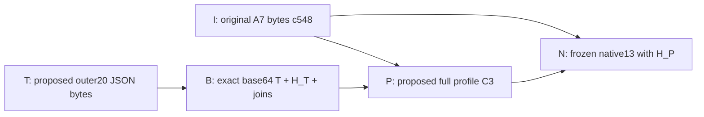

## Phase105 — PR55 PURE design/source mapping review only

Unified DraftPR55 HEADc741f36e8ddaf58bb8a709b986609916ec6f2358/treeb6e511476e81fb2480b4395b855849437f5b8636,base3e498de973536c2d6393f83abe7d59cb1452a9b4.15NEWallocateddocs/harness/fixturesonly;noRootsharedproduction/schema/workflowedit. A8 ownCPython3.12.10/jsonschema4.25.1 (owner3.15.2/4.26different). Executedonlypuremodeltestswithbackendimport/process/network/SQLiteeffecttripwires;noConsul/broker/worker/Meta/diagnostic/profile/issuedrecord/dispatch/provider/ordercall. Passingpureformatdata is not any native/currentidentity/admission/worker/storage/physical acceptance.

| Requirement ID | Repository / PR / Exact HEAD | Test name | Environment | Expected result | Actual result | Evidence link | Status | Severity | Required correction |
|---|---|---|---|---|---|---|---|---|---|
| M105-SOURCE | unified-system #55 /c741f36 | primarysource/newownedpaths | ownLFnohardclone |exactprimaryOID/raw/noextras |1411primaryGitBLOBOIDsandworkingrawindependentlyrecomputedprepost;15NEWownedpaths/noexistingproductionchanges | phase105/primary-verification.json;post-meta-verification.json | PASS | — | Sourcebindingonly/notprofilecommissioning |
| M105-PURE14 | unified-system #55 /c741f36 | committedTargetNativeProposal | ownCP312/jsonschema4.25.1 |14uniquepuretests/noskip |A8actual14PASS0skip;backendimport/effectattemptlist[];20INVALIDhash-sensitivity+4identitydomainsubcaseswithin14 | pure14.stdout.json;pure14.stderr.log;pure14-executed.py | PASS | — | Not34/38unique/nativejobs;noowner14countadoption |
| M105-REFERENCES | unified-system #55 /c741f36 +Grid26e/Rootcf7/Strattaed8 | exact11primaryfixturebindings | Gitrawobjects/read/hashonly |originalsourcebytesunchanged |8A2proposals/originalsbyteequalGrid26e/tree03b843;Rootsample/schema+1126BA7Ibyteequalprimary;alllength/SHA/OIDreferencesverified | reference-verification.json | PASS | — | A2proposaldataNOTsharedcodecACK/actualcommissionedprofile |
| M105-20TO13 | unified-system #55 /c741f36 | fullfield/hashdomaincoverage | purestructuralvectors |all20retained/nofielddrop/frozen13unchanged |20outerfieldscovered/native13same19357891schema/13fields;TJSONnumbersretainedasexactbase64insideC3P;I/T/P/Nhashdomainsdistinct;MetaF3notnativeStrattproducer | pure14.stdout.json;post-meta-verification.json;primarymapping.json | PASS | — | HashsensitivityNOTactualoriginal-conflictCASproof |
| M105-NOCYCLE | unified-system #55 /c741f36 | profilepreimage/selectorgraph | purestructuralvectors |noownPHash/Ndigest/issuedgrantinsideP/noouterselector |PcontainsTbase64/H_T+fixedbindings;H_Pcomputedexternally;NreferencesH_P+I;PdoesnotreferenceN/H_N;outer20noPselector;SAMEexistingprofilefamily/singleoriginallifecycleproposal | pure14.stdout.json;DESIGNprimarysource | PASS | — | RootOptionA/Bchoicepending;nofactory/registry/runtimeimplemented |
| M105-REFUSALS | unified-system #55 /c741f36 | direct/key/preissue/budget/overflownegative | puremodel |nocopyupgrade/nohiddenrewrite |directv1refused/bytesnotrewritten;dotkeyMAPPING_NOT_REPRESENTABLE/nothashed;assignment/fence/resultrefnullpreissue;fullyrebound3.0budgetrefused;C3profileoversizewhole-refused | pure14.stdout.json | PASS | — | C3encodingboundsnotnative64op/32768budget/capacityqualification |
| M105-REGISTRY | unified-system #55 /c741f36 | profileactormembership/reboundbudgetjoins | puremodel |invalidselfconsistenthashesstilldenied |principal_registrymismatchwithrehashedP/Nrefused;canonicaltypedbudgetguardrejects3.0evenwhenJSONSchemaacceptsandreboundhashesmatch | pure14.stdout.json | PASS | — | Actualpeer/currentpolicy/issuerprovenancechecksremainunimplementednativegates |
| M105-META | unified-system #55 /c741f36 | delete2guardsfromfinalharness | separateownmemoryscratchvariant | selectednegativesfailifguardsremoved |2selectedtestsproduce2EXPECTEDFAILURES/0errors;primarySHA88bb577.../scratchSHA2e52be05...retained;noexistingrepoedits | meta-controls.stdout.json;meta-controls.stderr.log;meta-controls-executed.py | PASS | — | Syntheticguard-deletionMETAcontrolNOToriginaloldsourceRED/nativeauthorizationbug |
| M105-ERROR | unified-system #55 /c741f36 | proposederror/currentfacts/privacy | puredata/source |noerrorpermission/unknownrekey/refund |copiedclosedA2errorcodecs/proposedallpermissionflagsfalse;testADMITTEDisFORMAT-ONLY;designrequiresactualcurrentREADrightsbeforeserializingknownhistoryandpreservesknownnativefactinternally | pure14.stdout.json;sourceDESIGN | PASS | — | Noactualerror/historydisclosuretest/native-observationcodecACK;admission-onlyfreezeadviseduntilownerABI |
| M105-OWNER | unified-system #55 /c741f36 | originalownerreceipt | readonlyhash |originalc336andsourcepinsmatch |receiptc336bec8418a9892d3029cc83169873bd3af388af70a5314a2a10de13ee786a3verified/3sourcebindingsmatchA8primary;ownerversion/countsseparate | owner-receipt.original.json;reference-verification.json | PASS | — | Noenvironment/nativeadmissiontransfer |
| M105-LIMITATION | unified-system #55 /c741f36 | actualRootchoice/profile/parser/plan | NOTEXECUTED/NOTIMPLEMENTED | separateactualABI/commissioning/targetCAS |OptionA/Bnotchosen;fullprofileV2actualparser/currentbrokerV1rejectsproposal;completeactualnativeplan/budget/ACL/currentindices-session/one-usepermit/quota/fence/UTC-commitNOTQUALIFIED | DESIGNprimarysource;post-meta-verification.json | BLOCKED | owner-labelledP0positiveacceptancegates | RootandA2exactchoice/coACK/actualownercodec+issuer+TargetTxnrequired;no14->positiveadmissiontransfer |
| M105-OBS-STORAGE | unified-system #55 /c741f36 | nativeobservation/publication/projection/consumer | NOTRECEIVED/NOTACKED | currentnativephase/factvsUNKNOWNpolicy/storageindependent |nativeobservationschemaNOTRECEIVED/NOTACKED;COMPLETED/publication/retrievalmustremainblockeduntilactualA2/A4/A7/Root/A6ABIs/receipt/readrights;nofakepositivebranch | owner-receipt.original.json;sourceDESIGN | BLOCKED | owner-labelledP0positiveacceptancegates | Preferadmission-onlyobservationfreeze;donotinvent/acceptunbackedcompletionorpublication |
| M105-CI | unified-system #55 /c741f36 | mandatoryhostedacceptance | originalRESTsnapshot | noqueued/unrelatedworkflowPASStransfer |31originalrunsallqueuedatbounded100snapshot;nohosted/pinnedWindows/nativePASSadmitted;PR55addsNOworkflow | ci.original.json;pr.original.json | BLOCKED | existingreleasegates | ExactmandatoryCIdefinedbyscopeandterminaloriginalevidencerequired |
| M105-PHYSICAL | allreleaselevels | runtime/physical/Tailscale | NOTEXECUTED | separateauthorization/evidence |nobroker/Consul/worker/Meta/diagnosticinvocation/commission/issuedprofile/grants;nooffice/provider/networkpolicychange | pure14.stdout.json;post-meta-verification.json | NOT_RUN | existingpositivegates | Noautomaticmerge/deploy/physicalfault/Tailscaleremoval |

OptionA structural-only graph (NOT selected/commissioned; arrows mean hash-content dependency, not permission):

ThepurehelperchecksselfconsistencyofuntrustedFORMAT_ONLYtriples,notactualcommissionedprovenance/currentauthority. Avalidself-consistentnewT/P/Ndoesnotproveanoriginalconflictwasrejected:actualsame-originalnativeimmutablecommon/UUID/keyCASmustenforcethatfuturegate. ProposedC3profilelimitsmustbecheckedagainbyactualownerencoderandfullnativeplan;oldmeasuredplanfigurescannottransfer. Trialresource-demandstringsareNOTmeasuredcapacityorCPU/RSS/workercontainment;directIO/row/executionbudgetremainsindependentandstricterwhereapplicable.

No newmaterialcurrentpuredesign/sourcefinding. Thehistoricalregistry/budgetguardcorrectionsarecoveredbycurrentnegativesandourfinal-sourceguard-deletionMETAcontrols;we didnotrelabelWIPororiginaloldprimaryRED. A8reference-readerinitialGitshowhitWindowslongref:pathstatlimit;usingprimarycat-fileblobplumbing/command-scopedlongpathsresolvedread-onlyharnessissuewithnosourcechanges. The14passingtestsuseA8CP312/4.25.1,notowner3.15.2/4.26orwholetoolchainattestation. Actualnative-observationcodecremainsNOTRECEIVED,soformatresult_schemaURIisnotexistingconsumer/protocolproof. No ownobservationcodec/enum/actualruntimeiscreatedbythisaudit.

RELEASE_MANIFEST_STATUS: PURE_PROPOSAL_PR55_NOT_RELEASE_ADMISSION.
NODE_INVENTORY_STATUS: NOT_NEWLY_ADMITTED.
CONTRACT_STATUS: ROOT_NATIVE_CHOICE_AND_EXACT_OWNER_ABI_ACK_PENDING.
OFFLINE_TESTS: A8PURE14PASS0skip1411RAW;20INVALIDSENSITIVITY+4IDENTITYSUBCASES_WITHIN14;2SCRATCHMETA_EXPECTEDFAIL_NOT_NATIVEBUG.
WINDOWS_CI: BLOCKED_NOTTERMINALVERIFIED;OWNCP312_NOTOWNER3.15ENVATTESTATION.
PHYSICAL_TESTS: BLOCKED.
P0_P1_P2: owner-labelledP0positiveadmission/worker/UTC/quota/storage2domain/consumeracceptancegatesremainOPEN;confirmedimplementationfindingbaseline6P1/3P2unchanged;no newconfirmedimplementationdefect.
EVIDENCE: phase105ownpurelogs/primarysource/11originalfixturepins/originalc336receipt/separateMETAcontrols.
NEXT_ACTIONS: RootchoosesonlyafterexactA2/ownercoACK;A2ownsactualprofile/parser/TargetTxn/nativeadmission-onlyobservationcodec;currentreadrightsbeforeserializingknownhistory;A4publication/A7projection/A6consumerremainseparategates. No native/diagnosticrunfromthisreview.
GO_NO_GO: NO-GO. TAILSCALE_REMOVAL_ACCEPTANCE: BLOCKED/NO-GO.
