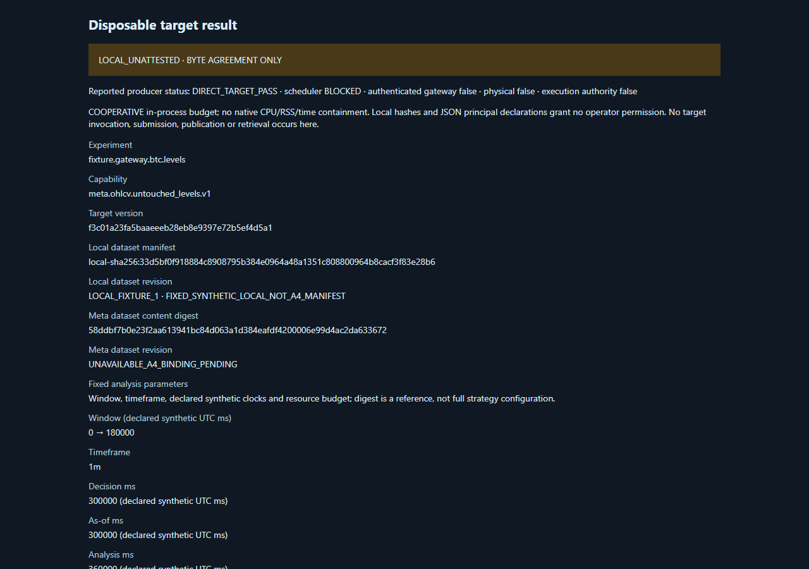

# Actual LS5 disposable functional pilot: scoped PASS

Executed source `1d923f6a33e1f0f16cd476f1b4e5e65ee03a8a6c`, tree
`e5ad4acf893b99cb71ad1b55cd642fcb4946de7c`; Terminan PR80 exact
`2ab52f86aca6a38bd63c1fea71e12a80a2c2ddd9`, tree
`cff995cd8e6397c86e51e7cbcfdf896fe80ba689`.
This evidence-publication commit is not the executed source.

| Required report field | Actual status / practical limit |
| --- | --- |
| LS5_IDENTITY | LS5; fresh observed parent and both retained child tokens nonadmin/elevation type3. OS inventory Windows11Pro10.0.26300 from20261109; no full OS qualification inferred. |
| LS5_ACL | Five selected ordinary ancestors inspected, no ACL change; not full deployed-account/security qualification or protection from same-user/admin tampering. |
| LS5_RESOURCE_BUDGET | Before-GO retained identity/image/creation join and own Job membership/limits readback. Observed USER7.53125s<10; peak Job COMMIT336625664B<1GiB; process ceiling512MiB, active limit16. USER cap excludes kernel10.234375s; COMMIT is not RSS/CPU-rate/worker capacity. |
| LS5_PORT_COLLISIONS | Own ephemeral127.0.0.1 server returned200; existing PostgreSQL55432 excluded. No blanket port/service installation qualification. |
| LS5_BACKUP_READY | Disposable originals/package/state retained, stop only own family. Production backup NOT_VERIFIED; no existing DB/service modified. |
| DISPOSABLE_PACKAGE_SHA | `3e05c5251d0bd84e073dc0545c95c903424654690942bd77313175ae493b0a5a`;19300files/1008702257B; protected package unchanged. |
| DISPOSABLE_SMOKE | `SCOPED_FUNCTIONAL_SMOKE_PASS_NOT_NATIVE_RESOURCE_OR_CLUSTER_ACCEPTANCE`. |
| DIRECT_TARGET_RESULT | Existing Strattester Aed8 / MetaAnalyse f3c01 actual exit0; fresh2070B artifact SHA256 f4997d7d26211676cd8664e53d7999f8b71f203510f3b9a275b439c403e03940; synthetic3rows/LOCAL_UNATTESTED. |
| TERMINAN_RENDER | Actual local renderer exit0; HTTP200/3requests/0blocked; model+DOM4levels/3rows match; screenshot hash checked and image viewed. No authenticated READ/chart/verified market data. Fixed viewport shows metadata; below-fold tables are DOM assertions, not screenshot visual proof. |
| COMMISSIONER_IMPLEMENTATION | Source-prepared/positive admission unavailable; no private commissioner executed. |
| SCHEDULER_ADMISSION | A5 local suspended attempt only; start DENY, qualified reservation/consume/start APIs NONE. |
| STORAGE_PUBLICATION | LOCAL_UNATTESTED; positive native commit/current scientific READ APIs NONE. No fabricated committed receipt. |
| HOSTED_CI | Exacted4 partial mandatory Windows2025 jobs passed7gate+16composed tests each; Ubuntu/pure-source queued. Terminan2ab12runs queued;21inspected jobs unassigned/no steps. Exact1d9 hosted qualification not observed. Local1d9 committed pure-source106PASS/0skip/1737raw unchanged, not hosted. |
| F26_STATUS | OPEN; full mandatory matrix incomplete; queue root cause UNKNOWN; no retries/cancellations. |
| A8_REVIEW | Phase157 file/source/invocation ACK plus phase158 independently reviewed original-result scoped PASS. No A8 runtime replay or repeated full post-run package hash. |
| NEXT_PHYSICAL_STAGE | No automatic repeat or distributed installation. Native authority/resource/Scheduler/Storage/authenticated READ/CI gates and separately admitted commissioning required first. Office fault injection remains forbidden. |
| GO_NO_GO | This one synthetic LS5 functional scope PASS; MASTER MISSION IN_PROGRESS / NO-GO. |

## Original evidence

Smoke receipt SHA256
`775f696ce668dbf693e2f6d1c0cb4fe40148d8ccbcc2b2296d31df77bd69da1f`;
render receipt `5430cd4684041cf5304aaafe249e7a09d130dc0d27c9580e5f9b6b6263189f3c`;
screenshot `c2cd43f0e1489d42f1687ac8122b87bde86495bd153df8f1342714310792e30e`.
Originals and exact size/hash index under
`release/physical-dev/ls5-20261109/passed-g/`.

Actual retained primary exits[0,0], own active0 and all primaries exited;
cumulative process count37 is not concurrent active count. Work17.8636257s,
cleanup0.0022681s, family17.8658938s, within20/10/30. Outer controller103.672s
includes source/package verification and is a different timing scope.
Issued context CLOSED/client DISCONNECTED/server CLOSED+actual exit0/HTTP CLOSED;
cleanup49.6534ms/no expiry, no denied SDK fallback. Diagnostics45events/2678B,
no overflow or IO failure. Model SHA256
`4a513a5ce13b192c26205de1cebe51b306e5492558fcdc4fde31e448004106b2`.

Phase157 A8 packet review: audit
`a9cb364ce837628d0ac10d90a277b8f0e3ba07db`, reportSHA256
`5ba882056409d658c323732463b459677b48c72506a2fa5dada819e9a9ece7c6`.
The review grants no execution permission; Root used the retained owner directive
961024a6... plus exact preparation and actual before-GO gates in its serial lane.

A8 phase158 original-result qualification: audit
`ca8826e3165f8e6c2e82b174d8e9bd20410df241`, reportSHA256
`61404a627f4a13d73a30be9dfa9c4b78451eaf7f3249272c0ecdb429b1426090`.
F36 scoped fix verified via Root's actual g originals. Audit still reports7P1/8P2;
F37 late-negative and F31/F32 qualification remain pending. No broader PASS transfer.

The one-line resolver correction now has actual positive-path support. This does
not prove an exclusive earlier e/office-network cause, all browser-native egress,
negative URL canonicalization, F37 late-fault runtime or scientific correctness
beyond the fixed synthetic result. Previous c/d/e/f RED originals remain unchanged.

ADMINIT excluded; six-node physical/LAN/Home qualification remains unaccepted.
No real provider/trading operation is in this scenario; no network/security/policy
changes, new credentials, production deployment, main merge, office fault injection
or data deletion. Public submit DENY; TRUSTED_RELEASE BLOCKED_NO_TRUSTED_PUBLISHER;
Tailscale removal BLOCKED. HA design packet is a separate unapproved design input.
