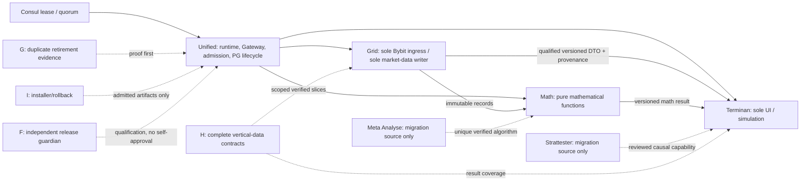

# Agent J — Round 26 isolated integration

**CODE NO_GO / PRODUCTION NO_GO.** This branch is an independently created integration workspace, **not** a declaration that frozen PR #166 or its source modules passed qualification. Branch initial HEAD is `9349d7f3ed93ef82d120976816b968e0b716b067`, Git tree `a6f7c675c3489badf31399a8dca380004947c0cf`. Frozen PR #166 itself is read-only. The manifest contains immutable **source candidate pins**, not verified released binaries.

## Dependency graph (runtime responsibilities)

## Safe sequencing

1. Freeze current PR heads, fetch exact source trees and verify ancestry/overlap; record the actual original CI jobs and immutable source/package evidence.
2. Establish **synthetic-offline** standalone seams only (Grid qualified immutable B-v2 PARTIAL/GAP/STALE/UNAVAILABLE → Math → Terminan bounded OHLC/POC); no mock output represented as live. Contract tests must disallow paper/trading authority.
3. Owner-coordinate session ID: real Consul-issued `4a91bb79-c488-1086-0664-30ccbc028eda` is canonical UUID-shaped text but NCS variant; B/C SQL uuid needs exact session-only agreement. Instance/node identities remain UUID4. E transport acceptance alone is not PostgreSQL admission. Do not silently change SQL ABI or fabricate normalized lease IDs.
4. Review C #170, E #171, B owner changes individually, deduplicate common ancestry; ensure A job/descendant extinction, C exact backend identity + durable SQL revoke and E lease handoff remain fail closed. Never cherry-pick whole overlapping candidates blindly.
5. Incorporate G retirement **only with** unique capability equivalence and reversible mapping; H additional data slices only on verified B/Math/D contracts; I installer only on isolated services/PG non5432 with backup/rollback/clean uninstall proof.
6. Run non-protected synthetic packaging/contract tests on exact pinned sources; distinguish historical GitHub CI statuses from newly executed E2E. Native isolated PG+Consul+Windows and F protected qualification only after required authorization.
7. Publish reproducible root manifest (Git commit/tree + hashes of original built wheel/sdist/RECORD, runtime import origins, exact CI run/job/log/artifact IDs). Hand original evidence to F. F review is required, then MASTER controls GO decisions.

## P0 blocker board (at branch creation)

| Domain | Finding | Status |
|---|---|---|
| A Windows2022 | Three Python versions: each 168 PASS / 6 FAIL / 2 SKIP, original GitHub run 45905863102; restricted token child `0xC0000142` | FAIL |
| B package/root | B #300 owner head fast-forwarded to `52d81298...`, but current genuine installed wheel, sdist, RECORD and protected admission not independently qualified | NOT_PROVEN |
| B/C/E Consul | NCS-variant UUID-shaped real session rejected by old strict UUIDv4 checks; exact issuer + lease/SQL-authority evidence needed | BLOCKED |
| C native PG | `LAB_NATIVE_PG_BOOTSTRAP_ABORT_UNKNOWN`; preserve quarantine, prohibit casual cleanup or reuse | BLOCKED |
| E transfer | Exact post-stop SQL revoke, unknown COMMIT + WAL reconciliation and expiry at B COMMIT not proven in native cohort | NOT_RUN |
| F Windows verifier | POSIX-only safe fd path; Windows protected package/runtime admission still DENIED | BLOCKED |
| D/H coverage | B-v2 bounded qualified chart OHLC/POC only, full trades/OI/funding/delta not yet proven as transferred | PARTIAL |
| I real host | Safe installer/upgrade/recovery/uninstall and Windows + fleet physical qualification unavailable | NOT_RUN |

Original source acceptance and a successful synthetic-only check are not a production release. No automatic CI retry/cancel/dispatch, no main merge, no branch deletion, no forced ref update, no user DB/5432, no real orders, no security weakening, no frozen #166 modifications.

## Cooperation

J1/G: ancestry, migration map, duplicate removal; J2/B: original distribution/RECORD/import origins; J3/D/H: DTO/status matrix and Math/Terminan contract; J4/C/E: session ID, durable PG fencing/Consul lease/unknown COMMIT; J5/A/F: disposable E2E evidence and native Windows; J6/I/F: installer/release artifact provenance. The J1–J6 names describe optional work lanes; **no independent agent has actually been launched from this chat**.
